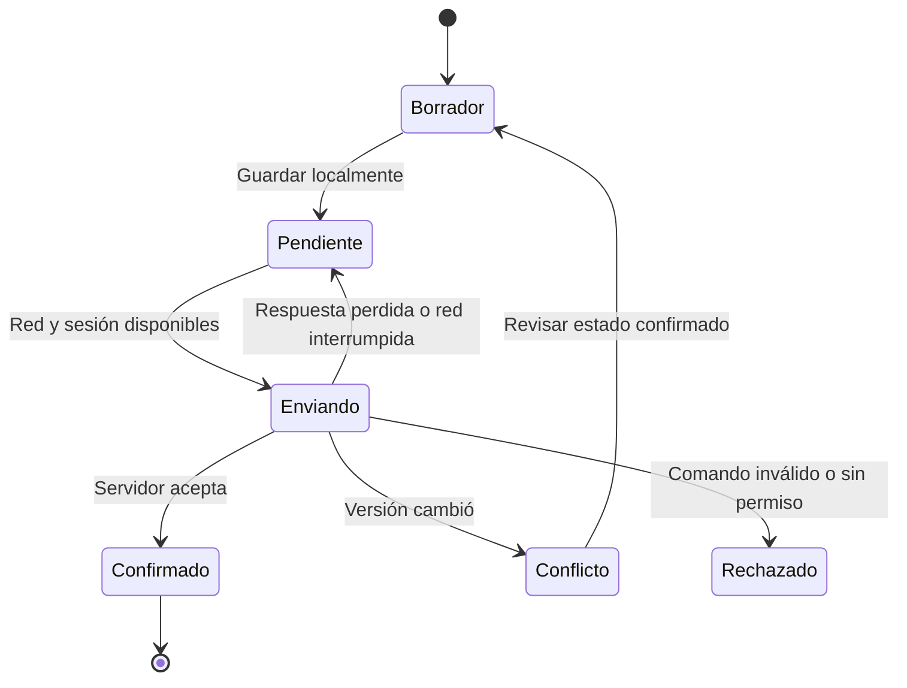

# Aplicación móvil

## Conexión REST, sesión persistente y Google · 25/11/2026

Al ejecutar `lib/main.dart` (entrada principal por defecto; `lib/main_prototype.dart` se conserva como alias compatible) con `API_BASE_URL` válido (HTTPS o `http://localhost:3000/api/v1` en debug con `OIDC_USB_DEBUG=true`) e iniciar sesión con Keycloak o Google, la app muestra el splash animado de Quantify y opera en modo conectado (`lib/api/mobile_api.dart`) contra `services/api` sin mezclar fixtures de demostración:

- **Sesión persistente y Google IdP:** `MobileSession` persiste tokens de forma cifrada mediante `flutter_secure_storage` (Keystore en Android con `allowBackup="false"` en `AndroidManifest.xml`), renueva automáticamente el `accessToken` con `refreshToken` antes de vencer o ante un primer `401`, y soporta **Continuar con Google** mediante `kc_idp_hint=google` en Custom Tab (`ADR-0010`). Facebook y Apple ID permanecen deshabilitados bajo «Próximamente».
- **Configuración de Google en Keycloak local:** definir `GOOGLE_CLIENT_ID` y `GOOGLE_CLIENT_SECRET` en `infrastructure/docker/.env.local` (ignorado por Git) y ejecutar `node scripts/configure-mobile-identity.mjs --apply-local`. El script además garantiza el rol por defecto `user` en el realm `quantify`.
- **Migración entre PCs sin PostgreSQL local:** Docker levanta `postgres:18.6` automáticamente; usa `node scripts/dev-base.mjs db-export` para generar un respaldo SQL de datos en `infrastructure/docker/backups/` (ignorado por Git) y `node scripts/dev-base.mjs db-import <archivo.sql>` en la máquina destino después de `up` + `docker-migrate`.
- **Perfil propio:** consulta `GET /api/v1/me` y, si aún no existe fila en `profiles` (`403`), ejecuta autoprovisión idempotente con `POST /api/v1/me` (`Idempotency-Key` UUIDv4). Desde Perfil se puede elegir la zona horaria IANA para alta de nuevos hábitos.
- **Hábitos personales:** lista (`GET /habits`) con filtros Activos / En pausa / Archivados, crea (`POST /habits`) y actualiza/pausa/archiva (`PATCH /habits/:id` con `If-Match` fuerte y vigencia futura `effectiveFrom`), mostrando además métricas confirmadas (`GET /habits/:id/metrics`).
- **Avances diarios y progreso:** consulta historial reciente (`GET /habits/:id/check-ins`), permite registrar/corregir Hoy o días recientes elegibles (`POST /habits/:id/check-ins` con `expectedVersion` y motivo auditable), y muestra `GET /me/dashboard/trends` junto con `GET /me/dashboard/progress` en Progreso.
- **Asistente conversacional Gemini (`ADR-0011`):** en **IA hábitos**, verifica y actualiza consentimiento explícito revocable (`GET` y `POST /me/assistant-consent`), envía hasta 10 turnos recientes en memoria (`POST /assistant/messages`) con opción de compartir o no el resumen mínimo de hábitos propios, presenta borradores revisables sin guardar, permite editarlos en `HabitEditor`, descartarlos sin escritura o confirmarlos de forma idempotente vía `POST /habits`, y mantiene siempre visible la creación manual. `GEMINI_API_KEY` reside únicamente en el servidor (`infrastructure/docker/.env.local`).

Sin `API_BASE_URL` o al entrar por «Explorar demostración», el prototipo conserva el dashboard local de ejemplo y no simula respuestas falsas de IA; al compilar con `API_BASE_URL` configurado, la bienvenida prioriza el acceso con Keycloak y oculta el recorrido de demostración sin base de datos. Siguen pendientes cola offline, notificaciones, Facebook/Apple ID e iOS en macOS.

## Acceso Keycloak · 23/11/2026

La pantalla ofrece **Continuar con Keycloak** y **Continuar con Google** mediante el proveedor federado de Keycloak cuando esté configurado. Facebook y Apple ID permanecen deshabilitados con el estado «Próximamente».

`lib/main_prototype.dart` incorpora login y registro en navegador del sistema con `flutter_appauth` 13.0.0, retorno al dashboard de ejemplo y cierre desde Perfil. Tokens en memoria; vencimiento exige volver a entrar. Android mínimo 24. [Configuración USB/HTTPS, pruebas y límites](docs/sesion-keycloak.md) · [ADR-0009](../../docs/arquitectura/adr/0009-sesion-movil-prototipo.md). Esta actualización sustituye las menciones posteriores a sesión pendiente para la entrada del prototipo; `lib/main.dart`, REST y métricas de negocio conservan su alcance independiente sin conexión. iOS requiere validación en macOS.

## Prototipo visual V2 · Liquid Glass · 20/11/2026

**Prueba en teléfono · 23/11/2026:** APK debug del prototipo instalado y abierto mediante USB en OPPO CPH2239, Android 11 (API 30). Se corrigió el paquete de `MainActivity` a `com.quantify.app` para coincidir con el namespace y la actividad declarada en Android; antes la app se cerraba con `ClassNotFoundException`. ADB confirmó la actividad en primer plano y el proceso activo. Revisión visual por el responsable en curso; este arranque no valida todos los recorridos ni el rendimiento. Las limitaciones de dispositivo indicadas más abajo corresponden al corte del 20/11.

**Revisión visual · 23/11/2026:** cristal con mayor transparencia, reflejo superior, borde iluminado y fondo azul/cian más visible; intensidad inicial 75 %. Se mantienen los dos filtros de cabecera/dock, efectos ligeros y alto contraste sólido. El icono Android usa la Q canónica (PNG por densidad e icono adaptativo). El splash nativo claro/oscuro muestra esa misma Q antes del primer frame, y `main_prototype.dart` anima la Q centrada, la desplaza a la izquierda y revela UANTIFY hasta completar QUANTIFY en dos segundos; al finalizar abre la bienvenida; movimiento reducido omite esa espera. Android 12+ tiene recurso específico para el splash del sistema; su apariencia queda pendiente de probar en esa versión. Las pruebas locales suman 14 aprobadas, con análisis sin incidencias; incluye salida del splash, navegación y movimiento reducido. No se conectaron servicios.

La entrada principal **`lib/main.dart`** (y su alias `lib/main_prototype.dart`) inicia con el splash animado (`PrototypeLaunch`) y recorre Bienvenida → Hoy / Progreso / IA hábitos / Perfil; hábitos, creación/edición, detalle, avance absoluto, historial y asistente Gemini conectado. La demo histórica sin conexión de octubre se conservó aparte en `lib/main_demo.dart` con sus pruebas independientes. [Pantallas, capturas, optimizaciones y límites](docs/prototipo-v2-2026-11-20.md).

Desde la raíz, entrar a `apps/mobile`. Entorno verificado: **Flutter 3.47.8 y Dart 3.13.7**; `pubspec.yaml` requiere Dart compatible con 3.13.3. No se añadieron paquetes de estado, efectos ni autenticación.

```powershell
cd apps/mobile
flutter pub get
flutter devices
# Con un teléfono/emulador Android ya conectado:
flutter run -d ID_DEL_DISPOSITIVO
```

Para revisar la misma UI Flutter en Chrome sin dispositivo Android:

```powershell
flutter run -d chrome
```

Para generar el APK local y comprobar el proyecto:

```powershell
flutter analyze
flutter test
flutter build apk --debug
```

El APK está en `build/app/outputs/flutter-apk/app-debug.apk`. El proyecto conserva su identificador Android y configuración de firma heredados; esto no constituye una aplicación publicada. No se comprobó instalación ni rendimiento en un teléfono físico. `flutter doctor` todavía señala herramientas Android de línea de comandos/licencias por revisar; pese a ello el SDK disponible permitió compilar el APK. No hay emulador configurado en esta máquina.

Para revisar la animación en el OPPO ARM64 en modo profile, generar `build/app/outputs/flutter-apk/app-profile.apk`:

```powershell
flutter build apk --profile --target lib/main_prototype.dart --target-platform android-arm64
```

La secuencia de entrada mantiene primero la Q, la desplaza y reduce para ocupar la primera letra de QUANTIFY, y revela UANTIFY de izquierda a derecha. Al completar los dos segundos de animación, el nombre se desvanece mientras aparece la bienvenida mediante un fundido de 600 ms, sin cambiar de fondo ni añadir un temporizador. Movimiento reducido omite tanto la animación como el fundido. El tiempo de arranque nativo anterior depende del teléfono y del modo de compilación. La prueba de widgets verifica Q sola, revelado parcial, nombre completo y salida, además del acceso sin espera con movimiento reducido.

**Revisión del cierre · 23/11/2026:** análisis sin incidencias, 14 pruebas aprobadas y generador canónico verificado. La prueba de entrada comprueba que la bienvenida y el nombre completo coexisten durante el fundido, con opacidad intermedia, y que el splash se retira al terminar. APK profile recompilado e instalado en el OPPO mediante ADB (`Success`). La comprobación visual de este último fundido queda pendiente porque el teléfono estaba bloqueado; las capturas enlazadas abajo corresponden a la animación anterior al ajuste de salida.

**Verificación del splash animado · 23/11/2026:** compilación profile ARM64 instalada y abierta en OPPO CPH2239. Se espera la señal del primer cuadro rasterizado antes de empezar el controlador para evitar consumir la animación detrás del splash nativo. Capturas reales: [Q inicial](docs/evidencias/prototipo-v2-2026-11-23/splash-q-oppo.png) y [QUANTIFY completo](docs/evidencias/prototipo-v2-2026-11-23/splash-quantify-oppo.png); la secuencia de captura posterior confirmó la bienvenida. Análisis sin incidencias y 14 pruebas aprobadas, incluyendo arranque de motor demorado. No se midieron tiempos de cuadro ni batería.

**Apariencia:** usar el icono de ajustes de la cabecera o **Perfil → Apariencia y Liquid Glass**. Cristal está activo inicialmente y se puede desactivar; intensidad, claro/oscuro/sistema, efectos ligeros y movimiento reducido son configurables. Alto contraste fuerza material sólido, y la reducción de movimiento del dispositivo tiene prioridad. Las preferencias y los hábitos son solo de esta sesión; no se guardan al reiniciar ni se sincronizan.

Para servir una compilación de revisión autocontenida en el navegador:

```powershell
flutter build web --target lib/main_prototype.dart --no-web-resources-cdn
py -m http.server 8788 --bind 127.0.0.1 --directory build/web
```

Abrir http://127.0.0.1:8788/. Es una vista Flutter Web para revisar el diseño móvil, independiente de la PWA React; no se presenta como prueba nativa Android ni como otra PWA instalable. Detener el servidor con Ctrl+C.

**Tokens, fuente e identidad Android:** se generan desde `packages/design-tokens/preview.json`, `mobile-effects.json`, el isotipo canónico y el Inter local. Los recursos Android, `.ttf` y Dart generados se incluyen para ejecutar Flutter sin Python. Para regenerarlos después de cambiar las fuentes canónicas, desde `apps/mobile`:

```powershell
python -m pip install -r tool/requirements.txt
python tool/generate_prototype_assets.py
python tool/generate_prototype_assets.py --check
```

La generación no descarga fuentes ni crea otra paleta; conserva la licencia Inter junto al asset. El acceso móvil real exige la topología HTTPS/OIDC alcanzable por el dispositivo descrita abajo. Esta entrada no llama a la API ni recibe contraseñas.

**Base de integración (16/11/2026):** [guía técnica compartida](../../docs/guias/base-tecnica.md), API NestJS e identidad verificadas en el host. Se incorporó la demo QUANCORE-29/31 del equipo; su conexión real sigue pendiente. El issuer loopback no sirve automáticamente para un teléfono: definir HTTPS y emisor alcanzable antes de conectar. El responsable del proyecto continuará con frontend móvil/PWA después de estabilizar diseño.

**Estado: demo Flutter integrada desde QUANCORE-29/31.** Contiene fuentes, `pubspec.yaml` y plataformas Android/iOS; no hay sesión OIDC ni peticiones REST implementadas en este cliente. Registros, métricas y medallas son simulaciones locales. [Guía de la demo del colaborador](GUIA-DEMO.md). La guía técnica que sigue orienta la integración pendiente con el producto.

## Responsabilidad y límites

Ofrecer rutina personal, registro de avance, métricas, recordatorios, recomendaciones, perfil, consentimiento y estado de dispositivos. Consumir los [contratos REST](../../packages/contracts/README.md) de la API NestJS; no conectarse a PostgreSQL, MongoDB, Redis ni FastAPI desde la app.

El esquema móvil del [prototipo](../../docs/practica-07/README.md) orienta recorridos, pero no contiene widgets Flutter ni demuestra integración nativa. Administración móvil es alcance por confirmar; cualquier implementación debe mantener el límite de datos agregados y nunca otorgar acceso a rutinas privadas por el rol administrador.

## Estructura propuesta

Separar UI y acceso a datos con repositorios y adaptadores. Es coherente con la [guía oficial de arquitectura Flutter](https://docs.flutter.dev/app-architecture/guide); el equipo concretará el manejo de estado en un ADR antes de instalar paquetes.

```text
lib/
  app/                    # Arranque, navegación, tema y sesión
  features/
    <feature>/
      presentation/       # Pantallas, widgets y estado de presentación
      application/        # Coordinación de acciones y casos de uso
      domain/             # Modelos e interfaces que la función necesite
      data/               # Conversión de DTO y repositorios
  shared/
    api/                  # Transporte, autenticación y errores
    config/               # Configuración pública por ambiente
    design/               # Adaptación Flutter de tokens compartidos
    storage/              # Almacenamiento local aprobado
    sync/                 # Cola, reintentos y conflictos
    platform/             # Notificaciones, permisos y vínculos nativos
test/
integration_test/
```

Es una estructura prevista, no un inventario de implementación. Evitar capas vacías o lógica de negocio dentro de widgets. Las reglas de rachas, validación final y autorización pertenecen al backend; el cliente puede ofrecer validaciones inmediatas consistentes con el contrato.

## Configuración y desarrollo local

1. Fijar versión de Flutter/Dart y registrar la matriz Android/iOS y las herramientas nativas necesarias. Compilar iOS requiere el entorno de Apple correspondiente.
2. Crear el proyecto en una entrega específica con identificadores de aplicación por ambiente; no reutilizar credenciales de producción para demostraciones.
3. Definir un ejemplo de configuración pública: `API_BASE_URL` con `/api/v1`, `OIDC_ISSUER`, `OIDC_CLIENT_ID` y `OIDC_REDIRECT_URI`. `API_BASE_URL` y `OIDC_ISSUER` ya tienen lector en el prototipo conectado; verificar las constantes de identidad del cliente para el resto.
4. Registrar retorno OIDC, enlaces de aplicación y orígenes permitidos por plataforma. Los valores empaquetados en una app, incluso mediante `--dart-define`, no son secretos.
5. Los comandos ejecutables del prototipo están al inicio. `flutter analyze` y `flutter test` cubren las bases locales existentes; flavors, pruebas integradas de servicios y publicación móvil siguen pendientes.

## Sesión y permisos

Usar Keycloak / OIDC Authorization Code con PKCE S256 y navegador del sistema mediante una integración nativa mantenida, con validación de `state`, `nonce` y retorno. No crear formularios que envíen contraseñas a una API propia ni embeber secretos de cliente.

Elegir almacenamiento seguro vinculado a las capacidades del sistema para material de sesión que necesite persistir; documentar exclusión de backups cuando corresponda, borrado al salir y comportamiento en dispositivos compartidos. El prototipo conectado usa `flutter_secure_storage`, según ADR-0010; su validación nativa por plataforma sigue siendo necesaria. No guardar tokens junto con los comandos offline en una base de datos de propósito general.

Solicitar permisos en contexto, explicar la finalidad y permitir continuar con captura manual si se rechazan. Separar permiso de notificaciones, permisos del sistema para señales y consentimiento de tratamiento: ninguno sustituye a los otros. No registrar tokens ni datos biométricos en logs de dispositivo o reporte de errores.

## Sincronización y funcionamiento offline



La escritura offline requiere aprobar motor local, cifrado/protección, migraciones, cuotas, caducidad y política de eliminación. SQLite aparece en material académico, pero **no está adoptado ni instalado**. Mientras no exista esta base, deshabilitar la acción sin conexión con una explicación y conservar solo borradores permitidos.

Cada comando debe vincular cuenta, entidad, clave idempotente, versión conocida, instante de captura, fecha de negocio y zona según su esquema contractual. El check-in transmite avance absoluto acumulado, no un incremento que pueda duplicarse. El cliente no inventa nombres de campos; consume los fijados en contratos.

- Reintentar una operación conserva su clave; una edición posterior es otro comando. El backend resuelve duplicados y concurrencia.
- Al recuperar conexión o reabrir la app, comprobar sesión y enviar con orden por entidad y reintentos acotados. La sincronización en segundo plano depende del sistema; ofrecer reintento en primer plano.
- Si un hábito se archivó o cambió de versión en otro dispositivo, mostrar el rechazo o conflicto y conservar información suficiente para que la persona lo resuelva.
- Los gráficos indican cuándo usan datos confirmados y su última actualización. Un registro pendiente no aumenta la racha confirmada.
- Cambiar zona horaria no reescribe el histórico. Conservar la fecha de negocio y la versión de programación de cada registro; el servidor valida periodos.
- Al cerrar sesión, advertir sobre comandos pendientes antes de descartarlos, borrar datos privados locales y revocar la sesión según su política. Nunca sincronizar la cola de una cuenta con la sesión de otra.

## Notificaciones y dispositivos

La elección de notificaciones locales, push o combinación sigue pendiente. Diseñar identificadores estables para evitar duplicados, cancelación al archivar hábitos y coherencia al editar horarios. El centro de avisos no debe afirmar que un mensaje fue entregado al dispositivo sin evidencia del mecanismo implementado.

La vinculación Wear OS se define en su [guía por fases](../wear/README.md); no suponer que todas las señales ni el emparejamiento están disponibles en iOS. Mostrar compatibilidad, estado de permiso, última sincronización y forma de desvincular.

## Diseño y verificación

Adaptar los [tokens](../../packages/design-tokens/README.md) a un tema Flutter y mantener el [catálogo de componentes](../../docs/diseno/sistema-diseno.md). Probar escalado de texto, orientación, áreas seguras, teclado, TalkBack/VoiceOver, semántica de controles y objetivos táctiles. Flutter proporciona soporte de accesibilidad y APIs de prueba; la accesibilidad se valida por pantalla, no por adoptar un widget. [Documentación oficial](https://docs.flutter.dev/ui/accessibility).

| Nivel | Evidencia esperada |
|---|---|
| Unitario | Conversión contractual, estados, cola y clasificación de errores con datos ficticios |
| Widgets | Formularios, vacío/error, foco, semántica y texto grande |
| Integración | Login/retorno, crear hábito, check-in, pérdida de red, respuesta perdida y conflicto |
| Dispositivo | Permisos denegados/revocados, reanudación, cambio de usuario, cambio de zona, recordatorios y almacenamiento lleno |

Bloqueos por cerrar: manejo de estado y navegación, paquetes OIDC y almacenamiento seguro, persistencia offline, notificaciones, soporte mínimo de SO y alcance administrativo. Cada selección requiere compatibilidad documentada, mantenimiento y prueba técnica; Riverpod no se vuelve obligatorio por aparecer en la Práctica 05.

[Volver a aplicaciones](../README.md) · [Recorridos](../../docs/diseno/recorridos.md) · [Decisiones pendientes](../../docs/arquitectura/decisiones-pendientes.md)
