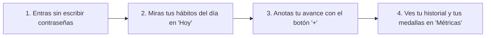

# Guía sencilla de la aplicación para celular — Quantify Core

Esta guía explica, con palabras cotidianas y sin términos técnicos complicados, qué hace la aplicación móvil de **Quantify Core**, cómo se usa cada una de sus pantallas y cómo puedes abrirla en tu computadora o teléfono Android.

Dicho de la manera más sencilla posible: **esta aplicación para celular te permite llevar el control diario de tus hábitos, ver cuántos días seguidos llevas cumpliendo tus metas (tu racha), revisar tu historial de registros sin que se repitan por error y ver las medallas que has ganado por tu constancia.**

---

## 1. ¿Por qué la aplicación es segura y fácil de usar?

1. **Nunca te pide ni guarda tu contraseña adentro de la aplicación:** Por tu seguridad, en la pantalla de entrada no hay cuadritos para escribir contraseñas. El sistema usa una entrada única segura (cuando se conecta al servidor institucional) o te deja entrar al modo de demostración con un solo toque.
2. **Anota tu total del día sin duplicar:** Si presionas el botón de guardar tu avance y el internet parpadea, la aplicación le pone un sello único a tu envío para que **nunca se sume dos veces el mismo registro**.
3. **Muestra tus medallas y tu historial en un solo lugar:** Cada vez que registras o corriges tu avance del día, tus gráficas, tu historial de versiones (`v1`, `v2`...) y tus medallas se actualizan al instante.



---

## 2. Explicación pantalla por pantalla (en palabras simples)

La aplicación tiene una barra en la parte de abajo con 4 pestañas principales y un botón azul con el signo **`+`** en el centro:

### A. Pantalla de bienvenida (`/login`)
* **¿Qué ves aquí?** El logotipo de Quantify Core y una explicación muy clara de por qué no se piden contraseñas dentro de la aplicación.
* **¿Qué puedes hacer?** Tocar el botón para continuar con la cuenta institucional o tocar **"Entrar a la Demostración"** para recorrer todas las pantallas de inmediato.

### B. Pestaña 1 — "Hoy" (Tu resumen diario)
* **¿Qué ves aquí?** Un saludo, la fecha del día, una tarjeta grande que te dice cuántos hábitos llevas completados hoy y cuál es tu mejor racha de días seguidos.
* **¿Qué puedes hacer?** Tocar el botón de cada hábito para marcarlo como completado o tocar el botón **`+`** para anotar una cantidad exacta.

### C. Botón central `+` — "Registrar Avance (Check-in)"
* **¿Qué ves aquí?** Una barra deslizable para indicar cuánto llevas acumulado hoy en tu hábito (por ejemplo, cuántos minutos caminaste o cuántos litros de agua tomaste).
* **¿Cómo te ayuda?** Te dice en vivo si con esa cantidad tu día queda **En cero**, con **Avance parcial** o con **Meta cumplida**, y le pone un sello único anti-duplicados para que nunca se guarde repetido.

### D. Pestaña 2 — "Hábitos" (Tu catálogo personal)
* **¿Qué ves aquí?** Todos tus hábitos ordenados por temas (*Salud*, *Aprendizaje*, *Bienestar* y *Descanso*) para que puedas filtrarlos con un toque.

### E. Pestaña 3 — "Métricas" (Tus gráficas, tus medallas y tu historial)
* **¿Qué ves aquí?**
  1. **Consejo preventivo:** Un mensaje sencillo que resume tu ritmo de la semana (recordando siempre que es un apoyo informativo y **no es un consejo médico**).
  2. **Gráfica de barras de la semana:** Qué porcentaje cumpliste cada día de lunes a domingo.
  3. **Vitrina de logros y medallas:** Tus 5 medallas de constancia (*Primer Paso Firme*, *Ritmo Inicial de 3 días*, *Constancia Semanal de 7 días*, *Doble Semana de 14 días* y *Hábito Consolidado de 30 días*), mostrando cuáles ya lograste y cuántos días te faltan para las demás.
  4. **Historial de registros:** La lista renglón por renglón de lo que has anotado, indicando la fecha, la cantidad y el número de revisión (`v1`, `v2`).

### F. Pestaña 4 — "Perfil" (Tus preferencias)
* **¿Qué ves aquí?** Tus datos de demostración, interruptores para avisos y un botón para salir a la pantalla de bienvenida.

---

## 3. ¿Cómo están ordenadas las carpetas por dentro?

Para que cualquier persona pueda encontrar rápido cada pantalla, todo está guardado en `apps/mobile/lib/`:

| Carpeta | ¿Qué guarda dicho de forma sencilla? |
|---|---|
| `core/` | Los colores oscuros y azules de la marca, las direcciones de las pantallas y la configuración general. |
| `features/auth/` | La pantalla de bienvenida sin campos de contraseña. |
| `features/today/` | La primera pestaña donde ves tus hábitos del día y tu resumen de racha. |
| `features/checkin/` | La pantalla para anotar tu avance diario y la libreta que evita registros repetidos. |
| `features/habits/` | La lista de hábitos por categoría. |
| `features/metrics/` | La pantalla de gráficas, la vitrina de medallas y el historial de registros. |
| `features/profile/` | La pantalla de perfil y ajustes. |

---

## 4. ¿Cómo abrir y probar la aplicación en tu computadora?

Solo sigue estos 4 pasos sencillos en la ventana de comandos:

1. **Entra a la carpeta de la aplicación móvil:**
   ```bash
   cd apps/mobile
   ```

2. **Descarga los paquetes necesarios:**
   ```bash
   flutter pub get
   ```

3. **Comprueba que no haya ningún error y corre las pruebas automáticas:**
   ```bash
   flutter analyze
   flutter test
   ```

4. **Ábrela en un teléfono Android o emulador encendido:**
   ```bash
   flutter run
   ```

---

[Ver diseño visual del proyecto](../../docs/GUI/README.md) · [Ver contratos de la API](../../packages/contracts/openapi.json) · [Ver guía de Keycloak](../../infrastructure/keycloak/README.md)
