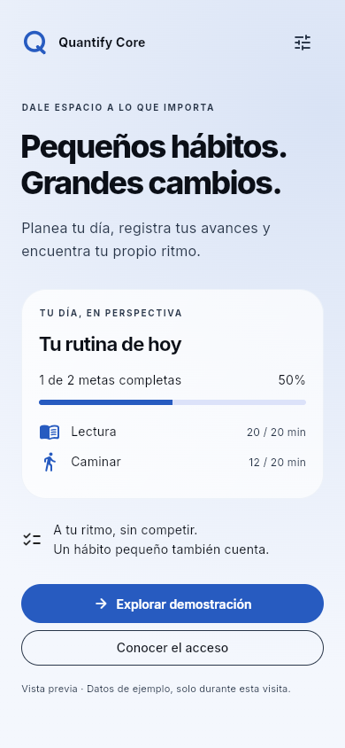
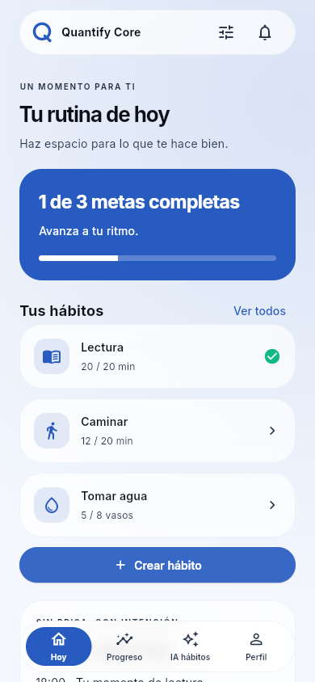
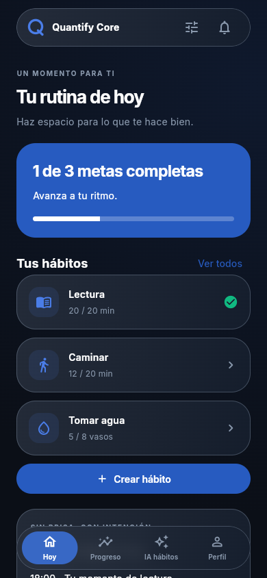

# Flutter móvil: prototipo V2 con Liquid Glass

Trabajo en `feature/prototipo-flutter`, basado en `develop`. Se conserva la demo del colaborador y sus pruebas; la entrada nueva es `lib/main_prototype.dart`. La PWA conserva su mejora de apariencia en el commit `80341be` de `feature/prototipo-pwa`; esta entrega no fusiona esa rama ni publica clientes.

## Referencia visual y recorridos

Se revisaron los SVG móviles claros de U01, U06, U10 y U12 y las reglas de [base visual](../../../docs/GUI/BASE-IMPLEMENTACION.md), [mockups](../../../docs/GUI/MOCKUPS.md) y [recorridos](../../../docs/diseno/recorridos.md). La navegación conserva Hoy, Progreso, IA hábitos y Perfil; la marca Q, Inter, paleta y geometría proceden de las fuentes canónicas.

| Referencia | Implementación de esta entrega |
|---|---|
| U01 | Bienvenida sin navegación de sesión; entrada explícita a demostración |
| U06 | Rutina, progreso local y acceso a hábitos/creación |
| U07/U08 | Formulario, programación, detalle, edición, avance absoluto, pausa y archivo confirmado |
| U10 | Semana/Mes con gráficos ilustrativos y acceso al historial de esta visita |
| U11 | Estado pendiente del asistente y alternativa manual; no se simulan respuestas de IA |
| U12 | Perfil de ejemplo, apariencia, privacidad y accesos a hábitos/historial |
| Identidad/avisos | Acceso institucional desactivado y aviso explícitamente ilustrativo |

No se afirma cobertura de las 33 pantallas ni de administración móvil. El modelo de presentación es independiente del dominio histórico de QUANCORE-29/31. Los valores de progreso son locales; no prometen idempotencia del servidor ni métricas oficiales. Pausar bloquea nuevos avances, archivar conserva el historial y un nuevo valor del día reemplaza el anterior. La fecha y zona se etiquetan como ejemplos; no se trasladan reglas temporales de una demo a una API.

## Liquid Glass y optimización

- Cristal opcional, activo inicialmente, con intensidad y tema configurables. Las preferencias se mantienen durante la sesión de demostración.
- Dos filtros de fondo agrupados y recortados en regiones no superpuestas: cabecera y dock flotantes. Las tarjetas no crean filtros individuales.
- Desenfoque acotado por tokens, material más opaco en oscuro, y **Efectos ligeros** para eliminar filtros conservando luz y bordes. No se usa un shader de refracción ni un plugin de efectos.
- Reducción de movimiento del sistema o manual; alto contraste presenta superficies sólidas. Texto escalado y áreas seguras conservados; gráficos con descripción semántica.
- Sin animaciones infinitas ni timers de repintado. Solo se construye la vista activa; el cambio de destino mantiene dos vistas durante la breve transición. Hábitos usa lista con construcción diferida.
- El deslizador actualiza su estado local al arrastrar y aplica la apariencia global al soltarlo. El isotipo solo repinta si cambia su color. No se añadieron dependencias de estado o efectos.
- Inter se distribuye localmente y se genera desde la fuente canónica. Los valores Dart se regeneran desde JSON, con comprobación de divergencia. No hay solicitudes a API ni identidad.

Estas son medidas estructurales verificables; no garantizan una tasa de cuadros ni un consumo de batería en todos los teléfonos. Las mediciones nativas requieren dispositivo y modo profile. Persistencia, sesión OIDC, adaptadores REST, sincronización, notificaciones reales e iOS siguen pendientes.

## Validación y reproducción

Ver comandos en el [README móvil](../README.md). Flutter 3.47.8 / Dart 3.13.7 en Windows. La vista de navegador usa Flutter Web release a 390 × 844 y no sustituye un ensayo en Android.

| Comprobación | Resultado |
|---|---|
| `flutter analyze` | Sin incidencias |
| `flutter test` | 12 pruebas aprobadas: 6 existentes y 6 del prototipo V2 |
| Generador con `--check` | Tokens, fuente y licencia coinciden con los originales canónicos |
| `flutter build web --target lib/main_prototype.dart --no-web-resources-cdn` | Release compilada con recursos del motor locales |
| `flutter build apk --debug --target lib/main_prototype.dart` | APK generado; sin instalación en dispositivo |
| Revisión Chrome / Playwright | Navegación, cambio de tema y cinco capturas; cero errores de script y cero solicitudes privadas a API/OIDC |

Las pruebas V2 verifican valores absolutos e historial local, validación de borradores, navegación y creación, apariencia en vivo, eliminación de filtros, movimiento reducido y 320 px con texto al 200 %. No verifican autenticación, sincronización ni rendimiento nativo. La revisión visual corrigió el fondo del panel para que se actualice al cambiar de tema mientras permanece abierto.

Capturas de **prototipo académico**, datos ficticios de usuario personal, entorno Flutter Web local, entrega del 20/11/2026 en esta rama (incluidas en el mismo commit que la UI):

| Bienvenida | Hoy claro | Hoy oscuro |
|---|---|---|
|  |  |  |

[Progreso](evidencias/prototipo-v2-2026-11-20/progreso.png) · [Apariencia](evidencias/prototipo-v2-2026-11-20/apariencia.png) · [Registro de verificación](evidencias/prototipo-v2-2026-11-20/verification.json).

Con la compilación servida en 8788, las capturas pueden reproducirse con `node apps/mobile/tool/capture_prototype.mjs` desde la raíz. Este script reutiliza Playwright instalado en `apps/web` y no agrega dependencias de ejecución a Flutter.
