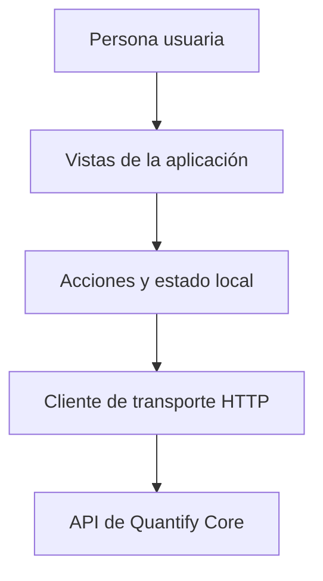

# Aplicación Web — Quantify Core

Este módulo contiene la aplicación web de **Quantify Core**, desarrollada con **React, TypeScript y Vite**. Su objetivo es permitir a las personas usuarias gestionar sus hábitos diarios, registrar su progreso mediante check-ins, revisar sus rachas y consultar información de su perfil de manera clara y accesible.

## Estado del Módulo

- **Base técnica:** React 18, TypeScript, Vite y React Router.
- **Diseño visual:** Integración con los tokens de diseño canónicos de [packages/design-tokens](../../packages/design-tokens/README.md), con soporte para modo claro y modo oscuro.
- **Organización:** Estructura modular dividida por funciones (features).



## Estructura del Código

La carpeta `src/` está organizada de forma limpia para facilitar el mantenimiento:

```text
src/
  app/                  # Configuración principal, enrutador y diseño base (layout)
  features/             # Funciones principales de la aplicación
    identity/           # Perfil de usuario y estado de sesión
    habits/             # Creación, visualización y control de hábitos
    checkins/           # Registro diario de progreso con valor absoluto e idempotencia
    analytics/          # Rachas y métricas de cumplimiento
    dashboard/          # Panel principal con resumen del día
  shared/               # Elementos reutilizables
    api/                # Cliente para comunicación con la API y cabecera de correlación
    config/             # Lectura de variables de entorno públicas
    tokens/             # Adaptador de estilos, colores y temas claro/oscuro
    ui/                 # Componentes visuales básicos (botones, tarjetas, insignias)
tests/                  # Pruebas automatizadas de componentes y tokens
```

## Guía de Uso y Comandos

Para trabajar con este proyecto, asegúrate de estar dentro del directorio `apps/web`:

```bash
# 1. Instalar dependencias
npm install

# 2. Iniciar el servidor de desarrollo local (http://localhost:5173)
npm run dev

# 3. Verificar tipos con TypeScript
npm run typecheck

# 4. Ejecutar las pruebas automatizadas
npm test

# 5. Compilar la aplicación para producción
npm run build
```

## Variables de Entorno

La aplicación utiliza variables públicas expuestas por Vite (prefijo `VITE_`). Puedes copiar el archivo de ejemplo para iniciar:

```bash
cp .env.example .env
```

| Variable | Descripción | Valor por defecto local |
|---|---|---|
| `VITE_API_BASE_URL` | URL base de la API de negocio | `http://localhost:3000/api/v1` |
| `VITE_OIDC_ISSUER` | Emisor del servidor Keycloak | `http://localhost:8080/realms/quantify` |
| `VITE_OIDC_CLIENT_ID` | Identificador público del cliente web | `quantify-web` |
| `VITE_OIDC_REDIRECT_URI` | Dirección de retorno tras iniciar sesión | `http://localhost:5173/auth/callback` |

> **Importante:** Estas variables son públicas y viajan en el navegador. No se deben colocar contraseñas, secretos ni claves privadas en estos archivos.

## Tokens de Diseño y Temas

La interfaz utiliza los estilos oficiales definidos en el sistema de diseño:
- Se importan las variables CSS desde `packages/design-tokens/themes.css`.
- Soporta tema **Claro** (`[data-qc-theme="light"]`) y tema **Oscuro** (`[data-qc-theme="dark"]`).
- La fuente principal es **Inter**.

## Aviso de Salud Preventiva

Las métricas, análisis de constancia e indicadores presentados en la aplicación tienen un propósito informativo y de motivación para el bienestar diario. No constituyen diagnóstico ni recomendación médica.

---

[Volver a aplicaciones](../README.md) · [Contratos compartidos](../../packages/contracts/README.md) · [Sistema de diseño](../../docs/diseno/sistema-diseno.md) · [Configuración compartida](../../packages/config/README.md)
