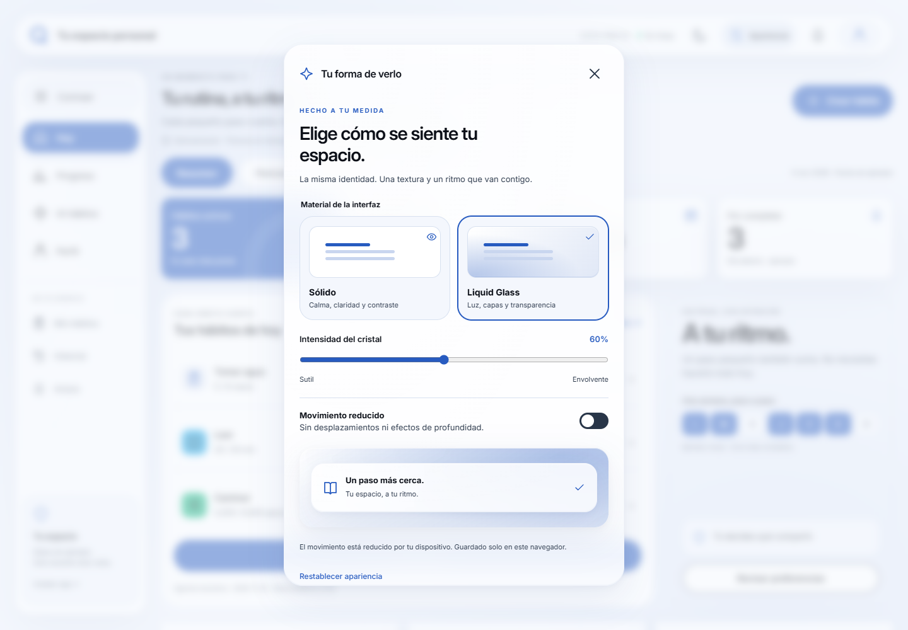
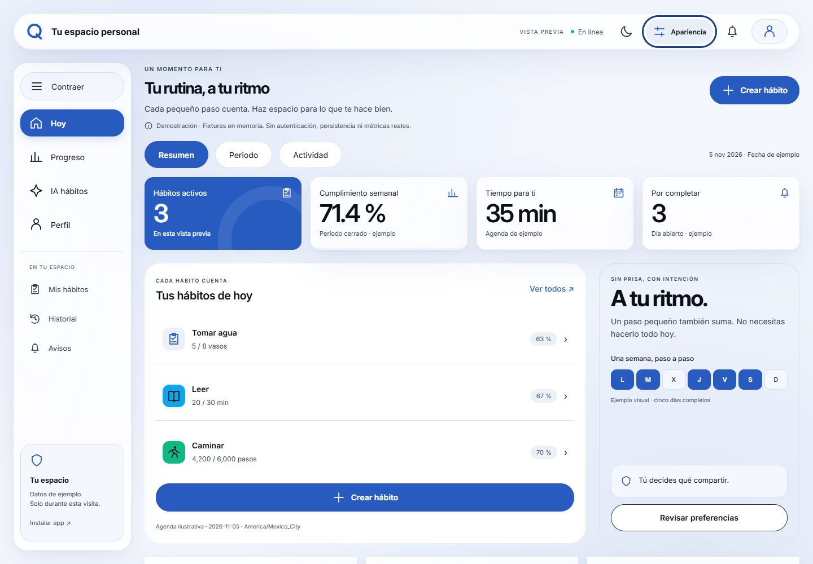
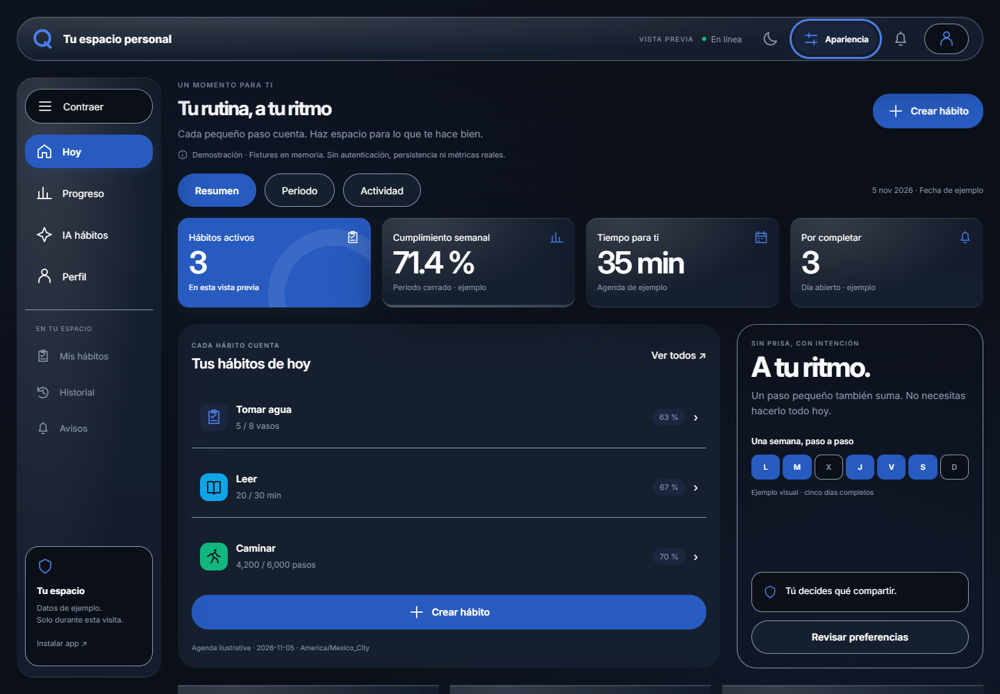
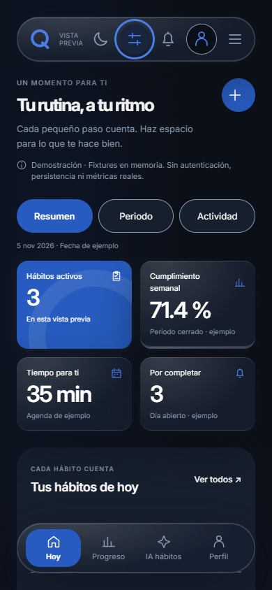

# PWA: movimiento fluido y Liquid Glass opcional

La mejora conserva el layout de islas, la paleta y los datos ilustrativos. Incorpora una selección de navegación que se desplaza, entradas por sección, respuesta al pulsar, inclinación suave de la escena pública y luz ligada al puntero. No añade librerías ni conecta escrituras de negocio.

## Revisar

En la rama `feature/prototipo-pwa`, desde la raíz:

```powershell
node scripts/dev-base.mjs web-docker
```

Abrir `http://localhost:5173/` y pulsar **Apariencia** en la cabecera. Elegir **Liquid Glass**, cambiar intensidad y cerrar con Escape. El ajuste también aparece en `/ajustes?seccion=Apariencia`. Se conserva al recargar y al cambiar de ruta; se puede restablecer. El tema claro/oscuro mantiene su control independiente.

Desplazarse por la bienvenida y mover el ratón sobre su escena; navegar de Hoy a Progreso y Perfil; contraer el rail; probar las tarjetas con ratón y teclado. En móvil no se aplica inclinación por puntero. Activar **Movimiento reducido** o la preferencia del sistema para detener efectos. Mayor contraste o transparencia reducida del dispositivo mantienen superficies sólidas.

Para revisar la PWA compilada e instalable en Docker, ejecutar `node scripts/dev-base.mjs web-static` y abrir `/instalar`. Este comando cambia de Vite a Nginx y conserva 5173. Después de editar, repetirlo para reconstruir.

## Alcance y comprobaciones

Solo se persisten material, intensidad y movimiento en `quantify.visual-preferences.v1`; no hay datos personales ni sincronización entre dispositivos. Los datos de demostración siguen perdiéndose al recargar. Los navegadores sin desenfoque conservan una presentación sólida. [Especificación visual](../../../docs/diseno/materiales-movimiento.md).

Pruebas añadidas: recuperación de preferencias corruptas, límites, persistencia/remontaje, almacenamiento bloqueado, accesibilidad del sistema, teclado y foco del diálogo, intensidad, cambio de ruta, inclinación real y contraste/reflujo de cristal en claro/oscuro a 320/390/1440 px.

Resultados del 20/11/2026: **88 pruebas unitarias y 12 E2E de Chrome aprobadas**, tipos canónicos, TypeScript, lint y build PWA aprobados. La suite E2E incluye navegación y edición de fixtures, accesibilidad básica, shell offline, exclusión de API/identidad y actualización que conserva borradores hasta confirmar. La comprobación automática no equivale a conformidad WCAG completa ni mide consumo en todos los dispositivos. El build conserva el aviso de tamaño del chunk principal superior a 500 kB.

## Capturas

Capturas de Chrome a 1440 × 1000 y 390 × 844, con reducción de movimiento del sistema para estabilizar las imágenes. Solo muestran fixtures públicos; no contienen sesiones reales. Se reproducen con `node apps/web/scripts/capture-appearance.mjs` contra el frontend local de 5173. Las capturas incluyen el trabajo visual local anterior, que se conserva separado del commit de esta mejora.








