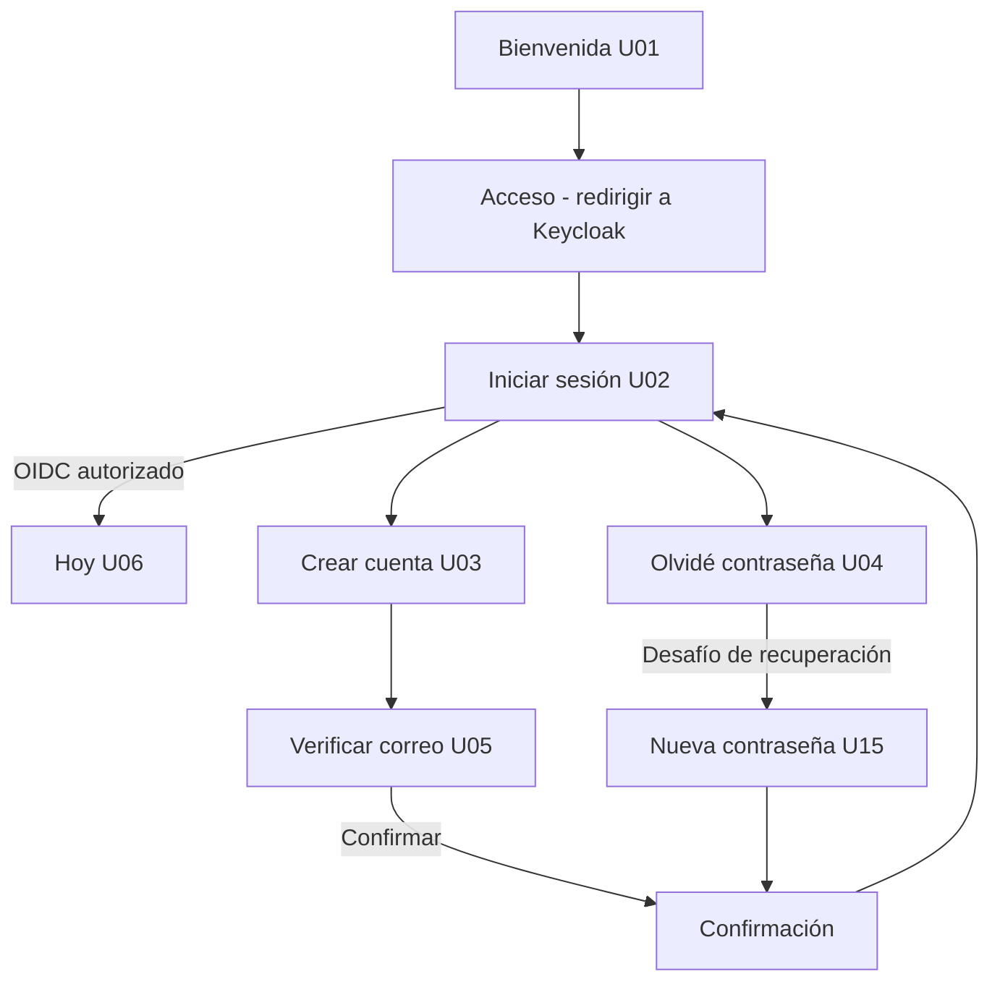

# Flujo de autenticación — Quantify Core V2

**Estado:** propuesta de diseño, sin integración de identidad ni envío de correos. Se preservan las 20 pantallas y 80 PNG del catálogo móvil original; este conjunto incorpora **6 vistas complementarias en 24 SVG editables**, sin renombrar archivos existentes.

**Trazabilidad:** RF-01 · QUANCORE-17 (realm) · QUANCORE-19 (cliente) · QUANCORE-26 (diseño) · QUANCORE-43 (ADR). Referencias: [Práctica 07](../../../../practica-07/README.md), [recorridos](../../../../diseno/recorridos.md), [Keycloak](../../../../../infrastructure/keycloak/README.md), [tokens](../../../../../packages/design-tokens/README.md).

## Matriz de pantallas

| Pantalla | Sketch | Wireframe | Mockup claro | Mockup oscuro |
|---|---|---|---|---|
| **Inicio de sesión (U02)** | [SVG](../sketches/auth-inicio-sesion.svg) | [SVG](../wireframes/auth-inicio-sesion.svg) | [SVG](../mockups/light/auth-inicio-sesion.svg) | [SVG](../mockups/dark/auth-inicio-sesion.svg) |
| **Crear cuenta (U03)** | [SVG](../sketches/auth-crear-cuenta.svg) | [SVG](../wireframes/auth-crear-cuenta.svg) | [SVG](../mockups/light/auth-crear-cuenta.svg) | [SVG](../mockups/dark/auth-crear-cuenta.svg) |
| **Código de verificación (U05)** | [SVG](../sketches/auth-verificar-correo.svg) | [SVG](../wireframes/auth-verificar-correo.svg) | [SVG](../mockups/light/auth-verificar-correo.svg) | [SVG](../mockups/dark/auth-verificar-correo.svg) |
| **Olvidé mi contraseña (U04)** | [SVG](../sketches/auth-recuperar-acceso.svg) | [SVG](../wireframes/auth-recuperar-acceso.svg) | [SVG](../mockups/light/auth-recuperar-acceso.svg) | [SVG](../mockups/dark/auth-recuperar-acceso.svg) |
| **Nueva contraseña (U15)** | [SVG](../sketches/auth-nueva-contrasena.svg) | [SVG](../wireframes/auth-nueva-contrasena.svg) | [SVG](../mockups/light/auth-nueva-contrasena.svg) | [SVG](../mockups/dark/auth-nueva-contrasena.svg) |
| **Confirmación de acceso (U05/U15)** | [SVG](../sketches/auth-acceso-confirmado.svg) | [SVG](../wireframes/auth-acceso-confirmado.svg) | [SVG](../mockups/light/auth-acceso-confirmado.svg) | [SVG](../mockups/dark/auth-acceso-confirmado.svg) |

[Galería visual con selector de fidelidad y tema](index.html) · [Inventario estructurado](catalogo.json) · [Generador reproducible](../../../fuente/auth-flow.mjs)

## Navegación conceptual



**No implementar un sistema de credenciales paralelo** dentro de React, Flutter o API. Keycloak debe encargarse de formularios, identidad y desafío, con redirección OIDC Authorization Code + PKCE; la aplicación solo muestra la entrada y el retorno. El flujo de seis dígitos es una **propuesta visual opcional**: el mecanismo estándar de verificación de correo de Keycloak es por enlace y el OTP de correo requiere personalización/extension aprobada.

## Estados a validar

| Pantalla | Comportamientos y validaciones previstos |
|---|---|
| Inicio de sesión | Correo vacío/inválido, contraseña omitida, credencial incorrecta, sesión vencida, bloqueo, cancelar |
| Crear cuenta | Nombre, correo, contraseña/confirmación, consentimiento explícito, duplicados sin filtrar identidades, correo pendiente |
| Verificar correo | Código incompleto, incorrecto, vencido, reenvío limitado; depende de extensión OTP o reemplazo por enlace |
| Recuperar acceso | Mensaje neutro aunque el correo no exista, límites de reintento, entrega solo mediante proveedor autorizado |
| Nueva contraseña | Desafío válido, vencimiento, complejidad, confirmación, revocación de token de restablecimiento |
| Confirmación | Mensaje seguro, botón de regreso; no conceder sesión automáticamente |

## Brechas reales detectadas

1. El export `infrastructure/keycloak/realm-export.json` contiene `registrationAllowed=false`, `verifyEmail=false`, `resetPasswordAllowed=false`; el diseño no cambia esas opciones ni configura SMTP.
2. La Práctica 07 simula la verificación mediante el código `123456`; es solo demostración, no una seguridad real. No trasladar esa credencial de ejemplo a producción.
3. `registro.png` significa registrar **progreso de hábito**, no crear cuenta. Los nuevos nombres comienzan en `auth-`.
4. `acceso.png` es el botón de acceso del **cliente**; el nuevo `auth-inicio-sesion.svg` documenta el formulario alojado por el **proveedor** de identidad.
5. La autentificación de administradores usa el mismo proveedor pero permisos distintos en la API. No mostrar hábitos privados a administradores.
6. Web/PWA y Flutter comparten las reglas y contenidos, no sus callbacks; se probarán individualmente después.

## Regeneración y calidad

Los SVG se generan a partir de un solo catálogo, con geometría 390 × 844 y tokens compartidos. Sketches solo geometría gris, wireframes Arial/grises y mockups Inter/paleta claro-oscuro.

```bash
node docs/GUI/fuente/auth-flow.mjs
node docs/GUI/fuente/tests/auth-flow.test.mjs
```

Los mockups incluyen mediante `data:` la fuente canónica `docs/GUI/assets/inter.woff2` y su licencia SIL OFL completa. Un SVG usado como imagen externa no hereda la fuente de la página y no puede depender de descargarla desde otra URL. El generador mantiene un solo archivo fuente; la inclusión en los doce SVG es un artefacto derivado necesario para descargarlos y visualizarlos de forma independiente. No se añade una segunda copia `.woff2`. La galería carga ese mismo recurso mediante una ruta relativa.

La confirmación usa un trazo vectorial para el icono de éxito: el carácter tipográfico anterior recurría a una fuente de símbolos del sistema. Los sketches siguen sin texto y los wireframes usan Arial. Se conservan colores, distribución y catálogo original.

[Resultados, comandos reproducibles y capturas de QA](VALIDACION.md). La prueba de navegador verifica fuentes efectivas con Chrome DevTools, recursos SVG como imágenes externas, límites de geometría y navegación; no basta con comprobar `font-family` ni `document.fonts.check`.

Estas instrucciones son reproducibles; no constituyen evidencia de que haya SMTP, OAuth o OTP real. Antes de etiquetar `develop`, integrar con revisión y comprobar referencias, variantes y pruebas; un tag es un punto de referencia de Git, no una certificación de servicio.
