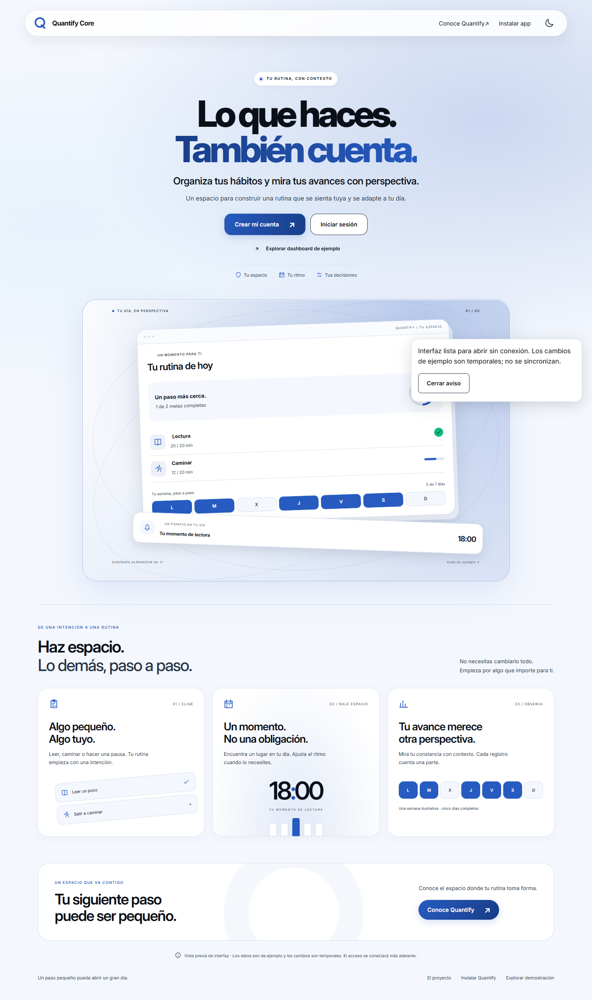
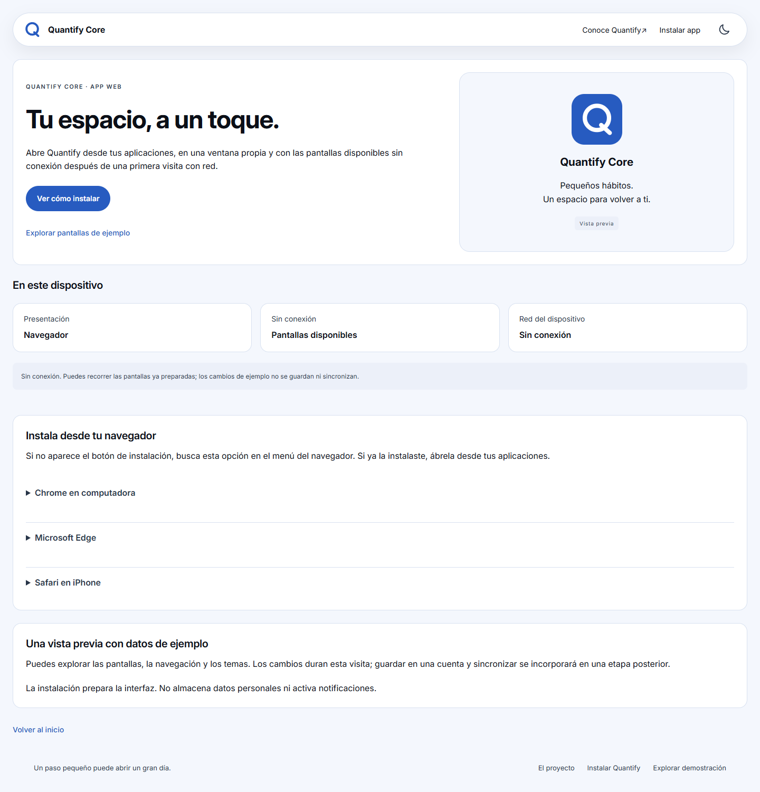

# Levantar Quantify Core en local

Guía para compañeros y agentes sobre la base ejecutable de `develop`. Los comandos usan PowerShell desde la raíz salvo indicación contraria. La evidencia previa corresponde a Windows; Linux/macOS requieren validar sus rutas y comandos. Los mínimos de RAM, CPU y disco siguen pendientes de medición.

## Requisitos según lo que vas a ejecutar

| Objetivo | Instalar en el equipo | Tecnologías utilizadas |
|---|---|---|
| Web + API + datos + login | Git, Docker Desktop con motor Linux y Compose; Chrome o Edge | PostgreSQL 18.6, Keycloak 26.8.1, API NestJS/TypeScript y React/TypeScript/Vite compilado con Nginx. Node 24.14.1 y paquetes se instalan dentro de las imágenes. |
| Editar web en Docker | Lo anterior y un editor | Perfil `web` con Vite y actualización al guardar, en lugar de `web-static`. |
| Desarrollar API/web fuera de Docker o ejecutar helpers Node | Node 24.x y npm 11.x adicionales; corte probado 24.14.1/11.11.0 | Datos/identidad siguen en Docker. Dependencias fijadas en los lockfiles de cada módulo. |
| Aplicación móvil | Flutter 3.47.8 con Dart 3.13.7 (Dart requerido `^3.13.3`); Android SDK/JDK compatible y dispositivo/emulador para Android, o Chrome para Flutter Web | Demo Flutter independiente; iOS requiere macOS/Xcode. `flutter doctor -v` identifica herramientas/licencias pendientes. |
| Monitoreo opcional | Docker y Node 24.x para los helpers | Prometheus 3.16.0, Grafana 13.2.4, Loki 3.7.9, Alertmanager 0.35.0 y receptor técnico Node, en contenedores. |
| Telemetría sintética opcional | Node/npm y dependencias de `services/api/telemetry` | Pruebas aisladas con PostgreSQL y MongoDB 8.2.6 temporales. MongoDB no forma parte del Compose base. |

No necesitas instalar globalmente PostgreSQL, Keycloak, React, NestJS, Vite ni Nginx para el camino Docker. La primera ejecución requiere Internet para descargar imágenes/paquetes. Reserva **5173** para web, **3000** para API, **8180** para identidad y **55432** para PostgreSQL, publicados únicamente en loopback.

**Tecnologías previstas sin arranque integrado:** FastAPI/Python para analítica/asistente sigue en diseño; Redis y workers no tienen servicio ejecutable integrado; Wear OS no tiene app ni SDK decidido. No hay comandos aprobados para arrancarlos. Consulta [analítica](../../services/analytics/README.md), [workers](../../services/workers/README.md) y [Wear OS](../../apps/wear/README.md). OpenTelemetry distribuido también sigue pendiente; el laboratorio de métricas/logs disponible se describe más abajo.

## Obtener el código

En una máquina nueva:

```powershell
git clone https://github.com/AngelJdev/Quantify-Core.git
cd Quantify-Core
git switch develop
git status --short
```

Si ya tienes una copia, revisa primero `git status` y conserva tus cambios. Obtén referencias con `git fetch origin` y sigue el [Git Flow](../guias/git-flow.md). No atribuyas a `develop` capacidades de otra rama.

## Ruta de arranque

1. Preparar configuración, iniciar datos, aplicar migraciones e iniciar API/web según los pasos siguientes.
2. Preparar una cuenta Keycloak y su perfil para usar `/conexion`; la bienvenida pública es una demo.
3. Consultar persistencia y diagnóstico antes de regenerar configuración o limpiar Docker.
4. Elegir desarrollo en host, móvil, monitoreo o telemetría si la tarea lo requiere.

## Instalación y ejecución

**Entorno local verificado el 20/11/2026:** PostgreSQL, Keycloak, API NestJS y frontend compilado/PWA en Docker. Requiere Git y Docker Desktop iniciado con contenedores Linux y Compose; estos pasos usan PowerShell desde la raíz del repositorio. No necesitas Node/npm en Windows para este arranque. Flutter, Wear OS y analítica no forman parte de este Compose.

### 1. Entrar y preparar la configuración

```powershell
cd "C:\ruta\a\Quantify-Core"
docker version
docker compose version
$qcCompose = @("--env-file", "infrastructure/docker/.env.local", "-f", "infrastructure/docker/compose.yaml")
```

`docker version` debe mostrar Client y Server. En otra PC, sustituye la ruta por la de tu copia del repositorio. Define `$qcCompose` de nuevo si abres otra terminal.

**Solo en una instalación nueva, sin ninguno de los cuatro `.env.local`:**

```powershell
docker run --rm --mount "type=bind,source=$($PWD.Path),target=/workspace" --workdir /workspace node:24.14.1-bookworm-slim node scripts/dev-base.mjs init
```

Genera claves aleatorias sin imprimirlas. Los cuatro archivos son privados y están excluidos de Git y de las imágenes:

| Archivo | Consumidor y propósito |
|---|---|
| `infrastructure/docker/.env.local` | Compose: claves de PostgreSQL, rol de API y administrador inicial de Keycloak. |
| `services/api/.env.local` | API ejecutada fuera de Docker: conexión con rol limitado y configuración de identidad. |
| `services/api/.env.migrate.local` | Migraciones ejecutadas fuera de Docker: conexión con el propietario del esquema. |
| `apps/web/.env.local` | Vite ejecutado fuera de Docker: URL pública de la API, sin claves de servidor. |

Si ya existen, omite `init`: no los borres ni regeneres para reutilizar los volúmenes. Si la configuración está incompleta, revisa los archivos faltantes con sus ejemplos; `init` se detiene si encuentra cualquiera de los cuatro. Cambiar una clave en un archivo no cambia la de una base ya inicializada.

### 2. Iniciar datos e identidad y aplicar migraciones

```powershell
docker compose @qcCompose --profile "*" config --quiet
docker compose @qcCompose up -d postgres keycloak
docker compose @qcCompose --profile tools run --rm --build migrate
```

La imagen PostgreSQL crea la base `quantify_core_dev` al inicializar un volumen vacío. Después, la tarea `migrate` espera a PostgreSQL saludable, crea las tablas mediante las migraciones versionadas y configura el rol limitado de la API. Una segunda ejecución no duplica el esquema ni carga hábitos de ejemplo. Continúa únicamente si termina correctamente: arrancar la API no aplica migraciones automáticamente.

### 3. Iniciar API y frontend compilado

Si tenías Vite en una terminal, detenlo con Ctrl+C. Este comando detiene la alternativa de desarrollo de Docker para liberar 5173:

```powershell
docker compose @qcCompose --profile web stop web
docker compose @qcCompose --profile app --profile web-static up -d --build api web-static
docker compose @qcCompose ps
Invoke-RestMethod "http://localhost:3000/api/v1/health/ready"
```

Espera a que API y `web-static` aparezcan `healthy`; `health/ready` debe devolver `status: ok`. La primera construcción descarga e instala dependencias dentro de Docker. Se puede cerrar la terminal: los servicios quedan en segundo plano.

| Componente | Dirección local |
|---|---|
| Aplicación | http://localhost:5173/ |
| Instalación PWA | http://localhost:5173/instalar |
| Lectura con sesión real | http://localhost:5173/conexion |
| API / salud | http://localhost:3000/api/v1/health/ready |
| Administración Keycloak | http://localhost:8180/admin/ |
| PostgreSQL | `127.0.0.1:55432`, base `quantify_core_dev` |

La imagen web usa Nginx sin privilegios y archivos compilados; no monta fuentes ni ejecuta Vite. API y Keycloak continúan en `localhost:3000/8180` porque las solicitudes salen del navegador. Los valores públicos `VITE_*` se incorporan al compilar; cambiarlos requiere reconstruir la imagen. Este entorno HTTP/loopback y Keycloak `start-dev` es local; publicar requiere dominio, HTTPS y configuración de identidad del destino.

### 4. Volver a iniciar, reconstruir, consultar logs y apagar

```powershell
# Otro día: reutilizar imágenes y datos existentes.
docker compose @qcCompose --profile app --profile web-static up -d postgres keycloak api web-static

# Después de cambiar código: reconstruir API y web.
docker compose @qcCompose --profile app --profile web-static up -d --build api web-static

# Diagnóstico del entorno base.
docker compose @qcCompose logs --tail 100 web-static api postgres keycloak

# Detener el entorno base conservando los datos.
docker compose @qcCompose --profile "*" stop
```

Si ya activaste el monitoreo, su [procedimiento independiente](../../docs/despliegue/runbook-observabilidad.md) mantiene Grafana/Prometheus/Loki/Alertmanager. No uses borrado de volúmenes para resolver un fallo de arranque o contraseña. Un puerto ocupado requiere detener el proceso que lo usa; conserva 5173 para que coincidan CORS y el callback OIDC. El aviso de realm existente de Keycloak significa que conserva el realm anterior; no actualiza automáticamente su configuración.

### Desarrollo, PWA y acceso real

Para editar con actualización al guardar, cambia al perfil `web`:

```powershell
docker compose @qcCompose --profile web-static stop web-static
docker compose @qcCompose --profile web up -d --build web
```

Para volver al frontend compilado, repite el paso 3. Solo una de las dos modalidades puede ocupar 5173. La PWA instalable se verifica en `web-static`: abrir `/instalar` con Chrome/Edge normal, aceptar la instalación y volver a abrir sin red después de la primera visita. El soporte offline cubre el shell público; consultas personales y Keycloak requieren conexión. Los cambios en datos de demostración son temporales.

La sesión real se prueba en `/conexion`; los formularios visuales de la portada siguen siendo maquetas. No existen cuentas de producto predeterminadas. Para preparar tu cuenta de prueba:

1. Consulta privadamente el usuario/clave administrativos generados en `infrastructure/docker/.env.local` y accede a Keycloak en 8180.
2. Selecciona el realm `quantify`, crea un usuario de prueba habilitado, establece su contraseña y asigna el rol de realm `user`. Completa los datos y acciones requeridos por el realm para poder iniciar sesión.
3. Copia el ID del usuario (su subject OIDC) y aprovisiona su perfil, sustituyendo `ID_DEL_USUARIO`:

```powershell
docker compose @qcCompose --profile tools run --rm --build -e PROFILE_SUBJECT=ID_DEL_USUARIO -e PROFILE_TIME_ZONE=America/Mexico_City profile
```

Este comando vincula el subject existente; no crea contraseñas ni reactiva perfiles suspendidos. Después abre `/conexion` e inicia sesión con Keycloak. Si falta el perfil, se muestra `403`, sin sustituirlo por fixtures. [Reglas de aprovisionamiento](../../docs/guias/base-tecnica.md#ejecutar-api-y-web).

**Validación reproducible:** `node scripts/verify-docker-web.mjs`, con dependencias web/API instaladas y Chrome en el host, verifica la imagen estática, instalación admitida por Chrome, shell offline, exclusión de API/identidad del cache, login real Code+PKCE, lecturas `200`, perfil ausente `403` y logout. Crea dos cuentas sintéticas y un perfil vacío, y los elimina al terminar; no escribe hábitos. Es una comprobación explícita del laboratorio local. Si se interrumpe abruptamente, revisar privadamente las cuentas `qc-docker-*` de esa ejecución. [Resultados y límites](../../docs/evidencias/docker-2026-11-20/README.md).



*Captura de la bienvenida pública servida por Nginx en Docker. La pantalla usa datos ilustrativos; no demuestra escrituras de negocio.*



*Captura después de deshabilitar la red en Chrome y recargar `/instalar`. No se capturaron sesiones, credenciales ni datos personales.*

### Si el entorno no inicia

| Síntoma | Qué revisar |
|---|---|
| `docker version` no muestra Server | Inicia Docker Desktop y selecciona contenedores Linux antes de continuar. |
| Compose indica que falta configuración | Comprueba `infrastructure/docker/.env.local` y vuelve a definir `$qcCompose` en esa terminal. Usa `config --quiet` para validar sin imprimir claves. |
| Puerto 5173 ocupado | Detén Vite del host o la otra modalidad web de Docker, según el paso 3. |
| API no está lista o devuelve 503 | Consulta `ps` y los logs de API/PostgreSQL; comprueba que `migrate` terminó sin errores. Salud SQL no comprueba el login de Keycloak. |
| Inicio de sesión falla o `/conexion` devuelve 403 | Revisa realm, rol `user` y perfil aprovisionado para el subject correcto. Un realm existente no se actualiza al reimportar. |
| PostgreSQL rechaza la contraseña | Conserva el volumen y recupera la configuración correspondiente; regenerar `.env.local` no actualiza usuarios existentes. |

## Base de datos y persistencia local

### Qué existe y dónde se guarda

El núcleo de hábitos **sí tiene PostgreSQL y esquema SQL implementados**. El [modelo conceptual](../../docs/datos-ia/modelo-datos.md) describe además entidades futuras; para conocer las tablas actuales, la fuente ejecutable son las [migraciones de la API](../../services/api/db/migrations/).

| Datos | Almacén actual | Persistencia en Docker |
|---|---|---|
| Perfiles, hábitos, check-ins, historial, recibos de idempotencia y outbox de auditoría | PostgreSQL 18.6, base `quantify_core_dev` | Volumen `quantify-core-dev_postgres-data`, montado en `/var/lib/postgresql`. |
| Cuentas, credenciales, roles y configuración de identidad | Base de desarrollo integrada de Keycloak 26.8.1 | Volumen `quantify-core-dev_keycloak-data`, montado en `/opt/keycloak/data`. No usa el PostgreSQL de negocio en este Compose. |
| Datos ilustrativos de las pantallas de demostración | Fixtures/estado del cliente | No se convierten en registros PostgreSQL al editar la demo. `/conexion` consulta datos reales y puede mostrar una lista vacía. |

Los nombres corresponden al proyecto `quantify-core-dev` definido en [compose.yaml](../../infrastructure/docker/compose.yaml); cambiar el nombre del proyecto crea otro conjunto de volúmenes. Son volúmenes administrados por Docker, no carpetas del repositorio ni archivos sincronizados por Git/OneDrive. En Docker Desktop con contenedores Linux, el almacenamiento pertenece al entorno Linux de Docker. No se necesita buscar ni editar sus archivos internos para consultar SQL.

MongoDB tiene una implementación opcional para la [simulación sintética de telemetría](../../services/api/telemetry/README.md), separada de este arranque. Redis y FastAPI no son dependencias del núcleo manual ni servicios del Compose base.

### Esquema y migraciones

| Fuente | Qué prepara |
|---|---|
| [001_core.sql](../../services/api/db/migrations/001_core.sql) | `profiles`, `categories`, `habits`, `habit_revisions` y `audit_outbox`, con restricciones y auditoría. La tabla `categories` no implica que exista un endpoint de categorías. |
| [002_core_integration.sql](../../services/api/db/migrations/002_core_integration.sql) | Zona del perfil, `check_ins`, `check_in_revisions`, `api_receipts` y vistas `dashboard_read.v1_*`. |
| [migrate.cjs](../../services/api/db/migrate.cjs) | Ledger `schema_migrations`, checksums y aplicación transaccional con bloqueo para evitar migraciones concurrentes. |
| [provision-runtime.cjs](../../services/api/db/provision-runtime.cjs) | Rol `quantify_api` con permisos limitados; las migraciones usan `quantify_owner`. |

Las migraciones crean estructura, no cuentas Keycloak ni hábitos de ejemplo. El perfil de negocio enlaza `(oidc_issuer, oidc_subject)` con la identidad existente, sin copiar contraseñas. Para crear ese perfil sigue [Desarrollo, PWA y acceso real](#desarrollo-pwa-y-acceso-real).

Después de recibir nuevas migraciones, vuelve a ejecutar la tarea `migrate` del paso 2 antes de reconstruir la API. No edites una migración ya aplicada: un checksum distinto detiene la ejecución. Añade otra migración para evolucionar el esquema y revisa el cambio con el responsable de datos.

### Consultar la base y localizar los volúmenes

Desde la raíz, con `$qcCompose` definido como en el paso 1 y PostgreSQL iniciado, estos comandos inspeccionan estructura y estado sin mostrar registros personales ni claves:

```powershell
# Tablas de negocio y vistas de lectura.
docker compose @qcCompose exec postgres psql -U quantify_owner -d quantify_core_dev -c '\dt public.*'
docker compose @qcCompose exec postgres psql -U quantify_owner -d quantify_core_dev -c '\dv dashboard_read.*'

# Migraciones aplicadas: deben figurar 001_core.sql y 002_core_integration.sql.
docker compose @qcCompose exec postgres psql -U quantify_owner -d quantify_core_dev -c 'SELECT filename, applied_at FROM schema_migrations ORDER BY filename;'

# Volúmenes del proyecto y ubicación administrada por Docker.
docker volume ls --filter label=com.docker.compose.project=quantify-core-dev
docker volume inspect quantify-core-dev_postgres-data quantify-core-dev_keycloak-data --format '{{.Name}} -> {{.Mountpoint}}'
```

`Mountpoint` es una ruta del motor Docker; en Docker Desktop puede no ser accesible directamente desde el Explorador de Windows. Para una herramienta SQL del host, utiliza `127.0.0.1:55432`, base `quantify_core_dev`, y configura privadamente la credencial local del rol autorizado. La API dentro de Compose se conecta a `postgres:5432` como `quantify_api`; el navegador se comunica con la API, nunca directamente con PostgreSQL.

### Conservar datos y trabajo pendiente

`stop` conserva contenedores y volúmenes. Reconstruir API/web conserva los datos porque están en volúmenes separados. `docker compose down`, sin `--volumes`, elimina contenedores/red y conserva los volúmenes con nombre; `down --volumes`, eliminar estos volúmenes o restablecer el almacenamiento de Docker puede borrar los datos locales. Conservar un volumen **no equivale a tener un respaldo**.

Quedan por cerrar y verificar respaldos/restauración, retención y eliminación, capacidad y configuración de datos del destino productivo. El ORM sigue siendo una decisión pendiente; el núcleo actual usa SQL mediante `pg`. Estas tareas no impiden levantar el laboratorio, pero deben resolverse antes de tratarlo como entorno de producción. Consulta [recuperación](../../docs/despliegue/recuperacion.md) y [decisiones pendientes](../../docs/arquitectura/decisiones-pendientes.md).

## Desarrollo con Node en el equipo

Esta alternativa usa los mismos datos e identidad. No ejecutes API/Vite del host a la vez que el contenedor que ocupa su puerto. Desde la raíz, con configuración y migraciones ya preparadas:

```powershell
node --version
npm.cmd --version
npm.cmd ci --prefix services/api
npm.cmd ci --prefix apps/web
npm.cmd run build --prefix services/api
# Liberar puertos para los procesos del host.
docker compose @qcCompose --profile app --profile web --profile web-static stop api web web-static
node scripts/dev-base.mjs api
```

En otra terminal desde la raíz:

```powershell
node scripts/dev-base.mjs web
```

Detener con Ctrl+C. Los helpers cargan los archivos privados de cada módulo; no copies claves al cliente. Para migrar desde el host existe `node scripts/dev-base.mjs migrate`; no hace falta repetirlo si ya aplicaste las migraciones en Docker. Las escrituras de revisión están deshabilitadas por defecto. Su opt-in y reglas están en la [guía base](../guias/base-tecnica.md#ejecutar-api-y-web); `/conexion` es de lectura.

## Aplicación móvil independiente

El Compose base no compila ni instala Flutter. En esta base de `develop`, `main_prototype.dart` usa datos locales de sesión y no implementa OIDC/REST real. No requiere bases de datos para revisar la UI.

```powershell
cd apps/mobile
flutter --version
flutter doctor -v
flutter pub get
flutter devices
# Elegir una opción: Chrome o Android con el ID de flutter devices.
flutter run -d chrome --target lib/main_prototype.dart
flutter run -d ID_DEL_DISPOSITIVO --target lib/main_prototype.dart
```

Sustituye el ID de ejemplo. Android exige dispositivo autorizado para depuración o emulador preparado, SDK/herramientas de compilación y licencias resueltas según `flutter doctor`. Desde `apps/mobile`, para comprobar y generar APK debug:

```powershell
flutter analyze
flutter test
flutter build apk --debug --target lib/main_prototype.dart
```

El APK queda en `apps/mobile/build/app/outputs/flutter-apk/app-debug.apk` respecto a la raíz. Consulta el [README móvil](../../apps/mobile/README.md) y la [demo anterior](../../apps/mobile/GUIA-DEMO.md) para elegir la entrada correcta. En un teléfono, `localhost` designa al teléfono: cambiar únicamente la URL de API o issuer no resuelve la identidad. La conexión móvil real necesita topología/configuración aprobadas y no forma parte de este arranque. Detén Flutter con `q` o Ctrl+C y vuelve a la raíz antes de continuar.

## Monitoreo opcional

Con base, migraciones y Node preparados, desde la raíz:

```powershell
# Solo la primera vez: omitir init si ya existe su configuración privada.
node scripts/observability.mjs init
node scripts/observability.mjs config
node scripts/observability.mjs up
node scripts/observability.mjs status
```

Grafana: `http://localhost:3300`, usuario `quantify-operator` y clave privada en `infrastructure/observability/.env.local`. Prometheus: `http://localhost:9090`. Alertmanager usa 9093 y el receptor técnico 9194, solo loopback; Loki 3100 queda interno. No es necesario instalar estos programas en Windows.

`up` construye/reconfigura la API con el overlay de observabilidad del mismo proyecto; no aplica migraciones. Para detener conservando datos usa `node scripts/observability.mjs stop`; PostgreSQL/Keycloak permanecen disponibles. Si vuelves al Compose base, inicia/reconstruye API según el paso 3 para recuperar esa configuración. El [runbook](../despliegue/runbook-observabilidad.md) contiene diagnóstico y ensayo de caída; su verificador detiene servicios de forma controlada y no es parte del arranque normal.

## Telemetría y MongoDB opcionales

El núcleo manual no usa MongoDB. Para desarrollar la simulación sigue su [README](../../services/api/telemetry/README.md) y [.env.example](../../services/api/telemetry/.env.example): contienen requisitos de identidad, migraciones de esquema separado y activación explícita. No uses datos personales ni montes sus rutas en el núcleo por defecto.

Para verificar el módulo de forma aislada, desde la raíz:

```powershell
npm.cmd ci --prefix services/api/telemetry
npm.cmd test --prefix services/api/telemetry
```

La suite inicia PostgreSQL/MongoDB temporales y los elimina al terminar; necesita red para los binarios y puertos de loopback. No requiere instalar MongoDB globalmente. Un MongoDB persistente con autenticación y permisos necesita configuración separada; no existe perfil MongoDB en el Compose base.

## Comprobación y entrega a otro compañero o agente

Desde la raíz, con Node en el host:

```powershell
node scripts/check-docs.mjs
git diff --check
```

Para el camino Docker, comprueba PostgreSQL/API/web saludables, `health/ready` con `status: ok`, descubrimiento OIDC en `http://localhost:8180/realms/quantify/.well-known/openid-configuration` y lectura de `/conexion` con cuenta/perfil de prueba. Una lista vacía es válida: las migraciones no cargan hábitos de demo.

Las comprobaciones ampliadas tienen requisitos y efectos propios: [web Docker real](../evidencias/docker-2026-11-20/README.md), [base técnica](../guias/base-tecnica.md) y [observabilidad](../despliegue/runbook-observabilidad.md). No atribuyas sus resultados a una máquina nueva sin ejecutarlas.

Para pedir ayuda a un agente, indica sistema operativo, rama/commit, ruta elegida (Docker, host o Flutter), comando y error saneado. Debe leer [AGENTS.md](../../AGENTS.md), revisar el estado Git y esta guía, preservar configuración/volúmenes e indicar qué pudo comprobar. No adjuntes `.env.local`, contraseñas, tokens ni volcados de datos. El [mapa documental](../README.md) enlaza requisitos, contratos y decisiones para continuar.
