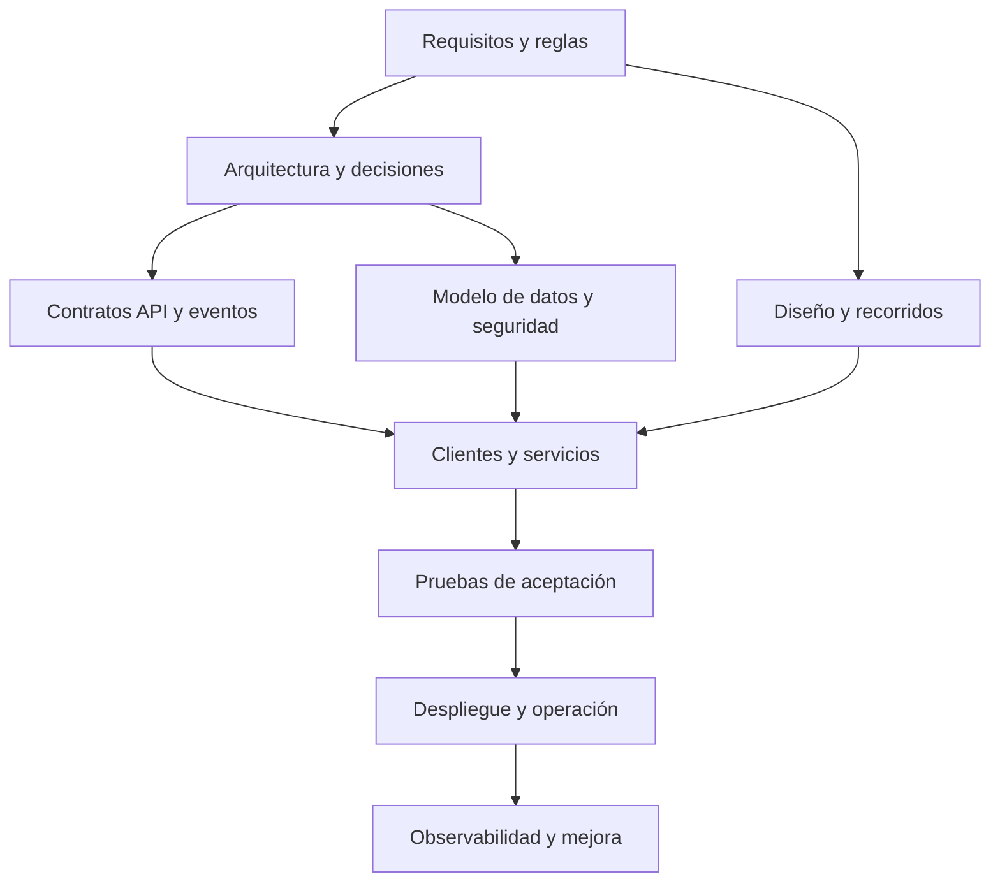

**Ubicación:** [Quantify-Core](../README.md) → docs · **Nivel 1**

# Documentación del proyecto · Quantify Core

Mapa de referencia para que el equipo y sus agentes implementen el mismo producto con contratos, reglas y diseño coherentes. Empezar por [incorporación](guias/incorporacion.md), [contribución](../CONTRIBUTING.md) y el README del componente que se modificará.

**Estado:** base de desarrollo y contratos propuestos. El prototipo académico y la [simulación sintética QUANCORE-35](datos-ia/telemetria-simulada.md) son ejecutables; los clientes y servicios generales del producto siguen pendientes de integración. Cada módulo debe actualizar su estado y aportar evidencia cuando cambie esta situación.

## Identidad local (QUANCORE-17)

[Guía única de Keycloak](../infrastructure/keycloak/README.md): configuración, operación, pruebas y diez evidencias descritas al pie. Export auditado e importable; la integración final de clientes y backend sigue pendiente.

## Documentación por área

Este índice reúne producto, planificación, ingeniería, diseño, calidad y operación sin mover sus fuentes canónicas. **Corte de revisión: 09/11/2026**, asociado a [QUANCORE-13](https://utxicotepec-team-q5ufett6.atlassian.net/browse/QUANCORE-13), consultado en estado Por hacer. Versionar documentos no acredita implementación ni aprobación.

### Producto y requisitos

| Propósito | Fuente y estado |
|---|---|
| Visión, problema, valor y alcance | [Presentación del producto](../README.md), [Charter](gestion/acta-constitucion.md) y [requerimientos](requerimientos/README.md); alcance del Charter propuesto para revisión. |
| Especificación y reglas | [Catálogo RF-01..10 / RNF-01..10](requerimientos/catalogo.md), [reglas](requerimientos/reglas-negocio.md) y [trazabilidad](requerimientos/aceptacion.md); conservan sus identificadores y definiciones. |
| Historias y aceptación | [HU-01..10](UHs/README.md), [primer recorrido](UHs/primer-flujo.md) y [AC/CA](requerimientos/aceptacion.md); las fichas precisan alcance y dependencias, sin equiparar propuesta, implementación y aceptación. |

### Planificación y gestión

| Propósito | Fuente y estado |
|---|---|
| Constitución y gobierno | [Project Charter](gestion/acta-constitucion.md); propósito, alcance, riesgos, hitos y referencias Jira. Patrocinio y autorización pendientes. |
| Paquetes y seguimiento | [EDT/WBS y diccionario](gestion/edt.md); resultados, criterios de salida y dependencias. Fechas y seguimiento en Jira, sin porcentajes deducidos de commits. |
| Responsabilidades | [Matriz RACI](gestion/raci.md); propuesta contrastada con README y Jira, sin reasignar personas ni sustituir aceptación. |
| Recursos y costos | [Estimación preliminar](gestion/presupuesto.md); rubros, método y escenarios. Faltan horas, tarifas, destino y aprobación; no hay total ni gasto confirmado. |

### Arquitectura e ingeniería

| Propósito | Fuente y estado |
|---|---|
| Límites, componentes e integraciones | [Arquitectura](arquitectura/README.md), [componentes](arquitectura/componentes.md) y [flujos](arquitectura/flujos.md). La integración general sigue pendiente. |
| Decisiones y alternativas | [Registro ADR](arquitectura/adr/README.md) y [decisiones abiertas](arquitectura/decisiones-pendientes.md). ADR-0001..0004 están en esta base; ADR-0005/0006 se revisan en la rama frontend como propuestas, sin copiar ni renumerar. |
| Contratos y datos | [OpenAPI y eventos](../packages/contracts/README.md), [referencia API](api/README.md) y [modelo de datos](datos-ia/modelo-datos.md); los consumidores deben verificar compatibilidad antes de integrar. |
| Seguridad y configuración | [Seguridad](seguridad/README.md), [Keycloak](../infrastructure/keycloak/README.md), [configuración compartida](../packages/config/README.md) e [instalación](Installation/README.md). La sesión OIDC real de clientes sigue pendiente. |

### Diseño y experiencia de usuario

| Propósito | Fuente y estado |
|---|---|
| Identidad y estilos | [GUI](GUI/README.md), [sistema de diseño](diseno/sistema-diseno.md) y [tokens](../packages/design-tokens/README.md); recursos existentes verificados por pruebas GUI, sin otra paleta ni definición paralela. |
| Pantallas y fidelidades | [Catálogo móvil](GUI/prototipos/movil/README.md), [mockups](GUI/prototipos/movil/mockups/README.md) y [autenticación](GUI/prototipos/movil/autenticacion/README.md): 20 pantallas en 40 PNG claro/oscuro, más seis vistas de autenticación en 24 SVG entre fidelidades. No equivalen a producto conectado. |
| Prototipo y navegación | [Figma oficial](https://www.figma.com/design/L6ePtwcmyBeiC2xI1iDGM3), [entradas y validación estructural](GUI/README.md#prototipo-interactivo-en-figma) y [recorridos](diseno/recorridos.md). Wireframes y mockups tienen conexiones existentes; el prototipo HTML histórico es una referencia distinta. |
| Accesibilidad | [Criterios de diseño](diseno/README.md) y [plan de verificación](../tests/plan-pruebas.md); una comprobación estructural o automatizada no acredita por sí sola toda la experiencia. |

### Calidad y verificación

| Propósito | Fuente y estado |
|---|---|
| Estrategia y ejecución | [Estrategia](../tests/README.md) y [plan operativo](../tests/plan-pruebas.md): entornos, niveles, criterios y tratamiento de incidencias; sin SLO inventados. |
| Casos y resultados esperados | [CA-01..20 y pasos](requerimientos/aceptacion.md); precondiciones y procedimientos sobre la fuente existente, pendientes de ejecución integrada. |
| Resultados y evidencias | [Informe del 09/11/2026](../tests/informe-ejecucion-2026-11-09.md) y [validación documental](guias/validacion-documental.md); comandos, revisión y salidas reales. Se distingue trabajo de compañeros, simulaciones y producto pendiente. |

### Operaciones y liberaciones

| Propósito | Fuente y estado |
|---|---|
| Entornos y servicios | [Infraestructura](../infrastructure/README.md), [Docker](../infrastructure/docker/README.md) y [despliegue](despliegue/README.md); plataforma y publicación de producto pendientes de acreditar. |
| CI/CD y observabilidad | [Configuración de GitHub](../.github/CONFIGURACION.md) y [observabilidad](../infrastructure/observability/README.md); revisar automatizaciones y señales ejecutables antes de declararlas operativas. |
| Publicación y recuperación | [Procedimiento de publicación](despliegue/publicacion.md) y [recuperación](despliegue/recuperacion.md); completar ambiente, responsables y comandos verificados para el destino elegido. |
| Criterios y cierre de versión | [Registro preliminar de cierre y liberación](gestion/acta-cierre.md); sin cierre efectivo, firmas ni demo atribuida, con condiciones de aceptación pendientes. |

### Líneas base y revisión pendiente

La rama documental se inició en `0272ed8ea8fe729b42a54ad8031b16f616636a4e`. La rama independiente `feature/QUANCORE-42-consolidacion-frontend` contiene seis commits propios respecto a esa base y mantiene ADR-0005/0006 propuestos. La revisión previa comprobó ocho archivos entre `5a02680` (cuatro documentos de arquitectura) y `4a8d9a8` (cuatro del diagnóstico HTTP). Sus propuestas pueden consultarse sin mezclarlas con esta rama:

```powershell
git show feature/QUANCORE-42-consolidacion-frontend:docs/arquitectura/adr/0005-consolidacion-frontend.md
git show feature/QUANCORE-42-consolidacion-frontend:docs/arquitectura/adr/0006-integracion-api-identidad-http.md
```

El [PR #1](https://github.com/AngelJdev/Quantify-Core/pull/1) y el tag `v2.0.0-design-baseline` identifican la línea base visual integrada. Los commits posteriores de telemetría, MongoDB y dashboard conservan la autoría de Al Farias; no acreditan la integración general.

Falta aprobar alcance institucional, RACI, estimación de recursos y cierre; resolver arquitectura, sesión e historial en QUANCORE-43; demostrar E2E conectado en QUANCORE-38; validar destino y correcciones en QUANCORE-16/39; y realizar la demo QUANCORE-40. Los hitos y dependencias se mantienen en Jira y el Charter. Los documentos formales conservan estilo institucional; la bitácora personal se entrega fuera del repositorio.

## Carpetas por tipo de documento

| Carpeta | Contenido y referencia |
|---|---|
| [BRs](BRs/README.md) | Reglas de negocio y enlace a su definición `RN-P`. |
| [FRs](FRs/README.md) | Requisitos funcionales `RF-01` a `RF-10`. |
| [GUI](GUI/README.md) | Pantallas, estados, prototipo y diseño del producto. |
| [Installation](Installation/README.md) | Preparación comprobable y requisitos de instalación futura. |
| [Manual](Manual/README.md) | Guía técnica para diseñar, programar y entregar cambios. |
| [NFRs](NFRs/README.md) | Requisitos no funcionales `RNF-01` a `RNF-10`. |
| [UHs](UHs/README.md) | Historias de usuario y [primer recorrido](UHs/primer-flujo.md). |
| [UserManual](UserManual/README.md) | Uso del prototipo disponible y alcance del manual futuro. |

Estas carpetas organizan la lectura solicitada. Los requisitos, reglas y contratos mantienen sus fuentes canónicas enlazadas desde cada README; la misma definición no se vuelve a editar en ocho lugares.

## Recursos interactivos y publicación

[Galería visual local de Quantify Core](GUI/index.html) · [Documentación completa de diseño](GUI/README.md). Cuatro lienzos de identidad y prototipos en tres fidelidades, con la familia Inter unificada. La galería pública histórica devolvió HTTP 404 el 09/11/2026; servir la copia local y verificar las rutas de publicación antes de presentar enlaces como disponibles. Los accesos siguientes conservan las referencias históricas de las prácticas, no una certificación de publicación vigente.

- [Portal principal](https://angeljesus13.github.io/Quantify-Core/)
- [Práctica 04 — Business Model Canvas Interactivo](https://angeljesus13.github.io/Quantify-Core/docs/Practica04/business-model-canvas.html)
- [Práctica 05 — Diagrama de Roles de Usuario Interactivo](https://angeljesus13.github.io/Quantify-Core/docs/Practica05/diagrama-roles-quantify.html)
- [Examen de arquitectura — Plano interactivo](https://angeljesus13.github.io/Quantify-Core/docs/examen/index.html)
- [Práctica 07 — Prototipo Interactivo de Sketches](https://angeljesus13.github.io/Quantify-Core/docs/practica-07/)
- [Práctica 07 — Mapa de Navegación de Sketches](https://angeljesus13.github.io/Quantify-Core/docs/practica-07/navegacion.html)

## Cómo se conectan las decisiones



Los diagramas usan [Mermaid compatible con Markdown de GitHub](https://docs.github.com/en/get-started/writing-on-github/working-with-advanced-formatting/creating-diagrams). Los bloques desplegables permiten consultar detalles sin perder la ruta principal; su formato está descrito en la [documentación de GitHub](https://docs.github.com/en/get-started/writing-on-github/working-with-advanced-formatting/organizing-information-with-collapsed-sections).

## Ruta según tu trabajo

| Área | Leer primero | Continuar con |
|---|---|---|
| Todo el equipo | [Requerimientos](requerimientos/README.md), [arquitectura](arquitectura/README.md), [estándares](guias/estandares-desarrollo.md). | [Decisiones pendientes](arquitectura/decisiones-pendientes.md) y [pruebas](../tests/README.md). |
| Frontend web | [Web](../apps/web/README.md), [sistema de diseño](diseno/sistema-diseno.md). | [Recorridos](diseno/recorridos.md), [contrato API](../packages/contracts/README.md). |
| Móvil y wearable | [Flutter](../apps/mobile/README.md), [Wear OS](../apps/wear/README.md). | [Consentimiento y datos](datos-ia/README.md), [seguridad](seguridad/README.md). |
| Backend | [API NestJS](../services/api/README.md), [referencia API](api/README.md). | [Workers](../services/workers/README.md), [modelo de datos](datos-ia/modelo-datos.md). |
| Datos e IA | [Datos e IA](datos-ia/README.md), [analítica FastAPI](../services/analytics/README.md). | [Calidad y ciclo de vida](datos-ia/calidad-ciclo-vida.md), [reglas](requerimientos/reglas-negocio.md). |
| Infraestructura | [Infraestructura](../infrastructure/README.md), [Docker](../infrastructure/docker/README.md). | [Operación](despliegue/README.md), [observabilidad](../infrastructure/observability/README.md). |
| Agentes | [AGENTS.md](../AGENTS.md), [contribución](../CONTRIBUTING.md). | README del área, contrato y criterio de aceptación de la tarea. |

## Fuentes de referencia

Las fuentes canónicas se agrupan en [documentación por área](#documentación-por-área). Complementan ese mapa [analítica e IA](datos-ia/analitica-ia.md), [amenazas](seguridad/amenazas.md) y [Git Flow](guias/git-flow.md). No copiar una regla para crear una segunda definición en otro módulo: enlazar su fuente. Los desacuerdos entre código, contrato y documentación se resuelven con una decisión y cambios coordinados, sin esconder la discrepancia.

<details>
<summary><strong>Si solo vas a implementar el primer flujo</strong></summary>

El recorrido inicial es identidad → perfil → hábito → check-in → métricas, relacionado con RF-01 a RF-05. Leer sus criterios y el contrato antes de crear pantallas, tablas o endpoints. Recordatorios, recomendaciones, Wear OS y administración tienen fases y dependencias propias; no se presumen listos por aparecer en el prototipo.

</details>

<details>
<summary><strong>Qué significan los estados de documentación</strong></summary>

- **Propuesto / borrador:** diseño para orientar el trabajo, pendiente de validaciones indicadas.
- **Implementado:** existe código o configuración; debe identificarse dónde y con qué alcance.
- **Verificado:** hay evidencia reproducible, entorno y límites de la comprobación.
- **Histórico / académico:** material de referencia de una entrega; no reemplaza decisiones vigentes del producto.

Un documento aceptado define una decisión; no demuestra por sí mismo que la implementación la cumpla.

</details>

## Antecedentes del proyecto

- [Práctica 04 — Business Model Canvas](Practica04/README.md).
- [Práctica 05 — Roles y funcionalidades](Practica05/README.md).
- [Examen de arquitectura — plano y memoria técnica](examen/README.md).
- [Práctica 07 — Prototipo y navegación](practica-07/README.md).
- [Portal académico](index.html).

Las prácticas conservan su contexto. Paletas, cuentas demo, modelos de almacenamiento local y umbrales ilustrativos se interpretan según su alcance; la implementación sigue los contratos y decisiones de esta base. Consultar la [validación de la documentación](guias/validacion-documental.md) para conocer las comprobaciones realizadas y sus límites.
