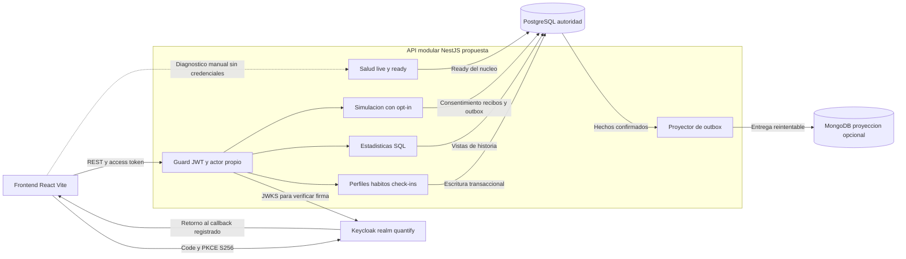

# ADR-0006: Integración de API NestJS, identidad y HTTP del frontend

- Estado: **propuesto para revisión; no aceptado ni implementado como API unificada**.
- Fecha: 2026-11-09.
- Tarea: QUANCORE-43; dependencias QUANCORE-17/19/21/22/23/24/25/35/42.
- Revisión requerida: arquitectura, backend, frontend, datos y seguridad; asignación personal y aprobación pendientes.
- Requisitos: RF-01 a RF-05, RF-08/10 sintéticos; RN-P01/02/04/06..18/22/24.
- Decisiones relacionadas: D-01/02/03/04/05/08/09/10; ninguna se declara cerrada.

## Contexto y fuentes inspeccionadas

La base vigente del [repositorio](../../../README.md) exige NestJS/TypeScript para negocio y FastAPI/Python para analítica. Esta propuesta conserva esa base; no introduce un cambio de stack. Tener Express como adaptador HTTP de NestJS no equivale a mantener otra aplicación Express de negocio.

| Fuente | Revisión inspeccionada | Estado y límites relevantes |
|---|---|---|
| `origin/develop`, `services/api/telemetry` | `0272ed8ea8fe729b42a54ad8031b16f616636a4e` | Host NestJS aislado, PostgreSQL, proyección MongoDB opcional y dashboard SQL; exige opt-in sintético y no implementa API general, salud ni CORS |
| `origin/feature/QUANCORE-21-23-backend-persistencia` | `d66d1e969b05a082615851dfdfe487576d664eb9` | NestJS, perfiles, categorías, hábitos, snapshots y outbox. No es una API lista para integrar: hay errores sintácticos y brechas de contrato |
| `origin/feature/QC-41-inicializar-api` | `60a4a0457a62848cb49c1667e323b35756113420` | Express independiente con salud de proceso y Swagger; no prueba disponibilidad de BD ni sustituye la base NestJS |
| `packages/contracts` | Principal `0.4.0-draft`, telemetría `1.1.0`, dashboard `1.0.0` | Fuente canónica; primer flujo y extensiones tienen alcances diferentes |
| `infrastructure/keycloak/realm-export.json` | Export versionado de Keycloak 26.8.1 | Realm `quantify`, clientes públicos, Code + PKCE S256; no acredita sesión web/móvil integrada |
| Frontend, `93ba834` | Diagnóstico HTTP y fixtures | Sin sesión, adaptadores de hábitos ni llamadas automáticas; asumía el sufijo `health` al invocarlo |

Las fuentes remotas se leen con `git show`, sin fusionarlas ni aplicar sus migraciones. Los [ADR-0002](0002-simulacion-telemetria-aislada.md), [0003](0003-proyeccion-mongodb-telemetria-sintetica.md), [0004](0004-dashboard-lectura-versionada.md) y [0005](0005-consolidacion-frontend.md) conservan su contenido y estado propuesto.

## Opciones consideradas y recomendación

1. **Conservar Express general y NestJS sintético separados:** mantiene dos bootstraps, guards y configuraciones, y contradice la base de negocio. No se recomienda como arquitectura final.
2. **Convertir directamente el host sintético en API general:** su configuración obliga a habilitar simulación y acopla estadísticas a `TelemetryIdentity`/`TelemetryDatabase`. No debe trasladarse íntegro a producto.
3. **Una API modular NestJS con plataforma común y módulos acotados:** recomendada para revisión. Reutiliza código y pruebas selectivamente, conservando contratos y separación de datos. Su implementación requiere reconciliar las ramas; este ADR no autoriza merges automáticos.

## Composición propuesta de una sola API

Un `main.ts`, un `AppModule`, un puerto HTTP y un prefijo `/api/v1` en `services/api`. Separar `platform/config`, `platform/database`, `platform/identity`, `platform/errors` y los módulos `profiles`, `habits`, `checkins`, `metrics`, `dashboard`, `telemetry-simulation` y `health`. Son destinos previstos, no carpetas ya implementadas.

| Parte | Integración requerida antes de habilitarla |
|---|---|
| Plataforma | Unificar configuración validada, cierre de pools, límites de payload, errores minimizados `application/problem+json`, CORS y ciclo de vida. Proponer Node 24.x/npm 11.x y la línea NestJS 11 existente; fijar y probar un lockfile de API antes de aceptar D-01 |
| Identidad | Extraer un guard común del comportamiento probado de telemetría: RS256, issuer/audience, `sub`/`iat`/`exp`, access token, perfil activo y actor interno. Adaptar `telemetryOwner` y `actor` a un único contexto; conservar pruebas de propiedad y de administrador sin bypass |
| Persistencia | Incorporar selectivamente migraciones y casos de uso QUANCORE-21/23 una vez corregidos; un servicio PostgreSQL compartido con transacciones explícitas. Separar usuario de migración, runtime y proyección; no duplicar perfiles ni pools por copiar proveedores |
| Check-ins y métricas | Adaptar reglas QUANCORE-24 a NestJS y a persistencia canónica. El valor absoluto, idempotencia durable y revisión conocida deben confirmarse en una misma transacción; las funciones puras por sí solas no son endpoints |
| Dashboard | Extraer de la configuración sintética y montar con guard/BD comunes. Implementar vistas `dashboard_read.v1_revisions` y `v1_check_ins` desde historia confirmada, conservando snapshot SQL de solo lectura y errores 503 cuando falte origen |
| Telemetría | Montaje opcional, solo con `TELEMETRY_SIMULATION_ENABLED=1`; deshabilitada por defecto en la API general. Conservar namespace `/telemetry/simulation`, contratos, consentimiento, dedupe, outbox y locks. No activar biometría real ni exigir simulación para arrancar el núcleo |
| MongoDB | Proyección opcional del outbox sintético; preservar locks por fuente, IDs y expiración originales. Reservar la conexión de sesión usada por el advisory lock; no envolver la llamada MongoDB en una transacción SQL ni convertirla en escritura dual |
| Salud | Controladores propios del bootstrap general; sin importar el módulo sintético, su configuración o sus fixtures |

Los cambios de este diseño deben ejecutarse por unidades verificables en una rama de trabajo acordada. No copiar `node_modules`, sustituir lockfiles entre módulos ni ejecutar semillas de prueba sobre el destino compartido. El manifiesto frontend y su lockfile siguen siendo independientes de los de la API.

## Diagrama de integración propuesto

Las conexiones siguientes describen el destino, no una plataforma ya operativa. Keycloak emite identidad; la API verifica tokens y autoriza cada recurso. El navegador no accede a los almacenes.

## Matriz de endpoints y autoridad

Todas las rutas API siguientes incluyen el prefijo mostrado. «Existente» significa código identificado en esa revisión, no despliegue accesible ni aceptación de producto.

| Rutas / métodos | Estado real | Destino y acción pendiente |
|---|---|---|
| `GET /health`, `GET /api/v1/health` | Solo Express QC-41, rama separada; responde proceso/uptime | No importarlas como readiness. Si se necesita compatibilidad, aprobar un alias explícito; no presuponerlo |
| `GET /docs`, `GET /api/docs` | Solo Express QC-41 | Visor futuro del contrato canónico; no conservar su OpenAPI paralelo como autoridad |
| `GET /api/v1/me` | Contrato principal; sin controlador en las implementaciones revisadas | Implementar perfil propio y política de aprovisionamiento tras validar identidad |
| `GET/POST /api/v1/habits`, `GET/PATCH /api/v1/habits/{habitId}` | Contrato y código en QUANCORE-21/23, bloqueado por sintaxis/semántica | Reconciliar DTO, paginación, ETag fuerte, idempotencia y errores antes de integrar |
| `DELETE /api/v1/habits/{id}`, CRUD `/api/v1/categories` | Código en QUANCORE-21/23, sin operación equivalente en el OpenAPI principal | No publicar como contrato aprobado. Archivo canónico mediante PATCH; categorías requieren ampliación revisada si se mantienen |
| `GET/POST /api/v1/habits/{habitId}/check-ins`, `GET /api/v1/habits/{habitId}/metrics` | Contrato; sin controladores en las dos ramas API inspeccionadas | Escritor, historial, revisión e idempotencia pendientes; no inferir endpoints desde funciones puras |
| `POST /api/v1/telemetry/simulation/sources`; `GET/DELETE .../sources/{sourceId}`; `PUT .../consent` | Host sintético en `0272ed8` | Conservar contrato y guard común; nunca convertir señales en check-ins |
| `POST /api/v1/telemetry/simulation/batches`; `GET .../sources/{sourceId}/batches/{batchId}` y `.../summary` | Host sintético en `0272ed8` | Mantener confirmación SQL, recibos y replay durable |
| `POST .../sources/{sourceId}/mongodb/project`; `GET .../events` y `.../audit`, bajo `/api/v1/telemetry/simulation` | Controladores existentes; MongoDB requiere opt-in | Conservar permisos mínimos, consulta propia y manejo de fallo del proyector |
| `GET /api/v1/me/dashboard/progress`, `/calendar`, `/trends` | Controladores existentes; exigen opt-in y vistas SQL | Conectar el escritor real a las vistas versionadas antes de presentar datos de producto |
| `GET /api/v1/health/live` | **Propuesto; no implementado ni añadido a OpenAPI** | Proceso/event loop y bootstrap; sin consultar Keycloak, PostgreSQL o MongoDB |
| `GET /api/v1/health/ready` | **Propuesto; no implementado ni añadido a OpenAPI** | Preparación para núcleo manual: configuración, migraciones compatibles y PostgreSQL; 503 si no está listo o está cerrando |
| `GET /api/v1/health/dependencies` | **Propuesto; pendiente de política operativa** | Diagnóstico por dependencia, restringido por red y permiso operativo; no exponer detalles internos públicamente |
| Endpoints OIDC bajo `/realms/quantify/protocol/openid-connect/` | Configuración del proveedor, no rutas de la API | Authorization/token/logout/JWKS se usan vía protocolo; no crear `/api/login` ni recibir contraseñas |

Antes de implementar salud o categorías, añadir sus contratos revisados en `packages/contracts` y definir autenticación/exposición. Los DTO de negocio, telemetría y dashboard no se sustituyen entre sí. El generador frontend actual cubre solo `components.schemas` del documento principal, no los tipos externos de esas extensiones.

## Disponibilidad del proceso y de dependencias

Propuesta de respuesta pública mínima para live/ready: HTTP 200 con `{"status":"ok"}`; readiness no disponible: HTTP 503 con `{"status":"unavailable"}`. `Cache-Control: no-store`, sin DSN, muestras, versiones de librerías, stack ni credenciales. La semántica y sus esquemas necesitan revisión antes de publicarse. Evaluar `@nestjs/terminus` en la implementación; no está instalado ni aprobado por este documento.

Liveness no falla porque una BD o el IdP estén caídos: reiniciar el proceso por ese motivo no recupera la dependencia. Readiness verifica una consulta SQL acotada y compatibilidad de migraciones del núcleo; `SELECT 1` por sí solo no comprueba esquema ni permisos. Definir plazos de cada indicador y del balanceador mediante medición, sin convertir el timeout de cinco segundos del diagnóstico web en un SLO.

La preparación inicial de identidad requiere configuración válida y capacidad de verificar las claves del emisor. No hacer una petición a Keycloak por cada probe ni usar readiness como prueba de login. Con claves cacheadas, una caída de Keycloak puede impedir nuevos logins aunque firmas conocidas todavía se validen; una clave desconocida no se acepta. Monitorear el IdP por separado y fallar de forma segura cuando no se pueda verificar un token.

MongoDB es opcional para el núcleo manual: su caída degrada proyección/lecturas sintéticas, deja outbox pendiente y no convierte automáticamente la API de hábitos en no disponible. Dashboard solo está listo cuando su puerto SQL es válido; MongoDB sano no demuestra eso. Redis/FastAPI no son dependencias obligatorias del núcleo por aparecer en diagramas. La política final de capacidades, alarmas y readiness requiere revisión D-08/QUANCORE-46/47/48.

## HTTP y CORS de desarrollo recomendados

Valores de **destino propuesto**, sin backend unificado desplegado: frontend `http://localhost:5173`, API `http://localhost:3000/api/v1`, emisor `http://localhost:8080/realms/quantify`. Mantener `localhost` coherente en navegador, issuer y redirects; `127.0.0.1` no es el mismo origen. El bind del servidor puede seguir restringido a loopback. Puerto 3035 conserva su significado en el host sintético independiente mientras exista; no apuntar el frontend a él para fingir integración de hábitos.

| Configuración | Consumo real o propuesto | Valor / tratamiento |
|---|---|---|
| `VITE_API_BASE_URL` | Ya leído por diagnóstico frontend | Vacío por defecto; futura API `http://localhost:3000/api/v1`. `/api/v1` solo cuando se configure y verifique mismo origen/proxy |
| `VITE_API_HEALTH_PATH` | Corrección del diagnóstico frontend | Vacío por defecto; proponer `health/ready` después de implementarlo. `health` solo si se selecciona expresamente el scaffold legado |
| `VITE_OIDC_ISSUER`, `VITE_OIDC_CLIENT_ID`, `VITE_OIDC_REDIRECT_URI` | **Nombres propuestos; frontend aún no los consume** | Issuer anterior, `quantify-web`, `http://localhost:5173/auth/callback`; sin secreto de cliente |
| `HOST`, `PORT` | HOST propuesto; PORT ya existe en hosts separados | API unificada propuesta: `127.0.0.1`, `3000`; no cambia hoy el `3035` sintético |
| `CORS_ALLOWED_ORIGINS` | **Variable propuesta; aún no leída** | Lista validada de orígenes exactos; inicialmente solo `http://localhost:5173` |
| `KEYCLOAK_ISSUER`, `KEYCLOAK_AUDIENCE` | Ya usadas por guards separados | Proponer issuer coherente y audiencia API `quantify-api`; verificar mapper y tokens antes de habilitar |
| `DATABASE_URL` | Ya usada, solo servidor | Secreto local sin valor en Git; acceso a PostgreSQL por rol y propósito |
| `TELEMETRY_SIMULATION_ENABLED`, `TELEMETRY_MONGODB_ENABLED`, `DASHBOARD_ENABLED` | Ya usadas por host sintético | API general propuesta: simulación/Mongo desactivados; dashboard solo tras adaptar sus vistas. La plantilla sintética existente activa simulación por su alcance de laboratorio |
| `MONGODB_URL`, `MONGODB_DATABASE` | Ya usadas si Mongo está habilitado | URI secreta solo servidor; base y permisos separados. No trasladar TTL de laboratorio a datos personales |

Las variables `VITE_*` son públicas y quedan incorporadas al build. No incluir contraseñas, claves privadas, secretos OIDC, conexiones de BD ni tokens; reiniciar Vite o reconstruir para aplicar cambios. Dejar `.env.example` web vacío mantiene la demo sin solicitudes.

Propuesta CORS de la API, pendiente de implementar con `app.enableCors`: orígenes de la allowlist exacta, métodos `GET,POST,PATCH,PUT,DELETE,OPTIONS`, cabeceras permitidas `Authorization,Content-Type,Idempotency-Key,If-Match`, cabecera expuesta `ETag`, y `credentials: false` para el diseño Bearer/PKCE propuesto. Responder preflight sin exigir token, conservar `Vary: Origin` y no permitir `*`, origen `null` ni reflexión arbitraria del origen. CORS no autoriza recursos; llamadas nativas o sin Origin siguen necesitando autenticación. Probar origen permitido/rechazado y preflight real en navegador.

Keycloak tiene su propia lista Web Origins y no hereda CORS de la API. El preview E2E actual en `127.0.0.1:4180` usa fixtures; no se agrega automáticamente al IdP ni a CORS. Un BFF/cookies requeriría revisar credenciales, CSRF y origen, no solo cambiar un booleano. Remoto de demostración: HTTPS, dominio, recursos y presupuesto siguen sin elegir; no se contrata ni publica infraestructura desde este ADR.

## Integración Keycloak propuesta y puntos de revisión

Se recomienda para la primera integración una SPA pública con Authorization Code + PKCE S256, coherente con el export actual, frente a un BFF que agregaría manejo de sesión servidor y CSRF. **D-02 sigue abierta**: el equipo debe aprobar esa topología y biblioteca/versiones antes de implementar sesión.

1. Mantener `quantify-web` público, Code habilitado, PKCE S256 requerido y sin password/implicit grants. Usar un adaptador OIDC mantenido; no escribir el protocolo manualmente ni añadir formularios de contraseña en React. Inicializar el adaptador coordinadamente antes del router, procesar callback una vez y validar estado/nonce según protocolo; no registrar códigos ni tokens.
2. Proponer redirect exacto `http://localhost:5173/auth/callback`, Web Origin `http://localhost:5173` y post-logout exacto `http://localhost:5173/`. El export conserva comodines localhost: **no se modifican en esta propuesta**. Aplicar nuevos valores tras acordar callback y probar login/logout.
3. Access/refresh tokens solo en memoria del adaptador; no localStorage, sessionStorage, IndexedDB ni service worker. La gestión del estado transitorio de PKCE/callback debe revisarse con la biblioteca elegida. El diagnóstico HTTP no recibe tokens, no usa ese adaptador ni inicializa sesión.
4. Antes de llamadas de negocio, renovación coordinada para evitar renovaciones concurrentes; no reintentar escrituras con otra intención/clave. Un 401 termina o renueva según política; un 403 no dispara renovación en bucle. Logout debe cerrar sesión IdP y limpiar memoria propia; no prometer revocación inmediata de access tokens ya emitidos sin una política probada.
5. Verificar firma RS256, issuer exacto, audiencia API, vigencia y tipo de access token en servidor; resolver perfil por `(issuer, subject)` y exigir estado activo. El export contiene `audience resolve` de roles, pero no demuestra una audiencia fija `quantify-api`: revisar mapper explícito para web/móvil y comprobar el claim sin imprimir tokens. No aceptar ID tokens como credencial API.
6. Definir aprovisionamiento de perfiles y suspensión/revocación. Los guards actuales requieren perfil previo; no equivalen a registro de producto. `admin` no permite hábitos ni biometría ajenos. Probar dos usuarios sintéticos y acceso cruzado, también en reintentos.
7. Flutter conserva cliente público propio y PKCE, cuenta IdP compartida sin compartir tokens. Validar el esquema `com.quantify.app:/oauth2redirect` en el sistema operativo y red del dispositivo; no asumir que localhost móvil es la PC.

Registro, verificación de correo y recuperación están deshabilitados en el export; no hay SMTP configurado. OTP de seis dígitos sigue siendo UX propuesta, no capacidad implementada. Federar Google, MFA, BFF, política de renovación/revocación y almacenamiento offline requieren su propia revisión, sin activar terceros ni datos personales por defecto.

## Autoridad de datos y conflictos comprobados

**PostgreSQL** mantiene perfiles, propiedad, hábitos y revisiones, check-ins consolidados y sus correcciones, consentimiento, recibos/dedupe, auditoría durable y outbox. **MongoDB** es una proyección opcional de eventos sintéticos con esquema e IDs estables y auditoría mínima separada; no decide permisos, identidad ni métricas de hábitos. Entrega reintentable después del commit SQL, sin garantía de transacción distribuida ni de exactamente una vez. Retención de personas reales y recuperación coordinada siguen en D-04/09 y QUANCORE-44.

Bloqueos concretos de integración:

- `module.ts` de QUANCORE-21/23 contiene backticks precedidos de barra inversa: parser TypeScript 5.9.3 reporta TS1127 en línea 38 y TS1160 en línea 106. Se trata de análisis sintáctico en memoria desde Git, no de un build completo de esa rama. No se modifica ni fusiona su fuente aquí.
- `If-Match` sí es canónico para PATCH de hábito; la rama interpreta un número sin emitir los ETag fuertes que el contrato exige. Falta aplicar `Idempotency-Key` en POST/PATCH. `expectedVersion` pertenece al comando de check-in y no reemplaza ese header.
- El DTO de rama añade `categoryId` y restricciones decimales propias; su listado no implementa la paginación canónica. `DELETE` y categorías no tienen contrato principal equivalente. Reconciliar sin crear DTO paralelos ni aprobar precisión productiva por accidente.
- La migración de rama guarda snapshots en `habit_revisions`, pero no crea check-ins ni las dos vistas dashboard. Una vista que elija la última meta o duplicados por fecha efectiva reescribe historia; resolver vigencias y pausa/archivo antes del adaptador SQL.
- Dashboard depende hoy del guard, pool y configuración sintéticos; extraer interfaces comunes sin debilitar pruebas. La salud y el arranque general no pueden exigir `TELEMETRY_SIMULATION_ENABLED=1`.
- Existen manifiestos/bootstrap/OpenAPI distintos en ramas de API. Resolver los diffs por módulo y conservar autoría; no fusionar ramas enteras solo por tickets Listo. Destino, capacidad, TLS, SLA/SLO/RPO/RTO y políticas de datos reales continúan pendientes.

## Evidencia y puertas de aceptación

Evidencia local de la auditoría del 09/11/2026: contrato principal y extensiones validados (17/9/3 rutas); 64 pruebas del host sintético aprobadas con PostgreSQL 18.6 y MongoDB 8.2.6 temporales. Frontend en `93ba834`: 26 pruebas y tres E2E Chrome aprobadas. Estos resultados son antecedentes del mismo día, no pruebas de la API unificada o del login real. La corrección de ruta explícita tiene pruebas propias; sus resultados de ejecución se entregan con el cambio, sin convertir este ADR en una bitácora personal.

Antes de aceptar la propuesta y habilitar integración:

1. Backend/BD revisan sintaxis, contrato, migraciones y el puerto histórico, con build desde instalación limpia y prueba de actualización conservando datos. No ejecutar semillas destructivas sobre bases compartidas.
2. Validar contrato HTTP, paginación, errores, ETag/If-Match, idempotencia durable, concurrencia, medianoche y cambios históricos; demostrar que un replay no duplica progreso ni auditoría.
3. Probar live/ready ante caída de SQL, Mongo e IdP, configuración inválida y cierre del proceso; documentar qué capacidades quedan disponibles y por qué.
4. Probar CORS en Chrome con origen permitido/rechazado, preflight y ETag expuesto; login/callback/renovación/logout con dos cuentas, audiencia y rechazo de ID token/perfil suspendido/recursos ajenos.
5. Revisar elección SPA/BFF y librería OIDC, perfil inicial, retención/privacidad, destino y costos. Registrar revisores, acuerdo y fecha; hasta entonces ADR-0006 y D-01..D-11 conservan su estado pendiente aplicable.

La secuencia recomendada es plataforma NestJS y salud contractual → identidad y perfiles → escritor canónico con historia e idempotencia → vistas dashboard → adaptadores frontend y E2E → integración sintética opcional conservando sus pruebas. La telemetría ya probada no sustituye ni bloquea el núcleo manual; puede verificarse en paralelo al núcleo una vez extraída la plataforma.

## Reversión y consecuencias

La propuesta reduce duplicación de hosts/guards y evita conectar clientes a una demo como si fuera producto. Tiene costo de refactor y exige corregir la rama escritora, migraciones y contratos antes de obtener un flujo real. Mientras tanto, frontend con fixtures y host sintético conservan sus alcances separados.

Si la revisión cambia topología, salud u origen, actualizar este ADR propuesto, contratos y consumidores conjuntamente. Si se acepta y luego se reemplaza, registrar otro ADR y conservar la historia. Deshabilitar una capacidad preserva datos/outbox; no borrar volúmenes, stash ni respaldos como mecanismo de reversión. La publicación de rama, PR e integración en `develop` requieren autorización expresa del usuario.

## Referencias técnicas

- [NestJS CORS](https://docs.nestjs.com/security/cors): configuración explícita por aplicación.
- [NestJS health checks](https://docs.nestjs.com/recipes/terminus): indicadores de liveness/readiness; evaluar versión compatible con NestJS 11 antes de instalar.
- [Keycloak JavaScript adapter](https://www.keycloak.org/securing-apps/javascript-adapter): cliente público, redirects, PKCE y tokens en memoria. Verificar compatibilidad de la biblioteca elegida con el servidor 26.8.1, sin asumir que la documentación más reciente fija nuestras versiones.
- [Vite: variables y modos](https://vite.dev/guide/env-and-mode): variables públicas incorporadas al build y reinicio tras cambios.
- [Contratos](../../../packages/contracts/README.md), [reglas](../../requerimientos/reglas-negocio.md) y [decisiones abiertas](../decisiones-pendientes.md).
