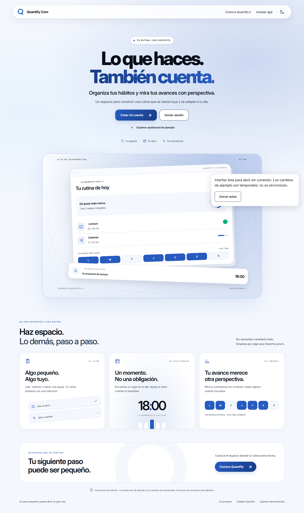
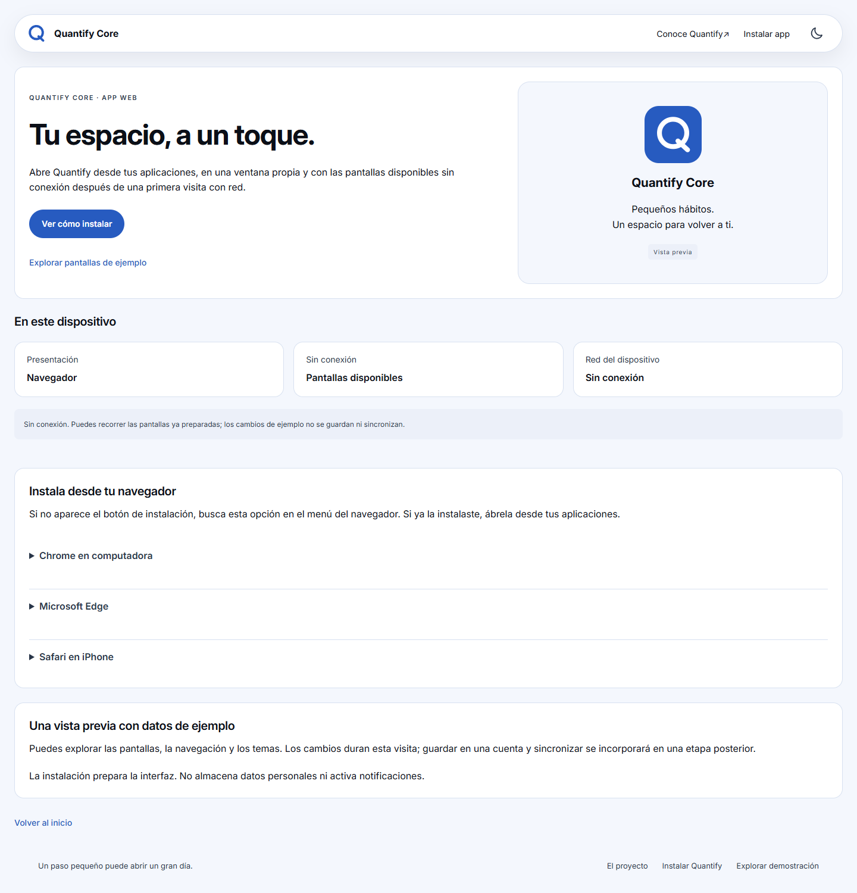

# Docker: frontend compilado, PWA y sesión real

Verificación local del 20/11/2026 en Windows/Docker Desktop con Chrome. [Resultado saneado](verification.json). El [README principal](../../../README.md#instalación-y-ejecución) contiene los comandos de arranque.

Se construyeron las imágenes de API, migraciones y web estática. API y Nginx quedaron saludables; repetir la migración sobre el laboratorio existente produjo `0 new migrations`. Esta ejecución no demuestra preparación en otra máquina ni una instalación SQL desde cero.

`node scripts/verify-docker-web.mjs` comprobó:

- Nginx y enlaces profundos SPA; manifiesto e iconos servidos correctamente.
- Chrome sin impedimentos de instalación reportados por CDP en un perfil temporal normal. No se instaló manualmente una aplicación en el sistema operativo.
- Service worker activo, recarga sin red, indicador offline y exclusión de API, identidad y URLs con tokens del cache.
- Aprovisionamiento de un perfil mediante el servicio Compose `profile`, repetido sin duplicarlo.
- Login real en React con Keycloak, perfil y hábitos con respuestas 200, callback sin parámetros de protocolo, sin JWT persistidos y logout.
- Otro login real sin perfil de negocio: 403 y error visible, seguido de logout.

La prueba crea dos usuarios sintéticos `qc-docker-*` y un perfil vacío, que elimina al terminar. No crea hábitos ni historial. Si se interrumpe abruptamente, revisar privadamente solo los sujetos de esa ejecución; no limpiar usuarios ajenos ni volúmenes. No guarda capturas de páginas autenticadas, traces, contraseñas, tokens ni cuerpos de respuestas personales.

Para reproducir, iniciar el entorno base y `web-static` en 5173, disponer de Chrome y Node 24/npm 11 en el host, e instalar dependencias con:

```powershell
npm.cmd ci --prefix services/api
npm.cmd ci --prefix apps/web
node scripts/verify-docker-web.mjs
```

La prueba usa las credenciales privadas existentes de Docker y de migración únicamente en la base loopback `quantify_core_dev`. No ejecutar contra un entorno compartido o productivo. La imagen estática captura el código presente en la carpeta al construir; estas capturas incluyen los ajustes visuales locales que ya estaban pendientes antes del cambio Docker y no atribuyen esos ajustes a esta entrega.





Los límites permanecen: laboratorio HTTP local, Keycloak `start-dev`, shell offline público y lecturas conectadas. No acredita despliegue público, instalación manual del SO, sesión Flutter, escrituras web, sincronización privada offline, carga o recuperación productiva.
