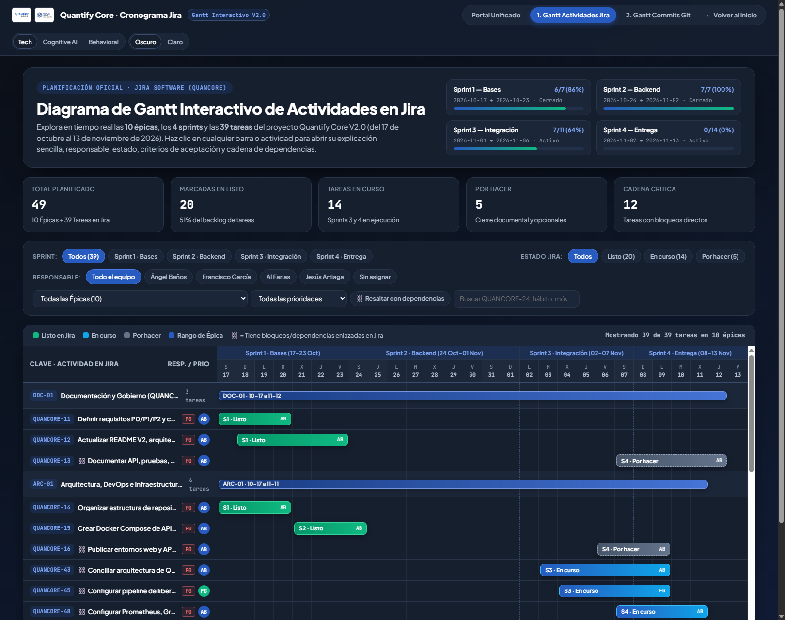
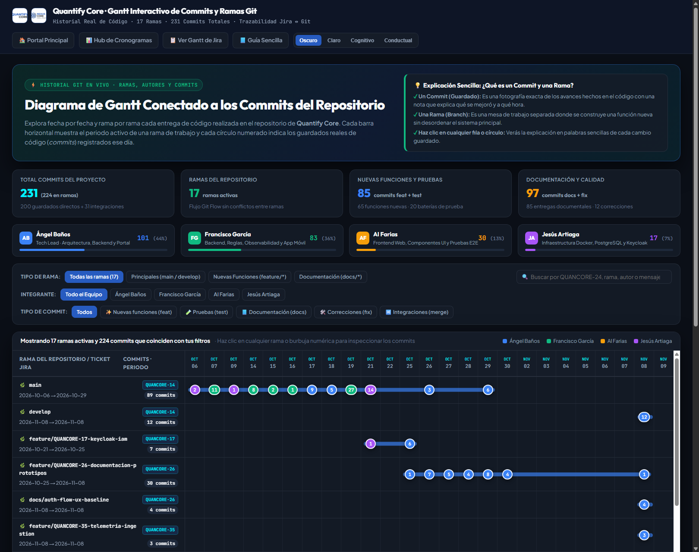

**Ubicación:** [Quantify-Core](../../README.md) → [docs](../README.md) → gantt · **Nivel 2**

# Guía Sencilla del Sitio Interactivo de Diagramas de Gantt (Jira y Commits del Repositorio)

Bienvenido a la documentación explicativa de los **Diagramas de Gantt Interactivos de Quantify Core**. Este documento fue redactado pensando en cualquier persona que quiera entender cómo avanza nuestro proyecto, incluso si nunca antes ha escuchado palabras de programación o administración de sistemas. Aquí explicamos paso a paso, con palabras de todos los días y ejemplos claros, qué es este sitio interactivo, por qué existen dos calendarios distintos y cómo puedes usar cada botón de la pantalla.

---

## 1. ¿Qué es este sitio interactivo y para qué sirve?

Cuando un equipo construye una aplicación grande como **Quantify Core** (una aplicación para ayudar a las personas a cumplir sus hábitos diarios saludables), necesita llevar un orden muy claro de dos cosas:

1. **Lo que se planeó hacer:** Es decir, la lista de actividades, quién las va a realizar y en qué fechas deben quedar listas. Esa lista de actividades vive en una herramienta de organización llamada **Jira**.
2. **Lo que realmente ya se construyó y se guardó:** Es decir, los archivos reales del programa que cada integrante del equipo fue escribiendo y guardando día tras día. Esos guardados reales viven en el almacén del proyecto llamado **Repositorio Git**.

Antes teníamos solamente dos imágenes fijas (como fotografías estáticas) en la página principal del proyecto. El problema de una imagen fija es que no puedes hacer clic en ella, no puedes buscar tu nombre, no puedes filtrar tareas y no puedes ver qué se hizo dentro de cada actividad.

Por eso construimos este **Sitio Interactivo de Diagramas de Gantt**, formado por tres páginas conectadas entre sí:

- **[Centro Unificado de Cronogramas (`index.html`)](index.html):** Es la puerta principal donde puedes alternar con un solo clic entre el calendario de actividades planeadas, el calendario de entregas reales y una tabla que une ambos mundos.
- **[Diagrama de Gantt Conectado a las Actividades de Jira (`gantt-jira.html`)](gantt-jira.html):** Es el calendario interactivo que muestra las **49 actividades oficiales** del proyecto organizadas por semanas de trabajo.
- **[Diagrama de Gantt Conectado a los Commits del Repositorio (`gantt-commits.html`)](gantt-commits.html):** Es el calendario interactivo que muestra las **17 mesas de trabajo (ramas)** y los **231 guardados reales de código (commits)** hechos por el equipo.

---

## 2. Diccionario básico sin palabras técnicas (Explicado con ejemplos cotidianos)

Para que cualquier persona pueda leer y disfrutar las pantallas interactivas sin confundirse, aquí explicamos qué significa cada palabra que aparece en los botones:

### ¿Qué es un Diagrama de Gantt?
Un **Diagrama de Gantt** es simplemente un **calendario visual con barras horizontales**.
- En el lado izquierdo de la pantalla ves una lista de actividades (por ejemplo: *"Crear la pantalla del celular"*).
- En el lado derecho ves los días del calendario (octubre y noviembre) y una **barra de color** que se estira desde el día en que empieza esa actividad hasta el día en que termina.
- Así, de un solo vistazo, sabes cuánto dura cada tarea, qué tareas ocurren al mismo tiempo y cuáles van primero y cuáles van después.

### ¿Qué es Jira y qué es una Actividad (`QUANCORE-11`, `QUANCORE-24`, etc.)?
**Jira** es como el **tablero de pendientes del equipo**. Para no confundir una tarea con otra, cada actividad recibe una etiqueta única que empieza con la palabra `QUANCORE` seguida de un número (por ejemplo, `QUANCORE-24` o `QUANCORE-29`). Cada vez que veas ese código, significa simplemente el número de boleto o número de tarea dentro de nuestra lista de trabajo.

### ¿Qué es una Épica (Epic)?
Una **Épica** es una **carpeta grande o tema general** que agrupa varias tareas pequeñas que tratan de lo mismo. Por ejemplo, en lugar de tener 39 tareas sueltas y revueltas, las agrupamos en **10 grandes temas (Épicas)** como *"Aplicación Móvil"*, *"Seguridad e Inicio de Sesión"* o *"Página Web"*.

### ¿Qué es un Sprint?
Un **Sprint** es una **etapa de trabajo de aproximadamente una semana**. En lugar de intentar construir todo el sistema en un solo día, dividimos el calendario en **4 etapas (Sprint 1, Sprint 2, Sprint 3 y Sprint 4)**:
- **Sprint 1 (17 al 23 de octubre):** Preparar los cimientos, reglas y bases de datos.
- **Sprint 2 (24 de octubre al 2 de noviembre):** Construir el motor principal del servidor y el diseño de las pantallas.
- **Sprint 3 (1 al 6 de noviembre):** Conectar la página web, la aplicación móvil, las rachas de hábitos y las medallas.
- **Sprint 4 (7 al 13 de noviembre):** Realizar las pruebas finales, gráficas de salud del sistema y documentación de entrega.

### ¿Qué es una Rama (Branch) en el repositorio?
Imagina que cuatro cocineros están preparando un banquete. Si los cuatro intentan cocinar sobre la misma tabla de picar al mismo tiempo, se van a estorbar. Por eso, cada cocinero toma su propia **mesa de trabajo separada** para preparar su platillo tranquilo, y cuando termina, lo lleva a la mesa central.
En nuestro proyecto, cada **Rama (Branch)** es una **mesa de trabajo independiente**:
- La rama `main` y la rama `develop` son las mesas centrales donde se reúne el trabajo revisado de todos.
- Las ramas que empiezan con `feature/...` o `docs/...` son las mesas individuales donde cada integrante construye una función específica sin desordenar el trabajo de sus compañeros.

### ¿Qué es un Commit?
Un **Commit** es un **guardado oficial con fotografía y nota explicativa**. Cada vez que un integrante del equipo avanza en su tarea y comprueba que esa parte funciona bien, presiona "guardar" en el repositorio y escribe una frase breve contando qué hizo y a qué hora lo terminó.
En lugar de hacer un solo guardado gigante al final de la semana, una buena práctica de trabajo consiste en hacer **muchos guardados pequeños y ordenados (commits)** a lo largo de las horas y los días. Así queda registrado paso a paso cómo evolucionó el proyecto.

---

## 3. Vista previa y explicación del primer calendario: Gantt de Actividades de Jira

En la página **[`gantt-jira.html`](gantt-jira.html)** encontrarás todo el plan de trabajo conectado a Jira:

### ¿Qué significan los colores de las barras en el Gantt de Jira?
- **Verde (`Listo`):** Significa que la actividad ya fue terminada y revisada dentro del tablero.
- **Azul (`En curso`):** Significa que la actividad pertenece a las etapas actuales de trabajo y se encuentra en desarrollo o revisión.
- **Gris (`Por hacer`):** Significa que la actividad está programada para los últimos días del calendario o espera a que se integren las partes previas.

### ¿Qué puedes hacer dentro del Gantt de Jira?
1. **Filtrar por Sprint (Etapa 1, 2, 3 o 4):** Si haces clic en el botón `Sprint 1`, `Sprint 2`, `Sprint 3` o `Sprint 4`, la tabla esconderá el resto y te mostrará únicamente lo que corresponde a esa semana.
2. **Filtrar por Estado (`Listo`, `En curso`, `Por hacer`):** Te permite ver de inmediato qué actividades ya se completaron y cuáles siguen activas.
3. **Filtrar por Integrante del Equipo:** Puedes elegir ver las actividades de todo el equipo o hacer clic en **Ángel Baños**, **Francisco García**, **Al Farias** o **Jesús Artiaga** para ver únicamente las tareas asignadas a esa persona.
4. **Resaltar tareas con dependencias:** Algunas tareas necesitan que otra tarea termine primero (por ejemplo, no puedes guardar hábitos en la base de datos si todavía no se ha creado la base de datos). Con este botón verás qué tareas dependen unas de otras.
5. **Hacer clic en cualquier actividad o barra:** Al hacer clic sobre cualquier fila o barra de color, se abre una **ventana explicativa** que te cuenta en lenguaje sencillo qué hace esa tarea, quién es el responsable, qué fechas abarca y con qué otras tareas se conecta.

---

## 4. Vista previa y explicación del segundo calendario: Gantt de Commits del Repositorio

En la página **[`gantt-commits.html`](gantt-commits.html)** verás la historia real del código escrito en el repositorio:

### ¿Cómo se lee el Gantt de Commits?
- **Las filas representan las 17 ramas (mesas de trabajo):** En la columna izquierda ves el nombre de cada rama (por ejemplo, `feature/QUANCORE-24-rachas-idempotencia`) y a qué boleto de Jira pertenece (`QUANCORE-24`).
- **La línea horizontal de color:** Representa los días en que esa rama estuvo activa recibiendo trabajo.
- **Los círculos numerados (burbujas):** Cada círculo colocado sobre un día del calendario te dice **cuántos guardados (commits) se hicieron exactamente en esa fecha**. Por ejemplo, si ves un círculo con el número `7`, significa que ese día se guardaron 7 avances distintos en esa rama.

### ¿Qué puedes hacer dentro del Gantt de Commits?
1. **Hacer clic en las tarjetas de los 4 integrantes:** Arriba del calendario aparecen las tarjetas de **Ángel Baños (101 commits)**, **Francisco García (83 commits)**, **Al Farias (30 commits)** y **Jesús Artiaga (17 commits)**. Al hacer clic en cualquiera de ellos, todo el calendario y la tabla inferior se filtran para mostrar únicamente los guardados hechos por esa persona.
2. **Filtrar por tipo de trabajo (`feat`, `test`, `docs`, `fix`, `merge`):**
   - `feat` (Nuevas funciones): Cuando se construye una pantalla, botón o cálculo nuevo.
   - `test` (Pruebas): Cuando se agregan revisiones automáticas para comprobar que nada falle.
   - `docs` (Documentación): Cuando se escriben manuales, guías o diagramas como este.
   - `fix` (Correcciones): Cuando se repara algún detalle o error.
   - `merge` (Integraciones): Cuando se une el trabajo de varias ramas.
3. **Hacer clic en cualquier círculo numerado o rama:** Se abrirá una ventana que lista todos los guardados hechos ese día o en esa rama, con una **explicación en palabras sencillas** de qué hizo cada cambio y un botón para ver el archivo original en GitHub.

---

## 5. Identidad visual y temas de color adaptables

Tanto el portal unificado como ambos diagramas de Gantt respetan al 100 % la identidad visual oficial de **Quantify Core** y **Codevost** (igual que la [Práctica 04](../Practica04/README.md), la [Práctica 05](../Practica05/README.md) y el [Portal Principal](../../index.html)):

- **Tipografías oficiales:** Títulos en `Outfit`, textos de lectura cómoda en `Plus Jakarta Sans` y códigos o fechas exactas en `JetBrains Mono`.
- **Cuatro temas visuales en vivo:** En la esquina superior derecha de cualquiera de las páginas puedes cambiar en cualquier momento entre:
  1. **Oscuro (`Tech Dark`):** Fondo oscuro descansado para la vista con acentos azul láser (`#275BC0`) y cian eléctrico (`#00F2FE`).
  2. **Claro (`Tech Light`):** Fondo blanco limpio de alto contraste ideal para lectura diurna o impresión.
  3. **Cognitivo (`Cognitive`):** Paleta azul pizarra suave enfocada en concentración tranquila.
  4. **Conductual (`Behavioral`):** Paleta de alto contraste con acentos ámbar y esmeralda enfocada en energía y logros.

Además, si cambias el tema visual desde la página principal del proyecto ([`index.html`](../../index.html)), los diagramas de Gantt cambian automáticamente al mismo tema sin que tengas que configurarlo dos veces.

---

## 6. Archivos que componen este módulo

Para mantener todo ordenado y fácil de mantener, este sitio interactivo se organiza en la carpeta `docs/gantt/` con los siguientes archivos:

| Archivo | ¿Qué contiene explicado de forma sencilla? |
|---|---|
| [`index.html`](index.html) | Portal unificado que reúne en pestañas el Gantt de Jira, el Gantt de Commits y la tabla puente que conecta ambos. |
| [`gantt-jira.html`](gantt-jira.html) | Sitio interactivo del Diagrama de Gantt conectado a las 10 épicas, 4 sprints y 39 tareas de Jira. |
| [`gantt-commits.html`](gantt-commits.html) | Sitio interactivo del Diagrama de Gantt conectado a las 17 ramas y los commits reales del repositorio Git. |
| [`data/jira-activities.json`](data/jira-activities.json) | Archivo de datos con toda la información de las actividades de Jira y sus explicaciones en lenguaje sencillo. |
| [`data/git-commits.json`](data/git-commits.json) | Archivo de datos con el catálogo de ramas, fechas, autores y mensajes de commits del repositorio. |
| [`gantt-jira-preview.png`](gantt-jira-preview.png) | Imagen de alta resolución del Diagrama de Gantt de Jira utilizada como vista previa en el README principal. |
| [`gantt-commits-preview.png`](gantt-commits-preview.png) | Imagen de alta resolución del Diagrama de Gantt de Commits utilizada como vista previa en el README principal. |
| [`README.md`](README.md) | Esta guía explicativa redactada sin tecnicismos para cualquier lector. |
