# Práctica 07 · Navegación de sketches de Quantify Core

**Entrega académica · 10.º A · Universidad Tecnológica de Xicotepec de Juárez**

**[Abrir entrega en GitHub Pages](https://angeljdev.github.io/Quantify-Core/docs/practica-07/entrega.html)** · [Prototipo](https://angeljdev.github.io/Quantify-Core/docs/practica-07/) · [Galería](https://angeljdev.github.io/Quantify-Core/docs/practica-07/galeria.html).

Pages está configurado por el responsable desde **`develop` y `/ (root)`**. Esta ampliación aparecerá en esos enlaces después de integrar y desplegar la rama de trabajo. El dominio anterior `angeljesus13.github.io` devuelve 404; usar `angeljdev.github.io`.

## Explorar la práctica

**Un solo documento de entrega:** este README reúne las fichas, los requisitos, el proceso, los prompts y la validación.

[Sketches y fichas](#fichas) · [Cumplimiento](#cumplimiento) · [Proceso](#proceso) · [Validación](#validacion)

**Login y Register son pantallas completas e independientes:** [U02 · Login](index.html#usuario/U02) y [U03 · Register](index.html#usuario/U03), además del acceso administrativo A01.

| Login · U02 | Register · U03 |
|---|---|
| [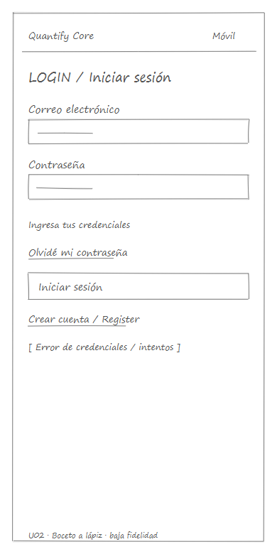](../GUI/prototipos/movil/sketches/practica-07/U02.png) | [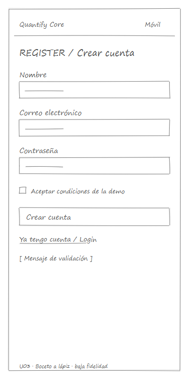](../GUI/prototipos/movil/sketches/practica-07/U03.png) |

**[Abrir la guía de entrega](entrega.html)** → [Galería de 33 sketches](galeria.html) → [Prototipo navegable](index.html) → [Mapa completo](mapa-completo.html).

En GitHub, los HTML se muestran como código. Para explorar esta rama localmente, ejecutar desde la raíz:

```sh
python -m http.server 8765 --bind 127.0.0.1
```

Abrir **http://127.0.0.1:8765/docs/practica-07/entrega.html**. Las [fichas Markdown](README.md#fichas), los PNG y la [matriz de cumplimiento](README.md#cumplimiento) sí pueden consultarse directamente en GitHub.

| Entregable | Ubicación |
|---|---|
| Guía de la práctica | [entrega.html](entrega.html) |
| 33 fichas con elementos, acciones, roles, plataformas y requisitos | [README.md#fichas](README.md#fichas) · [Galería](galeria.html) |
| 33 bocetos móviles y 33 bocetos PWA, cada uno en PNG y SVG | [GUI · sketches móviles](../GUI/prototipos/movil/sketches/practica-07/) · [GUI · sketches PWA](../GUI/prototipos/pwa/sketches/practica-07/) |
| Prototipo interactivo de 33 pantallas | [index.html](index.html) |
| Mapa completo con boceto y transiciones por nodo | [mapa-completo.html](mapa-completo.html) |
| Diagrama completo en formato textual editable | [navegacion-completa.mmd](navegacion-completa.mmd) |
| Diagrama original generado con Archify | [navegacion.html](navegacion.html) · [Especificación original](navegacion.archify.json) |
| Especificación ampliada para la siguiente ejecución de Archify | [navegacion-completa.archify.json](navegacion-completa.archify.json) |
| Decisiones, herramientas, prompts y correcciones | [README.md#proceso](README.md#proceso) |
| Matriz de las quince actividades solicitadas | [README.md#cumplimiento](README.md#cumplimiento) |
| Validación histórica y actual | [README.md#validacion](README.md#validacion) · [Evidencias](evidencias/) |

**Estado de cierre:** se amplía el diseño y el prototipo a 33 pantallas. El HTML original de Archify cubre doce pantallas; el mapa completo es un complemento JavaScript. Quedan la regeneración ampliada con Archify y la revisión/integración/publicación mediante Git Flow. Consultar la matriz antes de declarar cumplimiento total. Los enlaces públicos de entregas anteriores no acreditan la publicación de esta rama.

## Nueve pantallas generales obligatorias

| Pantalla solicitada | ID | Boceto móvil | Recorrido |
|---|---|---|---|
| Splash Screen | U16 | [PNG](../GUI/prototipos/movil/sketches/practica-07/U16.png) | [Abrir](index.html#usuario/U16) |
| Loading Screen | U17 | [PNG](../GUI/prototipos/movil/sketches/practica-07/U17.png) | [Abrir](index.html#usuario/U17) |
| Login Screen | U02 | [PNG](../GUI/prototipos/movil/sketches/practica-07/U02.png) | [Abrir](index.html#usuario/U02) |
| Recovery Account or Password | U04 | [PNG](../GUI/prototipos/movil/sketches/practica-07/U04.png) | [Abrir](index.html#usuario/U04) |
| Lock Account | U18 | [PNG](../GUI/prototipos/movil/sketches/practica-07/U18.png) | [Abrir](index.html#usuario/U18) |
| Unlock Account Code | U19 | [PNG](../GUI/prototipos/movil/sketches/practica-07/U19.png) | [Abrir](index.html#usuario/U19) |
| About Software | U20 | [PNG](../GUI/prototipos/movil/sketches/practica-07/U20.png) | [Abrir](index.html#usuario/U20) |
| About Team / Enterprise | U21 | [PNG](../GUI/prototipos/movil/sketches/practica-07/U21.png) | [Abrir](index.html#usuario/U21) |
| Home | U06 | [PNG](../GUI/prototipos/movil/sketches/practica-07/U06.png) | [Abrir](index.html#usuario/U06) |

Las 24 vistas restantes incluyen registro, verificación, hábitos, recordatorios, análisis, IA, ajustes, archivo, avisos, recuperación, acceso denegado y administración. No se cuentan los formatos móvil y PWA como pantallas funcionales diferentes. [Inventario y fichas de todas las pantallas](README.md#fichas).

## Roles, plataformas y alcance

- **Visitante:** inicialización, acceso, registro, recuperación, bloqueo/desbloqueo e información pública.
- **Usuario:** perfil y consentimiento, hábitos propios, registros, rachas, avisos y recomendaciones voluntarias.
- **Administrador:** catálogo, supervisión agregada de IA, estados de cuentas ficticias, configuración y auditoría. No consulta rutinas ni biometría privadas.

Las fichas relacionan las funciones con [RF-01 a RF-10 y sus historias](../requerimientos/catalogo.md), [RNF](../requerimientos/catalogo.md#no-funcionales) y las [reglas de producto](../requerimientos/reglas-negocio.md). Las vistas informativas y de inicialización apoyan el recorrido RF-01; no se presentan como requisitos nuevos del catálogo.

Plataformas de destino: **PWA React/Vite** y **Flutter**. El visor académico se ejecuta con HTML/CSS/JavaScript y simula la distribución móvil y web. No incorpora instalación PWA, service worker, ejecución Flutter, backend, autenticación real, envío de correo, notificaciones del dispositivo ni inferencia de IA.

Los bocetos de GUI son **muy sencillos, a lápiz**: fondo blanco, líneas finas e irregulares de grafito, recuadros, textos breves y botones sin acabado visual. Cada pantalla tiene SVG editable y PNG. El prototipo conserva sus interacciones y `sketch.css` simplifica también su presentación. Esto no sustituye los [tokens del producto](../../packages/design-tokens/README.md) ni la identidad de [GUI](../GUI/README.md).

## Cómo recorrerlo

1. Abrir el prototipo sin fragmento: U16 Splash → U17 Loading → U01 Bienvenida. La carga avanza manualmente para poder inspeccionar sus alternativas de error, reintento y cancelación.
2. Iniciar sesión con la cuenta de ejemplo para llegar a Home. Un error válido de credenciales incrementa el contador; el tercer fallo muestra Lock Account.
3. Solicitar desbloqueo, probar un código incorrecto y usar `654321` para volver al acceso. Cancelar o volver conserva el bloqueo durante esa visita.
4. Desde Login, recuperar el acceso con `123456`, establecer una nueva clave de prueba y volver a iniciar sesión.
5. Desde Home, crear o editar hábitos, registrar avance, configurar recordatorios, consultar análisis e IA y archivar con confirmación.
6. Desde Ajustes, abrir About Software, About Team o el escenario de acceso administrativo denegado.
7. Cambiar de rol para revisar Administración: acceso → resumen → catálogo, IA, auditoría, cuentas o configuración. El bloqueo y desbloqueo administrativo usan A10/A11.
8. Alternar Móvil/PWA; se conservan los formularios en curso. El formato móvil usa navegación inferior y el web incorpora menú lateral y columnas.
9. Abrir **Ver navegación**, el mapa completo o la galería. Sus selectores son herramientas de revisión que permiten inspeccionar pantallas directamente; no representan autorización productiva.

### Datos exclusivos de demostración

| Rol / contexto | Cuenta o código |
|---|---|
| Usuario | `alex@quantify.demo` / `Demo2026!` |
| Administrador | `admin@quantify.demo` / `Demo2026!` |
| Verificación de registro y recuperación | `123456` |
| Desbloqueo | `654321` |

Las cuentas son ficticias. No se envía correo. Las contraseñas y el bloqueo viven en memoria y se reinician al recargar. Los datos de hábitos y operaciones de ejemplo se conservan en `localStorage` si está disponible. Restablecer demo elimina esos datos locales y vuelve a Splash. El producto usa Keycloak/OIDC, no estas claves ni el límite demo de tres intentos.

## Reglas y condiciones

Las trece reglas de la simulación se consultan completas en el panel del visor y en `data.js`.

| Regla | Decisión académica |
|---|---|
| RN01 | Usuario gestiona su rutina; administración opera recursos autorizados y agregados. |
| RN02 | Acceso y códigos demo, verificación previa de nuevas cuentas; tres fallos bloquean y desbloquear no inicia sesión. |
| RN03 | Nombre válido, meta entera positiva, frecuencia no vacía y sin duplicados activos. |
| RN04 | Completar/deshacer actualiza un único registro por hábito y fecha de ejemplo. |
| RN05 | Rachas según días programados; edición conserva metas y frecuencias históricas. |
| RN06 | Archivar conserva historial y desactiva nuevas marcas y recordatorios. |
| RN07 | Avisos voluntarios; días compatibles con el hábito y horario válido. |
| RN08 | IA con consentimiento, siete días de datos y umbrales exclusivamente demostrativos. |
| RN09 | Solo guardar acepta la propuesta; cancelar no crea; descarte temporal y control de duplicados. |
| RN10 | Pausar/reactivar catálogo o IA exige confirmación y motivo; no altera hábitos existentes. |
| RN11 | Cambios administrativos generan auditoría local; no hay controles para editarla ni borrarla. |
| RN12 | Suspensión/reactivación de cuentas ficticias con motivo y protección del administrador actual. |
| RN13 | Paridad de pantallas, datos y formularios entre los formatos del visor. |

La fecha fija de los registros de hábitos es el **14 de octubre de 2026**. La auditoría muestra el instante real del cambio en `America/Mexico_City`. Las métricas administrativas son ilustrativas. Los umbrales, permisos simulados y almacenamiento de esta entrega no son decisiones de producción.

## Organización y reproducción

```text
docs/
  GUI/prototipos/
    movil/sketches/practica-07/   33 bocetos completos: PNG + SVG
    pwa/sketches/practica-07/     33 bocetos completos: PNG + SVG
  practica-07/
    README.md                    Única documentación de esta entrega
    entrega.html                 Entrada de la práctica
    galeria.html                 Bocetos y fichas por rol/formato
    index.html                   Prototipo navegable
    mapa-completo.html           Todos los nodos y transiciones
    data.js                      Inventario y relaciones compartidos
    evidencias/                  Capturas y resultados reproducibles
    scripts/                     Generación de bocetos, fichas y mapas
    tests/                       Lógica y escenarios de navegador
    navegacion.html              Artefacto original de Archify
    navegacion.archify.json       Especificación original
    navegacion-completa.archify.json  Ampliación preparada para Archify
    navegacion-completa.mmd       Diagrama completo editable
```

Sin instalación para consultar el prototipo. Para comprobar lógica y generar documentación:

```sh
node --test --test-timeout=10000 docs/practica-07/tests/prototipo.test.cjs
node docs/practica-07/scripts/dibujar-sketches.cjs
node docs/practica-07/scripts/documentar.cjs
node docs/practica-07/scripts/validar-entrega.cjs
```

Para las pruebas de navegador y regeneración de los 66 PNG en Windows, con Edge instalado y el servidor HTTP anterior activo, usar una carpeta temporal externa al repositorio:

```powershell
$taskTools = Join-Path $env:TEMP 'quantify-practica07-tools'
npm.cmd install --prefix $taskTools playwright@1.65.0 --no-audit --no-fund
$env:NODE_PATH = Join-Path $taskTools 'node_modules'
node docs/practica-07/tests/entrega-browser.cjs
```

`P07_URL` permite cambiar el origen local; `P07_BROWSER` permite seleccionar un canal Chromium compatible. El resultado registra la versión real del navegador y Playwright. No ejecutar contra datos de producción.

## Versionamiento y entrega

Rama: `feature/practica-07-entrega-completa`. Destino de revisión: `develop`. Seguir [Git Flow](../guias/git-flow.md), conservar commits descriptivos y revisar la matriz antes de integrar. Pages está configurado desde `develop` y `/ (root)`, según el cambio del responsable. La integración revisada a `develop` permite desplegar esta entrega; una futura release de producto a `main` sigue su procedimiento independiente.


<a id="fichas"></a>

<!-- FICHAS:INICIO -->
## Fichas individuales de los 33 sketches

[Galería visual](galeria.html) · [Mapa completo](mapa-completo.html)

Cada ficha se abre por separado dentro de este README. Los bocetos usan papel blanco, líneas sencillas de grafito, recuadros y textos breves, sin acabado de mockup. Fuentes SVG y PNG en las carpetas de sketches de GUI. Regenerar fichas con `node docs/practica-07/scripts/documentar.cjs`.

| Pantalla general obligatoria | ID | Bocetos |
|---|---|---|
| Splash Screen | [U16](#u16) | [Móvil](../GUI/prototipos/movil/sketches/practica-07/U16.png) · [PWA](../GUI/prototipos/pwa/sketches/practica-07/U16.png) |
| Loading Screen | [U17](#u17) | [Móvil](../GUI/prototipos/movil/sketches/practica-07/U17.png) · [PWA](../GUI/prototipos/pwa/sketches/practica-07/U17.png) |
| Login Screen | [U02](#u02) | [Móvil](../GUI/prototipos/movil/sketches/practica-07/U02.png) · [PWA](../GUI/prototipos/pwa/sketches/practica-07/U02.png) |
| Recovery Account or Password | [U04](#u04) | [Móvil](../GUI/prototipos/movil/sketches/practica-07/U04.png) · [PWA](../GUI/prototipos/pwa/sketches/practica-07/U04.png) |
| Lock Account | [U18](#u18) | [Móvil](../GUI/prototipos/movil/sketches/practica-07/U18.png) · [PWA](../GUI/prototipos/pwa/sketches/practica-07/U18.png) |
| Unlock Account Code | [U19](#u19) | [Móvil](../GUI/prototipos/movil/sketches/practica-07/U19.png) · [PWA](../GUI/prototipos/pwa/sketches/practica-07/U19.png) |
| About Software | [U20](#u20) | [Móvil](../GUI/prototipos/movil/sketches/practica-07/U20.png) · [PWA](../GUI/prototipos/pwa/sketches/practica-07/U20.png) |
| About Team / Enterprise | [U21](#u21) | [Móvil](../GUI/prototipos/movil/sketches/practica-07/U21.png) · [PWA](../GUI/prototipos/pwa/sketches/practica-07/U21.png) |
| Home | [U06](#u06) | [Móvil](../GUI/prototipos/movil/sketches/practica-07/U06.png) · [PWA](../GUI/prototipos/pwa/sketches/practica-07/U06.png) |

<a id="u01"></a>

<details>
<summary><strong>U01 · Bienvenida</strong> — ficha individual</summary>

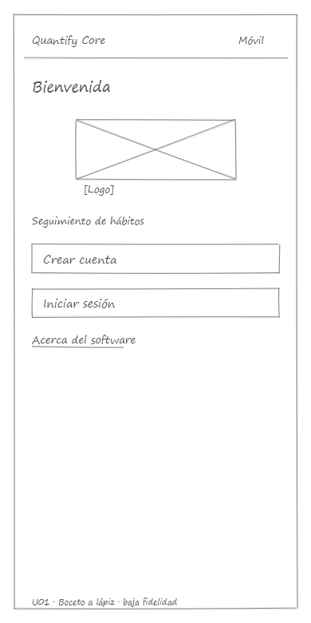

Presentación del seguimiento de hábitos y acceso a una rutina más consciente.

| Campo | Especificación |
|---|---|
| Plataforma de destino | PWA con React/Vite y aplicación Flutter |
| Rol autorizado | Usuario / visitante según el recorrido |
| Módulo | Acceso |
| Elementos principales | Presentación, imagen de referencia, beneficios, acceso, registro y enlace informativo |
| Requisitos / historias | [RF-01](../requerimientos/catalogo.md); historias expresadas en el catálogo canónico |
| Reglas de navegación / demo | RN02, RN13; [definición](#reglas-y-condiciones) |
| Referencia visual | [Sketch móvil](../GUI/prototipos/movil/sketches/practica-07/U01.png) · [Sketch PWA](../GUI/prototipos/pwa/sketches/practica-07/U01.png) |
| Fuente editable | [SVG móvil](../GUI/prototipos/movil/sketches/practica-07/U01.svg) · [SVG PWA](../GUI/prototipos/pwa/sketches/practica-07/U01.svg) |
| Recorrido interactivo | [Abrir pantalla](index.html#usuario/U01) · [Ver nodo](mapa-completo.html#U01) |

**Acciones, condiciones y pantallas relacionadas**

| Acción o condición | Destino | Resultado |
|---|---|---|
| Iniciar sesión | [U02](#u02) | Transición al sketch indicado |
| Crear cuenta | [U03](#u03) | Transición al sketch indicado |
| Acerca del software | [U20](#u20) | Transición al sketch indicado |

</details>

<a id="u02"></a>

<details>
<summary><strong>U02 · Login / Iniciar sesión</strong> — ficha individual</summary>


**Pantalla general obligatoria:** Login Screen.

Validar las credenciales de ejemplo y continuar a la rutina.

| Campo | Especificación |
|---|---|
| Plataforma de destino | PWA con React/Vite y aplicación Flutter |
| Rol autorizado | Usuario / visitante según el recorrido |
| Módulo | Acceso |
| Elementos principales | Correo, contraseña, error, contador de intentos, recuperación y registro |
| Requisitos / historias | [RF-01](../requerimientos/catalogo.md); historias expresadas en el catálogo canónico |
| Reglas de navegación / demo | RN02; [definición](#reglas-y-condiciones) |
| Referencia visual | [Sketch móvil](../GUI/prototipos/movil/sketches/practica-07/U02.png) · [Sketch PWA](../GUI/prototipos/pwa/sketches/practica-07/U02.png) |
| Fuente editable | [SVG móvil](../GUI/prototipos/movil/sketches/practica-07/U02.svg) · [SVG PWA](../GUI/prototipos/pwa/sketches/practica-07/U02.svg) |
| Recorrido interactivo | [Abrir pantalla](index.html#usuario/U02) · [Ver nodo](mapa-completo.html#U02) |

**Acciones, condiciones y pantallas relacionadas**

| Acción o condición | Destino | Resultado |
|---|---|---|
| Credenciales válidas | [U06](#u06) | Transición al sketch indicado |
| Credenciales inválidas | [U02](#u02) | Permanece en el sketch; muestra estado o validación |
| Crear cuenta | [U03](#u03) | Transición al sketch indicado |
| Olvidé mi contraseña | [U04](#u04) | Transición al sketch indicado |
| Continuar verificación pendiente | [U05](#u05) | Transición al sketch indicado |
| Volver | [U01](#u01) | Transición al sketch indicado |
| Tercer intento fallido o acceso bloqueado | [U18](#u18) | Transición al sketch indicado |

</details>

<a id="u03"></a>

<details>
<summary><strong>U03 · Register / Crear cuenta</strong> — ficha individual</summary>


Capturar los datos y aceptar las condiciones antes de verificar la cuenta.

| Campo | Especificación |
|---|---|
| Plataforma de destino | PWA con React/Vite y aplicación Flutter |
| Rol autorizado | Usuario / visitante según el recorrido |
| Módulo | Acceso |
| Elementos principales | Nombre ficticio, correo demo, contraseña de prueba, aceptación y validación |
| Requisitos / historias | [RF-01](../requerimientos/catalogo.md); historias expresadas en el catálogo canónico |
| Reglas de navegación / demo | RN02; [definición](#reglas-y-condiciones) |
| Referencia visual | [Sketch móvil](../GUI/prototipos/movil/sketches/practica-07/U03.png) · [Sketch PWA](../GUI/prototipos/pwa/sketches/practica-07/U03.png) |
| Fuente editable | [SVG móvil](../GUI/prototipos/movil/sketches/practica-07/U03.svg) · [SVG PWA](../GUI/prototipos/pwa/sketches/practica-07/U03.svg) |
| Recorrido interactivo | [Abrir pantalla](index.html#usuario/U03) · [Ver nodo](mapa-completo.html#U03) |

**Acciones, condiciones y pantallas relacionadas**

| Acción o condición | Destino | Resultado |
|---|---|---|
| Datos válidos | [U05](#u05) | Transición al sketch indicado |
| Corregir datos | [U03](#u03) | Permanece en el sketch; muestra estado o validación |
| Ya tengo cuenta | [U02](#u02) | Transición al sketch indicado |

</details>

<a id="u04"></a>

<details>
<summary><strong>U04 · Recuperar acceso</strong> — ficha individual</summary>

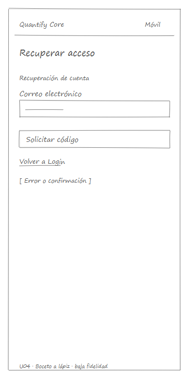

**Pantalla general obligatoria:** Recovery Account or Password.

Iniciar una recuperación simulada sin enviar correos.

| Campo | Especificación |
|---|---|
| Plataforma de destino | PWA con React/Vite y aplicación Flutter |
| Rol autorizado | Usuario / visitante según el recorrido |
| Módulo | Acceso |
| Elementos principales | Correo demo, solicitud de código, aviso de simulación y cancelar |
| Requisitos / historias | [RF-01](../requerimientos/catalogo.md); historias expresadas en el catálogo canónico |
| Reglas de navegación / demo | RN02; [definición](#reglas-y-condiciones) |
| Referencia visual | [Sketch móvil](../GUI/prototipos/movil/sketches/practica-07/U04.png) · [Sketch PWA](../GUI/prototipos/pwa/sketches/practica-07/U04.png) |
| Fuente editable | [SVG móvil](../GUI/prototipos/movil/sketches/practica-07/U04.svg) · [SVG PWA](../GUI/prototipos/pwa/sketches/practica-07/U04.svg) |
| Recorrido interactivo | [Abrir pantalla](index.html#usuario/U04) · [Ver nodo](mapa-completo.html#U04) |

**Acciones, condiciones y pantallas relacionadas**

| Acción o condición | Destino | Resultado |
|---|---|---|
| Solicitar código demo | [U05](#u05) | Transición al sketch indicado |
| Cancelar | [U02](#u02) | Transición al sketch indicado |

</details>

<a id="u05"></a>

<details>
<summary><strong>U05 · Verificar código</strong> — ficha individual</summary>

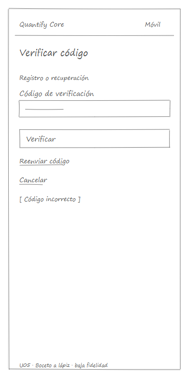

Verificación demostrativa del registro o de una recuperación.

| Campo | Especificación |
|---|---|
| Plataforma de destino | PWA con React/Vite y aplicación Flutter |
| Rol autorizado | Usuario / visitante según el recorrido |
| Módulo | Acceso |
| Elementos principales | Código de seis dígitos, contexto registro/recuperación, error y reenvío |
| Requisitos / historias | [RF-01](../requerimientos/catalogo.md); historias expresadas en el catálogo canónico |
| Reglas de navegación / demo | RN02; [definición](#reglas-y-condiciones) |
| Referencia visual | [Sketch móvil](../GUI/prototipos/movil/sketches/practica-07/U05.png) · [Sketch PWA](../GUI/prototipos/pwa/sketches/practica-07/U05.png) |
| Fuente editable | [SVG móvil](../GUI/prototipos/movil/sketches/practica-07/U05.svg) · [SVG PWA](../GUI/prototipos/pwa/sketches/practica-07/U05.svg) |
| Recorrido interactivo | [Abrir pantalla](index.html#usuario/U05) · [Ver nodo](mapa-completo.html#U05) |

**Acciones, condiciones y pantallas relacionadas**

| Acción o condición | Destino | Resultado |
|---|---|---|
| Código válido · registro | [U06](#u06) | Transición al sketch indicado |
| Código válido · recuperación | [U15](#u15) | Transición al sketch indicado |
| Código inválido o reenviar | [U05](#u05) | Permanece en el sketch; muestra estado o validación |
| Cancelar | [U02](#u02) | Transición al sketch indicado |

</details>

<a id="u06"></a>

<details>
<summary><strong>U06 · Hoy / Mis hábitos</strong> — ficha individual</summary>

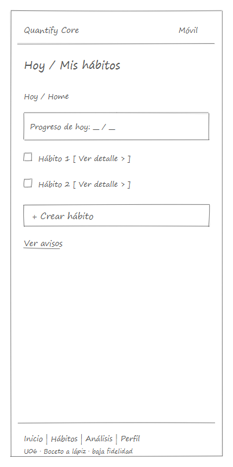

**Pantalla general obligatoria:** Home.

Visualizar el progreso y los hábitos programados para el día de ejemplo.

| Campo | Especificación |
|---|---|
| Plataforma de destino | PWA con React/Vite y aplicación Flutter |
| Rol autorizado | Usuario / visitante según el recorrido |
| Módulo | Rutina |
| Elementos principales | Resumen diario, progreso, filtros, lista de hábitos y navegación principal |
| Requisitos / historias | [RF-03](../requerimientos/catalogo.md), [RF-04](../requerimientos/catalogo.md), [RF-05](../requerimientos/catalogo.md); historias expresadas en el catálogo canónico |
| Reglas de navegación / demo | RN04, RN05; [definición](#reglas-y-condiciones) |
| Referencia visual | [Sketch móvil](../GUI/prototipos/movil/sketches/practica-07/U06.png) · [Sketch PWA](../GUI/prototipos/pwa/sketches/practica-07/U06.png) |
| Fuente editable | [SVG móvil](../GUI/prototipos/movil/sketches/practica-07/U06.svg) · [SVG PWA](../GUI/prototipos/pwa/sketches/practica-07/U06.svg) |
| Recorrido interactivo | [Abrir pantalla](index.html#usuario/U06) · [Ver nodo](mapa-completo.html#U06) |

**Acciones, condiciones y pantallas relacionadas**

| Acción o condición | Destino | Resultado |
|---|---|---|
| Nuevo hábito | [U07](#u07) | Transición al sketch indicado |
| Abrir hábito | [U08](#u08) | Transición al sketch indicado |
| Completar o deshacer | [U06](#u06) | Permanece en el sketch; muestra estado o validación |
| Ver avisos | [U14](#u14) | Transición al sketch indicado |
| Análisis | [U10](#u10) | Transición al sketch indicado |
| IA Coach | [U11](#u11) | Transición al sketch indicado |
| Ajustes | [U12](#u12) | Transición al sketch indicado |

</details>

<a id="u07"></a>

<details>
<summary><strong>U07 · Crear / editar hábito</strong> — ficha individual</summary>

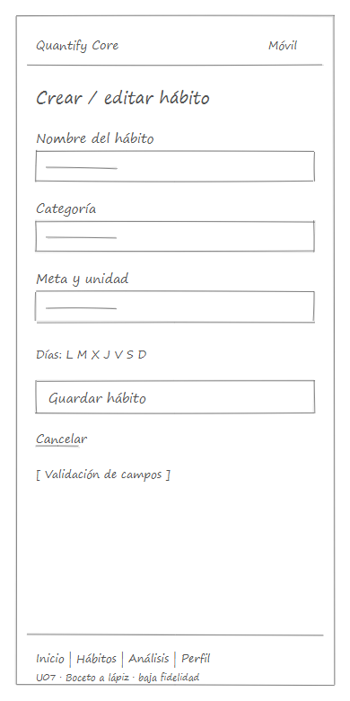

Personalizar la meta, la frecuencia y el color, con validación antes de guardar.

| Campo | Especificación |
|---|---|
| Plataforma de destino | PWA con React/Vite y aplicación Flutter |
| Rol autorizado | Usuario / visitante según el recorrido |
| Módulo | Rutina |
| Elementos principales | Nombre, categoría, frecuencia, meta, unidad, color, guardar y cancelar |
| Requisitos / historias | [RF-03](../requerimientos/catalogo.md); historias expresadas en el catálogo canónico |
| Reglas de navegación / demo | RN03, RN09; [definición](#reglas-y-condiciones) |
| Referencia visual | [Sketch móvil](../GUI/prototipos/movil/sketches/practica-07/U07.png) · [Sketch PWA](../GUI/prototipos/pwa/sketches/practica-07/U07.png) |
| Fuente editable | [SVG móvil](../GUI/prototipos/movil/sketches/practica-07/U07.svg) · [SVG PWA](../GUI/prototipos/pwa/sketches/practica-07/U07.svg) |
| Recorrido interactivo | [Abrir pantalla](index.html#usuario/U07) · [Ver nodo](mapa-completo.html#U07) |

**Acciones, condiciones y pantallas relacionadas**

| Acción o condición | Destino | Resultado |
|---|---|---|
| Guardar válido | [U08](#u08) | Transición al sketch indicado |
| Datos inválidos | [U07](#u07) | Permanece en el sketch; muestra estado o validación |
| Cancelar creación | [U06](#u06) | Transición al sketch indicado |
| Cancelar edición | [U08](#u08) | Transición al sketch indicado |

</details>

<a id="u08"></a>

<details>
<summary><strong>U08 · Detalle del hábito</strong> — ficha individual</summary>

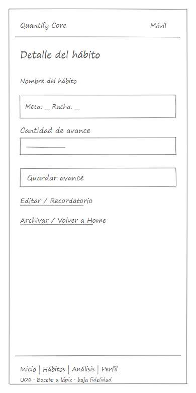

Registrar avances parciales, completar el día o revisar la racha.

| Campo | Especificación |
|---|---|
| Plataforma de destino | PWA con React/Vite y aplicación Flutter |
| Rol autorizado | Usuario / visitante según el recorrido |
| Módulo | Rutina |
| Elementos principales | Meta, avance parcial, racha, historial, edición, recordatorio y archivo |
| Requisitos / historias | [RF-04](../requerimientos/catalogo.md), [RF-05](../requerimientos/catalogo.md); historias expresadas en el catálogo canónico |
| Reglas de navegación / demo | RN04, RN05, RN06; [definición](#reglas-y-condiciones) |
| Referencia visual | [Sketch móvil](../GUI/prototipos/movil/sketches/practica-07/U08.png) · [Sketch PWA](../GUI/prototipos/pwa/sketches/practica-07/U08.png) |
| Fuente editable | [SVG móvil](../GUI/prototipos/movil/sketches/practica-07/U08.svg) · [SVG PWA](../GUI/prototipos/pwa/sketches/practica-07/U08.svg) |
| Recorrido interactivo | [Abrir pantalla](index.html#usuario/U08) · [Ver nodo](mapa-completo.html#U08) |

**Acciones, condiciones y pantallas relacionadas**

| Acción o condición | Destino | Resultado |
|---|---|---|
| Editar | [U07](#u07) | Transición al sketch indicado |
| Recordatorio | [U09](#u09) | Transición al sketch indicado |
| Archivar | [U13](#u13) | Transición al sketch indicado |
| Guardar avance o deshacer | [U08](#u08) | Permanece en el sketch; muestra estado o validación |
| Ver análisis | [U10](#u10) | Transición al sketch indicado |
| Volver a Hoy | [U06](#u06) | Transición al sketch indicado |

</details>

<a id="u09"></a>

<details>
<summary><strong>U09 · Recordatorio</strong> — ficha individual</summary>

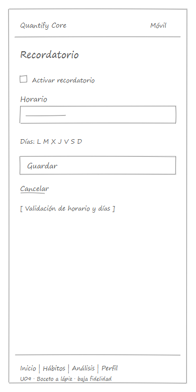

Definir días y horario de un aviso simulado para el hábito seleccionado.

| Campo | Especificación |
|---|---|
| Plataforma de destino | PWA con React/Vite y aplicación Flutter |
| Rol autorizado | Usuario / visitante según el recorrido |
| Módulo | Rutina |
| Elementos principales | Días compatibles, horario, aviso voluntario, guardar y cancelar |
| Requisitos / historias | [RF-06](../requerimientos/catalogo.md); historias expresadas en el catálogo canónico |
| Reglas de navegación / demo | RN07; [definición](#reglas-y-condiciones) |
| Referencia visual | [Sketch móvil](../GUI/prototipos/movil/sketches/practica-07/U09.png) · [Sketch PWA](../GUI/prototipos/pwa/sketches/practica-07/U09.png) |
| Fuente editable | [SVG móvil](../GUI/prototipos/movil/sketches/practica-07/U09.svg) · [SVG PWA](../GUI/prototipos/pwa/sketches/practica-07/U09.svg) |
| Recorrido interactivo | [Abrir pantalla](index.html#usuario/U09) · [Ver nodo](mapa-completo.html#U09) |

**Acciones, condiciones y pantallas relacionadas**

| Acción o condición | Destino | Resultado |
|---|---|---|
| Guardar o cancelar | [U08](#u08) | Transición al sketch indicado |
| Corregir horario o días | [U09](#u09) | Permanece en el sketch; muestra estado o validación |

</details>

<a id="u10"></a>

<details>
<summary><strong>U10 · Análisis y rachas</strong> — ficha individual</summary>

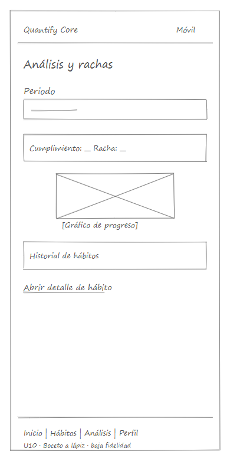

Consultar resultados calculados con los registros locales de ejemplo.

| Campo | Especificación |
|---|---|
| Plataforma de destino | PWA con React/Vite y aplicación Flutter |
| Rol autorizado | Usuario / visitante según el recorrido |
| Módulo | Seguimiento |
| Elementos principales | Periodo, métricas, referencia de gráfico e historial por hábito |
| Requisitos / historias | [RF-05](../requerimientos/catalogo.md); historias expresadas en el catálogo canónico |
| Reglas de navegación / demo | RN05, RN06; [definición](#reglas-y-condiciones) |
| Referencia visual | [Sketch móvil](../GUI/prototipos/movil/sketches/practica-07/U10.png) · [Sketch PWA](../GUI/prototipos/pwa/sketches/practica-07/U10.png) |
| Fuente editable | [SVG móvil](../GUI/prototipos/movil/sketches/practica-07/U10.svg) · [SVG PWA](../GUI/prototipos/pwa/sketches/practica-07/U10.svg) |
| Recorrido interactivo | [Abrir pantalla](index.html#usuario/U10) · [Ver nodo](mapa-completo.html#U10) |

**Acciones, condiciones y pantallas relacionadas**

| Acción o condición | Destino | Resultado |
|---|---|---|
| Cambiar periodo | [U10](#u10) | Permanece en el sketch; muestra estado o validación |
| Ver hábito | [U08](#u08) | Transición al sketch indicado |
| Hoy | [U06](#u06) | Transición al sketch indicado |
| IA Coach | [U11](#u11) | Transición al sketch indicado |
| Ajustes | [U12](#u12) | Transición al sketch indicado |

</details>

<a id="u11"></a>

<details>
<summary><strong>U11 · IA Coach</strong> — ficha individual</summary>

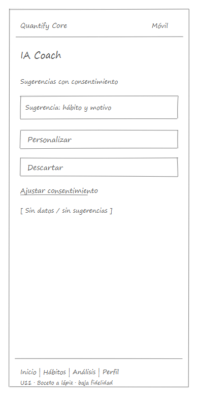

Recomendaciones explicables con consentimiento, umbral y control de duplicados.

| Campo | Especificación |
|---|---|
| Plataforma de destino | PWA con React/Vite y aplicación Flutter |
| Rol autorizado | Usuario / visitante según el recorrido |
| Módulo | Seguimiento |
| Elementos principales | Consentimiento, tarjetas de sugerencias, explicación, personalizar y descartar |
| Requisitos / historias | [RF-07](../requerimientos/catalogo.md); historias expresadas en el catálogo canónico |
| Reglas de navegación / demo | RN08, RN09, RN10; [definición](#reglas-y-condiciones) |
| Referencia visual | [Sketch móvil](../GUI/prototipos/movil/sketches/practica-07/U11.png) · [Sketch PWA](../GUI/prototipos/pwa/sketches/practica-07/U11.png) |
| Fuente editable | [SVG móvil](../GUI/prototipos/movil/sketches/practica-07/U11.svg) · [SVG PWA](../GUI/prototipos/pwa/sketches/practica-07/U11.svg) |
| Recorrido interactivo | [Abrir pantalla](index.html#usuario/U11) · [Ver nodo](mapa-completo.html#U11) |

**Acciones, condiciones y pantallas relacionadas**

| Acción o condición | Destino | Resultado |
|---|---|---|
| Personalizar sugerencia | [U07](#u07) | Transición al sketch indicado |
| Descartar por 21 días | [U11](#u11) | Permanece en el sketch; muestra estado o validación |
| Cambiar consentimiento | [U12](#u12) | Transición al sketch indicado |
| Hoy | [U06](#u06) | Transición al sketch indicado |
| Análisis | [U10](#u10) | Transición al sketch indicado |
| Ajustes | [U12](#u12) | Transición al sketch indicado |

</details>

<a id="u12"></a>

<details>
<summary><strong>U12 · Perfil y ajustes</strong> — ficha individual</summary>

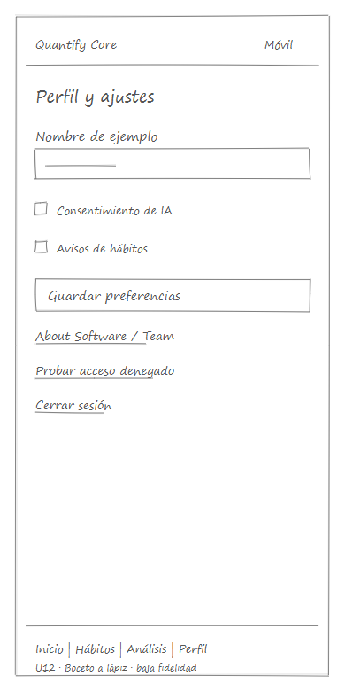

Preferencias de privacidad y avisos. Solo se conservan datos de demostración.

| Campo | Especificación |
|---|---|
| Plataforma de destino | PWA con React/Vite y aplicación Flutter |
| Rol autorizado | Usuario / visitante según el recorrido |
| Módulo | Cuenta |
| Elementos principales | Nombre de ejemplo, consentimiento, preferencias, información y cierre de sesión |
| Requisitos / historias | [RF-02](../requerimientos/catalogo.md); historias expresadas en el catálogo canónico |
| Reglas de navegación / demo | RN02, RN07, RN08; [definición](#reglas-y-condiciones) |
| Referencia visual | [Sketch móvil](../GUI/prototipos/movil/sketches/practica-07/U12.png) · [Sketch PWA](../GUI/prototipos/pwa/sketches/practica-07/U12.png) |
| Fuente editable | [SVG móvil](../GUI/prototipos/movil/sketches/practica-07/U12.svg) · [SVG PWA](../GUI/prototipos/pwa/sketches/practica-07/U12.svg) |
| Recorrido interactivo | [Abrir pantalla](index.html#usuario/U12) · [Ver nodo](mapa-completo.html#U12) |

**Acciones, condiciones y pantallas relacionadas**

| Acción o condición | Destino | Resultado |
|---|---|---|
| Guardar preferencias | [U12](#u12) | Permanece en el sketch; muestra estado o validación |
| Ver avisos | [U14](#u14) | Transición al sketch indicado |
| Cerrar sesión | [U02](#u02) | Transición al sketch indicado |
| Hoy | [U06](#u06) | Transición al sketch indicado |
| Análisis | [U10](#u10) | Transición al sketch indicado |
| IA Coach | [U11](#u11) | Transición al sketch indicado |
| Acerca del software | [U20](#u20) | Transición al sketch indicado |
| Intentar módulo administrativo | [U22](#u22) | Transición al sketch indicado |

</details>

<a id="u13"></a>

<details>
<summary><strong>U13 · Archivar hábito</strong> — ficha individual</summary>

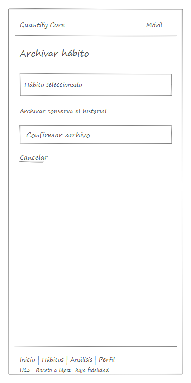

Confirmar una acción que conserva los registros históricos.

| Campo | Especificación |
|---|---|
| Plataforma de destino | PWA con React/Vite y aplicación Flutter |
| Rol autorizado | Usuario / visitante según el recorrido |
| Módulo | Rutina |
| Elementos principales | Resumen del hábito, advertencia de conservación del historial y confirmación |
| Requisitos / historias | [RF-03](../requerimientos/catalogo.md); historias expresadas en el catálogo canónico |
| Reglas de navegación / demo | RN06; [definición](#reglas-y-condiciones) |
| Referencia visual | [Sketch móvil](../GUI/prototipos/movil/sketches/practica-07/U13.png) · [Sketch PWA](../GUI/prototipos/pwa/sketches/practica-07/U13.png) |
| Fuente editable | [SVG móvil](../GUI/prototipos/movil/sketches/practica-07/U13.svg) · [SVG PWA](../GUI/prototipos/pwa/sketches/practica-07/U13.svg) |
| Recorrido interactivo | [Abrir pantalla](index.html#usuario/U13) · [Ver nodo](mapa-completo.html#U13) |

**Acciones, condiciones y pantallas relacionadas**

| Acción o condición | Destino | Resultado |
|---|---|---|
| Confirmar archivo | [U06](#u06) | Transición al sketch indicado |
| Cancelar | [U08](#u08) | Transición al sketch indicado |

</details>

<a id="u14"></a>

<details>
<summary><strong>U14 · Centro de avisos</strong> — ficha individual</summary>

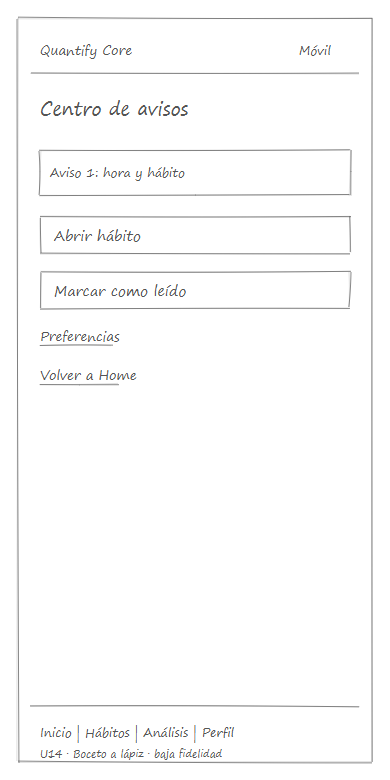

Avisos locales de ejemplo con estado leído y acceso al hábito asociado.

| Campo | Especificación |
|---|---|
| Plataforma de destino | PWA con React/Vite y aplicación Flutter |
| Rol autorizado | Usuario / visitante según el recorrido |
| Módulo | Cuenta |
| Elementos principales | Lista de avisos, horario, estado leído y enlace al hábito asociado |
| Requisitos / historias | [RF-06](../requerimientos/catalogo.md); historias expresadas en el catálogo canónico |
| Reglas de navegación / demo | RN07; [definición](#reglas-y-condiciones) |
| Referencia visual | [Sketch móvil](../GUI/prototipos/movil/sketches/practica-07/U14.png) · [Sketch PWA](../GUI/prototipos/pwa/sketches/practica-07/U14.png) |
| Fuente editable | [SVG móvil](../GUI/prototipos/movil/sketches/practica-07/U14.svg) · [SVG PWA](../GUI/prototipos/pwa/sketches/practica-07/U14.svg) |
| Recorrido interactivo | [Abrir pantalla](index.html#usuario/U14) · [Ver nodo](mapa-completo.html#U14) |

**Acciones, condiciones y pantallas relacionadas**

| Acción o condición | Destino | Resultado |
|---|---|---|
| Abrir hábito asociado | [U08](#u08) | Transición al sketch indicado |
| Marcar como leído | [U14](#u14) | Permanece en el sketch; muestra estado o validación |
| Preferencias | [U12](#u12) | Transición al sketch indicado |
| Volver | [U06](#u06) | Transición al sketch indicado |

</details>

<a id="u15"></a>

<details>
<summary><strong>U15 · Nueva contraseña</strong> — ficha individual</summary>

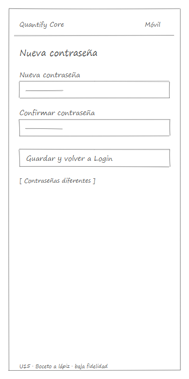

Completar la recuperación simulada. La nueva clave vive solo en memoria.

| Campo | Especificación |
|---|---|
| Plataforma de destino | PWA con React/Vite y aplicación Flutter |
| Rol autorizado | Usuario / visitante según el recorrido |
| Módulo | Acceso |
| Elementos principales | Nueva contraseña de prueba, confirmación, error y guardar |
| Requisitos / historias | [RF-01](../requerimientos/catalogo.md); historias expresadas en el catálogo canónico |
| Reglas de navegación / demo | RN02; [definición](#reglas-y-condiciones) |
| Referencia visual | [Sketch móvil](../GUI/prototipos/movil/sketches/practica-07/U15.png) · [Sketch PWA](../GUI/prototipos/pwa/sketches/practica-07/U15.png) |
| Fuente editable | [SVG móvil](../GUI/prototipos/movil/sketches/practica-07/U15.svg) · [SVG PWA](../GUI/prototipos/pwa/sketches/practica-07/U15.svg) |
| Recorrido interactivo | [Abrir pantalla](index.html#usuario/U15) · [Ver nodo](mapa-completo.html#U15) |

**Acciones, condiciones y pantallas relacionadas**

| Acción o condición | Destino | Resultado |
|---|---|---|
| Guardar clave válida | [U02](#u02) | Transición al sketch indicado |
| Corregir clave | [U15](#u15) | Permanece en el sketch; muestra estado o validación |

</details>

<a id="u16"></a>

<details>
<summary><strong>U16 · Splash Screen</strong> — ficha individual</summary>

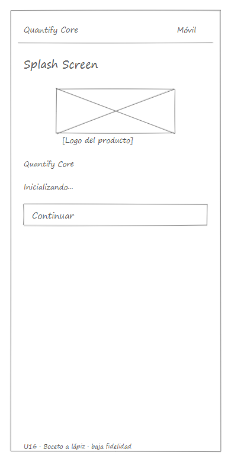

**Pantalla general obligatoria:** Splash Screen.

Identificar el producto al iniciar la aplicación.

| Campo | Especificación |
|---|---|
| Plataforma de destino | PWA con React/Vite y aplicación Flutter |
| Rol autorizado | Usuario / visitante según el recorrido |
| Módulo | Acceso |
| Elementos principales | Identidad del producto, texto de inicialización y continuar |
| Requisitos / historias | [RF-01](../requerimientos/catalogo.md); historias expresadas en el catálogo canónico |
| Reglas de navegación / demo | RN13; [definición](#reglas-y-condiciones) |
| Referencia visual | [Sketch móvil](../GUI/prototipos/movil/sketches/practica-07/U16.png) · [Sketch PWA](../GUI/prototipos/pwa/sketches/practica-07/U16.png) |
| Fuente editable | [SVG móvil](../GUI/prototipos/movil/sketches/practica-07/U16.svg) · [SVG PWA](../GUI/prototipos/pwa/sketches/practica-07/U16.svg) |
| Recorrido interactivo | [Abrir pantalla](index.html#usuario/U16) · [Ver nodo](mapa-completo.html#U16) |

**Acciones, condiciones y pantallas relacionadas**

| Acción o condición | Destino | Resultado |
|---|---|---|
| Continuar inicialización | [U17](#u17) | Transición al sketch indicado |

</details>

<a id="u17"></a>

<details>
<summary><strong>U17 · Loading Screen</strong> — ficha individual</summary>

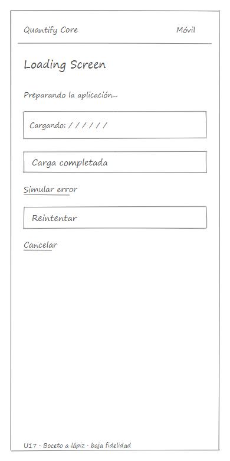

**Pantalla general obligatoria:** Loading Screen.

Mostrar la carga inicial, reintento y salida ante un fallo.

| Campo | Especificación |
|---|---|
| Plataforma de destino | PWA con React/Vite y aplicación Flutter |
| Rol autorizado | Usuario / visitante según el recorrido |
| Módulo | Acceso |
| Elementos principales | Indicador de carga, mensaje de error, completar, reintentar y cancelar |
| Requisitos / historias | [RF-01](../requerimientos/catalogo.md); historias expresadas en el catálogo canónico |
| Reglas de navegación / demo | RN13; [definición](#reglas-y-condiciones) |
| Referencia visual | [Sketch móvil](../GUI/prototipos/movil/sketches/practica-07/U17.png) · [Sketch PWA](../GUI/prototipos/pwa/sketches/practica-07/U17.png) |
| Fuente editable | [SVG móvil](../GUI/prototipos/movil/sketches/practica-07/U17.svg) · [SVG PWA](../GUI/prototipos/pwa/sketches/practica-07/U17.svg) |
| Recorrido interactivo | [Abrir pantalla](index.html#usuario/U17) · [Ver nodo](mapa-completo.html#U17) |

**Acciones, condiciones y pantallas relacionadas**

| Acción o condición | Destino | Resultado |
|---|---|---|
| Carga completada | [U01](#u01) | Transición al sketch indicado |
| Error o reintentar | [U17](#u17) | Permanece en el sketch; muestra estado o validación |
| Cancelar | [U16](#u16) | Transición al sketch indicado |

</details>

<a id="u18"></a>

<details>
<summary><strong>U18 · Lock Account</strong> — ficha individual</summary>

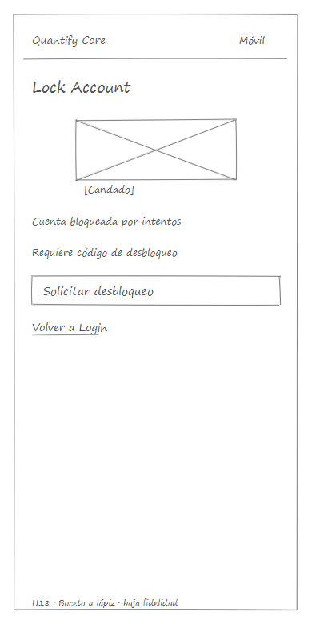

**Pantalla general obligatoria:** Lock Account.

Informar el bloqueo temporal después de tres intentos fallidos de demostración.

| Campo | Especificación |
|---|---|
| Plataforma de destino | PWA con React/Vite y aplicación Flutter |
| Rol autorizado | Usuario / visitante según el recorrido |
| Módulo | Acceso |
| Elementos principales | Candado, explicación del bloqueo, solicitar código y volver |
| Requisitos / historias | [RF-01](../requerimientos/catalogo.md); historias expresadas en el catálogo canónico |
| Reglas de navegación / demo | RN02; [definición](#reglas-y-condiciones) |
| Referencia visual | [Sketch móvil](../GUI/prototipos/movil/sketches/practica-07/U18.png) · [Sketch PWA](../GUI/prototipos/pwa/sketches/practica-07/U18.png) |
| Fuente editable | [SVG móvil](../GUI/prototipos/movil/sketches/practica-07/U18.svg) · [SVG PWA](../GUI/prototipos/pwa/sketches/practica-07/U18.svg) |
| Recorrido interactivo | [Abrir pantalla](index.html#usuario/U18) · [Ver nodo](mapa-completo.html#U18) |

**Acciones, condiciones y pantallas relacionadas**

| Acción o condición | Destino | Resultado |
|---|---|---|
| Solicitar desbloqueo | [U19](#u19) | Transición al sketch indicado |
| Volver al acceso; conserva bloqueo | [U02](#u02) | Transición al sketch indicado |

</details>

<a id="u19"></a>

<details>
<summary><strong>U19 · Unlock Account Code</strong> — ficha individual</summary>

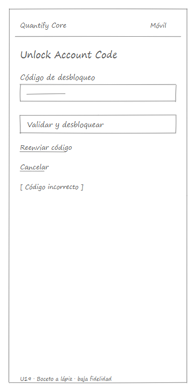

**Pantalla general obligatoria:** Unlock Account Code.

Validar un código exclusivo del recorrido de desbloqueo.

| Campo | Especificación |
|---|---|
| Plataforma de destino | PWA con React/Vite y aplicación Flutter |
| Rol autorizado | Usuario / visitante según el recorrido |
| Módulo | Acceso |
| Elementos principales | Código de desbloqueo, error, validación, reenvío y cancelar |
| Requisitos / historias | [RF-01](../requerimientos/catalogo.md); historias expresadas en el catálogo canónico |
| Reglas de navegación / demo | RN02; [definición](#reglas-y-condiciones) |
| Referencia visual | [Sketch móvil](../GUI/prototipos/movil/sketches/practica-07/U19.png) · [Sketch PWA](../GUI/prototipos/pwa/sketches/practica-07/U19.png) |
| Fuente editable | [SVG móvil](../GUI/prototipos/movil/sketches/practica-07/U19.svg) · [SVG PWA](../GUI/prototipos/pwa/sketches/practica-07/U19.svg) |
| Recorrido interactivo | [Abrir pantalla](index.html#usuario/U19) · [Ver nodo](mapa-completo.html#U19) |

**Acciones, condiciones y pantallas relacionadas**

| Acción o condición | Destino | Resultado |
|---|---|---|
| Código válido; volver a iniciar sesión | [U02](#u02) | Transición al sketch indicado |
| Código inválido o reenviar | [U19](#u19) | Permanece en el sketch; muestra estado o validación |
| Cancelar; conserva bloqueo | [U18](#u18) | Transición al sketch indicado |

</details>

<a id="u20"></a>

<details>
<summary><strong>U20 · About Software</strong> — ficha individual</summary>

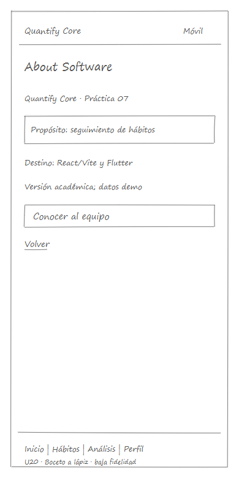

**Pantalla general obligatoria:** About Software.

Presentar propósito, plataformas previstas, versión y límites del prototipo.

| Campo | Especificación |
|---|---|
| Plataforma de destino | PWA con React/Vite y aplicación Flutter |
| Rol autorizado | Usuario / visitante según el recorrido |
| Módulo | Información |
| Elementos principales | Propósito, versión académica, plataformas, límites y enlaces informativos |
| Requisitos / historias | [RF-01](../requerimientos/catalogo.md); historias expresadas en el catálogo canónico |
| Reglas de navegación / demo | RN13; [definición](#reglas-y-condiciones) |
| Referencia visual | [Sketch móvil](../GUI/prototipos/movil/sketches/practica-07/U20.png) · [Sketch PWA](../GUI/prototipos/pwa/sketches/practica-07/U20.png) |
| Fuente editable | [SVG móvil](../GUI/prototipos/movil/sketches/practica-07/U20.svg) · [SVG PWA](../GUI/prototipos/pwa/sketches/practica-07/U20.svg) |
| Recorrido interactivo | [Abrir pantalla](index.html#usuario/U20) · [Ver nodo](mapa-completo.html#U20) |

**Acciones, condiciones y pantallas relacionadas**

| Acción o condición | Destino | Resultado |
|---|---|---|
| Conocer al equipo | [U21](#u21) | Transición al sketch indicado |
| Volver a bienvenida | [U01](#u01) | Transición al sketch indicado |
| Volver a ajustes | [U12](#u12) | Transición al sketch indicado |

</details>

<a id="u21"></a>

<details>
<summary><strong>U21 · About Team / Enterprise</strong> — ficha individual</summary>

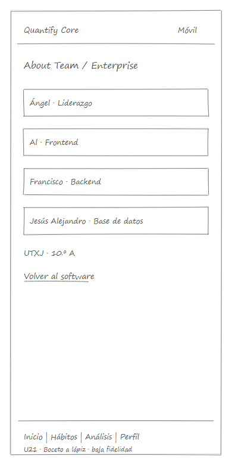

**Pantalla general obligatoria:** About Team / Enterprise.

Presentar al equipo académico y responsabilidades del proyecto.

| Campo | Especificación |
|---|---|
| Plataforma de destino | PWA con React/Vite y aplicación Flutter |
| Rol autorizado | Usuario / visitante según el recorrido |
| Módulo | Información |
| Elementos principales | Equipo, responsabilidades, institución y enlaces de retorno |
| Requisitos / historias | [RF-01](../requerimientos/catalogo.md); historias expresadas en el catálogo canónico |
| Reglas de navegación / demo | RN13; [definición](#reglas-y-condiciones) |
| Referencia visual | [Sketch móvil](../GUI/prototipos/movil/sketches/practica-07/U21.png) · [Sketch PWA](../GUI/prototipos/pwa/sketches/practica-07/U21.png) |
| Fuente editable | [SVG móvil](../GUI/prototipos/movil/sketches/practica-07/U21.svg) · [SVG PWA](../GUI/prototipos/pwa/sketches/practica-07/U21.svg) |
| Recorrido interactivo | [Abrir pantalla](index.html#usuario/U21) · [Ver nodo](mapa-completo.html#U21) |

**Acciones, condiciones y pantallas relacionadas**

| Acción o condición | Destino | Resultado |
|---|---|---|
| Volver al software | [U20](#u20) | Transición al sketch indicado |
| Volver a bienvenida | [U01](#u01) | Transición al sketch indicado |

</details>

<a id="u22"></a>

<details>
<summary><strong>U22 · Acceso denegado</strong> — ficha individual</summary>

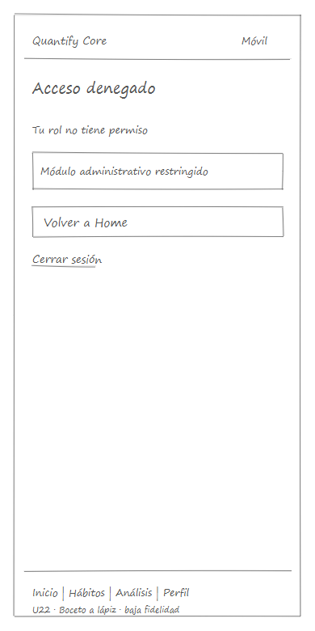

Explicar por qué el rol Usuario no puede operar módulos administrativos.

| Campo | Especificación |
|---|---|
| Plataforma de destino | PWA con React/Vite y aplicación Flutter |
| Rol autorizado | Usuario / visitante según el recorrido |
| Módulo | Cuenta |
| Elementos principales | Mensaje de acceso denegado, alcance del rol, Home y cierre de sesión |
| Requisitos / historias | [RF-09](../requerimientos/catalogo.md); historias expresadas en el catálogo canónico |
| Reglas de navegación / demo | RN01; [definición](#reglas-y-condiciones) |
| Referencia visual | [Sketch móvil](../GUI/prototipos/movil/sketches/practica-07/U22.png) · [Sketch PWA](../GUI/prototipos/pwa/sketches/practica-07/U22.png) |
| Fuente editable | [SVG móvil](../GUI/prototipos/movil/sketches/practica-07/U22.svg) · [SVG PWA](../GUI/prototipos/pwa/sketches/practica-07/U22.svg) |
| Recorrido interactivo | [Abrir pantalla](index.html#usuario/U22) · [Ver nodo](mapa-completo.html#U22) |

**Acciones, condiciones y pantallas relacionadas**

| Acción o condición | Destino | Resultado |
|---|---|---|
| Volver a Home | [U06](#u06) | Transición al sketch indicado |
| Cerrar sesión | [U02](#u02) | Transición al sketch indicado |

</details>

<a id="a01"></a>

<details>
<summary><strong>A01 · Acceso administrador</strong> — ficha individual</summary>

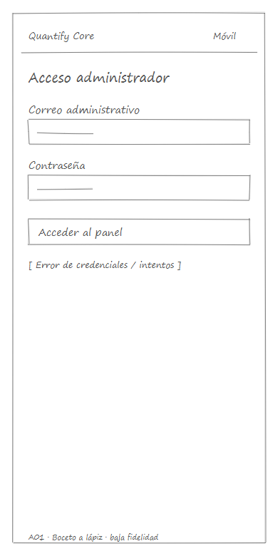

Entrada de demostración para personal autorizado; sin registro público.

| Campo | Especificación |
|---|---|
| Plataforma de destino | PWA con React/Vite y aplicación Flutter |
| Rol autorizado | Administrador |
| Módulo | Acceso |
| Elementos principales | Correo administrativo demo, contraseña de prueba, error y contador |
| Requisitos / historias | [RF-01](../requerimientos/catalogo.md), [RF-09](../requerimientos/catalogo.md); historias expresadas en el catálogo canónico |
| Reglas de navegación / demo | RN01, RN02; [definición](#reglas-y-condiciones) |
| Referencia visual | [Sketch móvil](../GUI/prototipos/movil/sketches/practica-07/A01.png) · [Sketch PWA](../GUI/prototipos/pwa/sketches/practica-07/A01.png) |
| Fuente editable | [SVG móvil](../GUI/prototipos/movil/sketches/practica-07/A01.svg) · [SVG PWA](../GUI/prototipos/pwa/sketches/practica-07/A01.svg) |
| Recorrido interactivo | [Abrir pantalla](index.html#admin/A01) · [Ver nodo](mapa-completo.html#A01) |

**Acciones, condiciones y pantallas relacionadas**

| Acción o condición | Destino | Resultado |
|---|---|---|
| Credenciales demo válidas | [A02](#a02) | Transición al sketch indicado |
| Acceso denegado | [A01](#a01) | Permanece en el sketch; muestra estado o validación |
| Tercer intento fallido o acceso bloqueado | [A10](#a10) | Transición al sketch indicado |

</details>

<a id="a02"></a>

<details>
<summary><strong>A02 · Resumen operativo</strong> — ficha individual</summary>

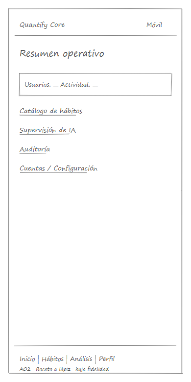

Indicadores agregados ilustrativos, estado de servicios y accesos a los módulos.

| Campo | Especificación |
|---|---|
| Plataforma de destino | PWA con React/Vite y aplicación Flutter |
| Rol autorizado | Administrador |
| Módulo | Operación |
| Elementos principales | Métricas agregadas ilustrativas y accesos a los módulos de operación |
| Requisitos / historias | [RF-09](../requerimientos/catalogo.md); historias expresadas en el catálogo canónico |
| Reglas de navegación / demo | RN01; [definición](#reglas-y-condiciones) |
| Referencia visual | [Sketch móvil](../GUI/prototipos/movil/sketches/practica-07/A02.png) · [Sketch PWA](../GUI/prototipos/pwa/sketches/practica-07/A02.png) |
| Fuente editable | [SVG móvil](../GUI/prototipos/movil/sketches/practica-07/A02.svg) · [SVG PWA](../GUI/prototipos/pwa/sketches/practica-07/A02.svg) |
| Recorrido interactivo | [Abrir pantalla](index.html#admin/A02) · [Ver nodo](mapa-completo.html#A02) |

**Acciones, condiciones y pantallas relacionadas**

| Acción o condición | Destino | Resultado |
|---|---|---|
| Ver catálogo | [A03](#a03) | Transición al sketch indicado |
| Supervisar IA | [A05](#a05) | Transición al sketch indicado |
| Auditoría | [A06](#a06) | Transición al sketch indicado |
| Cuentas | [A07](#a07) | Transición al sketch indicado |
| Configuración | [A08](#a08) | Transición al sketch indicado |

</details>

<a id="a03"></a>

<details>
<summary><strong>A03 · Catálogo de hábitos</strong> — ficha individual</summary>

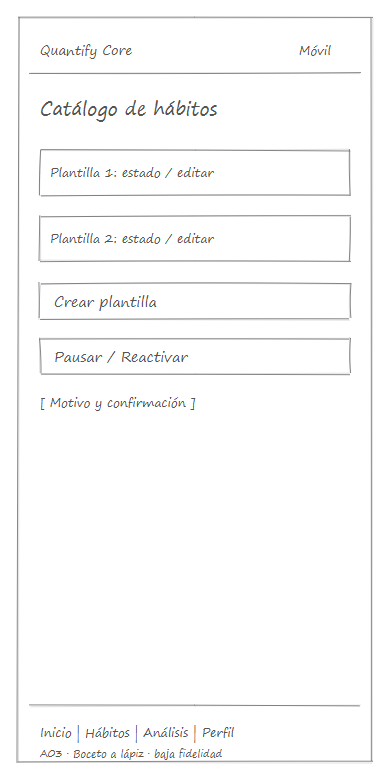

Gestionar plantillas sin modificar las rutinas personales existentes.

| Campo | Especificación |
|---|---|
| Plataforma de destino | PWA con React/Vite y aplicación Flutter |
| Rol autorizado | Administrador |
| Módulo | Operación |
| Elementos principales | Lista de plantillas, estado, crear, editar, pausar y reactivar |
| Requisitos / historias | [RF-09](../requerimientos/catalogo.md); historias expresadas en el catálogo canónico |
| Reglas de navegación / demo | RN10, RN11; [definición](#reglas-y-condiciones) |
| Referencia visual | [Sketch móvil](../GUI/prototipos/movil/sketches/practica-07/A03.png) · [Sketch PWA](../GUI/prototipos/pwa/sketches/practica-07/A03.png) |
| Fuente editable | [SVG móvil](../GUI/prototipos/movil/sketches/practica-07/A03.svg) · [SVG PWA](../GUI/prototipos/pwa/sketches/practica-07/A03.svg) |
| Recorrido interactivo | [Abrir pantalla](index.html#admin/A03) · [Ver nodo](mapa-completo.html#A03) |

**Acciones, condiciones y pantallas relacionadas**

| Acción o condición | Destino | Resultado |
|---|---|---|
| Crear o editar plantilla | [A04](#a04) | Transición al sketch indicado |
| Confirmar pausa o reactivación | [A03](#a03) | Permanece en el sketch; muestra estado o validación |
| Resumen | [A02](#a02) | Transición al sketch indicado |
| IA | [A05](#a05) | Transición al sketch indicado |
| Auditoría | [A06](#a06) | Transición al sketch indicado |
| Cuentas | [A07](#a07) | Transición al sketch indicado |
| Configuración | [A08](#a08) | Transición al sketch indicado |

</details>

<a id="a04"></a>

<details>
<summary><strong>A04 · Editar plantilla</strong> — ficha individual</summary>

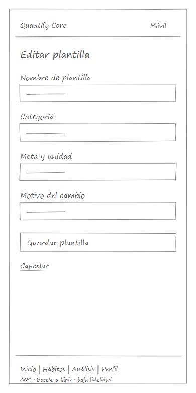

Validar nombre, categoría y meta antes de guardar y auditar la modificación.

| Campo | Especificación |
|---|---|
| Plataforma de destino | PWA con React/Vite y aplicación Flutter |
| Rol autorizado | Administrador |
| Módulo | Operación |
| Elementos principales | Nombre, categoría, meta, unidad, motivo obligatorio y guardar/cancelar |
| Requisitos / historias | [RF-09](../requerimientos/catalogo.md); historias expresadas en el catálogo canónico |
| Reglas de navegación / demo | RN03, RN10, RN11; [definición](#reglas-y-condiciones) |
| Referencia visual | [Sketch móvil](../GUI/prototipos/movil/sketches/practica-07/A04.png) · [Sketch PWA](../GUI/prototipos/pwa/sketches/practica-07/A04.png) |
| Fuente editable | [SVG móvil](../GUI/prototipos/movil/sketches/practica-07/A04.svg) · [SVG PWA](../GUI/prototipos/pwa/sketches/practica-07/A04.svg) |
| Recorrido interactivo | [Abrir pantalla](index.html#admin/A04) · [Ver nodo](mapa-completo.html#A04) |

**Acciones, condiciones y pantallas relacionadas**

| Acción o condición | Destino | Resultado |
|---|---|---|
| Guardar o cancelar | [A03](#a03) | Transición al sketch indicado |
| Corregir datos | [A04](#a04) | Permanece en el sketch; muestra estado o validación |
| Abrir IA | [A05](#a05) | Transición al sketch indicado |

</details>

<a id="a05"></a>

<details>
<summary><strong>A05 · Supervisión de IA</strong> — ficha individual</summary>

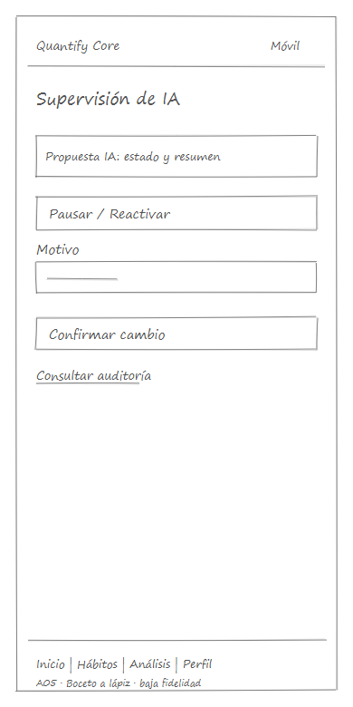

Revisar tasas de aceptación ilustrativas y pausar propuestas con un motivo.

| Campo | Especificación |
|---|---|
| Plataforma de destino | PWA con React/Vite y aplicación Flutter |
| Rol autorizado | Administrador |
| Módulo | Operación |
| Elementos principales | Propuestas de IA agregadas, estado, motivo y confirmación |
| Requisitos / historias | [RF-07](../requerimientos/catalogo.md), [RF-09](../requerimientos/catalogo.md); historias expresadas en el catálogo canónico |
| Reglas de navegación / demo | RN08, RN10, RN11; [definición](#reglas-y-condiciones) |
| Referencia visual | [Sketch móvil](../GUI/prototipos/movil/sketches/practica-07/A05.png) · [Sketch PWA](../GUI/prototipos/pwa/sketches/practica-07/A05.png) |
| Fuente editable | [SVG móvil](../GUI/prototipos/movil/sketches/practica-07/A05.svg) · [SVG PWA](../GUI/prototipos/pwa/sketches/practica-07/A05.svg) |
| Recorrido interactivo | [Abrir pantalla](index.html#admin/A05) · [Ver nodo](mapa-completo.html#A05) |

**Acciones, condiciones y pantallas relacionadas**

| Acción o condición | Destino | Resultado |
|---|---|---|
| Confirmar pausa o reactivación | [A05](#a05) | Permanece en el sketch; muestra estado o validación |
| Resumen | [A02](#a02) | Transición al sketch indicado |
| Catálogo | [A03](#a03) | Transición al sketch indicado |
| Ver auditoría | [A06](#a06) | Transición al sketch indicado |
| Cuentas | [A07](#a07) | Transición al sketch indicado |
| Configuración | [A08](#a08) | Transición al sketch indicado |

</details>

<a id="a06"></a>

<details>
<summary><strong>A06 · Auditoría</strong> — ficha individual</summary>

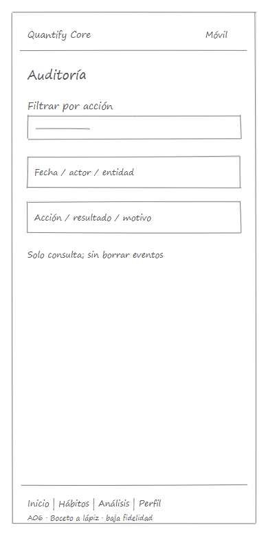

Consultar cambios administrativos registrados en esta demostración.

| Campo | Especificación |
|---|---|
| Plataforma de destino | PWA con React/Vite y aplicación Flutter |
| Rol autorizado | Administrador |
| Módulo | Control |
| Elementos principales | Filtro de acciones, fecha, actor, entidad y motivo; sin editar ni borrar |
| Requisitos / historias | [RF-10](../requerimientos/catalogo.md); historias expresadas en el catálogo canónico |
| Reglas de navegación / demo | RN11; [definición](#reglas-y-condiciones) |
| Referencia visual | [Sketch móvil](../GUI/prototipos/movil/sketches/practica-07/A06.png) · [Sketch PWA](../GUI/prototipos/pwa/sketches/practica-07/A06.png) |
| Fuente editable | [SVG móvil](../GUI/prototipos/movil/sketches/practica-07/A06.svg) · [SVG PWA](../GUI/prototipos/pwa/sketches/practica-07/A06.svg) |
| Recorrido interactivo | [Abrir pantalla](index.html#admin/A06) · [Ver nodo](mapa-completo.html#A06) |

**Acciones, condiciones y pantallas relacionadas**

| Acción o condición | Destino | Resultado |
|---|---|---|
| Filtrar eventos | [A06](#a06) | Permanece en el sketch; muestra estado o validación |
| Resumen | [A02](#a02) | Transición al sketch indicado |
| Catálogo | [A03](#a03) | Transición al sketch indicado |
| IA | [A05](#a05) | Transición al sketch indicado |
| Cuentas | [A07](#a07) | Transición al sketch indicado |
| Configuración | [A08](#a08) | Transición al sketch indicado |

</details>

<a id="a07"></a>

<details>
<summary><strong>A07 · Control de accesos</strong> — ficha individual</summary>

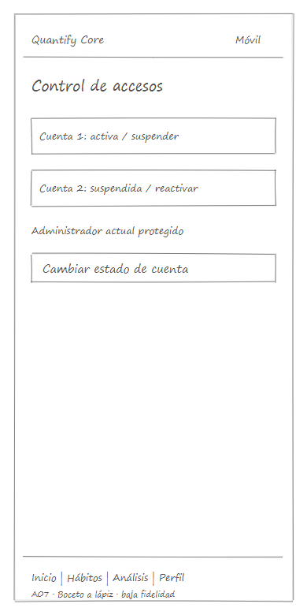

Administrar el estado de cuentas ficticias identificadas por códigos.

| Campo | Especificación |
|---|---|
| Plataforma de destino | PWA con React/Vite y aplicación Flutter |
| Rol autorizado | Administrador |
| Módulo | Control |
| Elementos principales | Códigos de cuentas ficticias, estado, suspensión/reactivación y cuenta protegida |
| Requisitos / historias | [RF-09](../requerimientos/catalogo.md); historias expresadas en el catálogo canónico |
| Reglas de navegación / demo | RN01, RN12; [definición](#reglas-y-condiciones) |
| Referencia visual | [Sketch móvil](../GUI/prototipos/movil/sketches/practica-07/A07.png) · [Sketch PWA](../GUI/prototipos/pwa/sketches/practica-07/A07.png) |
| Fuente editable | [SVG móvil](../GUI/prototipos/movil/sketches/practica-07/A07.svg) · [SVG PWA](../GUI/prototipos/pwa/sketches/practica-07/A07.svg) |
| Recorrido interactivo | [Abrir pantalla](index.html#admin/A07) · [Ver nodo](mapa-completo.html#A07) |

**Acciones, condiciones y pantallas relacionadas**

| Acción o condición | Destino | Resultado |
|---|---|---|
| Cambiar estado de cuenta | [A09](#a09) | Transición al sketch indicado |
| Resumen | [A02](#a02) | Transición al sketch indicado |
| Catálogo | [A03](#a03) | Transición al sketch indicado |
| IA | [A05](#a05) | Transición al sketch indicado |
| Auditoría | [A06](#a06) | Transición al sketch indicado |
| Configuración | [A08](#a08) | Transición al sketch indicado |

</details>

<a id="a08"></a>

<details>
<summary><strong>A08 · Configuración global</strong> — ficha individual</summary>

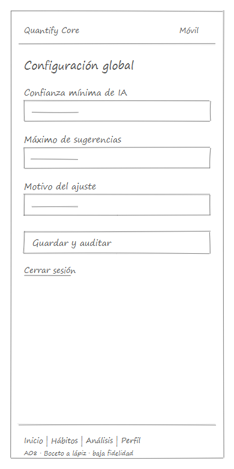

Ajustar límites de sugerencias respetando el mínimo de confianza y auditar cambios.

| Campo | Especificación |
|---|---|
| Plataforma de destino | PWA con React/Vite y aplicación Flutter |
| Rol autorizado | Administrador |
| Módulo | Control |
| Elementos principales | Límites académicos de IA, motivo, guardar y cierre de sesión |
| Requisitos / historias | [RF-09](../requerimientos/catalogo.md); historias expresadas en el catálogo canónico |
| Reglas de navegación / demo | RN08, RN11; [definición](#reglas-y-condiciones) |
| Referencia visual | [Sketch móvil](../GUI/prototipos/movil/sketches/practica-07/A08.png) · [Sketch PWA](../GUI/prototipos/pwa/sketches/practica-07/A08.png) |
| Fuente editable | [SVG móvil](../GUI/prototipos/movil/sketches/practica-07/A08.svg) · [SVG PWA](../GUI/prototipos/pwa/sketches/practica-07/A08.svg) |
| Recorrido interactivo | [Abrir pantalla](index.html#admin/A08) · [Ver nodo](mapa-completo.html#A08) |

**Acciones, condiciones y pantallas relacionadas**

| Acción o condición | Destino | Resultado |
|---|---|---|
| Validar y guardar | [A08](#a08) | Permanece en el sketch; muestra estado o validación |
| Resumen | [A02](#a02) | Transición al sketch indicado |
| Catálogo | [A03](#a03) | Transición al sketch indicado |
| IA | [A05](#a05) | Transición al sketch indicado |
| Auditoría | [A06](#a06) | Transición al sketch indicado |
| Cuentas | [A07](#a07) | Transición al sketch indicado |
| Cerrar sesión | [A01](#a01) | Transición al sketch indicado |

</details>

<a id="a09"></a>

<details>
<summary><strong>A09 · Confirmar cambio de acceso</strong> — ficha individual</summary>

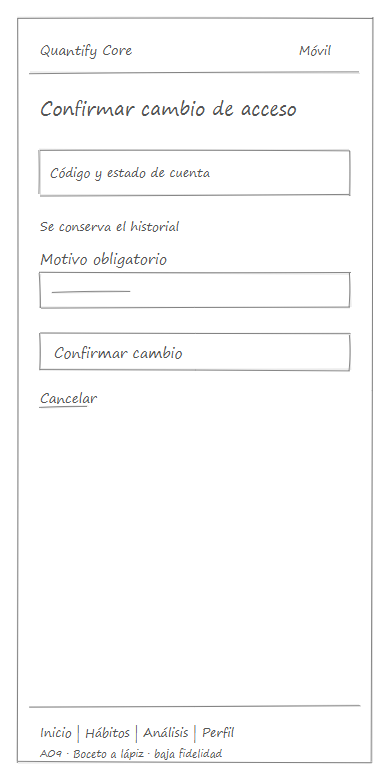

Confirmar suspensión o reactivación con un motivo obligatorio.

| Campo | Especificación |
|---|---|
| Plataforma de destino | PWA con React/Vite y aplicación Flutter |
| Rol autorizado | Administrador |
| Módulo | Control |
| Elementos principales | Código de cuenta, conservación de datos, motivo y confirmación/cancelación |
| Requisitos / historias | [RF-09](../requerimientos/catalogo.md); historias expresadas en el catálogo canónico |
| Reglas de navegación / demo | RN11, RN12; [definición](#reglas-y-condiciones) |
| Referencia visual | [Sketch móvil](../GUI/prototipos/movil/sketches/practica-07/A09.png) · [Sketch PWA](../GUI/prototipos/pwa/sketches/practica-07/A09.png) |
| Fuente editable | [SVG móvil](../GUI/prototipos/movil/sketches/practica-07/A09.svg) · [SVG PWA](../GUI/prototipos/pwa/sketches/practica-07/A09.svg) |
| Recorrido interactivo | [Abrir pantalla](index.html#admin/A09) · [Ver nodo](mapa-completo.html#A09) |

**Acciones, condiciones y pantallas relacionadas**

| Acción o condición | Destino | Resultado |
|---|---|---|
| Confirmar o cancelar | [A07](#a07) | Transición al sketch indicado |
| Motivo incompleto | [A09](#a09) | Permanece en el sketch; muestra estado o validación |

</details>

<a id="a10"></a>

<details>
<summary><strong>A10 · Lock Account · Administrador</strong> — ficha individual</summary>

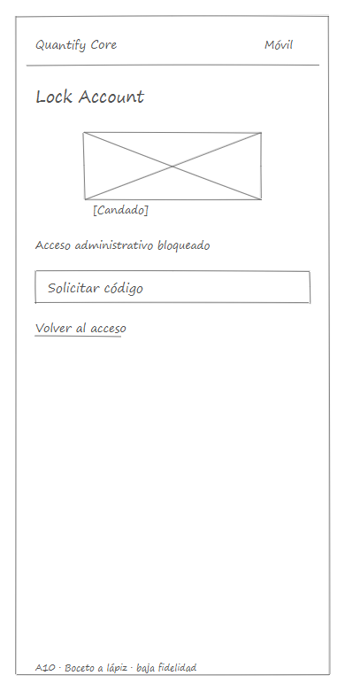

Bloqueo de ejemplo tras tres accesos administrativos fallidos.

| Campo | Especificación |
|---|---|
| Plataforma de destino | PWA con React/Vite y aplicación Flutter |
| Rol autorizado | Administrador |
| Módulo | Acceso |
| Elementos principales | Candado, explicación de bloqueo administrativo y solicitud de código |
| Requisitos / historias | [RF-01](../requerimientos/catalogo.md), [RF-09](../requerimientos/catalogo.md); historias expresadas en el catálogo canónico |
| Reglas de navegación / demo | RN02; [definición](#reglas-y-condiciones) |
| Referencia visual | [Sketch móvil](../GUI/prototipos/movil/sketches/practica-07/A10.png) · [Sketch PWA](../GUI/prototipos/pwa/sketches/practica-07/A10.png) |
| Fuente editable | [SVG móvil](../GUI/prototipos/movil/sketches/practica-07/A10.svg) · [SVG PWA](../GUI/prototipos/pwa/sketches/practica-07/A10.svg) |
| Recorrido interactivo | [Abrir pantalla](index.html#admin/A10) · [Ver nodo](mapa-completo.html#A10) |

**Acciones, condiciones y pantallas relacionadas**

| Acción o condición | Destino | Resultado |
|---|---|---|
| Solicitar desbloqueo | [A11](#a11) | Transición al sketch indicado |
| Volver; conserva bloqueo | [A01](#a01) | Transición al sketch indicado |

</details>

<a id="a11"></a>

<details>
<summary><strong>A11 · Unlock Account Code · Administrador</strong> — ficha individual</summary>

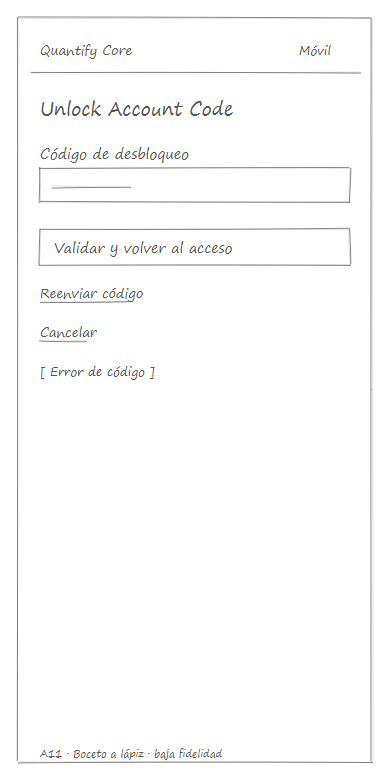

Desbloquear el acceso de ejemplo sin conceder una sesión.

| Campo | Especificación |
|---|---|
| Plataforma de destino | PWA con React/Vite y aplicación Flutter |
| Rol autorizado | Administrador |
| Módulo | Acceso |
| Elementos principales | Código de desbloqueo administrativo, error, reenvío y cancelar |
| Requisitos / historias | [RF-01](../requerimientos/catalogo.md), [RF-09](../requerimientos/catalogo.md); historias expresadas en el catálogo canónico |
| Reglas de navegación / demo | RN02; [definición](#reglas-y-condiciones) |
| Referencia visual | [Sketch móvil](../GUI/prototipos/movil/sketches/practica-07/A11.png) · [Sketch PWA](../GUI/prototipos/pwa/sketches/practica-07/A11.png) |
| Fuente editable | [SVG móvil](../GUI/prototipos/movil/sketches/practica-07/A11.svg) · [SVG PWA](../GUI/prototipos/pwa/sketches/practica-07/A11.svg) |
| Recorrido interactivo | [Abrir pantalla](index.html#admin/A11) · [Ver nodo](mapa-completo.html#A11) |

**Acciones, condiciones y pantallas relacionadas**

| Acción o condición | Destino | Resultado |
|---|---|---|
| Código válido; volver a iniciar sesión | [A01](#a01) | Transición al sketch indicado |
| Código inválido o reenviar | [A11](#a11) | Permanece en el sketch; muestra estado o validación |
| Cancelar; conserva bloqueo | [A10](#a10) | Transición al sketch indicado |

</details>

<!-- FICHAS:FIN -->

<a id="cumplimiento"></a>

## Cumplimiento de la consigna

Consigna: «Diagrama de Secuencia o Navegación de Sketches del Proyecto Integrador» suministrada por el solicitante. Revisión del 11 de noviembre de 2026 en `feature/practica-07-entrega-completa`.

**No se declara cierre al 100%:** los entregables locales de diseño y navegación están ampliados; falta regenerar el diagrama completo mediante Archify y completar la revisión, integración y publicación de esta rama. Los prompts históricos de Archify no están disponibles. Esta tabla distingue archivos existentes de pasos pendientes.

| Actividad de la consigna | Evidencia verificable | Estado |
|---|---|---|
| 1. Analizar requisitos, historias, reglas, actores y funciones | [Proceso y análisis](README.md#proceso), [catálogo canónico](../requerimientos/catalogo.md), requisitos y reglas por ID en [README.md#fichas](README.md#fichas) | Cubierto en la documentación |
| 2. Documentar roles, privilegios y restricciones | [Roles del README](README.md#roles-plataformas-y-alcance), fichas por rol, RN01 y escenario U22; administración sin datos privados | Cubierto en el diseño académico |
| 3. Estructura general de navegación y diferencias web/móvil | Entrada U16 → U17 → U01, recorridos del README y [mapa completo](mapa-completo.html); navegación inferior móvil y lateral PWA | Cubierto |
| 4. Nueve sketches generales obligatorios | [Tabla de correspondencia](README.md#nueve-pantallas-generales-obligatorias): U16, U17, U02, U04, U18, U19, U20, U21 y U06 | Nueve diseños independientes disponibles en ambos formatos |
| 5. Once sketches adicionales de funciones por rol | 24 vistas adicionales a las nueve generales; hábitos, registros, avisos, análisis, IA, perfil, archivo, catálogo, auditoría y gestión operativa | Supera el mínimo de once |
| 6. Componentes comprensibles y apariencia a lápiz | [Galería](galeria.html), 66 PNG exportados del visor y `sketch.css`: gris, tipografía manuscrita, contornos, recuadros e hachurado | Bocetos de baja fidelidad disponibles en PNG y SVG |
| 7. Documentar individualmente los veinte sketches | [33 fichas](README.md#fichas): ID, nombre, descripción, plataforma, rol, componentes, acciones, relaciones y requisitos/historias del catálogo | Supera el mínimo de veinte |
| 8. Transiciones y condiciones de acceso, error, recuperación, bloqueo, desbloqueo, salida, denegación y funciones | `data.js`, [mapa completo](mapa-completo.html), pruebas de lógica y escenarios de navegador | Cubierto en la simulación; sin autenticación productiva |
| 9. Diagrama general con nodos, direcciones, roles y condiciones | [Mapa completo interactivo](mapa-completo.html), [diagrama textual editable](navegacion-completa.mmd) e inventario del visor | Los 33 nodos y todas las transiciones están representados; el mapa muestra flechas por nodo seleccionado |
| 10. Generar diagrama interactivo con Archify | [HTML original de Archify](navegacion.html), [especificación original](navegacion.archify.json), recibo en [README.md#validacion](README.md#validacion) | Parcial: original de doce pantallas disponible; ampliación de 33 preparada en `navegacion-completa.archify.json`, pendiente de ejecutar con Archify |
| 11. Integrar referencias visuales y organizar los recorridos | Cada nodo del mapa completo abre su boceto, ficha y pantalla; galería por rol y formato, inventario por módulo | Cubierto mediante enlaces complementarios; el Archify original se conserva como antecedente |
| 12. Validar escenarios por rol, alternativas y retornos | [Pruebas y resultados](README.md#validacion), `tests/prototipo.test.cjs`, `tests/entrega-browser.cjs` y `evidencias/resultados-browser.json` | Comprobación automática de lógica y navegador; ver sus límites |
| 13. Documentar agente, herramientas, prompts, decisiones, relaciones, observaciones y correcciones | [README.md#proceso](README.md#proceso), fichas y [README.md#validacion](README.md#validacion) | Parcial: proceso actual registrado; falta recuperar el prompt histórico original o ejecutar y registrar la nueva generación de Archify |
| 14. Integrar archivos organizados en una rama y explicar consulta en README | Rama `feature/practica-07-entrega-completa`; README, prototipo y mapas en `docs/practica-07/`; bocetos en `docs/GUI/prototipos/{movil,pwa}/sketches/practica-07/` | Organización local cubierta; publicación de la rama pendiente |
| 15. Revisión final, commits descriptivos, integración revisada y enlace de entrega en GitHub | Validadores, bocetos, fichas y [Git Flow](../guias/git-flow.md); Pages configurado desde `develop` y `/ (root)` por el responsable | Pendiente de revisión e integración a `develop` y despliegue; una release posterior a `main` es independiente |

### Lista de cierre

- [x] Nueve pantallas generales independientes, incluidos bloqueo y desbloqueo por código.
- [x] Al menos once pantallas adicionales de funciones y veinte sketches totales.
- [x] Bocetos completos móvil/PWA en carpetas separadas y fichas por ID.
- [x] Mapa completo enlazado a los bocetos y al prototipo.
- [x] Roles, permisos de diseño, condiciones, errores, retornos y conservación de historial.
- [x] Pruebas de lógica y navegador; resultados y capturas revisables.
- [x] Acceso a la práctica desde el README raíz y GUI, sin duplicar el entregable.
- [ ] Ejecutar la especificación ampliada con Archify; conservar prompt real, HTML, recibo y evidencia de su revisión.
- [ ] Publicar la rama y abrir el pull request a `develop` para revisión del equipo.
- [ ] Integrar mediante Git Flow y publicar la versión aprobada; proporcionar el enlace de esa versión.

El mapa complementario, la especificación preparada y el prompt propuesto no sustituyen una ejecución demostrable de Archify. La fusión o publicación no se realiza como efecto de editar esta matriz.


<a id="proceso"></a>

## Proceso, decisiones y prompts

### Contexto y fuentes

Ampliación del 11 de noviembre de 2026 en `feature/practica-07-entrega-completa`, creada desde `develop` después de comprobar el estado limpio y obtener las referencias remotas. Se conserva el prototipo académico existente y la evidencia histórica del diagrama original de Archify.

Fuentes: [requisitos e historias](../requerimientos/catalogo.md), [reglas de producto](../requerimientos/reglas-negocio.md), [roles de Práctica 05](../Practica05/README.md), [arquitectura](../arquitectura/README.md), [contratos](../../packages/contracts/README.md) y la consigna de Práctica 07 suministrada por el solicitante. La [matriz de cumplimiento](README.md#cumplimiento) relaciona sus quince actividades con evidencias concretas.

### Herramientas y decisiones

- Codex: revisión del inventario, programación de las vistas adicionales, documentación, pruebas y generación de la especificación ampliada. No se invocó un agente Archify durante esta ampliación.
- HTML, CSS y JavaScript: visor académico existente. Se mantiene para diseñar recorridos; las plataformas de destino siguen siendo React/Vite y Flutter. No se cambia el stack del producto.
- Node.js: pruebas de lógica, generación reproducible de fichas y diagrama Mermaid.
- Playwright y Microsoft Edge: comprobación de navegador y exportación de imágenes de cada pantalla. Las versiones efectivamente utilizadas se registran en `evidencias/resultados-browser.json`.
- Archify: el artefacto original y su especificación se conservan sin cambios. No está disponible como herramienta ni ejecutable en esta sesión; la búsqueda del plugin por nombre tampoco encontró una conexión disponible. La procedencia original se documenta en `README.md#validacion`.

Los bocetos se dibujan con `scripts/dibujar-sketches.cjs`: líneas dobles de grafito, recuadros simples y textos cortos sobre blanco. No hay marcos de teléfono decorativos, tarjetas con acabado final, paleta ni sombras. Se exportan desde SVG a PNG y se guardan exclusivamente en las carpetas de sketches de GUI. El visor mantiene la interacción y un tratamiento sencillo con `sketch.css`. La identidad y los tokens del producto permanecen en sus fuentes canónicas.

Se conservan los IDs existentes U01–U15 y A01–A09 para no romper referencias. Se agregan U16–U22 y A10–A11. La pantalla de bienvenida no se reutiliza como Splash. El desbloqueo usa un contexto y código diferentes de la recuperación. La suspensión administrativa de A09 tampoco sustituye al bloqueo por intentos fallidos.

### Reglas de navegación y plataformas

#### Análisis de requisitos y restricciones

| Base | Aplicación al diseño |
|---|---|
| RF-01 y su historia de identidad | Inicialización, acceso, registro, recuperación y estados de bloqueo/desbloqueo; en producto se delegan a Keycloak. |
| RF-02 | Perfil y consentimiento explícito; el usuario controla el uso de sus datos. |
| RF-03 / RF-04 / RF-05 | Crear, editar, archivar, registrar una sola vez y conservar la lectura histórica de hábitos y métricas. |
| RF-06 / RF-07 | Avisos voluntarios y recomendaciones explicadas que requieren guardar para crear un hábito. |
| RF-09 / RF-10 | Catálogo, estados de cuentas ficticias, motivo y auditoría; sin acceso administrativo general a datos privados. |
| RF-08 | No se selecciona integración de dispositivos para esta práctica; no se simula recepción de biometría como función implementada. |
| RNF-01 / RNF-05 | Separación de roles, escenario de denegación y datos de demostración; la autorización productiva sigue siendo responsabilidad de la API. |
| RNF-02 / RNF-03 | Reintentos de progreso sin duplicados y fecha de ejemplo explícita; las reglas de concurrencia y zona de producto permanecen en sus contratos. |
| RNF-04 | Etiquetas de formulario, errores textuales, mapa por teclado y estados que no dependen del color. Las pruebas actuales no acreditan una auditoría WCAG completa. |
| RNF-08 / RNF-10 | Inventario compartido entre visor, galería, fichas y mapas; scripts, versiones y resultados reproducibles. |

Las historias asociadas se consultan en la columna de cada RF del catálogo canónico. No se asignan identificadores de historias o Jira inexistentes. RNF-06/07/09 de rendimiento, recuperación y observabilidad productiva no se declaran cumplidos mediante una demo de navegación.

Entrada principal U16 → U17 → U01. La carga y sus errores avanzan mediante controles explícitos para poder inspeccionar los estados. El visitante accede a autenticación, registro, recuperación e información; el usuario navega a su Home y recursos; la administración opera catálogo, estado de cuentas y datos agregados, sin rutinas privadas.

Tres fallos de credenciales sintácticamente válidas producen el bloqueo demo del rol. Un formulario vacío no cuenta como intento. Cancelar o volver no elimina el bloqueo. El código correcto `654321` desbloquea y vuelve al acceso; no concede una sesión. El código `123456` solo verifica registro o recuperación. Bloqueos y claves viven en memoria y se reinician al recargar: son una simulación académica, no una política de seguridad. El producto delega la identidad y sus políticas en Keycloak.

En móvil, navegación inferior y controles apilados; en PWA, menú lateral y distribución por columnas. El cambio de formato conserva la pantalla y los valores de formularios porque no vuelve a renderizar su contenido. Los enlaces del inventario, galería y mapas permiten revisar diseños directamente. El botón atrás de navegador y los retornos explícitos representan la navegación; la API de producto deberá aplicar permisos y propiedad independientemente de la vista.

### Prompts y solicitudes registrados

Síntesis de la solicitud de ampliación:

> Completar la Práctica 07 en una rama nueva; incorporar las pantallas faltantes, Login y Register completos, bocetos muy sencillos a lápiz y una organización profesional en GUI. Reunir la documentación en un solo README e integrar a develop mediante merge sin fast-forward.

La consigna exige nueve pantallas generales, once funcionalidades adicionales, fichas individuales, roles, transiciones, Archify, validación y entrega versionada. Se convirtió en la matriz de quince actividades sin afirmar que los pasos de publicación ya se realizaron.

**Prompt preparado para Archify, pendiente de ejecución:**

```text
Genera un diagrama interactivo de navegación de Quantify Core para la Práctica 07.
Usa navegacion-completa.archify.json y data.js como fuentes de nodos y relaciones.
Incluye los 33 sketches, separando Usuario/visitante y Administrador.
Representa todas las transiciones y condiciones, incluidos retornos y estados
que permanecen en la pantalla: acceso correcto/incorrecto, recuperación,
tres intentos fallidos, bloqueo, código incorrecto/correcto de desbloqueo,
cierre de sesión, acceso denegado y operaciones autorizadas por rol.
Los códigos y umbrales son exclusivamente demostrativos.
Enlaza cada nodo con galeria.html#ID y con index.html#rol/ID mediante
las capacidades admitidas por la herramienta o enlaces complementarios.
Conserva el destino PWA React/Vite y móvil Flutter, sin afirmar que el visor
HTML implementa esos clientes ni que autentica contra Keycloak.
Entrega un HTML completo, la especificación editable y un recibo de validación.
Verifica legibilidad, enlaces, retornos y visualización móvil/escritorio.
```

No se conserva el prompt de la generación original de Archify. Su recibo histórico no permite reconstruirlo; no se inventa una conversación de origen. El prompt anterior es una preparación para la siguiente ejecución, no evidencia de una llamada realizada.

### Observaciones y correcciones

1. El inventario inicial tenía 24 vistas, pero omitía seis tipos obligatorios. Se añadieron como pantallas independientes y se identificaron las nueve en la guía de la práctica.
2. El mapa original solo cubría doce pantallas. Se agregó un mapa completo derivado del mismo inventario con selección, flechas direccionales, condiciones, lista de transiciones y acceso al boceto.
3. Las fichas originales no detallaban elementos y requisitos por pantalla. Se añadieron metadatos por ID y una generación común para Markdown y galería.
4. El estilo conservaba acabados de interfaz final. Se añadió un tratamiento de baja fidelidad sin modificar la paleta institucional del producto.
5. Se incorporaron pruebas de bloqueo, cancelación, reenvío, validación del código y separación entre roles. Los resultados reales se registran en `README.md#validacion` y en las evidencias del navegador.
6. La documentación de acceso se conecta desde el README raíz, `docs/README.md` y `docs/GUI/README.md`, conservando una sola ubicación para la práctica.

### Revisión e integración

Rama de trabajo → pull request a `develop` → revisión del equipo → integración. La publicación final sigue el [Git Flow](../guias/git-flow.md) y el alcance autorizado. No fusionar esta rama directamente en `main`. El enlace público de GitHub Pages puede seguir mostrando la entrega anterior hasta su despliegue; los accesos relativos del repositorio corresponden al contenido de la rama revisada.


<a id="validacion"></a>

## Validación de la entrega

<!-- VALIDACION:ACTUAL -->

Comprobación del **11 de noviembre de 2026** con Node.js **v24.14.1**, Playwright **1.65.0** y Microsoft Edge **157.0.4341.46**.

| Control | Resultado |
|---|---|
| Lógica del prototipo | **25/25 pruebas aprobadas** |
| Navegador real | **12/12 escenarios aprobados**, sin errores de página ni respuestas HTTP fallidas |
| Inventario | 33 pantallas, nueve generales obligatorias, 24 adicionales y 131 transiciones con destino existente |
| Bocetos | 66 PNG y 66 SVG editables; móvil 390×780 y PWA 1040×780; grafito en escala de grises |
| Galería y mapa | Filtros, selección de nodos, bocetos y enlaces al prototipo comprobados |
| Adaptación | Prototipo, entrada, galería y mapa comprobados a 390 y 1440 píxeles sin desbordamiento de la página |
| Enlaces locales de la práctica | Sin destinos ausentes |
| Espacios y sintaxis | `git diff --check` y comprobación de sintaxis JavaScript sin errores |
| Validador documental general | Informa 12 referencias externas OpenAPI no soportadas por ese validador; contratos y script sin cambios respecto de `develop`. No informa enlaces Markdown ausentes en esta entrega. |

Resultados: [navegador](evidencias/resultados-browser.json) · [integridad](evidencias/integridad.json) · [lámina móvil](evidencias/contacto-movil.png) · [lámina PWA](evidencias/contacto-pwa.png).

Los escenarios comprueban inicialización y carga con error/reintento; bloqueo, cancelación y desbloqueo de ambos roles; recuperación y nueva clave; registro y verificación; información del software/equipo; acceso denegado; creación, edición, avance, recordatorio y archivo de hábito; paridad de formulario y auditoría administrativa. Se recorren además las 33 pantallas en ambos formatos. Se usa movimiento reducido para estabilizar la medición del contenido durante cambios de formato.

Las láminas de los 66 bocetos se inspeccionaron visualmente, además de revisar Login, Register y ejemplos individuales en ambos formatos. Las pruebas representan una simulación académica: no certifican Keycloak, API, clientes React/Flutter, biometría ni seguridad productiva. La especificación ampliada de Archify está preparada; no se afirma que haya sido ejecutada por esa herramienta.

<details>
<summary>Evidencia histórica conservada · octubre de 2026</summary>


Revisión realizada el **14 de octubre de 2026**, en la rama `practica-07-integradora`.

## Prototipo

- **16 pruebas de lógica aprobadas** con `node --test --test-timeout=10000 docs/practica-07/tests/prototipo.test.cjs`.
- Los 24 sketches generan contenido y todas las transiciones del inventario apuntan a pantallas existentes del mismo rol.
- Se comprobaron duplicados, frecuencias vacías, límites de avance, completar/deshacer, metas y frecuencias históricas, archivo, rachas, filtros de IA, descarte, aceptación, días de recordatorios, motivos administrativos, protección de la cuenta actual, auditoría y ausencia de contraseñas en el almacenamiento persistente.
- Sintaxis de `app.js` y `data.js` comprobada con `node --check`.
- Recursos locales de `index.html` encontrados; sin scripts ni estilos de red requeridos.
- Vista por HTTP local con respuesta **200 OK** y apertura directa del archivo HTML verificadas.

Las pruebas ejecutan la lógica real en un contexto JavaScript en memoria con adaptadores mínimos de formularios y DOM. No sustituyen una prueba automatizada de navegador.

## Revisión manual en Safari

Se inspeccionó la composición en una ventana de escritorio y en el modo responsivo a **390 × 844**. Se revisaron los formatos Móvil y PWA, el mapa integrado y la adaptación del inventario de pantallas.

Recorridos ejecutados en el navegador:

1. Inicio de sesión demo de usuario → Hoy.
2. Nuevo hábito → escribir nombre → cambiar a PWA conservando el formulario → guardar → detalle.
3. Cambiar al rol Administrador → acceso demo → resumen.
4. Catálogo → pausar plantilla → motivo y confirmación → estado pausado.
5. Auditoría → comprobar entidad, motivo y responsable del cambio.
6. Abrir el mapa y revisar las salidas del sketch y sus tarjetas de transiciones.
7. Abrir el diagrama general y revisar sus temas oscuro y claro.
8. Abrir el prototipo directamente desde `index.html` y comprobar su renderizado y datos iniciales.

No se midió automáticamente el desbordamiento del DOM ni se ejecutó una matriz automatizada de todos los sketches y resoluciones. La revisión móvil corresponde a la emulación de viewport, no a un dispositivo físico.

## Diagrama general de Archify

```text
diagram_type: workflow
output: docs/practica-07/navegacion.html
specification_sha256: 5e75eb90ec17e869bb8f3209ee5c8076bd07e5db614a82bfcfdf5db3d380f6cd
artifact_sha256: 35b50910d5f5b34847a36bb161482e5ffd9caac30cb52a3ab77c749ffa6f793d
specification_bytes: 3784
artifact_bytes: 810177
validation: 9/9 showcase, 0 errors, 0 warnings
browser_evidence: skipped
visual_review: passed
correction_rounds: 0
```

`deliver` finalizó correctamente y vincula la especificación con el HTML mediante los hashes anteriores. No se modificó el artefacto después de su entrega.

`browser_evidence: skipped` corresponde al resultado real de [navegacion.visual-check.json](./navegacion.visual-check.json): el verificador no encontró Chrome/Chromium. No se generaron capturas automáticas ni mediciones de sus cuatro viewports.

`visual_review: passed` se refiere exclusivamente a la inspección perceptual manual del HTML entregado en Safari, en los temas claro y oscuro. Las flechas y etiquetas de ambos recorridos resultaron legibles y sin superposiciones visibles en la ventana revisada. Esta inspección no cambia el resultado automático omitido ni acredita cobertura de 1440×900, 1600×1000, 1920×1080 y 2048×1320.

## Identidad de los archivos principales revisados

Después del ajuste visual a sketches, se volvieron a aprobar las 16 pruebas y la comprobación de sintaxis. Se inspeccionaron en Safari los recuadros de Análisis y del progreso de Hoy. Esta revisión adicional no modifica el diagrama independiente de Archify ni su recibo.

| Archivo | SHA-256 |
|---|---|
| `index.html` | `72f34110c708a66eace53a784652f0121a6466b6cdcdb1a983ea721f9e6dfa20` |
| `styles.css` | `42fd0335120fcffd051010c91de72419cbdd25ac7a41ba480491d7f3003d6c5d` |
| `data.js` | `0216b08e3eaf608e6b207b548785e6d73b162750f22ed3cc7d482f85ce985153` |
| `app.js` | `786da1caeff36e94522eec2cc3c0e5feb9b649dd29c60193b9aea1bb57ea62f5` |


## Correcciones y comprobación del 17 de octubre de 2026

- **21 de 21 pruebas de lógica aprobadas**: las 16 originales y 5 regresiones adicionales.
- Las cuentas recién registradas requieren el código antes de iniciar sesión. Pueden retomar la verificación; recuperar una cuenta pendiente no omite este paso. El acceso y la recuperación de la cuenta demo siguen funcionando.
- El centro de avisos deriva sus entradas de los recordatorios activos para el día de ejemplo. Refleja horario y días, excluye hábitos archivados, conserva el estado leído para el mismo aviso y escapa los nombres al generar HTML.
- El README identifica la captura aportada como U01 — Bienvenida, de una versión anterior del diseño. La imagen original se conserva.
- Las referencias a Práctica 05 apuntan a los archivos de `main` en GitHub, bajo `docs/Practica05`, para funcionar con ambas estructuras de carpetas. Se comprobó su existencia en la referencia local `main`; no se comprobó su disponibilidad por HTTP.
- Sintaxis JavaScript, recursos locales y espacios del diff comprobados. No se realizó una nueva revisión visual en navegador; la inspección de Safari descrita arriba corresponde al 14 de octubre.
- Los hashes de la tabla anterior son históricos. Estos son los hashes de los archivos modificados de la aplicación en esta revisión:

| Archivo | SHA-256 |
|---|---|
| `data.js` | `76fb52b24b3fd3ddcef44f6d9d3fffac15b45aa74f19be8338bb74700237af6f` |
| `app.js` | `cc7ee0135b272eb7cbab3677b76e4d15402d3289a62028e097a2a9e2543e5f0e` |


</details>
