# Fichas de los 33 sketches

[Galería visual](galeria.html) · [Explorador de navegación](navegacion.html)

Cada ficha reúne descripción, componentes, plataformas, rol, requisitos, historias, reglas, acciones y pantallas relacionadas. Los PNG y SVG permanecen en GUI. [Volver a los 15 puntos de la práctica](README.md).

<strong>U01 · Bienvenida</strong> — ficha individual

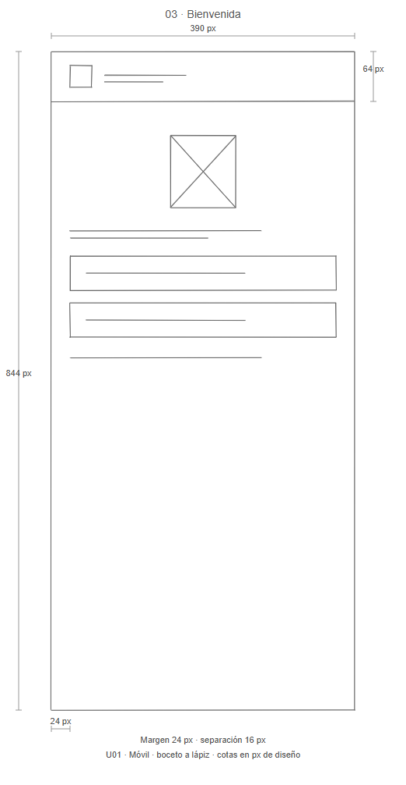

Presentación del seguimiento de hábitos y acceso a una rutina más consciente.

| Campo | Especificación |
|---|---|
| Plataforma de destino | PWA con React/Vite y aplicación Flutter |
| Rol autorizado | Usuario / visitante según el recorrido |
| Módulo | Acceso |
| Elementos principales | Presentación, imagen de referencia, beneficios, acceso, registro y enlace informativo |
| Requisitos / historias | [RF-01](../requerimientos/catalogo.md#rf-01); [HU-01](../UHs/README.md#hu-01) |
| Reglas de navegación / demo | RN02, RN13; [definición](referencia-tecnica.md#reglas-y-condiciones) |
| Referencia visual | [Sketch móvil](../GUI/prototipos/movil/sketches/practica-07/U01.png) · [Sketch PWA](../GUI/prototipos/pwa/sketches/practica-07/U01.png) |
| Fuente editable | [SVG móvil](../GUI/prototipos/movil/sketches/practica-07/U01.svg) · [SVG PWA](../GUI/prototipos/pwa/sketches/practica-07/U01.svg) |
| Recorrido interactivo | [Abrir pantalla](index.html#usuario/U01) · [Ver nodo](mapa-completo.html#U01) |

**Acciones, condiciones y pantallas relacionadas**

| Acción o condición | Destino | Resultado |
|---|---|---|
| Iniciar sesión | [U02](#u02) | Transición al sketch indicado |
| Crear cuenta | [U03](#u03) | Transición al sketch indicado |
| Acerca del software | [U20](#u20) | Transición al sketch indicado |

<strong>U02 · Login / Iniciar sesión</strong> — ficha individual

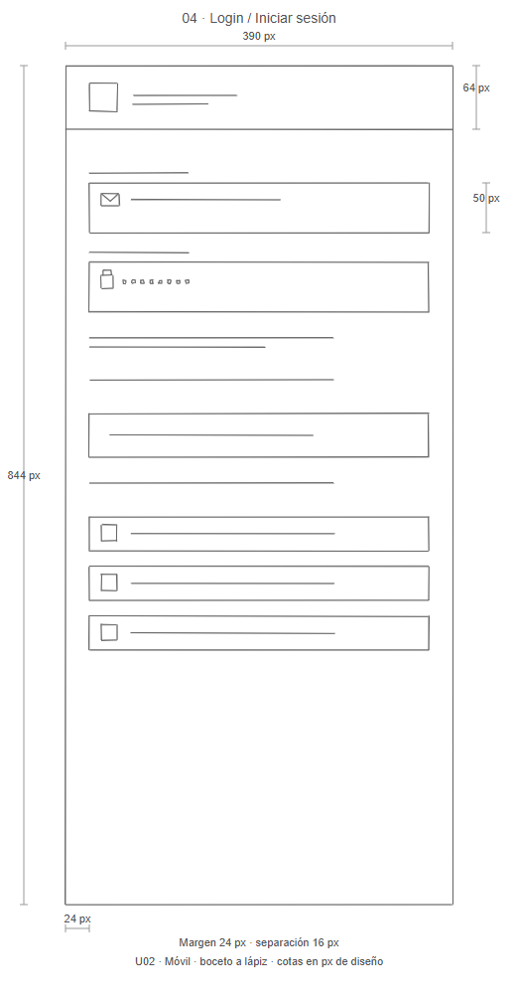

**Pantalla general obligatoria:** Login Screen.

Validar las credenciales de ejemplo y continuar a la rutina.

| Campo | Especificación |
|---|---|
| Plataforma de destino | PWA con React/Vite y aplicación Flutter |
| Rol autorizado | Usuario / visitante según el recorrido |
| Módulo | Acceso |
| Elementos principales | Correo, contraseña, error, contador de intentos, recuperación y registro |
| Requisitos / historias | [RF-01](../requerimientos/catalogo.md#rf-01); [HU-01](../UHs/README.md#hu-01) |
| Reglas de navegación / demo | RN02; [definición](referencia-tecnica.md#reglas-y-condiciones) |
| Referencia visual | [Sketch móvil](../GUI/prototipos/movil/sketches/practica-07/U02.png) · [Sketch PWA](../GUI/prototipos/pwa/sketches/practica-07/U02.png) |
| Fuente editable | [SVG móvil](../GUI/prototipos/movil/sketches/practica-07/U02.svg) · [SVG PWA](../GUI/prototipos/pwa/sketches/practica-07/U02.svg) |
| Recorrido interactivo | [Abrir pantalla](index.html#usuario/U02) · [Ver nodo](mapa-completo.html#U02) |

**Acciones, condiciones y pantallas relacionadas**

| Acción o condición | Destino | Resultado |
|---|---|---|
| Credenciales válidas | [U06](#u06) | Transición al sketch indicado |
| Credenciales inválidas | [U02](#u02) | Permanece en el sketch; muestra estado o validación |
| Crear cuenta | [U03](#u03) | Transición al sketch indicado |
| Olvidé mi contraseña | [U04](#u04) | Transición al sketch indicado |
| Continuar verificación pendiente | [U05](#u05) | Transición al sketch indicado |
| Volver | [U01](#u01) | Transición al sketch indicado |
| Tercer intento fallido o acceso bloqueado | [U18](#u18) | Transición al sketch indicado |

<strong>U03 · Register / Crear cuenta</strong> — ficha individual

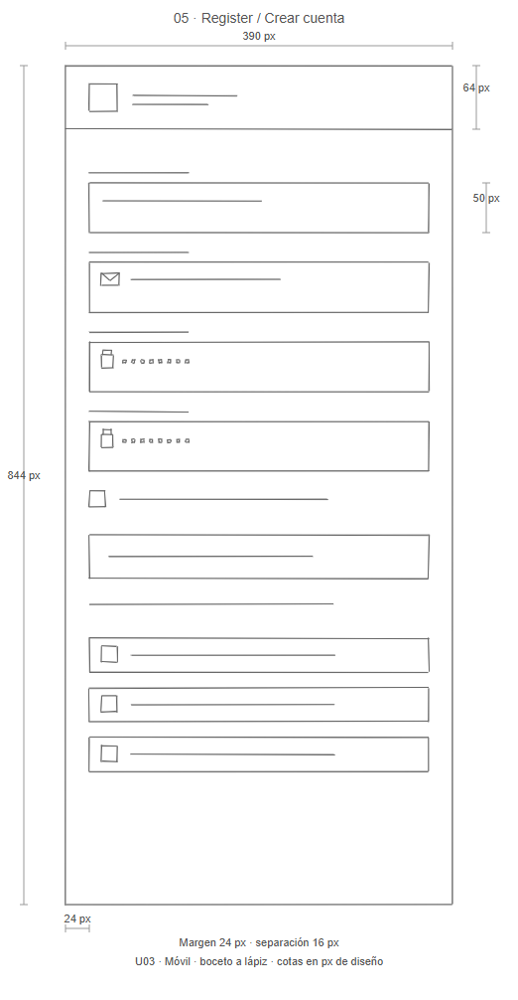

Capturar los datos y aceptar las condiciones antes de verificar la cuenta.

| Campo | Especificación |
|---|---|
| Plataforma de destino | PWA con React/Vite y aplicación Flutter |
| Rol autorizado | Usuario / visitante según el recorrido |
| Módulo | Acceso |
| Elementos principales | Nombre ficticio, correo demo, contraseña de prueba, aceptación y validación |
| Requisitos / historias | [RF-01](../requerimientos/catalogo.md#rf-01); [HU-01](../UHs/README.md#hu-01) |
| Reglas de navegación / demo | RN02; [definición](referencia-tecnica.md#reglas-y-condiciones) |
| Referencia visual | [Sketch móvil](../GUI/prototipos/movil/sketches/practica-07/U03.png) · [Sketch PWA](../GUI/prototipos/pwa/sketches/practica-07/U03.png) |
| Fuente editable | [SVG móvil](../GUI/prototipos/movil/sketches/practica-07/U03.svg) · [SVG PWA](../GUI/prototipos/pwa/sketches/practica-07/U03.svg) |
| Recorrido interactivo | [Abrir pantalla](index.html#usuario/U03) · [Ver nodo](mapa-completo.html#U03) |

**Acciones, condiciones y pantallas relacionadas**

| Acción o condición | Destino | Resultado |
|---|---|---|
| Datos válidos | [U05](#u05) | Transición al sketch indicado |
| Corregir datos | [U03](#u03) | Permanece en el sketch; muestra estado o validación |
| Ya tengo cuenta | [U02](#u02) | Transición al sketch indicado |

<strong>U04 · Recuperar acceso</strong> — ficha individual

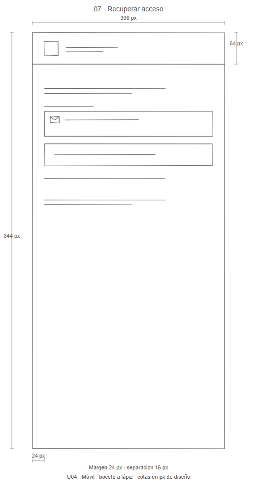

**Pantalla general obligatoria:** Recovery Account or Password.

Iniciar una recuperación simulada sin enviar correos.

| Campo | Especificación |
|---|---|
| Plataforma de destino | PWA con React/Vite y aplicación Flutter |
| Rol autorizado | Usuario / visitante según el recorrido |
| Módulo | Acceso |
| Elementos principales | Correo demo, solicitud de código, aviso de simulación y cancelar |
| Requisitos / historias | [RF-01](../requerimientos/catalogo.md#rf-01); [HU-01](../UHs/README.md#hu-01) |
| Reglas de navegación / demo | RN02; [definición](referencia-tecnica.md#reglas-y-condiciones) |
| Referencia visual | [Sketch móvil](../GUI/prototipos/movil/sketches/practica-07/U04.png) · [Sketch PWA](../GUI/prototipos/pwa/sketches/practica-07/U04.png) |
| Fuente editable | [SVG móvil](../GUI/prototipos/movil/sketches/practica-07/U04.svg) · [SVG PWA](../GUI/prototipos/pwa/sketches/practica-07/U04.svg) |
| Recorrido interactivo | [Abrir pantalla](index.html#usuario/U04) · [Ver nodo](mapa-completo.html#U04) |

**Acciones, condiciones y pantallas relacionadas**

| Acción o condición | Destino | Resultado |
|---|---|---|
| Solicitar código demo | [U05](#u05) | Transición al sketch indicado |
| Cancelar | [U02](#u02) | Transición al sketch indicado |

<strong>U05 · Verificar código</strong> — ficha individual

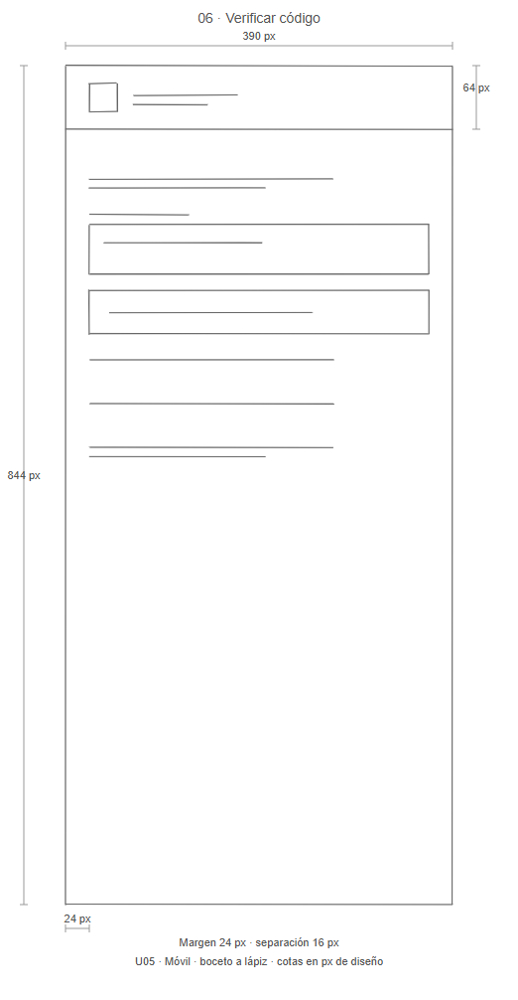

Verificación demostrativa del registro o de una recuperación.

| Campo | Especificación |
|---|---|
| Plataforma de destino | PWA con React/Vite y aplicación Flutter |
| Rol autorizado | Usuario / visitante según el recorrido |
| Módulo | Acceso |
| Elementos principales | Código de seis dígitos, contexto registro/recuperación, error y reenvío |
| Requisitos / historias | [RF-01](../requerimientos/catalogo.md#rf-01); [HU-01](../UHs/README.md#hu-01) |
| Reglas de navegación / demo | RN02; [definición](referencia-tecnica.md#reglas-y-condiciones) |
| Referencia visual | [Sketch móvil](../GUI/prototipos/movil/sketches/practica-07/U05.png) · [Sketch PWA](../GUI/prototipos/pwa/sketches/practica-07/U05.png) |
| Fuente editable | [SVG móvil](../GUI/prototipos/movil/sketches/practica-07/U05.svg) · [SVG PWA](../GUI/prototipos/pwa/sketches/practica-07/U05.svg) |
| Recorrido interactivo | [Abrir pantalla](index.html#usuario/U05) · [Ver nodo](mapa-completo.html#U05) |

**Acciones, condiciones y pantallas relacionadas**

| Acción o condición | Destino | Resultado |
|---|---|---|
| Código válido · registro | [U06](#u06) | Transición al sketch indicado |
| Código válido · recuperación | [U15](#u15) | Transición al sketch indicado |
| Código inválido o reenviar | [U05](#u05) | Permanece en el sketch; muestra estado o validación |
| Cancelar | [U02](#u02) | Transición al sketch indicado |

<strong>U06 · Hoy / Mis hábitos</strong> — ficha individual

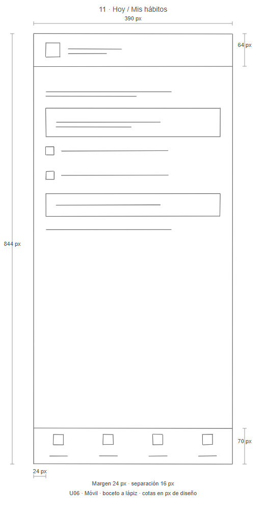

**Pantalla general obligatoria:** Home.

Visualizar el progreso y los hábitos programados para el día de ejemplo.

| Campo | Especificación |
|---|---|
| Plataforma de destino | PWA con React/Vite y aplicación Flutter |
| Rol autorizado | Usuario / visitante según el recorrido |
| Módulo | Rutina |
| Elementos principales | Resumen diario, progreso, filtros, lista de hábitos y navegación principal |
| Requisitos / historias | [RF-03](../requerimientos/catalogo.md#rf-03), [RF-04](../requerimientos/catalogo.md#rf-04), [RF-05](../requerimientos/catalogo.md#rf-05); [HU-03](../UHs/README.md#hu-03), [HU-04](../UHs/README.md#hu-04), [HU-05](../UHs/README.md#hu-05) |
| Reglas de navegación / demo | RN04, RN05; [definición](referencia-tecnica.md#reglas-y-condiciones) |
| Referencia visual | [Sketch móvil](../GUI/prototipos/movil/sketches/practica-07/U06.png) · [Sketch PWA](../GUI/prototipos/pwa/sketches/practica-07/U06.png) |
| Fuente editable | [SVG móvil](../GUI/prototipos/movil/sketches/practica-07/U06.svg) · [SVG PWA](../GUI/prototipos/pwa/sketches/practica-07/U06.svg) |
| Recorrido interactivo | [Abrir pantalla](index.html#usuario/U06) · [Ver nodo](mapa-completo.html#U06) |

**Acciones, condiciones y pantallas relacionadas**

| Acción o condición | Destino | Resultado |
|---|---|---|
| Nuevo hábito | [U07](#u07) | Transición al sketch indicado |
| Abrir hábito | [U08](#u08) | Transición al sketch indicado |
| Completar o deshacer | [U06](#u06) | Permanece en el sketch; muestra estado o validación |
| Ver avisos | [U14](#u14) | Transición al sketch indicado |
| Análisis | [U10](#u10) | Transición al sketch indicado |
| IA Coach | [U11](#u11) | Transición al sketch indicado |
| Ajustes | [U12](#u12) | Transición al sketch indicado |

<strong>U07 · Crear / editar hábito</strong> — ficha individual

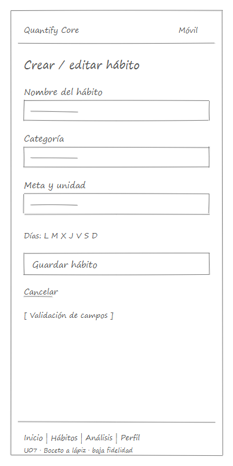

Personalizar la meta, la frecuencia y el color, con validación antes de guardar.

| Campo | Especificación |
|---|---|
| Plataforma de destino | PWA con React/Vite y aplicación Flutter |
| Rol autorizado | Usuario / visitante según el recorrido |
| Módulo | Rutina |
| Elementos principales | Nombre, categoría, frecuencia, meta, unidad, color, guardar y cancelar |
| Requisitos / historias | [RF-03](../requerimientos/catalogo.md#rf-03); [HU-03](../UHs/README.md#hu-03) |
| Reglas de navegación / demo | RN03, RN09; [definición](referencia-tecnica.md#reglas-y-condiciones) |
| Referencia visual | [Sketch móvil](../GUI/prototipos/movil/sketches/practica-07/U07.png) · [Sketch PWA](../GUI/prototipos/pwa/sketches/practica-07/U07.png) |
| Fuente editable | [SVG móvil](../GUI/prototipos/movil/sketches/practica-07/U07.svg) · [SVG PWA](../GUI/prototipos/pwa/sketches/practica-07/U07.svg) |
| Recorrido interactivo | [Abrir pantalla](index.html#usuario/U07) · [Ver nodo](mapa-completo.html#U07) |

**Acciones, condiciones y pantallas relacionadas**

| Acción o condición | Destino | Resultado |
|---|---|---|
| Guardar válido | [U08](#u08) | Transición al sketch indicado |
| Datos inválidos | [U07](#u07) | Permanece en el sketch; muestra estado o validación |
| Cancelar creación | [U06](#u06) | Transición al sketch indicado |
| Cancelar edición | [U08](#u08) | Transición al sketch indicado |

<strong>U08 · Detalle del hábito</strong> — ficha individual

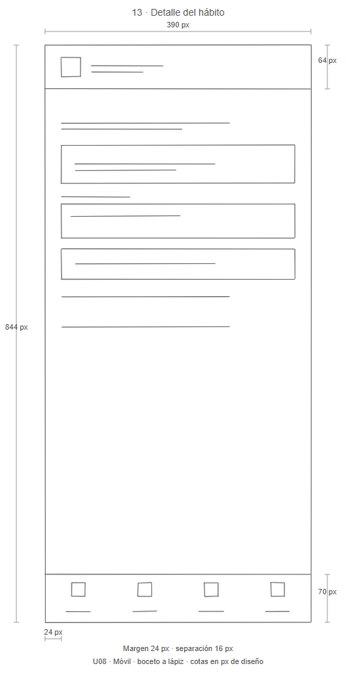

Registrar avances parciales, completar el día o revisar la racha.

| Campo | Especificación |
|---|---|
| Plataforma de destino | PWA con React/Vite y aplicación Flutter |
| Rol autorizado | Usuario / visitante según el recorrido |
| Módulo | Rutina |
| Elementos principales | Meta, avance parcial, racha, historial, edición, recordatorio y archivo |
| Requisitos / historias | [RF-04](../requerimientos/catalogo.md#rf-04), [RF-05](../requerimientos/catalogo.md#rf-05); [HU-04](../UHs/README.md#hu-04), [HU-05](../UHs/README.md#hu-05) |
| Reglas de navegación / demo | RN04, RN05, RN06; [definición](referencia-tecnica.md#reglas-y-condiciones) |
| Referencia visual | [Sketch móvil](../GUI/prototipos/movil/sketches/practica-07/U08.png) · [Sketch PWA](../GUI/prototipos/pwa/sketches/practica-07/U08.png) |
| Fuente editable | [SVG móvil](../GUI/prototipos/movil/sketches/practica-07/U08.svg) · [SVG PWA](../GUI/prototipos/pwa/sketches/practica-07/U08.svg) |
| Recorrido interactivo | [Abrir pantalla](index.html#usuario/U08) · [Ver nodo](mapa-completo.html#U08) |

**Acciones, condiciones y pantallas relacionadas**

| Acción o condición | Destino | Resultado |
|---|---|---|
| Editar | [U07](#u07) | Transición al sketch indicado |
| Recordatorio | [U09](#u09) | Transición al sketch indicado |
| Archivar | [U13](#u13) | Transición al sketch indicado |
| Guardar avance o deshacer | [U08](#u08) | Permanece en el sketch; muestra estado o validación |
| Ver análisis | [U10](#u10) | Transición al sketch indicado |
| Volver a Hoy | [U06](#u06) | Transición al sketch indicado |

<strong>U09 · Recordatorio</strong> — ficha individual

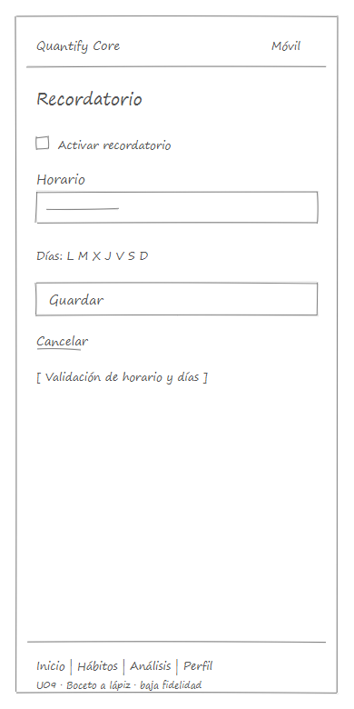

Definir días y horario de un aviso simulado para el hábito seleccionado.

| Campo | Especificación |
|---|---|
| Plataforma de destino | PWA con React/Vite y aplicación Flutter |
| Rol autorizado | Usuario / visitante según el recorrido |
| Módulo | Rutina |
| Elementos principales | Días compatibles, horario, aviso voluntario, guardar y cancelar |
| Requisitos / historias | [RF-06](../requerimientos/catalogo.md#rf-06); [HU-06](../UHs/README.md#hu-06) |
| Reglas de navegación / demo | RN07; [definición](referencia-tecnica.md#reglas-y-condiciones) |
| Referencia visual | [Sketch móvil](../GUI/prototipos/movil/sketches/practica-07/U09.png) · [Sketch PWA](../GUI/prototipos/pwa/sketches/practica-07/U09.png) |
| Fuente editable | [SVG móvil](../GUI/prototipos/movil/sketches/practica-07/U09.svg) · [SVG PWA](../GUI/prototipos/pwa/sketches/practica-07/U09.svg) |
| Recorrido interactivo | [Abrir pantalla](index.html#usuario/U09) · [Ver nodo](mapa-completo.html#U09) |

**Acciones, condiciones y pantallas relacionadas**

| Acción o condición | Destino | Resultado |
|---|---|---|
| Guardar o cancelar | [U08](#u08) | Transición al sketch indicado |
| Corregir horario o días | [U09](#u09) | Permanece en el sketch; muestra estado o validación |

<strong>U10 · Análisis y rachas</strong> — ficha individual

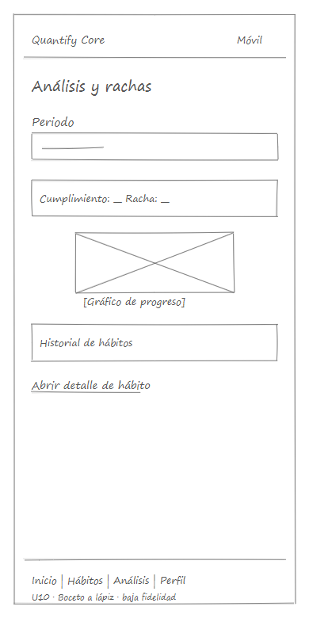

Consultar resultados calculados con los registros locales de ejemplo.

| Campo | Especificación |
|---|---|
| Plataforma de destino | PWA con React/Vite y aplicación Flutter |
| Rol autorizado | Usuario / visitante según el recorrido |
| Módulo | Seguimiento |
| Elementos principales | Periodo, métricas, referencia de gráfico e historial por hábito |
| Requisitos / historias | [RF-05](../requerimientos/catalogo.md#rf-05); [HU-05](../UHs/README.md#hu-05) |
| Reglas de navegación / demo | RN05, RN06; [definición](referencia-tecnica.md#reglas-y-condiciones) |
| Referencia visual | [Sketch móvil](../GUI/prototipos/movil/sketches/practica-07/U10.png) · [Sketch PWA](../GUI/prototipos/pwa/sketches/practica-07/U10.png) |
| Fuente editable | [SVG móvil](../GUI/prototipos/movil/sketches/practica-07/U10.svg) · [SVG PWA](../GUI/prototipos/pwa/sketches/practica-07/U10.svg) |
| Recorrido interactivo | [Abrir pantalla](index.html#usuario/U10) · [Ver nodo](mapa-completo.html#U10) |

**Acciones, condiciones y pantallas relacionadas**

| Acción o condición | Destino | Resultado |
|---|---|---|
| Cambiar periodo | [U10](#u10) | Permanece en el sketch; muestra estado o validación |
| Ver hábito | [U08](#u08) | Transición al sketch indicado |
| Hoy | [U06](#u06) | Transición al sketch indicado |
| IA Coach | [U11](#u11) | Transición al sketch indicado |
| Ajustes | [U12](#u12) | Transición al sketch indicado |

<strong>U11 · IA Coach</strong> — ficha individual

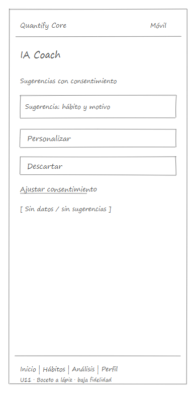

Recomendaciones explicables con consentimiento, umbral y control de duplicados.

| Campo | Especificación |
|---|---|
| Plataforma de destino | PWA con React/Vite y aplicación Flutter |
| Rol autorizado | Usuario / visitante según el recorrido |
| Módulo | Seguimiento |
| Elementos principales | Consentimiento, tarjetas de sugerencias, explicación, personalizar y descartar |
| Requisitos / historias | [RF-07](../requerimientos/catalogo.md#rf-07); [HU-07](../UHs/README.md#hu-07) |
| Reglas de navegación / demo | RN08, RN09, RN10; [definición](referencia-tecnica.md#reglas-y-condiciones) |
| Referencia visual | [Sketch móvil](../GUI/prototipos/movil/sketches/practica-07/U11.png) · [Sketch PWA](../GUI/prototipos/pwa/sketches/practica-07/U11.png) |
| Fuente editable | [SVG móvil](../GUI/prototipos/movil/sketches/practica-07/U11.svg) · [SVG PWA](../GUI/prototipos/pwa/sketches/practica-07/U11.svg) |
| Recorrido interactivo | [Abrir pantalla](index.html#usuario/U11) · [Ver nodo](mapa-completo.html#U11) |

**Acciones, condiciones y pantallas relacionadas**

| Acción o condición | Destino | Resultado |
|---|---|---|
| Personalizar sugerencia | [U07](#u07) | Transición al sketch indicado |
| Descartar por 21 días | [U11](#u11) | Permanece en el sketch; muestra estado o validación |
| Cambiar consentimiento | [U12](#u12) | Transición al sketch indicado |
| Hoy | [U06](#u06) | Transición al sketch indicado |
| Análisis | [U10](#u10) | Transición al sketch indicado |
| Ajustes | [U12](#u12) | Transición al sketch indicado |

<strong>U12 · Perfil y ajustes</strong> — ficha individual

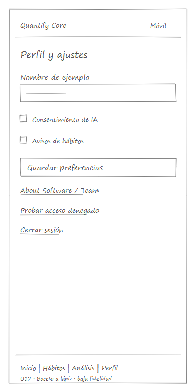

Preferencias de privacidad y avisos. Solo se conservan datos de demostración.

| Campo | Especificación |
|---|---|
| Plataforma de destino | PWA con React/Vite y aplicación Flutter |
| Rol autorizado | Usuario / visitante según el recorrido |
| Módulo | Cuenta |
| Elementos principales | Nombre de ejemplo, consentimiento, preferencias, información y cierre de sesión |
| Requisitos / historias | [RF-02](../requerimientos/catalogo.md#rf-02); [HU-02](../UHs/README.md#hu-02) |
| Reglas de navegación / demo | RN02, RN07, RN08; [definición](referencia-tecnica.md#reglas-y-condiciones) |
| Referencia visual | [Sketch móvil](../GUI/prototipos/movil/sketches/practica-07/U12.png) · [Sketch PWA](../GUI/prototipos/pwa/sketches/practica-07/U12.png) |
| Fuente editable | [SVG móvil](../GUI/prototipos/movil/sketches/practica-07/U12.svg) · [SVG PWA](../GUI/prototipos/pwa/sketches/practica-07/U12.svg) |
| Recorrido interactivo | [Abrir pantalla](index.html#usuario/U12) · [Ver nodo](mapa-completo.html#U12) |

**Acciones, condiciones y pantallas relacionadas**

| Acción o condición | Destino | Resultado |
|---|---|---|
| Guardar preferencias | [U12](#u12) | Permanece en el sketch; muestra estado o validación |
| Ver avisos | [U14](#u14) | Transición al sketch indicado |
| Cerrar sesión | [U02](#u02) | Transición al sketch indicado |
| Hoy | [U06](#u06) | Transición al sketch indicado |
| Análisis | [U10](#u10) | Transición al sketch indicado |
| IA Coach | [U11](#u11) | Transición al sketch indicado |
| Acerca del software | [U20](#u20) | Transición al sketch indicado |
| Intentar módulo administrativo | [U22](#u22) | Transición al sketch indicado |

<strong>U13 · Archivar hábito</strong> — ficha individual

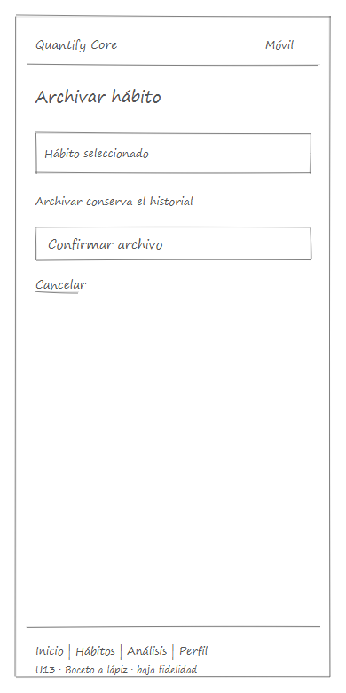

Confirmar una acción que conserva los registros históricos.

| Campo | Especificación |
|---|---|
| Plataforma de destino | PWA con React/Vite y aplicación Flutter |
| Rol autorizado | Usuario / visitante según el recorrido |
| Módulo | Rutina |
| Elementos principales | Resumen del hábito, advertencia de conservación del historial y confirmación |
| Requisitos / historias | [RF-03](../requerimientos/catalogo.md#rf-03); [HU-03](../UHs/README.md#hu-03) |
| Reglas de navegación / demo | RN06; [definición](referencia-tecnica.md#reglas-y-condiciones) |
| Referencia visual | [Sketch móvil](../GUI/prototipos/movil/sketches/practica-07/U13.png) · [Sketch PWA](../GUI/prototipos/pwa/sketches/practica-07/U13.png) |
| Fuente editable | [SVG móvil](../GUI/prototipos/movil/sketches/practica-07/U13.svg) · [SVG PWA](../GUI/prototipos/pwa/sketches/practica-07/U13.svg) |
| Recorrido interactivo | [Abrir pantalla](index.html#usuario/U13) · [Ver nodo](mapa-completo.html#U13) |

**Acciones, condiciones y pantallas relacionadas**

| Acción o condición | Destino | Resultado |
|---|---|---|
| Confirmar archivo | [U06](#u06) | Transición al sketch indicado |
| Cancelar | [U08](#u08) | Transición al sketch indicado |

<strong>U14 · Centro de avisos</strong> — ficha individual

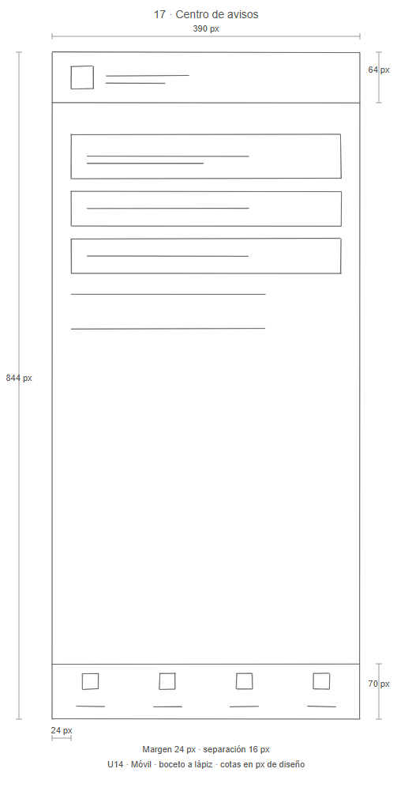

Avisos locales de ejemplo con estado leído y acceso al hábito asociado.

| Campo | Especificación |
|---|---|
| Plataforma de destino | PWA con React/Vite y aplicación Flutter |
| Rol autorizado | Usuario / visitante según el recorrido |
| Módulo | Cuenta |
| Elementos principales | Lista de avisos, horario, estado leído y enlace al hábito asociado |
| Requisitos / historias | [RF-06](../requerimientos/catalogo.md#rf-06); [HU-06](../UHs/README.md#hu-06) |
| Reglas de navegación / demo | RN07; [definición](referencia-tecnica.md#reglas-y-condiciones) |
| Referencia visual | [Sketch móvil](../GUI/prototipos/movil/sketches/practica-07/U14.png) · [Sketch PWA](../GUI/prototipos/pwa/sketches/practica-07/U14.png) |
| Fuente editable | [SVG móvil](../GUI/prototipos/movil/sketches/practica-07/U14.svg) · [SVG PWA](../GUI/prototipos/pwa/sketches/practica-07/U14.svg) |
| Recorrido interactivo | [Abrir pantalla](index.html#usuario/U14) · [Ver nodo](mapa-completo.html#U14) |

**Acciones, condiciones y pantallas relacionadas**

| Acción o condición | Destino | Resultado |
|---|---|---|
| Abrir hábito asociado | [U08](#u08) | Transición al sketch indicado |
| Marcar como leído | [U14](#u14) | Permanece en el sketch; muestra estado o validación |
| Preferencias | [U12](#u12) | Transición al sketch indicado |
| Volver | [U06](#u06) | Transición al sketch indicado |

<strong>U15 · Nueva contraseña</strong> — ficha individual

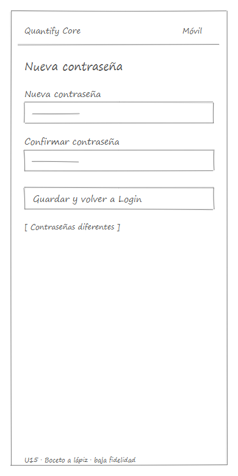

Completar la recuperación simulada. La nueva clave vive solo en memoria.

| Campo | Especificación |
|---|---|
| Plataforma de destino | PWA con React/Vite y aplicación Flutter |
| Rol autorizado | Usuario / visitante según el recorrido |
| Módulo | Acceso |
| Elementos principales | Nueva contraseña de prueba, confirmación, error y guardar |
| Requisitos / historias | [RF-01](../requerimientos/catalogo.md#rf-01); [HU-01](../UHs/README.md#hu-01) |
| Reglas de navegación / demo | RN02; [definición](referencia-tecnica.md#reglas-y-condiciones) |
| Referencia visual | [Sketch móvil](../GUI/prototipos/movil/sketches/practica-07/U15.png) · [Sketch PWA](../GUI/prototipos/pwa/sketches/practica-07/U15.png) |
| Fuente editable | [SVG móvil](../GUI/prototipos/movil/sketches/practica-07/U15.svg) · [SVG PWA](../GUI/prototipos/pwa/sketches/practica-07/U15.svg) |
| Recorrido interactivo | [Abrir pantalla](index.html#usuario/U15) · [Ver nodo](mapa-completo.html#U15) |

**Acciones, condiciones y pantallas relacionadas**

| Acción o condición | Destino | Resultado |
|---|---|---|
| Guardar clave válida | [U02](#u02) | Transición al sketch indicado |
| Corregir clave | [U15](#u15) | Permanece en el sketch; muestra estado o validación |

<strong>U16 · Splash Screen</strong> — ficha individual

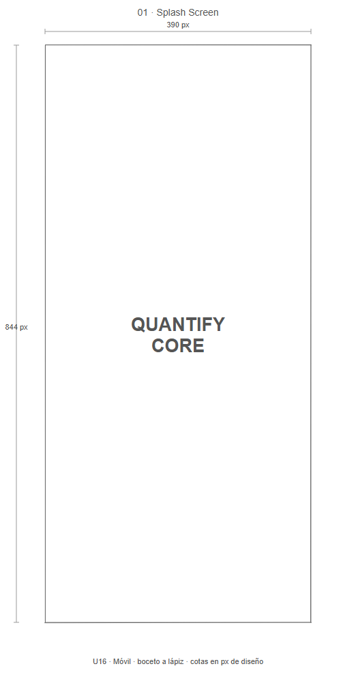

**Pantalla general obligatoria:** Splash Screen.

Identificar el producto al iniciar la aplicación.

| Campo | Especificación |
|---|---|
| Plataforma de destino | PWA con React/Vite y aplicación Flutter |
| Rol autorizado | Usuario / visitante según el recorrido |
| Módulo | Acceso |
| Elementos principales | Identidad del producto, texto de inicialización y continuar |
| Requisitos / historias | [RF-01](../requerimientos/catalogo.md#rf-01); [HU-01](../UHs/README.md#hu-01) |
| Reglas de navegación / demo | RN13; [definición](referencia-tecnica.md#reglas-y-condiciones) |
| Referencia visual | [Sketch móvil](../GUI/prototipos/movil/sketches/practica-07/U16.png) · [Sketch PWA](../GUI/prototipos/pwa/sketches/practica-07/U16.png) |
| Fuente editable | [SVG móvil](../GUI/prototipos/movil/sketches/practica-07/U16.svg) · [SVG PWA](../GUI/prototipos/pwa/sketches/practica-07/U16.svg) |
| Recorrido interactivo | [Abrir pantalla](index.html#usuario/U16) · [Ver nodo](mapa-completo.html#U16) |

**Acciones, condiciones y pantallas relacionadas**

| Acción o condición | Destino | Resultado |
|---|---|---|
| Continuar inicialización | [U17](#u17) | Transición al sketch indicado |

<strong>U17 · Loading Screen</strong> — ficha individual

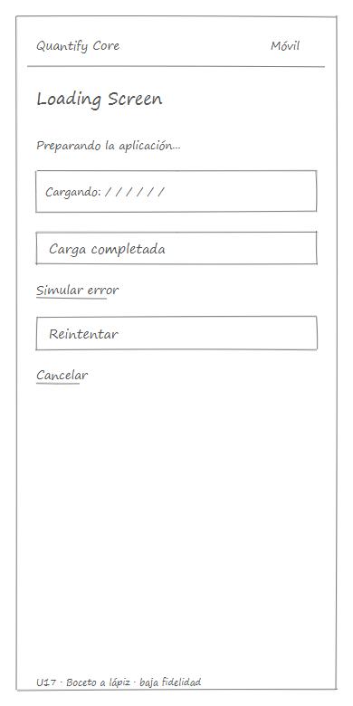

**Pantalla general obligatoria:** Loading Screen.

Mostrar la carga inicial, reintento y salida ante un fallo.

| Campo | Especificación |
|---|---|
| Plataforma de destino | PWA con React/Vite y aplicación Flutter |
| Rol autorizado | Usuario / visitante según el recorrido |
| Módulo | Acceso |
| Elementos principales | Indicador de carga, mensaje de error, completar, reintentar y cancelar |
| Requisitos / historias | [RF-01](../requerimientos/catalogo.md#rf-01); [HU-01](../UHs/README.md#hu-01) |
| Reglas de navegación / demo | RN13; [definición](referencia-tecnica.md#reglas-y-condiciones) |
| Referencia visual | [Sketch móvil](../GUI/prototipos/movil/sketches/practica-07/U17.png) · [Sketch PWA](../GUI/prototipos/pwa/sketches/practica-07/U17.png) |
| Fuente editable | [SVG móvil](../GUI/prototipos/movil/sketches/practica-07/U17.svg) · [SVG PWA](../GUI/prototipos/pwa/sketches/practica-07/U17.svg) |
| Recorrido interactivo | [Abrir pantalla](index.html#usuario/U17) · [Ver nodo](mapa-completo.html#U17) |

**Acciones, condiciones y pantallas relacionadas**

| Acción o condición | Destino | Resultado |
|---|---|---|
| Carga completada | [U01](#u01) | Transición al sketch indicado |
| Error o reintentar | [U17](#u17) | Permanece en el sketch; muestra estado o validación |
| Cancelar | [U16](#u16) | Transición al sketch indicado |

<strong>U18 · Lock Account</strong> — ficha individual

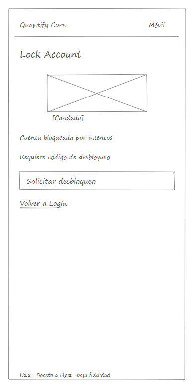

**Pantalla general obligatoria:** Lock Account.

Informar el bloqueo temporal después de tres intentos fallidos de demostración.

| Campo | Especificación |
|---|---|
| Plataforma de destino | PWA con React/Vite y aplicación Flutter |
| Rol autorizado | Usuario / visitante según el recorrido |
| Módulo | Acceso |
| Elementos principales | Candado, explicación del bloqueo, solicitar código y volver |
| Requisitos / historias | [RF-01](../requerimientos/catalogo.md#rf-01); [HU-01](../UHs/README.md#hu-01) |
| Reglas de navegación / demo | RN02; [definición](referencia-tecnica.md#reglas-y-condiciones) |
| Referencia visual | [Sketch móvil](../GUI/prototipos/movil/sketches/practica-07/U18.png) · [Sketch PWA](../GUI/prototipos/pwa/sketches/practica-07/U18.png) |
| Fuente editable | [SVG móvil](../GUI/prototipos/movil/sketches/practica-07/U18.svg) · [SVG PWA](../GUI/prototipos/pwa/sketches/practica-07/U18.svg) |
| Recorrido interactivo | [Abrir pantalla](index.html#usuario/U18) · [Ver nodo](mapa-completo.html#U18) |

**Acciones, condiciones y pantallas relacionadas**

| Acción o condición | Destino | Resultado |
|---|---|---|
| Solicitar desbloqueo | [U19](#u19) | Transición al sketch indicado |
| Volver al acceso; conserva bloqueo | [U02](#u02) | Transición al sketch indicado |

<strong>U19 · Unlock Account Code</strong> — ficha individual

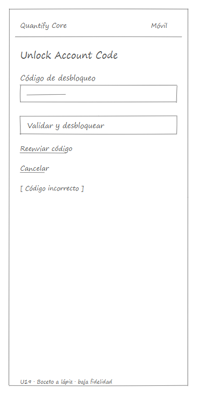

**Pantalla general obligatoria:** Unlock Account Code.

Validar un código exclusivo del recorrido de desbloqueo.

| Campo | Especificación |
|---|---|
| Plataforma de destino | PWA con React/Vite y aplicación Flutter |
| Rol autorizado | Usuario / visitante según el recorrido |
| Módulo | Acceso |
| Elementos principales | Código de desbloqueo, error, validación, reenvío y cancelar |
| Requisitos / historias | [RF-01](../requerimientos/catalogo.md#rf-01); [HU-01](../UHs/README.md#hu-01) |
| Reglas de navegación / demo | RN02; [definición](referencia-tecnica.md#reglas-y-condiciones) |
| Referencia visual | [Sketch móvil](../GUI/prototipos/movil/sketches/practica-07/U19.png) · [Sketch PWA](../GUI/prototipos/pwa/sketches/practica-07/U19.png) |
| Fuente editable | [SVG móvil](../GUI/prototipos/movil/sketches/practica-07/U19.svg) · [SVG PWA](../GUI/prototipos/pwa/sketches/practica-07/U19.svg) |
| Recorrido interactivo | [Abrir pantalla](index.html#usuario/U19) · [Ver nodo](mapa-completo.html#U19) |

**Acciones, condiciones y pantallas relacionadas**

| Acción o condición | Destino | Resultado |
|---|---|---|
| Código válido; volver a iniciar sesión | [U02](#u02) | Transición al sketch indicado |
| Código inválido o reenviar | [U19](#u19) | Permanece en el sketch; muestra estado o validación |
| Cancelar; conserva bloqueo | [U18](#u18) | Transición al sketch indicado |

<strong>U20 · About Software</strong> — ficha individual

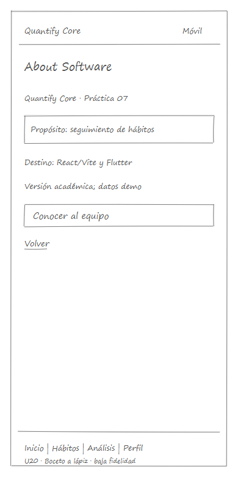

**Pantalla general obligatoria:** About Software.

Presentar propósito, plataformas previstas, versión y límites del prototipo.

| Campo | Especificación |
|---|---|
| Plataforma de destino | PWA con React/Vite y aplicación Flutter |
| Rol autorizado | Usuario / visitante según el recorrido |
| Módulo | Información |
| Elementos principales | Propósito, versión académica, plataformas, límites y enlaces informativos |
| Requisitos / historias | [RF-01](../requerimientos/catalogo.md#rf-01); [HU-01](../UHs/README.md#hu-01) |
| Reglas de navegación / demo | RN13; [definición](referencia-tecnica.md#reglas-y-condiciones) |
| Referencia visual | [Sketch móvil](../GUI/prototipos/movil/sketches/practica-07/U20.png) · [Sketch PWA](../GUI/prototipos/pwa/sketches/practica-07/U20.png) |
| Fuente editable | [SVG móvil](../GUI/prototipos/movil/sketches/practica-07/U20.svg) · [SVG PWA](../GUI/prototipos/pwa/sketches/practica-07/U20.svg) |
| Recorrido interactivo | [Abrir pantalla](index.html#usuario/U20) · [Ver nodo](mapa-completo.html#U20) |

**Acciones, condiciones y pantallas relacionadas**

| Acción o condición | Destino | Resultado |
|---|---|---|
| Conocer al equipo | [U21](#u21) | Transición al sketch indicado |
| Volver a bienvenida | [U01](#u01) | Transición al sketch indicado |
| Volver a ajustes | [U12](#u12) | Transición al sketch indicado |

<strong>U21 · About Team / Enterprise</strong> — ficha individual

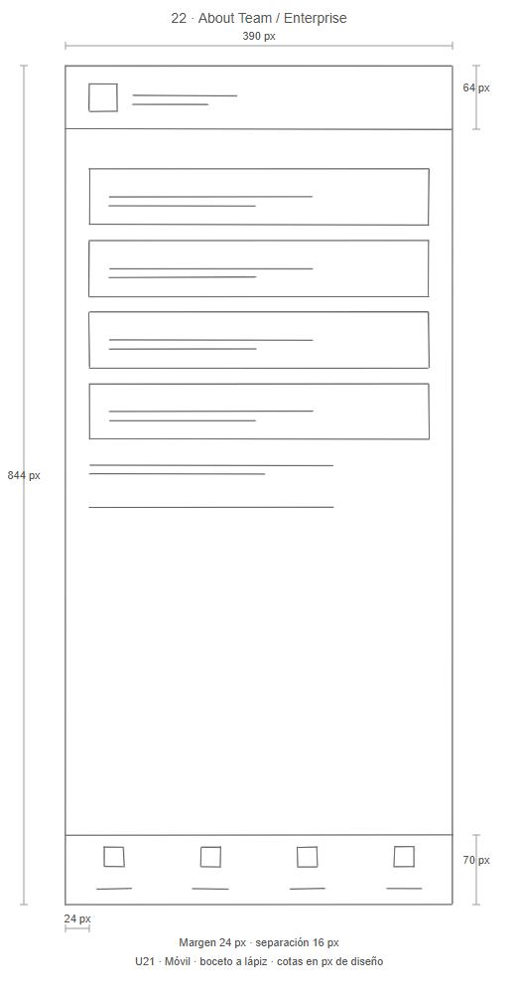

**Pantalla general obligatoria:** About Team / Enterprise.

Presentar al equipo académico y responsabilidades del proyecto.

| Campo | Especificación |
|---|---|
| Plataforma de destino | PWA con React/Vite y aplicación Flutter |
| Rol autorizado | Usuario / visitante según el recorrido |
| Módulo | Información |
| Elementos principales | Equipo, responsabilidades, institución y enlaces de retorno |
| Requisitos / historias | [RF-01](../requerimientos/catalogo.md#rf-01); [HU-01](../UHs/README.md#hu-01) |
| Reglas de navegación / demo | RN13; [definición](referencia-tecnica.md#reglas-y-condiciones) |
| Referencia visual | [Sketch móvil](../GUI/prototipos/movil/sketches/practica-07/U21.png) · [Sketch PWA](../GUI/prototipos/pwa/sketches/practica-07/U21.png) |
| Fuente editable | [SVG móvil](../GUI/prototipos/movil/sketches/practica-07/U21.svg) · [SVG PWA](../GUI/prototipos/pwa/sketches/practica-07/U21.svg) |
| Recorrido interactivo | [Abrir pantalla](index.html#usuario/U21) · [Ver nodo](mapa-completo.html#U21) |

**Acciones, condiciones y pantallas relacionadas**

| Acción o condición | Destino | Resultado |
|---|---|---|
| Volver al software | [U20](#u20) | Transición al sketch indicado |
| Volver a bienvenida | [U01](#u01) | Transición al sketch indicado |

<strong>U22 · Acceso denegado</strong> — ficha individual

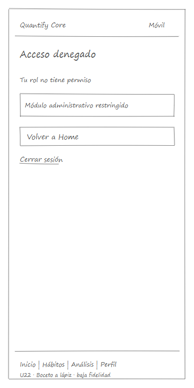

Explicar por qué el rol Usuario no puede operar módulos administrativos.

| Campo | Especificación |
|---|---|
| Plataforma de destino | PWA con React/Vite y aplicación Flutter |
| Rol autorizado | Usuario / visitante según el recorrido |
| Módulo | Cuenta |
| Elementos principales | Mensaje de acceso denegado, alcance del rol, Home y cierre de sesión |
| Requisitos / historias | [RF-09](../requerimientos/catalogo.md#rf-09); [HU-09](../UHs/README.md#hu-09) |
| Reglas de navegación / demo | RN01; [definición](referencia-tecnica.md#reglas-y-condiciones) |
| Referencia visual | [Sketch móvil](../GUI/prototipos/movil/sketches/practica-07/U22.png) · [Sketch PWA](../GUI/prototipos/pwa/sketches/practica-07/U22.png) |
| Fuente editable | [SVG móvil](../GUI/prototipos/movil/sketches/practica-07/U22.svg) · [SVG PWA](../GUI/prototipos/pwa/sketches/practica-07/U22.svg) |
| Recorrido interactivo | [Abrir pantalla](index.html#usuario/U22) · [Ver nodo](mapa-completo.html#U22) |

**Acciones, condiciones y pantallas relacionadas**

| Acción o condición | Destino | Resultado |
|---|---|---|
| Volver a Home | [U06](#u06) | Transición al sketch indicado |
| Cerrar sesión | [U02](#u02) | Transición al sketch indicado |

<strong>A01 · Acceso administrador</strong> — ficha individual

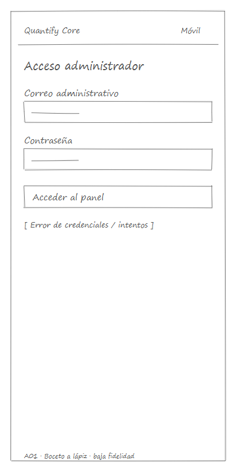

Entrada de demostración para personal autorizado; sin registro público.

| Campo | Especificación |
|---|---|
| Plataforma de destino | PWA con React/Vite y aplicación Flutter |
| Rol autorizado | Administrador |
| Módulo | Acceso |
| Elementos principales | Correo administrativo demo, contraseña de prueba, error y contador |
| Requisitos / historias | [RF-01](../requerimientos/catalogo.md#rf-01), [RF-09](../requerimientos/catalogo.md#rf-09); [HU-01](../UHs/README.md#hu-01), [HU-09](../UHs/README.md#hu-09) |
| Reglas de navegación / demo | RN01, RN02; [definición](referencia-tecnica.md#reglas-y-condiciones) |
| Referencia visual | [Sketch móvil](../GUI/prototipos/movil/sketches/practica-07/A01.png) · [Sketch PWA](../GUI/prototipos/pwa/sketches/practica-07/A01.png) |
| Fuente editable | [SVG móvil](../GUI/prototipos/movil/sketches/practica-07/A01.svg) · [SVG PWA](../GUI/prototipos/pwa/sketches/practica-07/A01.svg) |
| Recorrido interactivo | [Abrir pantalla](index.html#admin/A01) · [Ver nodo](mapa-completo.html#A01) |

**Acciones, condiciones y pantallas relacionadas**

| Acción o condición | Destino | Resultado |
|---|---|---|
| Credenciales demo válidas | [A02](#a02) | Transición al sketch indicado |
| Acceso denegado | [A01](#a01) | Permanece en el sketch; muestra estado o validación |
| Tercer intento fallido o acceso bloqueado | [A10](#a10) | Transición al sketch indicado |

<strong>A02 · Resumen operativo</strong> — ficha individual

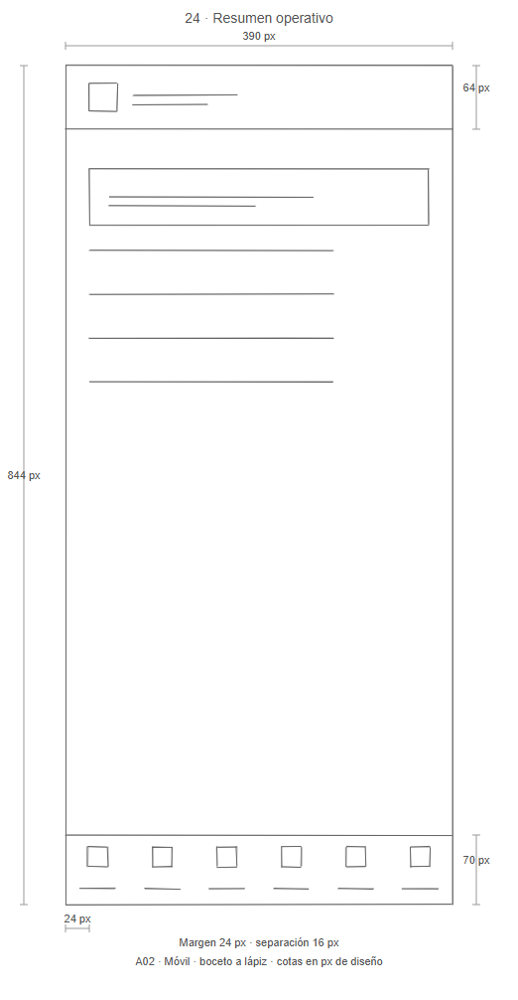

Indicadores agregados ilustrativos, estado de servicios y accesos a los módulos.

| Campo | Especificación |
|---|---|
| Plataforma de destino | PWA con React/Vite y aplicación Flutter |
| Rol autorizado | Administrador |
| Módulo | Operación |
| Elementos principales | Métricas agregadas ilustrativas y accesos a los módulos de operación |
| Requisitos / historias | [RF-09](../requerimientos/catalogo.md#rf-09); [HU-09](../UHs/README.md#hu-09) |
| Reglas de navegación / demo | RN01; [definición](referencia-tecnica.md#reglas-y-condiciones) |
| Referencia visual | [Sketch móvil](../GUI/prototipos/movil/sketches/practica-07/A02.png) · [Sketch PWA](../GUI/prototipos/pwa/sketches/practica-07/A02.png) |
| Fuente editable | [SVG móvil](../GUI/prototipos/movil/sketches/practica-07/A02.svg) · [SVG PWA](../GUI/prototipos/pwa/sketches/practica-07/A02.svg) |
| Recorrido interactivo | [Abrir pantalla](index.html#admin/A02) · [Ver nodo](mapa-completo.html#A02) |

**Acciones, condiciones y pantallas relacionadas**

| Acción o condición | Destino | Resultado |
|---|---|---|
| Ver catálogo | [A03](#a03) | Transición al sketch indicado |
| Supervisar IA | [A05](#a05) | Transición al sketch indicado |
| Auditoría | [A06](#a06) | Transición al sketch indicado |
| Cuentas | [A07](#a07) | Transición al sketch indicado |
| Configuración | [A08](#a08) | Transición al sketch indicado |

<strong>A03 · Catálogo de hábitos</strong> — ficha individual

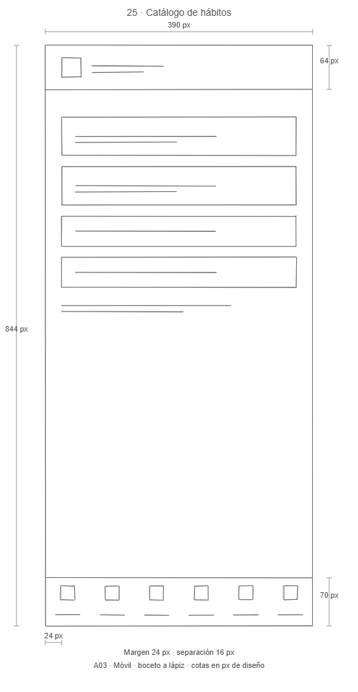

Gestionar plantillas sin modificar las rutinas personales existentes.

| Campo | Especificación |
|---|---|
| Plataforma de destino | PWA con React/Vite y aplicación Flutter |
| Rol autorizado | Administrador |
| Módulo | Operación |
| Elementos principales | Lista de plantillas, estado, crear, editar, pausar y reactivar |
| Requisitos / historias | [RF-09](../requerimientos/catalogo.md#rf-09); [HU-09](../UHs/README.md#hu-09) |
| Reglas de navegación / demo | RN10, RN11; [definición](referencia-tecnica.md#reglas-y-condiciones) |
| Referencia visual | [Sketch móvil](../GUI/prototipos/movil/sketches/practica-07/A03.png) · [Sketch PWA](../GUI/prototipos/pwa/sketches/practica-07/A03.png) |
| Fuente editable | [SVG móvil](../GUI/prototipos/movil/sketches/practica-07/A03.svg) · [SVG PWA](../GUI/prototipos/pwa/sketches/practica-07/A03.svg) |
| Recorrido interactivo | [Abrir pantalla](index.html#admin/A03) · [Ver nodo](mapa-completo.html#A03) |

**Acciones, condiciones y pantallas relacionadas**

| Acción o condición | Destino | Resultado |
|---|---|---|
| Crear o editar plantilla | [A04](#a04) | Transición al sketch indicado |
| Confirmar pausa o reactivación | [A03](#a03) | Permanece en el sketch; muestra estado o validación |
| Resumen | [A02](#a02) | Transición al sketch indicado |
| IA | [A05](#a05) | Transición al sketch indicado |
| Auditoría | [A06](#a06) | Transición al sketch indicado |
| Cuentas | [A07](#a07) | Transición al sketch indicado |
| Configuración | [A08](#a08) | Transición al sketch indicado |

<strong>A04 · Editar plantilla</strong> — ficha individual

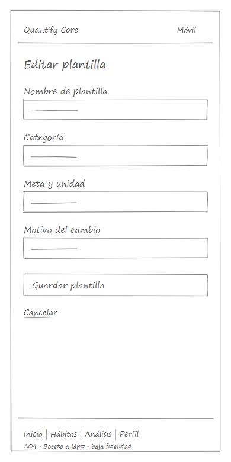

Validar nombre, categoría y meta antes de guardar y auditar la modificación.

| Campo | Especificación |
|---|---|
| Plataforma de destino | PWA con React/Vite y aplicación Flutter |
| Rol autorizado | Administrador |
| Módulo | Operación |
| Elementos principales | Nombre, categoría, meta, unidad, motivo obligatorio y guardar/cancelar |
| Requisitos / historias | [RF-09](../requerimientos/catalogo.md#rf-09); [HU-09](../UHs/README.md#hu-09) |
| Reglas de navegación / demo | RN03, RN10, RN11; [definición](referencia-tecnica.md#reglas-y-condiciones) |
| Referencia visual | [Sketch móvil](../GUI/prototipos/movil/sketches/practica-07/A04.png) · [Sketch PWA](../GUI/prototipos/pwa/sketches/practica-07/A04.png) |
| Fuente editable | [SVG móvil](../GUI/prototipos/movil/sketches/practica-07/A04.svg) · [SVG PWA](../GUI/prototipos/pwa/sketches/practica-07/A04.svg) |
| Recorrido interactivo | [Abrir pantalla](index.html#admin/A04) · [Ver nodo](mapa-completo.html#A04) |

**Acciones, condiciones y pantallas relacionadas**

| Acción o condición | Destino | Resultado |
|---|---|---|
| Guardar o cancelar | [A03](#a03) | Transición al sketch indicado |
| Corregir datos | [A04](#a04) | Permanece en el sketch; muestra estado o validación |
| Abrir IA | [A05](#a05) | Transición al sketch indicado |

<strong>A05 · Supervisión de IA</strong> — ficha individual

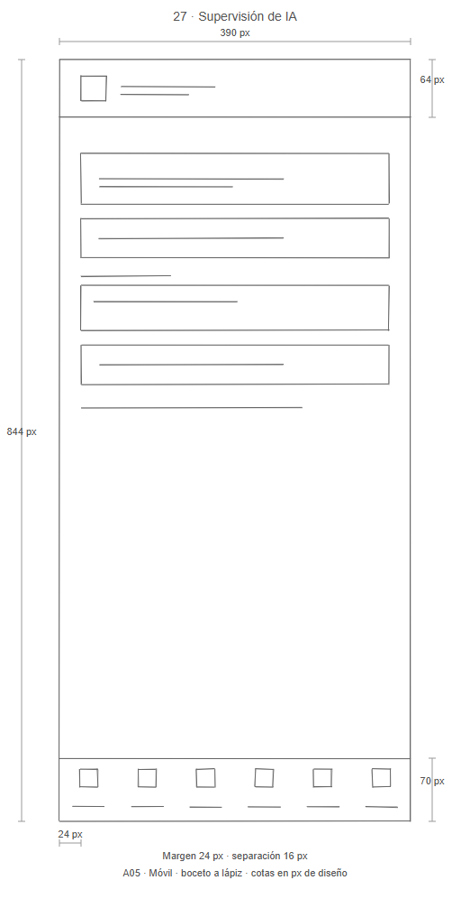

Revisar tasas de aceptación ilustrativas y pausar propuestas con un motivo.

| Campo | Especificación |
|---|---|
| Plataforma de destino | PWA con React/Vite y aplicación Flutter |
| Rol autorizado | Administrador |
| Módulo | Operación |
| Elementos principales | Propuestas de IA agregadas, estado, motivo y confirmación |
| Requisitos / historias | [RF-07](../requerimientos/catalogo.md#rf-07), [RF-09](../requerimientos/catalogo.md#rf-09); [HU-07](../UHs/README.md#hu-07), [HU-09](../UHs/README.md#hu-09) |
| Reglas de navegación / demo | RN08, RN10, RN11; [definición](referencia-tecnica.md#reglas-y-condiciones) |
| Referencia visual | [Sketch móvil](../GUI/prototipos/movil/sketches/practica-07/A05.png) · [Sketch PWA](../GUI/prototipos/pwa/sketches/practica-07/A05.png) |
| Fuente editable | [SVG móvil](../GUI/prototipos/movil/sketches/practica-07/A05.svg) · [SVG PWA](../GUI/prototipos/pwa/sketches/practica-07/A05.svg) |
| Recorrido interactivo | [Abrir pantalla](index.html#admin/A05) · [Ver nodo](mapa-completo.html#A05) |

**Acciones, condiciones y pantallas relacionadas**

| Acción o condición | Destino | Resultado |
|---|---|---|
| Confirmar pausa o reactivación | [A05](#a05) | Permanece en el sketch; muestra estado o validación |
| Resumen | [A02](#a02) | Transición al sketch indicado |
| Catálogo | [A03](#a03) | Transición al sketch indicado |
| Ver auditoría | [A06](#a06) | Transición al sketch indicado |
| Cuentas | [A07](#a07) | Transición al sketch indicado |
| Configuración | [A08](#a08) | Transición al sketch indicado |

<strong>A06 · Auditoría</strong> — ficha individual

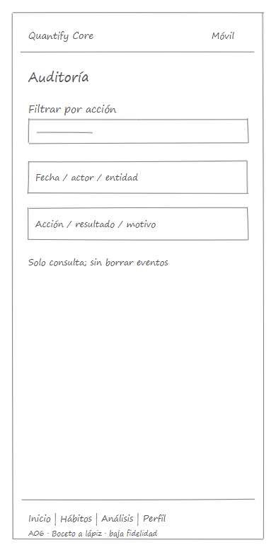

Consultar cambios administrativos registrados en esta demostración.

| Campo | Especificación |
|---|---|
| Plataforma de destino | PWA con React/Vite y aplicación Flutter |
| Rol autorizado | Administrador |
| Módulo | Control |
| Elementos principales | Filtro de acciones, fecha, actor, entidad y motivo; sin editar ni borrar |
| Requisitos / historias | [RF-10](../requerimientos/catalogo.md#rf-10); [HU-10](../UHs/README.md#hu-10) |
| Reglas de navegación / demo | RN11; [definición](referencia-tecnica.md#reglas-y-condiciones) |
| Referencia visual | [Sketch móvil](../GUI/prototipos/movil/sketches/practica-07/A06.png) · [Sketch PWA](../GUI/prototipos/pwa/sketches/practica-07/A06.png) |
| Fuente editable | [SVG móvil](../GUI/prototipos/movil/sketches/practica-07/A06.svg) · [SVG PWA](../GUI/prototipos/pwa/sketches/practica-07/A06.svg) |
| Recorrido interactivo | [Abrir pantalla](index.html#admin/A06) · [Ver nodo](mapa-completo.html#A06) |

**Acciones, condiciones y pantallas relacionadas**

| Acción o condición | Destino | Resultado |
|---|---|---|
| Filtrar eventos | [A06](#a06) | Permanece en el sketch; muestra estado o validación |
| Resumen | [A02](#a02) | Transición al sketch indicado |
| Catálogo | [A03](#a03) | Transición al sketch indicado |
| IA | [A05](#a05) | Transición al sketch indicado |
| Cuentas | [A07](#a07) | Transición al sketch indicado |
| Configuración | [A08](#a08) | Transición al sketch indicado |

<strong>A07 · Control de accesos</strong> — ficha individual

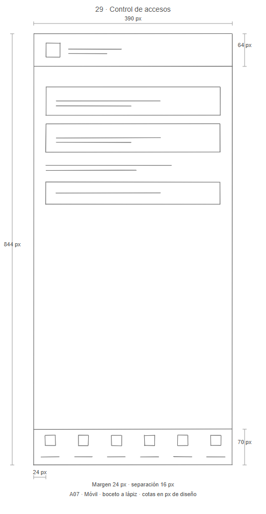

Administrar el estado de cuentas ficticias identificadas por códigos.

| Campo | Especificación |
|---|---|
| Plataforma de destino | PWA con React/Vite y aplicación Flutter |
| Rol autorizado | Administrador |
| Módulo | Control |
| Elementos principales | Códigos de cuentas ficticias, estado, suspensión/reactivación y cuenta protegida |
| Requisitos / historias | [RF-09](../requerimientos/catalogo.md#rf-09); [HU-09](../UHs/README.md#hu-09) |
| Reglas de navegación / demo | RN01, RN12; [definición](referencia-tecnica.md#reglas-y-condiciones) |
| Referencia visual | [Sketch móvil](../GUI/prototipos/movil/sketches/practica-07/A07.png) · [Sketch PWA](../GUI/prototipos/pwa/sketches/practica-07/A07.png) |
| Fuente editable | [SVG móvil](../GUI/prototipos/movil/sketches/practica-07/A07.svg) · [SVG PWA](../GUI/prototipos/pwa/sketches/practica-07/A07.svg) |
| Recorrido interactivo | [Abrir pantalla](index.html#admin/A07) · [Ver nodo](mapa-completo.html#A07) |

**Acciones, condiciones y pantallas relacionadas**

| Acción o condición | Destino | Resultado |
|---|---|---|
| Cambiar estado de cuenta | [A09](#a09) | Transición al sketch indicado |
| Resumen | [A02](#a02) | Transición al sketch indicado |
| Catálogo | [A03](#a03) | Transición al sketch indicado |
| IA | [A05](#a05) | Transición al sketch indicado |
| Auditoría | [A06](#a06) | Transición al sketch indicado |
| Configuración | [A08](#a08) | Transición al sketch indicado |

<strong>A08 · Configuración global</strong> — ficha individual

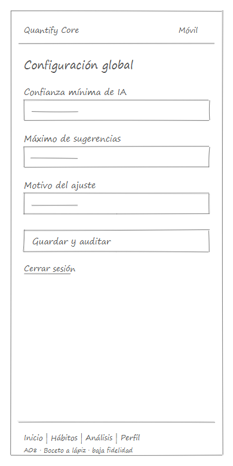

Ajustar límites de sugerencias respetando el mínimo de confianza y auditar cambios.

| Campo | Especificación |
|---|---|
| Plataforma de destino | PWA con React/Vite y aplicación Flutter |
| Rol autorizado | Administrador |
| Módulo | Control |
| Elementos principales | Límites académicos de IA, motivo, guardar y cierre de sesión |
| Requisitos / historias | [RF-09](../requerimientos/catalogo.md#rf-09); [HU-09](../UHs/README.md#hu-09) |
| Reglas de navegación / demo | RN08, RN11; [definición](referencia-tecnica.md#reglas-y-condiciones) |
| Referencia visual | [Sketch móvil](../GUI/prototipos/movil/sketches/practica-07/A08.png) · [Sketch PWA](../GUI/prototipos/pwa/sketches/practica-07/A08.png) |
| Fuente editable | [SVG móvil](../GUI/prototipos/movil/sketches/practica-07/A08.svg) · [SVG PWA](../GUI/prototipos/pwa/sketches/practica-07/A08.svg) |
| Recorrido interactivo | [Abrir pantalla](index.html#admin/A08) · [Ver nodo](mapa-completo.html#A08) |

**Acciones, condiciones y pantallas relacionadas**

| Acción o condición | Destino | Resultado |
|---|---|---|
| Validar y guardar | [A08](#a08) | Permanece en el sketch; muestra estado o validación |
| Resumen | [A02](#a02) | Transición al sketch indicado |
| Catálogo | [A03](#a03) | Transición al sketch indicado |
| IA | [A05](#a05) | Transición al sketch indicado |
| Auditoría | [A06](#a06) | Transición al sketch indicado |
| Cuentas | [A07](#a07) | Transición al sketch indicado |
| Cerrar sesión | [A01](#a01) | Transición al sketch indicado |

<strong>A09 · Confirmar cambio de acceso</strong> — ficha individual

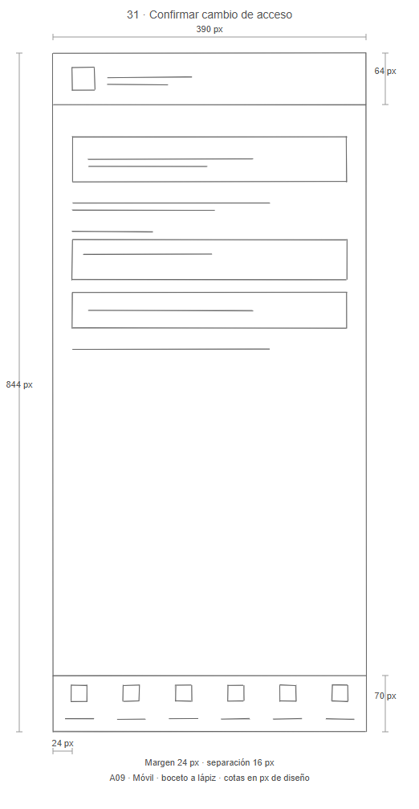

Confirmar suspensión o reactivación con un motivo obligatorio.

| Campo | Especificación |
|---|---|
| Plataforma de destino | PWA con React/Vite y aplicación Flutter |
| Rol autorizado | Administrador |
| Módulo | Control |
| Elementos principales | Código de cuenta, conservación de datos, motivo y confirmación/cancelación |
| Requisitos / historias | [RF-09](../requerimientos/catalogo.md#rf-09); [HU-09](../UHs/README.md#hu-09) |
| Reglas de navegación / demo | RN11, RN12; [definición](referencia-tecnica.md#reglas-y-condiciones) |
| Referencia visual | [Sketch móvil](../GUI/prototipos/movil/sketches/practica-07/A09.png) · [Sketch PWA](../GUI/prototipos/pwa/sketches/practica-07/A09.png) |
| Fuente editable | [SVG móvil](../GUI/prototipos/movil/sketches/practica-07/A09.svg) · [SVG PWA](../GUI/prototipos/pwa/sketches/practica-07/A09.svg) |
| Recorrido interactivo | [Abrir pantalla](index.html#admin/A09) · [Ver nodo](mapa-completo.html#A09) |

**Acciones, condiciones y pantallas relacionadas**

| Acción o condición | Destino | Resultado |
|---|---|---|
| Confirmar o cancelar | [A07](#a07) | Transición al sketch indicado |
| Motivo incompleto | [A09](#a09) | Permanece en el sketch; muestra estado o validación |

<strong>A10 · Lock Account · Administrador</strong> — ficha individual

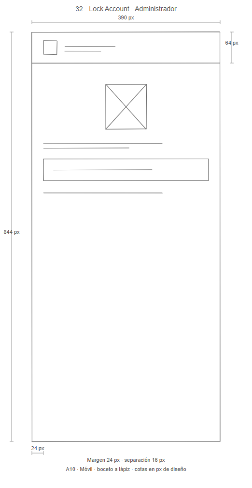

Bloqueo de ejemplo tras tres accesos administrativos fallidos.

| Campo | Especificación |
|---|---|
| Plataforma de destino | PWA con React/Vite y aplicación Flutter |
| Rol autorizado | Administrador |
| Módulo | Acceso |
| Elementos principales | Candado, explicación de bloqueo administrativo y solicitud de código |
| Requisitos / historias | [RF-01](../requerimientos/catalogo.md#rf-01), [RF-09](../requerimientos/catalogo.md#rf-09); [HU-01](../UHs/README.md#hu-01), [HU-09](../UHs/README.md#hu-09) |
| Reglas de navegación / demo | RN02; [definición](referencia-tecnica.md#reglas-y-condiciones) |
| Referencia visual | [Sketch móvil](../GUI/prototipos/movil/sketches/practica-07/A10.png) · [Sketch PWA](../GUI/prototipos/pwa/sketches/practica-07/A10.png) |
| Fuente editable | [SVG móvil](../GUI/prototipos/movil/sketches/practica-07/A10.svg) · [SVG PWA](../GUI/prototipos/pwa/sketches/practica-07/A10.svg) |
| Recorrido interactivo | [Abrir pantalla](index.html#admin/A10) · [Ver nodo](mapa-completo.html#A10) |

**Acciones, condiciones y pantallas relacionadas**

| Acción o condición | Destino | Resultado |
|---|---|---|
| Solicitar desbloqueo | [A11](#a11) | Transición al sketch indicado |
| Volver; conserva bloqueo | [A01](#a01) | Transición al sketch indicado |

<strong>A11 · Unlock Account Code · Administrador</strong> — ficha individual

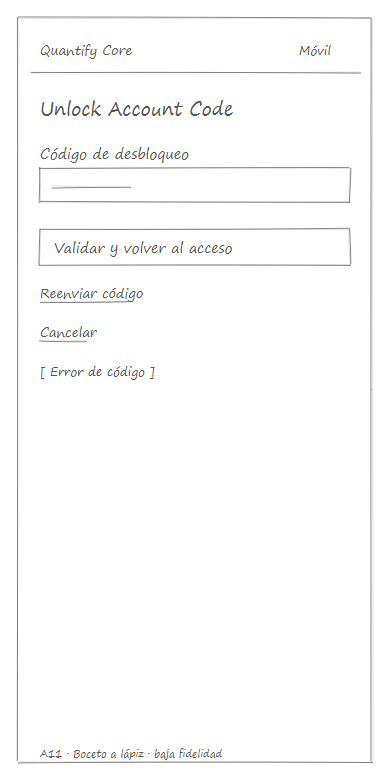

Desbloquear el acceso de ejemplo sin conceder una sesión.

| Campo | Especificación |
|---|---|
| Plataforma de destino | PWA con React/Vite y aplicación Flutter |
| Rol autorizado | Administrador |
| Módulo | Acceso |
| Elementos principales | Código de desbloqueo administrativo, error, reenvío y cancelar |
| Requisitos / historias | [RF-01](../requerimientos/catalogo.md#rf-01), [RF-09](../requerimientos/catalogo.md#rf-09); [HU-01](../UHs/README.md#hu-01), [HU-09](../UHs/README.md#hu-09) |
| Reglas de navegación / demo | RN02; [definición](referencia-tecnica.md#reglas-y-condiciones) |
| Referencia visual | [Sketch móvil](../GUI/prototipos/movil/sketches/practica-07/A11.png) · [Sketch PWA](../GUI/prototipos/pwa/sketches/practica-07/A11.png) |
| Fuente editable | [SVG móvil](../GUI/prototipos/movil/sketches/practica-07/A11.svg) · [SVG PWA](../GUI/prototipos/pwa/sketches/practica-07/A11.svg) |
| Recorrido interactivo | [Abrir pantalla](index.html#admin/A11) · [Ver nodo](mapa-completo.html#A11) |

**Acciones, condiciones y pantallas relacionadas**

| Acción o condición | Destino | Resultado |
|---|---|---|
| Código válido; volver a iniciar sesión | [A01](#a01) | Transición al sketch indicado |
| Código inválido o reenviar | [A11](#a11) | Permanece en el sketch; muestra estado o validación |
| Cancelar; conserva bloqueo | [A10](#a10) | Transición al sketch indicado |

