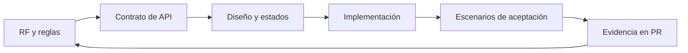

# Requerimientos de Quantify Core

Esta es la base documental propuesta para construir el producto. Describe qué debe hacer cada entrega y cómo demostrarlo; no acredita funciones implementadas ni aprobación del equipo. El [README principal](../../README.md) fija el stack de referencia.

Para consultar por tipo de documento: [BRs](../BRs/README.md) · [FRs](../FRs/README.md) · [NFRs](../NFRs/README.md) · [UHs](../UHs/README.md). FRs, NFRs y BRs son índices hacia las definiciones de esta carpeta; UHs contiene las historias. No se mantienen copias de los requisitos en esos índices.

## Ruta de lectura

| Documento | Decisión que permite tomar |
|---|---|
| [Catálogo de requisitos](catalogo.md) | Diez familias con 49 operaciones funcionales, sus AC y quince requisitos no funcionales |
| [Historias de usuario](../UHs/README.md) | Actor, necesidad y valor de HU-01 a HU-10; referencias a RF, reglas, escenarios y decisiones |
| [Reglas de negocio](reglas-negocio.md) | Cómo interpretar hábitos, fechas, progreso, rachas y recomendaciones |
| [Aceptación y trazabilidad](aceptacion.md) | Qué escenarios verificar antes de entregar una función |
| [Arquitectura](../arquitectura/README.md) | Qué componente implementa cada responsabilidad |
| [Diseño](../diseno/README.md) | Qué recorrido y estados debe mostrar el cliente |

El gráfico muestra el ciclo de revisión: cada cambio funcional debe actualizar su requisito, contrato, interfaz y evidencia. Un diagrama de prototipo por sí solo no demuestra integración.

## Alcance y orden

1. **Núcleo:** RF-01 a RF-05; acceso, consentimiento, hábitos, registros y métricas coherentes.
2. **Continuidad de uso:** RF-06 y aplicación Flutter, incluidos reintentos y sincronización.
3. **Operación y control:** RF-09 y RF-10 se construyen junto con las funciones que gobiernan. Autorización, auditoría, exportación y eliminación son puertas de entrada del piloto con datos personales.
4. **Integraciones:** RF-08 avanza por prueba técnica y dispositivo compatible; no bloquea el registro manual.
5. **Recomendaciones:** RF-07 necesita datos autorizados y evidencia de evaluación; puede comenzar con reglas explicables sin biometría.

Las fases expresan dependencias, no fechas. Cada ticket debe identificar RF, reglas aplicables, contrato, escenarios, alcance y enlace a su PR. No declarar terminado un RF completo si solo se entregó un recorrido de demo.

## Actores y permisos

| Actor | Puede hacer | Límite |
|---|---|---|
| Usuario | Gestionar perfil, consentimiento, hábitos, registros, avisos y resultados propios | Debe verificarse la pertenencia de cada recurso en la API |
| Administrador | Gestionar catálogo, estado de cuentas y métricas operativas agregadas | No accede por defecto a rutinas, biometría ni recomendaciones privadas |
| Servicios internos | Ejecutar tareas técnicas con identidad y permisos limitados | Son componentes, no un tercer rol humano ni una vía para eludir consentimiento |

No se adopta un modelo de suscripciones o pagos por aparecer en antecedentes académicos; requiere alcance y decisiones propios.

## Qué es antecedente y qué se implementará

- La [Práctica 05](../Practica05/README.md) aporta actores y funciones. Su [historia de recomendaciones](../Practica05/HU-Recomendaciones-IA.md) es un antecedente de RF-07; la etiqueta histórica «aprobada» no aprueba automáticamente esta arquitectura ni sus umbrales.
- La [Práctica 07](../practica-07/README.md) permite revisar 33 sketches y recorridos con datos locales. Sus códigos de acceso, fecha fija, métricas administrativas y reglas numéricas son de demostración.
- Los umbrales de confianza de 0.75 y 80%, la ventana de 7 días y el descarte por 21 días deben evaluarse y versionarse antes de aplicarlos al producto. No deben convertirse en constantes globales copiadas por agentes.
- El estado actual de cada componente debe comprobarse en su código y pruebas. Los documentos de esta sección son una especificación inicial, no un reporte de cobertura.

Si dos documentos discrepan, registrar el conflicto en [decisiones pendientes](../arquitectura/decisiones-pendientes.md), mantener la base tecnológica del README y resolver la regla en una revisión del equipo antes de cambiar el contrato.

## Fuentes y organización

Revisión del punto 1 de Práctica 07 · 12 de noviembre de 2026. El catálogo inicial tenía diez familias RF y diez RNF. La revisión identificó operaciones y cualidades más detalladas en los documentos siguientes; se conservaron los IDs existentes y se explicitó su desglose, sin adoptar otra arquitectura ni considerar implementada una capacidad por estar documentada.

| Fuente existente | Información identificada | Ubicación de su requisito |
|---|---|---|
| [Visión y módulos](../../README.md#módulos-funcionales) | Cuentas, rutinas, evidencia, análisis preventivo, arquetipos y dispositivos por fases | Familias RF-01 a RF-10; RF-07.05 explicita indicadores/arquetipos sujetos a evaluación |
| [Contratos y dashboard](../../packages/contracts/README.md) | Consultas propias, hábitos versionados, valores absolutos, calendario y métricas por periodo | RF-03, RF-04 y RF-05; los esquemas siguen exclusivamente en contratos |
| [Web](../../apps/web/README.md) y [móvil](../../apps/mobile/README.md) | Sesión, estados de UI, cola por cuenta, reconexión, adaptación y actualización | RF-01/04 y RNF-12/13/14; implementación offline y soporte de versiones pendientes |
| [Seguridad](../seguridad/README.md) y [ciclo de vida](../datos-ia/calidad-ciclo-vida.md) | Autorización, cifrado, consentimiento, revocación, exportación y eliminación | RF-02/09/10; RNF-01/05/11 |
| [Analítica e IA](../datos-ia/analitica-ia.md) | Calidad, evaluación sin fuga, explicación, abstención y retirada | RF-07 y RNF-15; umbrales en D-07 |
| [Práctica 05](../Practica05/README.md) y [su historia de IA](../Practica05/HU-Recomendaciones-IA.md) | Cinco features y una historia académica detallada; RNF con numeración propia | Antecedentes de RF-03 a RF-07; HU-QC-05 enlazada desde HU-07 |
| [Examen de arquitectura](../examen/README.md) | Propuesta histórica de sensores/IA, stack alternativo y objetivos numéricos | Referencia histórica; no sustituye stack, contratos ni decisiones vigentes |

Cada tipo de información tiene un lugar:

- **Qué hace y qué calidad debe cumplir:** [catálogo RF/RNF y AC](catalogo.md).
- **Quién lo necesita y para qué:** [historias HU](../UHs/README.md).
- **Condiciones del dominio:** [reglas RN-P01 a RN-P24](reglas-negocio.md).
- **Cómo verificarlo:** [escenarios CA](aceptacion.md), con evidencia real enlazada por entrega.
- **Qué se seleccionó para el prototipo:** [punto 1 de Práctica 07](../practica-07/README.md#punto-1), que referencia las fuentes y las pantallas sin redefinir requisitos.

Una función puede tener varios requisitos específicos y una historia abarcar varias operaciones. El número de familias no mide por sí solo la complejidad del producto. Los permisos, fórmulas, DTO y parámetros se resuelven en sus fuentes; no se copian dentro de cada ficha.
