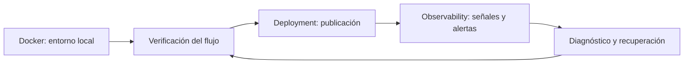

**Ubicación:** [Quantify-Core](../README.md) → infrastructure · **Nivel 1**

# Infraestructura de Quantify Core

**Base local (16/11/2026):** [Compose](docker/compose.yaml), API contenerizada y [guía del equipo](../docs/guias/base-tecnica.md), con monitoreo local probado. El despliegue público sigue pendiente; se preserva el laboratorio Keycloak anterior.

Esta carpeta establece cómo se preparará, ejecutará, observará y publicará la plataforma. Su objetivo es que desarrolladores y agentes compartan las mismas reglas y puedan reproducir un entorno sin depender de instrucciones particulares de otro integrante.

**Estado actual:** [Compose local](docker/compose.yaml), [API contenerizada](docker/api.Dockerfile), [Keycloak auditado](keycloak/README.md) y [monitoreo local](observability/README.md) verificables. No hay despliegue público acreditado. La guía distingue pruebas locales de la integración final; aceptación del equipo y decisiones productivas siguen pendientes.

## Responsabilidad de cada carpeta

| Carpeta | Qué se hará | Qué debe entregar |
|---|---|---|
| [keycloak](keycloak/README.md) | Configurar identidad local con realm y clientes públicos. | Export auditado, guía de operación, cuentas sin credenciales versionadas y evidencia de laboratorio. |
| [docker](docker/README.md) | Preparar imágenes y dependencias para desarrollo y pruebas reproducibles. | Configuración de contenedores, requisitos de la máquina, variables, puertos, persistencia y pasos verificados. |
| [deployment](deployment/README.md) | Preparar la publicación y recuperación de los componentes en los ambientes elegidos. | Configuración por ambiente, identificación de versiones, migraciones, verificación y reversión. |
| [observability](observability/README.md) | Definir cómo detectar y diagnosticar fallos técnicos. | Convenciones de métricas, logs y trazas; configuración, tableros y alertas con instrucciones de atención. |

El código de las aplicaciones permanece en `apps/` y `services/`. Los esquemas de datos, reglas de negocio y estilos visuales se mantienen en sus módulos correspondientes; la infraestructura configura cómo ejecutarlos.

## Lectura inicial para desarrolladores y agentes

1. Leer este documento y el README de la carpeta que se modificará.
2. Revisar el alcance y el stack del [README principal](../README.md), las [decisiones de arquitectura](../docs/arquitectura/adr/README.md) y el README del componente afectado.
3. Inspeccionar los archivos existentes y el estado de Git antes de editar. Trabajar en la rama acordada; para esta base documental se utiliza `docs/arquitectura` y la integración se dirige a `develop`, conforme al [flujo de ramas](../docs/guias/git-flow.md).
4. Distinguir requisitos, propuestas e implementación comprobada. Una carpeta vacía, una práctica académica o un ejemplo no prueban que exista un servicio operativo.
5. Si dos documentos o el código se contradicen, registrar la discrepancia y su impacto. Aplicar las decisiones aceptadas que correspondan y actualizar las referencias en el mismo cambio; una propuesta nueva no reemplaza por sí sola una decisión vigente.

Un agente debe reportar archivos modificados, decisiones asumidas, validaciones realizadas y pendientes. No debe inventar comandos, resultados de pruebas, credenciales, proveedores contratados ni aprobaciones del equipo. Una decisión pendiente solo bloquea la parte que depende de ella; se puede avanzar en el resto de la documentación.

## Dónde se define cada cosa

| Tema | Referencia que se debe mantener |
|---|---|
| Alcance, stack e identidad visual del proyecto | [README principal](../README.md). |
| Decisiones de tecnología, topología y cambios con impacto transversal | [ADR](../docs/arquitectura/adr/README.md); usar la [plantilla](../docs/arquitectura/adr/plantilla.md) y registrar estado, motivos y consecuencias. |
| API, eventos y compatibilidad entre componentes | [Contratos compartidos](../packages/contracts/README.md). |
| Reglas de herramientas y configuración común sin secretos | [Configuración compartida](../packages/config/README.md). |
| Interfaz, componentes y tokens visuales | [Diseño](../docs/diseno/README.md) y [tokens](../packages/design-tokens/README.md). |
| Seguridad, permisos y manejo de información | [Seguridad y privacidad](../docs/seguridad/README.md). |
| Procedimientos completos de operación | [Documentación de despliegue](../docs/despliegue/README.md), enlazada desde la configuración correspondiente. |
| Pruebas de integración y sistema | [Pruebas](../tests/README.md); las pruebas propias de un componente pueden permanecer junto a su código. |

Se enlaza la definición original en vez de copiarla entre carpetas. Los nombres, tipos y valores predeterminados de una variable deben coincidir en su consumidor, su validación y su documentación.

## Base tecnológica a respetar

La propuesta vigente contempla React + TypeScript + Vite para web, NestJS para la API, Python + FastAPI para analítica y procesos asíncronos con tecnología de colas aún pendiente. PostgreSQL, MongoDB, Redis y Keycloak son dependencias propuestas, no una obligación de levantar todos los servicios desde el primer día.

Docker y Compose son la base prevista para el entorno local. OpenTelemetry es la base prevista de instrumentación; Prometheus y Grafana se evalúan para observabilidad. El proveedor del backend, el almacenamiento de objetos y el backend de logs están pendientes. GitHub Pages aloja documentación y prácticas; la aplicación web y los servicios requieren su propia decisión de publicación.

No introducir stacks alternativos, otro motor de datos o una plataforma de orquestación como solución definitiva sin documentar el motivo y validar la decisión con el equipo. Empezar por los componentes mínimos necesarios para el primer flujo verificable.

## Convenciones compartidas

- **Documentación:** español claro, Markdown y UTF-8. Mantener `README.md` como nombre de entrada y escribir rutas con la capitalización real para que funcionen también en Linux. Conservar los identificadores oficiales de herramientas y protocolos.
- **Identificadores:** nombres nuevos de archivos y recursos en minúsculas con guiones, salvo convenciones propias de la herramienta, como `Dockerfile`. Usar `api`, `analytics`, `workers` y `web` como identificadores lógicos de esos componentes y documentar su correspondencia en cada plataforma.
- **Configuración:** variables propias en `UPPER_SNAKE_CASE`; respetar los nombres oficiales de dependencias. Validar valores requeridos al arrancar y emitir errores que no revelen secretos. Compartir configuración común y hacer explícitas las diferencias por ambiente.
- **Versiones:** registrar versiones compatibles de herramientas, imágenes y dependencias; evitar referencias flotantes como única identificación de una entrega. Los cambios de versión deben explicar compatibilidad y validación.
- **Datos y secretos:** usar datos sintéticos en desarrollo y pruebas. Las credenciales se suministran fuera de Git. Antes de crear archivos locales con secretos, incorporar y verificar las exclusiones de Git y del contexto de construcción; el `.gitignore` ahora excluye `.env`, exports sueltos en raíz y archivos privados de Keycloak. Una exclusión no reemplaza auditar el contenido antes de confirmar.
- **Contratos:** la infraestructura no redefine roles, eventos, campos de API ni migraciones. Consumir la definición del módulo responsable y coordinar cualquier cambio de compatibilidad.
- **Diseño:** las interfaces propias y visualizaciones del producto siguen los tokens compartidos y sus criterios de accesibilidad. Los tableros técnicos mantienen nombres, unidades y significados consistentes; no crean otra paleta de producto ni comunican estados solo mediante color.
- **Cambios comprobables:** mantener juntos configuración, documentación y evidencia de validación. Ningún comando se presentará como operativo hasta que existan sus archivos y se haya probado en el entorno indicado.

## Información mínima de cada componente

Ficha que debe completar cada componente antes de integrarse

Antes de integrar su configuración, registrar en el README correspondiente:

| Campo | Contenido requerido |
|---|---|
| Propósito y responsable | Función del componente y persona o rol responsable de mantenerlo. |
| Estado | Propuesto, implementado o verificado; enlazar la evidencia cuando exista. |
| Dependencias | Servicios requeridos, versiones compatibles y contrato utilizado. |
| Configuración | Nombre, tipo, obligatoriedad, valor de ejemplo sin secretos y momento de lectura de cada variable. |
| Red y acceso | Puertos internos y publicados, consumidores permitidos y mecanismo de autenticación. |
| Datos | Volúmenes o almacenamiento, migraciones, retención y recuperación. |
| Operación | Inicio, parada, comprobación de salud, diagnóstico y reversión. |
| Validación | Entorno, comandos realmente ejecutados, resultado y limitaciones conocidas. |

## Orden de trabajo y criterio de entrega

1. Confirmar el primer flujo de producto, sus componentes y responsables; registrar las decisiones necesarias en ADR.
2. Preparar el entorno local mínimo con datos sintéticos y configuración de ejemplo.
3. Verificar comunicación, persistencia, salud y diagnóstico de los componentes implementados.
4. Preparar un ambiente compartido de validación y su procedimiento de recuperación.
5. Automatizar las comprobaciones y la publicación cuando el procedimiento manual esté definido y probado.

Un cambio está listo para revisión cuando los enlaces y rutas existen, los requisitos coinciden con los módulos afectados, las pruebas aplicables tienen evidencia y los pendientes están identificados. Si solo cambia documentación, revisar su consistencia y enlaces; no afirmar que se construyeron imágenes o se desplegó el sistema.

## Decisiones por cerrar

Falta asignar responsables de infraestructura y operación, fijar versiones y recursos mínimos, confirmar las dependencias del primer entorno, elegir proveedor y registro de artefactos, y definir dominios, presupuesto, respaldos y objetivos de servicio. Cada decisión debe registrar responsable, criterio de cierre y referencia al ADR o tarea que la resuelva. Estas decisiones no se consideran aprobadas por estar mencionadas en un README.
