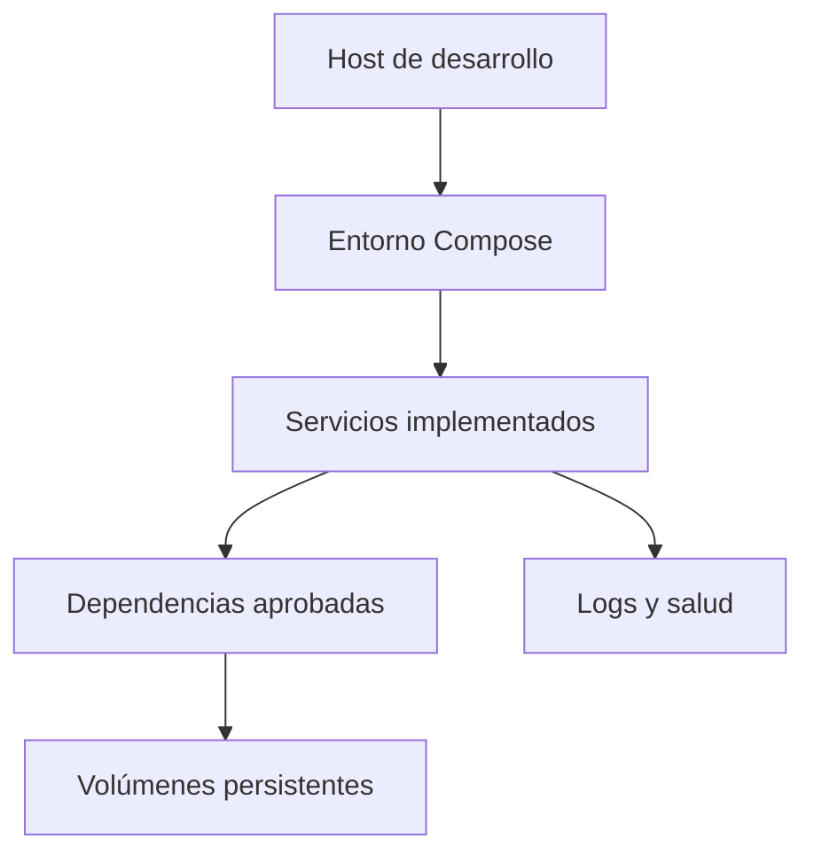

# Contenedores y entorno local

## Arranque completo y frontend compilado · 20/11/2026

La guía canónica está en el [README principal](../../README.md#instalación-y-ejecución): contiene comandos PowerShell de Docker puro desde la configuración inicial hasta el apagado, cuenta/perfil de prueba y capturas verificadas. No requiere Node/npm en Windows para ejecutar los servicios.

La sección [Base de datos y persistencia local](../../README.md#base-de-datos-y-persistencia-local) explica las tablas existentes, migraciones, roles SQL y comandos de inspección. PostgreSQL guarda el negocio en `quantify-core-dev_postgres-data`; Keycloak conserva su base de desarrollo separada en `quantify-core-dev_keycloak-data`. El esquema conceptual completo sigue incluyendo entidades futuras.

| Perfil | Servicio | Uso |
|---|---|---|
| Sin perfil | `postgres`, `keycloak` | Datos e identidad del laboratorio |
| `app` | `api` | API compilada |
| `web-static` | `web-static` | React compilado servido por Nginx sin root, puerto 5173 |
| `web` | `web` | Vite con actualización al guardar, también puerto 5173 |
| `tools` | `migrate`, `profile` | Tareas explícitas de migración y aprovisionamiento |

Las dos modalidades web son alternativas: detener una antes de iniciar la otra. `web.Dockerfile` compila con Node y copia solo `dist` a Nginx; su archivo `.dockerignore` específico permite las fuentes canónicas y excluye secretos/dependencias locales. El servidor soporta enlaces profundos y callback SPA, desactiva access logs para no guardar parámetros de autenticación y no cachea HTML/SW por HTTP. El SW aplica únicamente el precache público existente.

Con Node disponible en el host, también se pueden usar estos helpers desde la raíz:

```powershell
node scripts/dev-base.mjs docker-migrate
node scripts/dev-base.mjs docker-up
node scripts/dev-base.mjs status
```

Preparar primero la configuración y PostgreSQL/Keycloak según el README principal. `docker-up` no aplica migraciones automáticamente. `web-static` inicia solo el frontend compilado; `web-docker` cambia a desarrollo; `web-stop` detiene ambas alternativas. `stop` incluye ahora los perfiles web y API y conserva volúmenes; el monitoreo se administra según su runbook.

Ver [evidencia y límites](../../docs/evidencias/docker-2026-11-20/README.md): imagen estática y API saludables, migraciones repetidas sin cambios, aprovisionamiento idempotente, PWA admitida por Chrome, shell offline y sesión real React/Keycloak/API con 200/403 y logout. HTTP local y `start-dev` siguen siendo de laboratorio; dominio, HTTPS, despliegue público, capacidad y recuperación productiva requieren trabajo del destino.

La API base conserva sus métricas pero no intenta enviar logs a un servicio Loki ausente. El archivo adicional de observabilidad activa ese envío al incluir el colector. `node scripts/verify-docker-cold-start.mjs` verifica ambas configuraciones, inicialización sin sobrescritura y migraciones desde un PostgreSQL temporal vacío, sin publicar puertos ni montar configuración privada. Requiere las imágenes Node/PostgreSQL y la imagen de `migrate` ya construida (`node scripts/dev-base.mjs docker-migrate`); elimina solo los recursos temporales etiquetados por esa ejecución.

## Frontend de desarrollo en Docker · 20/11/2026

El perfil opcional `web` añade React/Vite a la misma red y proyecto Compose, en `http://localhost:5173`. Desde la raíz:

```powershell
node scripts/dev-base.mjs config
node scripts/dev-base.mjs web-docker
node scripts/dev-base.mjs status
```

Requiere Docker activo y `infrastructure/docker/.env.local` existente. En una instalación nueva, preparar la base con `init`, `up` y `migrate` según la [guía base](../../docs/guias/base-tecnica.md). `web-docker` solo construye/inicia el frontend, sin recrear API ni monitoreo. Detener Vite del host si ocupa 5173. La imagen `web.dev.Dockerfile` instala con lockfile en Node 24.14.1, ejecuta como `node` y recibe fuentes/recursos mediante montajes de solo lectura. No incorpora secretos ni dependencias Windows. Usa polling para actualización al guardar.

`web-stop` detiene las dos modalidades web; `stop` incluye web/API y conserva los volúmenes de datos. Repetir `web-docker` tras cambiar dependencias. En desarrollo, la configuración pública del navegador está explícita en `environment` de Compose; los `.env.local` no se montan. API/Keycloak siguen en `localhost:3000/8180` porque las peticiones salen del navegador. El frontend no depende del arranque de API para mostrar la demo. La lectura `/conexion` exige servicios, cuenta y perfil habilitados. Este perfil Vite no prueba instalación PWA; utilizar `web-static` según la guía anterior. Ver [web](../../apps/web/README.md#desarrollo-con-docker).

**Implementación local (16/11/2026, ampliada el 20/11):** [compose.yaml](compose.yaml), [.env.example](.env.example) y [api.Dockerfile](api.Dockerfile) preparan PostgreSQL 18.6, Keycloak 26.8.1 y API NestJS, con volúmenes aislados y puertos loopback. [Arranque, pruebas y recuperación](../../docs/guias/base-tecnica.md). API puede ejecutarse en host o en perfil `app`; web puede ejecutarse en host o en perfil `web`. Despliegue público pendiente.

Esta carpeta contiene las imágenes y el entorno base local. Las secciones de alcance y criterios que siguen conservan requisitos para ampliar infraestructura y publicar; no reemplazan los comandos operativos anteriores ni acreditan un despliegue productivo.

**Estado actual:** Compose local probado y [api.Dockerfile](api.Dockerfile) multietapa disponible para el perfil `app`, sin root ni secretos incorporados. El [runbook de monitoreo](../../docs/despliegue/runbook-observabilidad.md) construye y prueba ese perfil con las fuentes operativas. Leer las [convenciones de infraestructura](../README.md); despliegue público y recuperación de datos siguen pendientes.

## Alcance



- Construir imágenes de los servicios implementados en [services](../../services/README.md) y, cuando corresponda, del cliente [web](../../apps/web/README.md).
- Preparar las dependencias aprobadas del primer flujo: la propuesta incluye PostgreSQL, MongoDB, Redis y Keycloak, pero cada una deberá justificar su inclusión.
- Aislar redes, configuración y almacenamiento del entorno local y de las pruebas.
- Permitir activar componentes opcionales sin exigir que todos se ejecuten en cada máquina.

El código fuente, las migraciones y los datos sintéticos pertenecen al componente que los mantiene. Aquí se documenta cómo construirlo o ejecutarlo, evitando copias de esos archivos. La compilación móvil y de Wear OS requiere una guía específica en sus aplicaciones; no se presupone resuelta por Compose.

## Requisitos antes de implementar

| Requisito | Qué debe quedar definido |
|---|---|
| Herramientas | Versiones compatibles de Docker Engine o Docker Desktop y del complemento Docker Compose. |
| Equipo de desarrollo | Sistemas operativos y arquitecturas probados, memoria, CPU y disco necesarios según mediciones. Documentar WSL 2 si forma parte del entorno Windows elegido. |
| Servicios | Componentes que ya pueden construirse, comandos reales de arranque y dependencias necesarias. |
| Red y acceso | Puertos libres, acceso a registros de imágenes y reglas de conexión entre host y contenedores. |
| Datos | Migraciones disponibles, datos sintéticos, credenciales locales y volúmenes que se deben conservar. |

Las versiones usadas en el laboratorio están registradas en la [guía base](../../docs/guias/base-tecnica.md#preparación-desde-la-raíz). Los recursos mínimos y la compatibilidad con otros sistemas operativos siguen pendientes de medición; no se deben sustituir por valores supuestos.

## Artefactos previstos

| Artefacto | Responsabilidad |
|---|---|
| `compose.yaml` | Definición base del entorno y sus dependencias. Crear variantes o perfiles solo cuando resuelvan una diferencia concreta. |
| `<servicio>.Dockerfile` | Construcción del componente correspondiente; documentar su contexto de construcción y ruta del código fuente. |
| `.env.example` | Catálogo de variables con valores de ejemplo no sensibles, obligatoriedad y explicación de su uso. |
| `.dockerignore` en el contexto de construcción | Excluir archivos locales, secretos y contenido que la imagen no necesita. Su ubicación depende del contexto elegido. |
| Instrucciones en este README | Preparación, construcción, inicio, comprobación, parada y recuperación con comandos verificados. |

Los artefactos locales existentes se identifican al inicio; variantes para otros entornos siguen pendientes. Las exclusiones de Git deben prepararse antes de generar archivos locales con credenciales.

## Reglas de construcción y configuración

Usar imágenes base de procedencia confiable, versiones explícitas y un registro del digest utilizado para las entregas. Documentar cómo se actualizan para incorporar correcciones. Separar compilación y ejecución cuando reduzca dependencias en la imagen final; ejecutar los servicios propios sin privilegios de administrador cuando sea compatible con su funcionamiento. Estas prácticas se apoyan en la [guía oficial de construcción de Docker](https://docs.docker.com/build/building/best-practices/).

Cada imagen debe corresponder a una responsabilidad y utilizar los archivos de dependencias del servicio. No instalar paquetes manualmente dentro de un contenedor como paso necesario para reproducir el entorno.

La configuración debe distinguir valores públicos de secretos y valores de compilación de valores de ejecución. Nunca incorporar secretos en imágenes, argumentos de construcción, repositorio o archivos del cliente web. Si una construcción necesita autenticación, documentar un mecanismo de secretos de construcción que no los conserve en la imagen.

## Red, salud y persistencia

- Mantener una tabla por servicio con puerto interno, puerto del host si se publica, protocolo, consumidores y motivo de exposición. En el Compose base actual: web `5173 → 8080` (estática) o `5173 → 5173` (Vite), API `3000 → 3000`, Keycloak `8180 → 8080` y PostgreSQL `55432 → 5432`, todos publicados en `127.0.0.1`.
- Publicar en la máquina local únicamente lo necesario; las dependencias internas se comunican por la red del entorno. Las publicaciones locales de desarrollo se limitarán a la interfaz de loopback salvo una necesidad documentada.
- Distinguir las direcciones que usan los contenedores de las que usan el navegador o el host. En OIDC, comprobar también el emisor y las URL de retorno; no asumir que un nombre interno del contenedor será accesible desde el navegador.
- Documentar cuándo un proceso está vivo y cuándo está listo para atender solicitudes. El orden de arranque no garantiza que una dependencia esté disponible; los servicios necesitan una comprobación de disponibilidad y reintentos limitados.
- Declarar los datos que deben sobrevivir a la recreación del contenedor y los volúmenes que los alojan. Separar datos locales persistentes de datos desechables de pruebas.
- Diferenciar en la guía detener servicios, recrearlos y eliminar sus datos. Toda limpieza que borre volúmenes debe identificar los recursos afectados y requerir una elección explícita de quien la ejecuta.

## Procedimiento que se deberá documentar

1. Comprobar prerrequisitos y preparar la configuración de ejemplo con credenciales locales.
2. Validar la configuración sin publicar secretos en salidas compartidas.
3. Construir y arrancar los componentes seleccionados.
4. Ejecutar las migraciones y cargar los datos sintéticos mediante los mecanismos del servicio responsable.
5. Comprobar salud, comunicación y un flujo funcional mínimo.
6. Consultar logs, detener los servicios y volver a iniciarlos conservando los datos esperados.
7. Explicar cómo recuperar un entorno dañado y, por separado, cómo reiniciar sus datos.

Los comandos locales ejecutables están en el README principal. Este procedimiento enumera además criterios para futuros destinos.

## Criterios de entrega

- La configuración se valida y las imágenes se construyen desde una copia limpia, con las versiones documentadas.
- Un segundo integrante puede iniciar el entorno con datos sintéticos y reproducir la comprobación funcional.
- Se comprueban el comportamiento ante una dependencia no disponible y la conservación de datos tras recrear contenedores.
- Las variables de ejemplo cubren las requeridas, no existen secretos en los archivos o imágenes y los puertos publicados coinciden con el inventario.
- Las instrucciones distinguen operaciones que conservan datos de operaciones que los borran y registran los sistemas operativos realmente probados.

El Compose base fija versiones, puertos y servicios locales. Quedan pendientes el consumo mínimo de recursos, responsables operativos y validación de respaldo/restauración y del destino productivo. La configuración de publicación se coordinará con [deployment](../deployment/README.md) y las señales técnicas con [observability](../observability/README.md).
