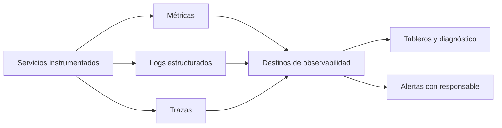

# Observabilidad técnica

Esta carpeta definirá cómo saber si Quantify Core funciona, detectar degradaciones y seguir un fallo entre componentes. El objetivo es que cualquier integrante pueda relacionar una solicitud con sus errores y trabajos asociados sin depender de mensajes de depuración particulares de otro desarrollador.

**Estado actual (16/11/2026):** laboratorio ejecutable Prometheus/Grafana/Loki/Alertmanager con fuentes reales de API, paneles y prueba de caída/recuperación. Seguir el [runbook](../../docs/despliegue/runbook-observabilidad.md), [ficha de niveles](../../docs/despliegue/niveles-servicio.md) y [ADR-0008](../../docs/arquitectura/adr/0008-observabilidad-local.md). OpenTelemetry distribuido, FastAPI instrumentado, destino público y acuerdo SLA siguen pendientes. Aplican las [convenciones de infraestructura](../README.md).

## Alcance y límites

Aquí se mantendrán configuraciones de recolección y exportación, tableros versionados, reglas de alertas y referencias a procedimientos de diagnóstico. La instrumentación se implementará junto al código de cada servicio para que acompañe sus contratos y pruebas.

La telemetría operativa describe el funcionamiento del sistema. Los hábitos, la biometría, las evidencias personales y las inferencias de bienestar pertenecen a los flujos de datos del producto; no deben copiarse a logs, métricas o trazas. La auditoría de negocio también requiere su propio modelo de acceso, integridad y retención: un log de depuración no la sustituye.

## Señales que se utilizarán

| Señal | Pregunta que ayuda a responder | Contenido previsto |
|---|---|---|
| Métricas | ¿Con qué frecuencia ocurre algo y cómo cambia en el tiempo? | Conteos, duración de operaciones, errores, uso de recursos y acumulación de trabajos. |
| Logs | ¿Qué ocurrió en una operación concreta? | Eventos estructurados con severidad, operación y código de error sin información sensible. |
| Trazas | ¿Por qué componentes pasó una operación y dónde tardó o falló? | Segmentos correlacionados de API, dependencias y trabajos cuando exista contexto propagable. |

OpenTelemetry proporciona mecanismos de instrumentación, recolección y exportación de señales; la elección de dónde almacenarlas y consultarlas se resuelve por separado. Véase su [documentación de señales](https://opentelemetry.io/docs/concepts/signals/).

## Convenciones de instrumentación

- Identificar de forma consistente el servicio, su versión y su ambiente. Usar los identificadores `api`, `analytics`, `workers` y `web` donde corresponda y mapearlos a las convenciones de la versión de OpenTelemetry seleccionada.
- Registrar tiempos técnicos en UTC y exponer unidades explícitas. Esto no cambia la zona horaria de negocio de cada usuario para hábitos y recordatorios.
- Emitir logs estructurados de los servicios con timestamp, severidad, servicio, ambiente, operación y código de error cuando aplique. Incluir identificadores de traza o solicitud si existen, sin inventarlos para operaciones no instrumentadas.
- Propagar contexto entre solicitudes y trabajos cuando sea posible. Documentar cuándo se pierde la continuidad y tratar el contexto recibido desde clientes como entrada no confiable, nunca como autorización.
- Distinguir fallos esperados, errores recuperables y fallos que requieren intervención. Mantener códigos y significados estables entre servicios y su documentación.
- Limitar tiempos de espera, colas y volumen de exportación. Probar que una caída del sistema de observabilidad no impida atender operaciones del producto ni provoque consumo ilimitado de recursos.

La biblioteca, versión y esquema exacto de atributos deberán validarse con cada runtime. Reutilizar las convenciones estándar que correspondan antes de crear campos particulares del proyecto.

## Métricas mínimas por componente

La siguiente tabla define necesidades de medición, no nombres de métricas ya implementadas ni objetivos de servicio aprobados.

| Componente | Indicadores iniciales | Qué se debe documentar |
|---|---|---|
| API | Volumen de solicitudes, proporción de errores y duración por operación. | Rutas normalizadas, clases de resultado, unidades y cálculo de percentiles. |
| Workers | Trabajos completados, fallidos y reintentados; duración y antigüedad de pendientes. | Tipo de trabajo, política de reintentos y condición de acumulación anormal. |
| Analítica | Duración, fallos y carga de los procesos implementados. | Operación y versión del componente; evaluar calidad del modelo en su documentación específica. |
| Dependencias | Disponibilidad, conexiones, errores y capacidad de almacenamiento cuando aplique. | Qué depende de cada recurso y qué impacto tiene su degradación. |
| Entorno | Consumo de CPU, memoria, disco y reinicios según la plataforma. | Límites configurados, frecuencia de medición y responsable. |

Cada métrica debe definir propósito, tipo, unidad, origen y etiquetas permitidas. Mantener acotada la cantidad de combinaciones de etiquetas: no usar IDs de usuarios, solicitudes, dispositivos, trazas ni URLs completas como etiquetas de métricas. Para rutas, utilizar la plantilla de la operación. Esto sigue las [convenciones de métricas y etiquetas de Prometheus](https://prometheus.io/docs/practices/naming/).

## Privacidad, acceso y conservación

Aplicar una lista explícita de campos permitidos para cada señal. Excluir contraseñas, tokens, cookies, cabeceras de autorización, cuerpos completos de solicitudes, parámetros sensibles, correos, hábitos, biometría y contenido enviado a modelos. Revisar también mensajes de excepción, consultas y atributos que capturen automáticamente las librerías. No depender únicamente de una limpieza posterior en el colector.

Los identificadores de correlación deben carecer de significado personal y conservar controles de acceso; no se consideran anónimos por ser aleatorios. Probar con datos sintéticos que las señales exportadas respetan los campos permitidos.

Antes de habilitar cada destino de exportación, documentar responsables, permisos, ubicación, cifrado, periodo de retención, eliminación y costo previsto. Los tableros, los colectores y los puntos de exposición de métricas tendrán acceso limitado según su función; no se publicarán como parte del sitio de documentación.

## Tableros y alertas

Empezar con una vista general de salud y vistas de los componentes realmente implementados. Cada panel debe indicar ambiente, periodo, unidad, origen y significado de sus valores. Los periodos sin datos deben distinguirse de un resultado igual a cero.

Los tableros técnicos usarán etiquetas y estados consistentes. Las visualizaciones propias del producto seguirán los [tokens compartidos](../../packages/design-tokens/README.md) y las [guías de diseño](../../docs/diseno/README.md); los estados incluirán texto o símbolos además de color.

Cada alerta deberá indicar condición, ventana de evaluación, severidad, responsable, canal, instrucciones de diagnóstico y criterio de recuperación. Los umbrales se definirán con mediciones y objetivos de servicio; no se fijan porcentajes o tiempos arbitrarios en esta etapa. Documentar también silencios de mantenimiento y cómo evitar notificaciones duplicadas.

Un objetivo de nivel de servicio (**SLO**) expresa el nivel esperado de un indicador medible (**SLI**). Las definiciones, ventanas y metas están pendientes del alcance y capacidad del sistema. La primera entrega debe proponerlas con evidencia y probar la recepción y recuperación de sus alertas en un entorno de validación.

## Criterios de entrega

- Un flujo sintético permite localizar sus logs y seguir su traza en los componentes instrumentados; se documentan los tramos sin cobertura.
- Las métricas distinguen una operación correcta de una fallida y muestran unidades y etiquetas controladas.
- Se comprueba que las señales exportadas no contienen datos excluidos y que su acceso está restringido.
- Se simula un fallo para verificar tablero, alerta, responsable y procedimiento de atención.
- Se prueba el comportamiento del producto cuando no está disponible el destino de telemetría.
- Configuración, tableros y reglas tienen versión y coinciden con los servicios que los generan.

Quedan pendientes las versiones de instrumentación, el destino de cada señal, la retención, el muestreo de trazas, los umbrales, los canales y los responsables. Su activación se coordinará con el entorno de [docker](../docker/README.md) y la configuración de [deployment](../deployment/README.md).
