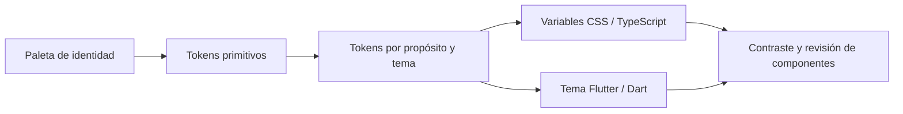

# Tokens de diseño

**Estado: contrato visual documental con JSON y adaptador CSS; todavía no hay paquete distribuido a clientes.** La identidad del [README principal](../../README.md) es la referencia de color para Quantify Core V2.0. Este documento propone nombres semánticos y registra decisiones necesarias antes de distribuir valores a React o Flutter.

## Tokens materializados para los prototipos

La revisión **0.4.1 del 17/11/2026** añade `prototypeEntry` para las composiciones académicas de bienvenida y carga: titulares de bienvenida de 34/43 px en móvil y 52/64 en PWA; carga de 32/40 y 42/54, todos Inter 700. Centraliza también órbita de 3000 ms y pulso de 2400 ms; ambas animaciones se desactivan con movimiento reducido. Es una extensión de presentación de estas dos vistas, sin cambiar los ocho estilos base ni la paleta. [Composición, procedencia y alcance](../../docs/GUI/ENTRADA.md).

[preview.json](preview.json) conserva la paleta y define **Inter** como familia de la entrega GUI. Los roles claros/oscuros y la geometría alimentan las [fuentes de láminas](../../docs/GUI/fuente/generar.py), exportadas como PNG con el mismo archivo WOFF2 local. Instrucciones y especificación completa en el [README de GUI](../../docs/GUI/README.md).

Todavía no se distribuye un paquete React/Flutter. Inter queda elegida para la interfaz visual por petición del proyecto; la implementación de componentes y el resto de decisiones técnicas D-10 siguen su proceso. El borde suave derivado `softBorder` es decorativo; campos, foco y estados deben conservar contraste suficiente.

La versión 0.4.0 añade `typography`: ocho usos con familia, peso, tamaño e interlineado en píxeles. Es la fuente para los [seis frames de Tarea 03](../../docs/GUI/identidad/README.md#tarea-03--guía-de-estilos), no una API distribuida. Los ocho estilos `qc/type/*` y las 46 variables se registraron en el archivo propio Education; la [evidencia](../../docs/GUI/identidad/guia/figma.json) conserva sus referencias y el permiso público pendiente. Los valores de color y las escalas existentes se conservan.

## Paleta base canónica

| Familia | Nombre | HEX | Propósito de identidad |
|---|---|---|---|
| Marca | Laser Blue | `#275BC0` | Acción principal y marca |
| Marca | Sky Laser | `#4A7DE8` | Acento y selección; uso interactivo condicionado a contraste |
| Marca | Deep Cobalt | `#183D87` | Énfasis y estado presionado |
| Neutro | Obsidian Slate | `#0B0F17` | Fondo oscuro y texto sobre claro |
| Neutro | Midnight Navy | `#161F2E` | Superficie oscura |
| Neutro | Steel Border | `#283548` | Divisores de la familia oscura; revisar controles |
| Neutro | Cool Gray | `#8A99AD` | Metadatos sobre fondos compatibles |
| Neutro | Pure Mist | `#F4F7FD` | Fondo claro |
| Neutro | Optical White | `#FFFFFF` | Superficie clara y texto sobre oscuro |
| Semántico | Emerald | `#10B981` | Éxito / rachas |
| Semántico | Amber | `#F59E0B` | Advertencia / pendiente |
| Semántico | Crimson | `#EF4444` | Error / interrupción |
| Semántico | Electric Cyan | `#0EA5E9` | IA / métricas |

La paleta no garantiza por sí sola contraste ni obliga a usar todos sus colores. `#1E54C9`, `#2C3036` y el resto de variables de las prácticas se preservan en sus sketches como evidencia; no son sustituciones silenciosas de estos valores.

## Capas y nombres propuestos

`preview.json.prototypeIslands` conserva la geometría de la [revisión documental de islas](../../docs/GUI/ISLAS.md): márgenes, separación, viewports, cabecera y navegación. Su estado `revision-documental-no-productiva` limita el alcance a sketches y wireframes; PWA sigue provisional con referencias de video revisadas. El generador de láminas consume esta fuente. No cambia los radios de control del producto ni acredita adaptadores React/Flutter.

| Capa | Ejemplo de nombre | Regla |
|---|---|---|
| Primitiva | `color.brand.laserBlue` | Un valor de paleta, sin asumir contraste |
| Semántica | `color.action.primary`, `color.text.primary`, `color.surface.canvas` | Referencia a un primitivo según propósito y tema |
| Estado | `color.feedback.error`, `color.focus.ring`, `color.sync.pending` | Texto/icono/patrón acompañan el color |
| Tipografía | `font.family.body`, `font.size.body`, `font.weight.label` | Inter definida para GUI; escala 40/28/20/16/14 |
| Geometría | `space.4`, `radius.control`, `size.target.touch` | Escalas propuestas, no exportadas todavía |
| Movimiento | `motion.duration.feedback`, `motion.reduce` | Equivalente sin animación obligatoria |

La sintaxis concreta y el formato fuente se decidirán junto con el generador. No mantener archivos CSS y Dart como dos fuentes manuales independientes: escoger una fuente versionada y generar adaptadores, o documentar explícitamente la sincronización temporal hasta disponer de generación.

Propuesta inicial de temas: claro con `Pure Mist`/`Optical White` y texto `Obsidian Slate`; oscuro con `Obsidian Slate`/`Midnight Navy` y texto `Optical White`. Los roles secundarios, bordes, hover, foco y deshabilitado necesitan pruebas específicas; no heredar las combinaciones del sketch por defecto.

## Contrastes medidos y decisiones de uso

Relaciones calculadas con luminancia relativa sRGB según WCAG, sobre colores sólidos, redondeadas a dos decimales. Transparencia, gradientes y superposición obligan a medir el resultado final. El mínimo para texto normal AA es 4.5:1; texto grande tiene un umbral distinto. [WCAG 2.2, contraste mínimo](https://www.w3.org/WAI/WCAG22/Understanding/contrast-minimum.html).

| Par de colores | Relación | Texto normal AA |
|---|---:|---|
| Laser Blue / blanco | 6.28:1 | Sí |
| Sky Laser / blanco | 3.90:1 | No |
| Cool Gray / blanco | 2.90:1 | No |
| Cool Gray / Midnight Navy | 5.70:1 | Sí |
| Emerald / blanco | 2.54:1 | No |
| Amber / blanco | 2.15:1 | No |
| Crimson / blanco | 3.76:1 | No |
| Electric Cyan / blanco | 2.77:1 | No |
| Obsidian Slate / Pure Mist | 17.87:1 | Sí |

Por tanto, no usar texto pequeño blanco sobre botones Sky Laser solo porque el README lo menciona como hover, ni texto Cool Gray sobre tarjetas blancas. Conservar contraste mediante otro par aprobado, texto oscuro o una variante semántica derivada que se mida y documente. Los colores de éxito/error/IA pueden funcionar como acento acompañado de texto legible; no se autoriza cualquier combinación de ellos.

## Entrega del futuro paquete

1. Aprobar formato y distribución del paquete; aplicar Inter como familia definida y revisar temas, escalas e iconografía.
2. Mantener valor, tipo, propósito, tema y estado de cada token; distinguir provisional y aprobado.
3. Producir adaptadores para web y móvil sin introducir lógica de negocio ni dependencias de componentes.
4. Documentar generación, comprobación y actualización con comandos reales cuando exista el paquete.
5. Revisar consumidores y contrastes cuando cambie un token. Renombrar/eliminar un token es un cambio de contrato; acompañarlo de migración y versión.
6. Comprobar que los valores generados coinciden con su fuente y que los componentes representativos mantienen accesibilidad en ambos temas.

No hay API de importación publicada. Los mockups citan esta paleta y utilizan la familia Inter definida; no acreditan componentes de producto implementados.

[Sistema de diseño](../../docs/diseno/sistema-diseno.md) · [Recorridos](../../docs/diseno/recorridos.md) · [Paquetes compartidos](../README.md)

## Roles para claro y oscuro · QUANCORE-26

`themes.light` y `themes.dark` incluyen `icon`, `iconMuted`, `controlBorder` y `statusInk`. Icono activo: Laser Blue en claro y Sky Laser en oscuro; neutro y borde de control: Steel / Cool Gray. Los badges de estado conservan su matiz y usan tinta Obsidian en ambos temas. Las justificaciones y ejemplos se documentan en el [README de GUI](../../docs/GUI/README.md).

[themes.css](themes.css) se genera al ejecutar `python docs/GUI/fuente/generar.py`. Exporta `--qc-icon-active`, `--qc-icon-muted`, `--qc-control-border`, `--qc-status-ink` y los demás roles. El selector raíz define claro; `[data-qc-theme="dark"]` sustituye roles para un futuro consumidor. No cambia por sí solo la apariencia de aplicaciones ni acredita integración React/Flutter. Los nombres de icono y tinta están registrados como variables semánticas también en Figma.

## Marca sobre oscuro · 29/10/2026

`branding.dark` referencia `skyLaser` para los trazos azules y `white` para las letras y trazos neutros, sobre transparencia. Reutiliza colores existentes; no amplía la paleta. Los originales claros conservan sus bytes y los PNG oscuros se generan desde ellos. Las reglas anteriores de placa blanca quedan sustituidas por esta variante autorizada. [Recursos, procedencia y generación](../../assets/images/README.md#derivados-oscuros-autorizados--29102026).
