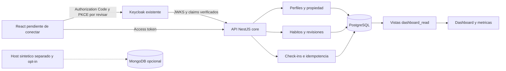
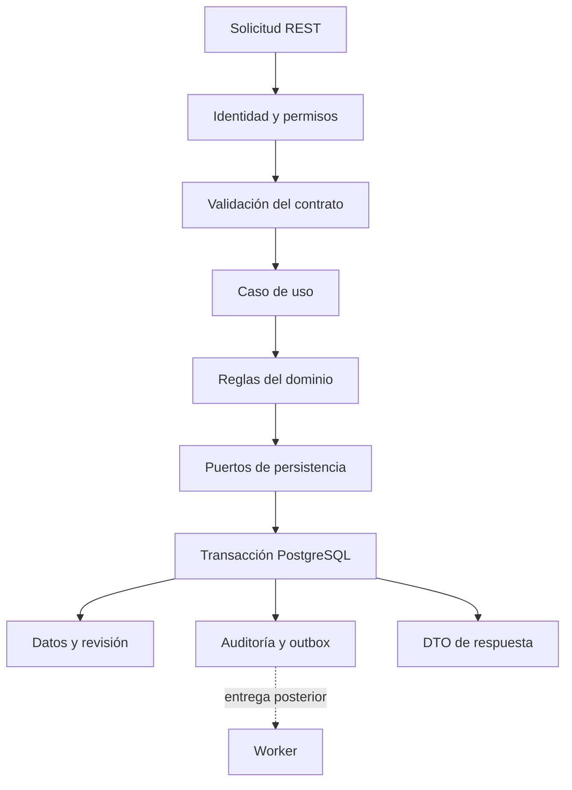

# API principal · NestJS + TypeScript

**Docker · 20/11/2026:** el [arranque completo](../../README.md#instalación-y-ejecución) incluye tareas opt-in `migrate` y `profile` del perfil Compose `tools`. `migrate` usa la etapa `migration` de la imagen para aplicar el ledger y preparar permisos en la base dedicada; `profile` reutiliza el aprovisionamiento existente con el rol runtime y un subject Keycloak suministrado explícitamente. Son tareas de una ejecución, no servidores ni semillas automáticas. La [verificación web real](../../scripts/verify-docker-web.mjs) comprobó React/Keycloak/API local con lecturas 200, perfil ausente 403 y logout; no acredita sesión móvil ni despliegue público.

**Base técnica (16/11/2026):** [guía del equipo](../../docs/guias/base-tecnica.md) y [ADR-0007](../../docs/arquitectura/adr/0007-base-tecnica-prototipo.md). El harness real verifica Keycloak y API con rol SQL runtime separado. Sesión de clientes, revisión del equipo y despliegue público siguen pendientes.

**API contenerizada y señales operativas:** el perfil Compose `app` usa [api.Dockerfile](../../infrastructure/docker/api.Dockerfile), usuario sin root y contratos incluidos. [ADR-0008](../../docs/arquitectura/adr/0008-observabilidad-local.md) y [runbook](../../docs/despliegue/runbook-observabilidad.md) explican Prometheus/Grafana/Loki/Alertmanager y los ensayos reales. `KEYCLOAK_JWKS_URL` permite el backchannel local acotado sin cambiar issuer/audiencia. `OBSERVABILITY_ENABLED=1` habilita métricas en puerto separado (`METRICS_HOST`, `METRICS_PORT`); `LOKI_PUSH_URL` solo admite el colector interno del laboratorio. Por defecto estas señales están desactivadas. No publicar el puerto de métricas ni copiar cabeceras/cuerpos de requests a logs.

> **Estado: núcleo NestJS ejecutable localmente en QUANCORE-43, pendiente de revisión e integración.** Perfiles, hábitos, check-ins, métricas y dashboard usan PostgreSQL real. Las escrituras requieren opt-in de la política provisional D-03/04. [OpenAPI](../../packages/contracts/openapi.json) sigue como borrador; no hay despliegue productivo ni sesión React/Flutter acreditados.

**Host separado QUANCORE-35:** [telemetry/README.md](telemetry/README.md) conserva el módulo NestJS **solo de simulación sintética**, con contrato y pruebas HTTP/PostgreSQL reales. Ese host no implementa los módulos generales del núcleo descrito aquí. QUANCORE-22 añade una [proyección MongoDB y auditoría](../../docs/datos-ia/eventos-mongodb.md), solo para la simulación y con activación explícita; no se hace obligatoria para el núcleo.

**QUANCORE-25:** se monta el lector existente de [estadísticas propias](../../docs/datos-ia/estadisticas-dashboard.md), sin duplicar sus cálculos. La migración `002_core_integration.sql` expone las vistas sobre maestros e historial reales del escritor. El host sintético conserva su activación independiente; sus rutas de ingesta no se montan en el núcleo.

## Ejecución local

Desde `services/api`, con Node 24.x, npm 11.x y PostgreSQL 15+ accesible:

```sh
npm ci
npm run build
```

Copiar `.env.example` a `.env.local`, excluido de Git. Completar `DATABASE_URL` con una base local dedicada y credenciales privadas. No apuntar las pruebas o una migración inicial a una base compartida sin revisión. Ejecutar:

```sh
node --env-file=.env.local db/migrate.cjs
node --env-file=.env.local build/src/main.js
```

`npm start` y `npm run migrate` usan variables ya exportadas por el entorno. El arranque no crea tablas, no instala fixtures ni migra automáticamente. El lockfile fija las dependencias de la prueba técnica; no cierra D-01.

| Variable | Uso |
|---|---|
| `DATABASE_URL` | Solo servidor; conexión PostgreSQL. No mostrarla en logs ni poner secretos en Git. |
| `KEYCLOAK_ISSUER` | Emisor exacto. Desarrollo: `http://localhost:8080/realms/quantify`; HTTP solo loopback. |
| `KEYCLOAK_AUDIENCE` | Audiencia exigida `quantify-api`. El export actualizado incorpora el mapper web/móvil, verificado en laboratorio nuevo. Revisar y aplicar explícitamente el cambio en realms existentes; no aceptar otra audiencia para eludirlo. |
| `HOST`, `PORT` | Por defecto `127.0.0.1:3000`. Prefijo único `/api/v1`. |
| `CORS_ALLOWED_ORIGINS` | Orígenes exactos separados por coma; ejemplo `http://localhost:5173`. Sin comodines ni credenciales CORS. |
| `CORE_REVIEW_WRITES_ENABLED` | `0` por defecto. `1` activa explícitamente las escrituras de revisión con datos de prueba; no equivale a aprobar D-03/04/09 para datos personales reales. |
| `GEMINI_API_KEY`, `GEMINI_MODEL` | Solo servidor (`ADR-0011`). Clave privada de Google AI Studio y modelo Flash estable (`gemini-3.5-flash-lite` por defecto) para `/assistant/messages`; nunca se expone a clientes ni bloquea `/health/ready` si está ausente. |

Keycloak conserva cuentas y contraseñas. Para relacionar un subject **ya existente** con un perfil de negocio desde consola, configurar privadamente `PROFILE_SUBJECT` y `PROFILE_TIME_ZONE` y ejecutar `node --env-file=.env.local db/provision-profile.cjs` después del build y migraciones. Con `CORE_REVIEW_WRITES_ENABLED=1`, los clientes autenticados también pueden aprovisionar su perfil propio en primer acceso mediante `POST /api/v1/me` (`Idempotency-Key` + `{ timeZone }`). Ninguna de las dos vías crea cuentas IdP, modifica un perfil activo existente ni reactiva perfiles suspendidos. No hay endpoint de registro de usuarios ni contraseña en la API.

## Funcionalidades y rutas implementadas

| Ruta bajo `/api/v1` | Comportamiento real |
|---|---|
| `GET /health/live` | Proceso disponible, sin consultar dependencias. Público, respuesta mínima `status: ok`. |
| `GET /health/ready` | PostgreSQL, migraciones y puertos de lectura disponibles; 503 si faltan o durante cierre. MongoDB, Redis, FastAPI e IdP no se sondean aquí. |
| `GET /me` | Perfil propio activo y roles reconocidos del access token. |
| `POST /me` | Autoprovisión idempotente del perfil propio en primer acceso con JWT válido (`201` creado, `200` activo existente o replay, `403` si está suspendido). |
| `GET /habits`, `GET /habits/:id` | Listado paginado por UUID, filtro de estado, detalle y ETag fuerte. |
| `POST /habits`, `PATCH /habits/:id` | Escrituras transaccionales con `Idempotency-Key`; PATCH exige `If-Match` fuerte. |
| `POST /habits/:id/check-ins` | Valor absoluto, dedupe durable por clave y `clientEventId`; creación 201, corrección/replay 200. |
| `GET /habits/:id/check-ins` | Consolidaciones confirmadas por fecha, paginadas y con su versión vigente. Revisiones previas se preservan en SQL, sin inventar otro endpoint. |
| `GET /habits/:id/metrics` | Oportunidades cerradas y rachas en la ventana, usando metas, zonas y estados históricos. |
| `GET /me/dashboard/progress`, `/calendar`, `/trends` | Lector QUANCORE-25 sobre las vistas normales del backend, sin telemetría ni resultados ficticios. |
| `GET /me/assistant-consent`, `POST /me/assistant-consent` | Consulta y actualización transaccional/idempotente del consentimiento revocable para RF-07 (`003_assistant_consent.sql`). |
| `POST /assistant/messages` | Asistente conversacional RF-07 con Google Gemini, contexto propio opcional autorizado, borradores revisables sin escritura implícita y límite de frecuencia por perfil. |

No se añade alias `/health`, API de categorías ni DELETE sin contrato canónico. Todos los endpoints de negocio exigen JWT RS256 válido, issuer, audiencia, `sub/iat/exp`, tipo Bearer y perfil activo. Un administrador tampoco puede operar recursos ajenos: 404 en rutas personales; token inválido 401; perfil no habilitado/suspendido 403. No se implementa una segunda autenticación. SPA/BFF, renovación y revocación de sesión siguen sujetos a D-02; la validación de access tokens es una frontera común a ambas opciones.

Los cuerpos se validan contra los esquemas canónicos de OpenAPI en runtime. Errores minimizados `application/problem+json`, sin SQL, tokens ni stack. CORS permite GET/POST/PATCH/OPTIONS, cabeceras Authorization/Content-Type/Idempotency-Key/If-Match y expone ETag; CORS no concede autorización. Configuración, parser JSON, pool y errores se comparten; los timeouts SQL y de conexión limitan fallos de dependencias.

## Historia y política de escritura en revisión

- Se conserva la migración `001_core.sql` de QUANCORE-21/23 sin cambiar sus tablas ni triggers. `002` añade zona del perfil, check-ins, revisiones, recibos y las dos vistas `dashboard_read.v1_*`. No hay dos modelos maestros ni ORM nuevo.
- Las migraciones usan el ledger `schema_migrations` original, checksums y lock transaccional. Se reconocen representaciones LF/CRLF del mismo SQL. Una huella distinta o fechas históricas duplicadas detienen la migración; no se reescriben datos para forzarla. Bases antiguas sin ledger y reversión/restauración requieren revisión BD; no hay down destructivo automático.
- Se propone la precisión técnica ya usada por el puerto SQL: `numeric(12,3)`, hasta nueve enteros y tres decimales. Cantidades no representables fallan con 422 antes de escribir; nunca se redondean silenciosamente. Catálogo de unidades y límites productivos siguen abiertos.
- La creación conserva la fecha inicial solicitada, incluida una fecha pasada explícita. Cada PATCH crea una nueva revisión, con fecha posterior a hoy en ambas zonas y a la última revisión existente. Si se omite agenda, propone mañana en la zona anterior; puede rechazarse si no satisface esas condiciones. No modifica periodos anteriores ni permite corregir una revisión futura ya programada con la misma fecha. GET/listado devuelve la configuración más reciente planificada; las oportunidades se resuelven por vigencia histórica.
- Pausa/archivo son revisiones futuras bajo la misma regla. Un hábito archivado no se reactiva. Check-ins y correcciones solo se aceptan en oportunidades históricas activas/programadas; zona, fecha e instante deben concordar, sin instantes futuros. Corregir exige revisión conocida y motivo. La ventana máxima de corrección está pendiente: la prueba técnica admite correcciones sobre oportunidades históricas, sin convertirlo en política aprobada.
- El lock del perfil serializa las escrituras del actor entre instancias. Resultado, recibo, historial y outbox se confirman juntos; un replay vuelve a autorizar. Dedupe sin purga automática hasta acordar retención. No se entrega todavía el outbox a un broker.
- Consultas acotadas a 366 días. Las métricas usan la zona efectiva de cada oportunidad; `timeZone` identifica la última zona aplicable en la ventana y no reasigna días anteriores. No se suman cantidades de unidades diferentes. Los cursores están ligados a actor, operación y filtros; una página no es un snapshot entre solicitudes.

## Integración y procedencia

Revisé `origin/develop` en `0272ed8`, QUANCORE-21/23 en `d66d1e9`, QUANCORE-24 en `6c44a67` y Keycloak en `7dd7548`, sin fusionar esas ramas. Reutilicé mi esquema QUANCORE-21/23 y las funciones/pruebas de Francisco García de QUANCORE-24; amplié coherencia temporal, huella con `occurredAt` y cálculo por revisiones. Reutilicé el guard/pool y dashboard de Al Farias ya integrados en develop, conservando sus contratos y atribución. Las propuestas ADR-0005/0006 se consultaron desde la rama frontend y siguen propuestos allí; no se copian ni aceptan desde este README.

Sustituí en la integración el controlador monolítico con backticks escapados de QUANCORE-21/23 por módulos NestJS y validación canónica; corregí el ejecutor de migraciones y completé idempotencia, ETag, paginación, historia y puertos SQL ausentes. Categorías y `categoryId` de aquella rama no se trasladan al contrato principal sin revisión.



Los nombres históricos `TelemetryDatabase/Identity/Config` permanecen en `telemetry/src` como adaptadores compartidos, con **un pool y un guard en el proceso principal**. No se importa `TelemetrySimulationModule`, no se habilita ingesta sintética y no se crea conexión MongoDB. El compilador principal reutiliza esos fuentes en `build/telemetry/src`; el host aislado mantiene su propio `dist`. Al distribuir, incluir los contratos canónicos con la estructura del repositorio.

## Módulos y fronteras

| Módulo previsto | Responsabilidad | Requisitos |
|---|---|---|
| Identity | Validar tokens de Keycloak y mapear `(issuer, subject)` a identidad interna | RF-01 |
| Profiles / Consent | Preferencias, zona IANA, finalidades y revocaciones | RF-02 |
| Habits | Meta, programación versionada, archivo e historial | RF-03 |
| CheckIns | Valores absolutos, concurrencia, idempotencia y correcciones auditables | RF-04 |
| Metrics | Cumplimiento y rachas conforme a reglas versionadas | RF-05 |
| Reminders | Preferencias y comandos de programación para workers | RF-06 |
| Recommendations | Solicitudes, resultados y aceptación explícita de sugerencias | RF-07 |
| Devices / Telemetry | Asociación de dispositivos, autorización y validación de lotes | RF-08 |
| Administration | Operación autorizada, catálogos y agregados | RF-09 |
| Audit / DataRights | Trazabilidad, exportación y solicitudes de eliminación | RF-10 |

Platform, Profiles, Habits, CheckIns y Metrics están implementados como módulos del monolito. Los demás nombres expresan límites futuros, sin generar servicios vacíos ni implicar integración completa. Extraer componentes solo mediante un ADR justificado.



## Organización y evolución

```text
src/
  modules/<dominio>/
    presentation/    # Controladores y mapeo HTTP
    application/     # Casos de uso y límites de transacción
    domain/          # Reglas, valores y políticas sin transporte
    infrastructure/  # Repositorios y adaptadores
  platform/          # Configuración, identidad y observabilidad
```

La implementación actual usa `src/platform`, módulos con controladores/servicios y funciones de dominio reutilizadas. El esquema de capas anterior guía su evolución, sin afirmar que existan todas esas carpetas. Los controladores no consultan tablas directamente. Se usa `pg` parametrizado y NestJS 11 con versiones fijadas por lockfile; no se selecciona ORM ni se declara cerrada D-01/04.

## Recorrido de una escritura

1. Validar firma, algoritmo permitido, emisor, audiencia y vigencia del access token; rechazar ID tokens como credencial de API.
2. Resolver el actor interno y su estado. Un rol `admin` no concede acceso automático a hábitos de otras personas.
3. Validar DTO y campos permitidos. Rechazar atributos desconocidos en comandos; ignorarlos silenciosamente puede esconder errores o permitir asignación masiva.
4. Autorizar el recurso en la consulta y nuevamente en el caso de uso si cambia su contexto. Un identificador ajeno se responde como recurso no encontrado en rutas personales.
5. Resolver `Idempotency-Key`, verificar huella de la petición y versión esperada. La autorización se comprueba también al repetir una clave.
6. Guardar cambio, revisión, resultado idempotente y outbox en una transacción PostgreSQL. Las restricciones únicas impiden carreras entre instancias.
7. Confirmar la respuesta tras el commit; los workers distribuyen eventos y efectos posteriores. Si la transacción falla, no se publica un éxito.

NestJS permite implementar políticas mediante guards y validación mediante pipes. Su uso debe seguir la [guía oficial de autorización](https://docs.nestjs.com/security/authorization) y [validación](https://docs.nestjs.com/techniques/validation), con pruebas que demuestren los permisos reales.

## Persistencia y consistencia

- La API mantiene migraciones, índices y restricciones de PostgreSQL. Los demás servicios reciben vistas de solo lectura, exportaciones minimizadas o interfaces internas autorizadas.
- MongoDB contiene telemetría/eventos derivados con `eventId` único y `schemaVersion`; no reemplaza la transacción principal ni el registro durable de auditoría requerido para una escritura.
- Redis soporta caché, limitación de frecuencia y colas. La pérdida de Redis no debe borrar hábitos, correcciones ni trabajos de negocio pendientes de publicar.
- Las llamadas a Keycloak, analítica, objetos o notificaciones usan adaptadores con plazo máximo. No mantener una transacción abierta durante una llamada remota.
- El borrado físico y la retención necesitan política propia. Archivar un hábito solo impide nuevo progreso y conserva su historia conforme a [reglas de negocio](../../docs/requerimientos/reglas-negocio.md).

## Pruebas necesarias

| Nivel | Casos que deben demostrar |
|---|---|
| Unitarias de dominio | Periodos programados, cambio de zona, metas versionadas, archivo y rachas sin contar el día abierto como fallo |
| Contrato | Ejemplos, campos obligatorios, formatos, errores, paginación y compatibilidad de OpenAPI |
| Integración con PostgreSQL | Dos escrituras concurrentes, restricción única, rollback, outbox y reintento tras respuesta perdida |
| Autorización | Usuario A consulta/modifica B; administrador intenta ver hábitos ajenos; token inválido o audiencia errónea |
| Sistema | Crear hábito, registrar valor, repetir petición, corregir con versión, archivar y consultar historia |
| Fallos | Redis o MongoDB caídos, evento repetido, JWKS rotadas y servicio analítico indisponible |

Desde `services/api`: `npm test`, `npm run typecheck` y `npm run validate:openapi`. La suite principal arranca PostgreSQL 18.6 temporal real; requiere usuario sin privilegios de sistema en Unix y no omite la integración si la BD falla. Sus claves JWT/JWKS son sintéticas: no certifican login/PKCE real en Keycloak. En Windows los fixtures fijan `io_method=sync` para evitar workers de E/S huérfanos al detener PostgreSQL 18. El host sintético conserva su propia suite en `telemetry`.

Validación local del 09/11/2026 en Windows, Node 24.14.1/npm 11.11.0: instalación desde lockfile, typecheck y build aprobados; 35 pruebas del núcleo y 64 regresiones del host sintético aprobadas, estas últimas también con MongoDB 8.2.6 real. OpenAPI general, telemetría y dashboard: 19/9/3 rutas válidas con referencias resueltas. Los casos reproducibles están en `tests/` y `telemetry/tests/`; los resultados no acreditan operación en Linux ni un ambiente productivo.

Pendientes: aceptación de equipo y políticas D-01..04/09, sesión real de React/Flutter, recuperación, destino público, outbox worker y PWA/offline. El laboratorio de la base técnica ya verifica mapper de audiencia, protocolo OIDC y rol runtime separado. Para React local se configura base `http://localhost:3000/api/v1` y ruta `health/ready`; el diagnóstico no reemplaza fixtures ni conecta hábitos automáticamente.
