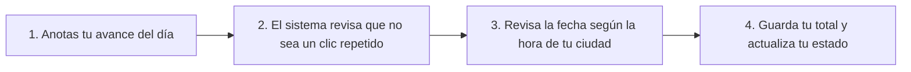

# Cómo funciona el registro diario de tus hábitos

Esta guía explica, con palabras sencillas y sin términos complicados, cómo el sistema guarda tu avance de cada día, cómo evita que un registro se guarde dos veces por error y cómo te permite corregir un dato si te equivocaste.

En pocas palabras: **aquí cuidamos que lo que anotas en tu día a día se guarde una sola vez, en el día que realmente te corresponde según el reloj de tu ciudad y sin sumar cosas repetidas.**

---

## 1. ¿Qué hace esta parte del sistema?

Imagina que tienes una libreta donde anotas tus metas diarias, como **leer 20 minutos** o **tomar 8 vasos de agua**. Esta parte del programa hace el trabajo de esa libreta, pero cuidando cuatro cosas muy importantes:

1. **Respeta el reloj del lugar donde vives:** No importa en qué país esté prendida la computadora central; para saber si cumpliste hoy o ayer, el sistema mira la hora de tu ciudad. Es decir, si anotas algo a las diez de la noche de tu ciudad, cuenta para hoy en tu ciudad.
2. **Anota tu total del día, no pedacitos sueltos:** Si en la mañana leíste 10 minutos y en la tarde leíste otros 10 minutos, tú le dices al sistema: *"Hoy llevo 20 minutos en total"*. Así siempre queda clarísimo cuánto llevas acumulado en el día entero.
3. **Evita registros duplicados cuando falla el internet:** Si presionas el botón de "Guardar" dos o tres veces seguidas porque tu celular tenía mala señal, el sistema se da cuenta de que es el mismo intento y **no te lo suma dos veces**. Lo guarda una sola vez y te responde que todo salió bien.
4. **Te deja corregir con orden:** Si por error escribiste 50 minutos en vez de 20, puedes corregirlo explicando brevemente por qué hiciste el cambio, para que tu historial siempre sea claro y confiable.



---

## 2. Explicación paso a paso (con ejemplos sencillos)

### A. El día depende de tu ciudad (y no de otro reloj)
Muchas veces los programas se confunden a medianoche porque usan el reloj de otro país. Aquí no pasa eso.
* **Dicho de forma sencilla:** El sistema convierte la hora universal a la hora exacta de tu ciudad antes de decidir qué día es.
* **En otras palabras:** Si en tu ciudad todavía es lunes a las 11:00 de la noche, tu registro se guarda en el lunes. Nunca se va a pasar al martes por accidente.

### B. Protección contra el "doble clic" (nada se suma dos veces)
A todos nos ha pasado que el internet se pone lento, tocamos el botón de enviar varias veces y sin querer mandamos lo mismo repetido.
* **¿Cómo lo resuelve el sistema?** Cada vez que tocas el botón de guardar, tu intento lleva una etiqueta única (como un boleto numerado).
* **Si el mismo boleto llega dos veces con el mismo dato:** El sistema dice *"Esto ya lo guardé hace un momento"*, no lo vuelve a sumar y te muestra tu registro guardado.
* **Si alguien intenta usar el mismo boleto para meter un dato diferente:** El sistema avisa que ese boleto ya fue usado y pide hacer un registro nuevo para no revolver la información.

### C. Los tres estados de tu día
Cuando anotas tu avance del día y lo comparas con tu meta, solo pueden pasar tres cosas muy fáciles de entender:
* **En cero (`zero`):** Todavía no llevas avance en ese día (llevas 0).
* **Avance parcial (`partial`):** Ya empezaste y llevas algo de avance, pero todavía no llegas a la meta completa (por ejemplo, llevas 10 minutos de una meta de 20).
* **Completado (`completed`):** Ya alcanzaste o superaste la meta que te propusiste para ese día (por ejemplo, llevas 20 minutos o más).

### D. ¿Qué pasa si tengo el celular y la computadora abiertos al mismo tiempo?
Para que tu celular no borre por accidente lo que acabas de anotar en la computadora, cada cambio lleva un número de revisión (revisión 1, revisión 2, revisión 3...).
* Si intentas corregir desde un aparato que no tiene la última información actualizada, el sistema te avisa amablemente para que primero veas el dato más reciente antes de encimarlo.

---

## 3. ¿Qué contiene cada archivo de esta carpeta?

| Archivo | ¿Para qué sirve dicho en palabras simples? |
|---|---|
| [businessDate.js](domain/businessDate.js) | Revisa que las fechas existan en el calendario, mira qué hora es en tu ciudad y sabe qué días de la semana te toca hacer tu hábito. |
| [idempotency.js](domain/idempotency.js) | Es el guardián que evita que un mismo clic o reintento de internet se guarde dos veces. |
| [checkInRules.js](domain/checkInRules.js) | Revisa que tu hábito esté activo, calcula si tu día quedó en cero, a medias o completado, y cuida el orden de las correcciones. |
| [problemMapper.js](domain/problemMapper.js) | Traduce cualquier problema o aviso a un mensaje ordenado y claro, sin mostrar datos confusos. |
| [recordCheckInUseCase.js](application/recordCheckInUseCase.js) | Une todos los pasos anteriores en fila para revisar que el hábito sea tuyo y guardar tu avance de principio a fin. |

---

## 4. ¿Cómo comprobar que todo funciona bien?

Si quieres verificar en tu computadora que todas estas reglas funcionan como deben, abre la ventana de comandos en la carpeta principal del proyecto y escribe:

```bash
node --test services/api/tests/businessDate.test.js services/api/tests/idempotency.test.js services/api/tests/problemMapper.test.js services/api/tests/recordCheckInUseCase.test.js
```

Verás una palomita verde en cada prueba, lo que significa que las fechas, la protección contra duplicados y las correcciones están funcionando sin fallos.

---

[Ver cómo se calculan las rachas](../metrics/README.md) · [Volver a la guía de la API](../../../README.md) · [Reglas del proyecto](../../../../../docs/requerimientos/reglas-negocio.md)
