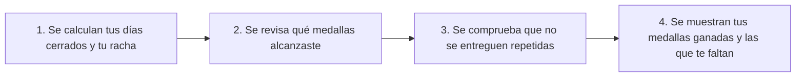

# Cómo funcionan tus logros y medallas de constancia

Esta guía explica, con palabras sencillas y sin términos complicados, cómo el sistema te entrega reconocimientos (medallas o logros) cuando eres constante con tus hábitos, y cómo evita entregar medallas repetidas o por error.

En pocas palabras: **aquí premiamos tu esfuerzo real cuando cumples tus días programados, asegurándonos de que nadie reciba dos veces la misma medalla por error y de que cada reconocimiento esté respaldado por días verdaderamente terminados.**

---

## 1. ¿Qué hace este módulo de logros?

Imagina un álbum de medallas donde vas desbloqueando insignias a medida que cumples tus hábitos. Este módulo revisa tus días cumplidos y tu racha seguida para saber qué medallas ya te ganaste y cuánto te falta para conseguir las siguientes.

Lo más importante de cómo funciona es:
1. **Solo premia días que ya terminaron y se cumplieron:** No regala medallas por adelantado ni por días que todavía no acaban.
2. **Nunca entrega la misma medalla dos veces:** Aunque consultes tu pantalla cien veces o tu celular mande el mismo registro dos veces por mala señal de internet, cada logro para ese hábito se te entrega **una sola vez** y conserva la fecha exacta en que lo desbloqueaste por primera vez.
3. **Si corriges un registro por equivocación, tus medallas se ajustan solas:** Si anotaste por error que cumpliste 7 días, pero luego corriges un día porque en realidad no habías terminado tu meta, el sistema actualiza tu vitrina para que solo aparezcan las medallas que de verdad te corresponden.



---

## 2. ¿Cuáles son las medallas que puedes desbloquear?

El catálogo tiene seis reconocimientos claros y fáciles de entender:

| Medalla | Nombre amigable | ¿Qué tienes que hacer para ganártela? |
|---|---|---|
| `FIRST_COMPLETED_DAY` | **Primer Paso Firme** | Cumplir tu meta completa por primera vez en un día que ya haya terminado. |
| `STREAK_3_DAYS` | **Ritmo Inicial** | Cumplir 3 días programados seguidos sin fallar (tus días de descanso no te cortan la cuenta). |
| `STREAK_7_DAYS` | **Constancia Semanal** | Cumplir 7 días programados seguidos llegando a tu meta. |
| `STREAK_14_DAYS` | **Doble Semana Imparable** | Cumplir 14 días programados seguidos llegando a tu meta. |
| `STREAK_30_DAYS` | **Hábito Consolidado** | Cumplir 30 días programados seguidos llegando a tu meta. |
| `PERFECT_WINDOW_5` | **Cumplimiento Impecable** | Tener el 100% de tus días cumplidos en un periodo donde te tocaba hacer el hábito al menos 5 veces. |

*Recuerda siempre:* Como todas las medallas se basan en tu racha justa, **tus días libres o tus días en pausa nunca te impiden ganar una medalla de días seguidos.**

---

## 3. ¿Por qué nunca se dan premios falsos ni repetidos?

1. **Sello único por medalla:** Cuando desbloqueas una medalla en un hábito, el sistema le pone un sello único que combina tu cuenta, tu hábito y el nombre de la medalla. Así, si el sistema vuelve a revisar tus datos un minuto después, ve que ese sello ya existe y no te vuelve a festejar la misma medalla como si fuera nueva.
2. **Sin dinero ni apuestas:** Estas medallas son únicamente un reconocimiento visual a tu constancia personal dentro de la aplicación.

---

## 4. ¿Qué contiene cada archivo de esta carpeta?

| Archivo | ¿Para qué sirve explicado sin palabras técnicas? |
|---|---|
| [achievementCatalog.js](domain/achievementCatalog.js) | Guarda la lista oficial de las 6 medallas, su nombre, su explicación y cuántos días necesitas para ganar cada una. |
| [achievementEvaluator.js](domain/achievementEvaluator.js) | Compara tus números (tus días cumplidos y tu racha) contra la lista de medallas para separar cuáles ya lograste y cuáles te faltan. |
| [achievementLedger.js](domain/achievementLedger.js) | Es la libreta que recuerda qué medallas ya te habían dado antes para no repetirlas y para actualizarlas si corriges algún día. |
| [evaluateHabitAchievementsUseCase.js](application/evaluateHabitAchievementsUseCase.js) | Une el cálculo de tus rachas con la revisión de medallas en un solo paso ordenado. |

---

## 5. ¿Cómo probar en tu computadora que las medallas funcionan bien?

Desde la carpeta principal del proyecto, ejecuta este comando en tu terminal:

```bash
node --test services/api/tests/achievementCatalog.test.js services/api/tests/achievementEvaluator.test.js services/api/tests/evaluateHabitAchievementsUseCase.test.js
```

Verás que todas las pruebas pasan con palomita verde.

---

[Ver cómo se calculan las rachas](../metrics/README.md) · [Ver cómo funciona el registro diario](../checkins/README.md) · [Volver a la guía de la API](../../../README.md)
