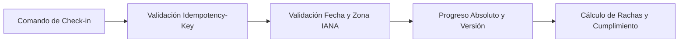

# Dominio de Check-ins, Fechas de Negocio y Rachas

Este módulo implementa las reglas de negocio para validar fechas, controlar la idempotencia en el registro de hábitos y calcular rachas sobre periodos cerrados, siguiendo lo definido en [reglas de negocio](../../../../../docs/requerimientos/reglas-negocio.md) y en el contrato [openapi.json](../../../../../packages/contracts/openapi.json).



## Archivos Principales

| Archivo | Propósito |
|---|---|
| [businessDate.js](../checkins/domain/businessDate.js) | Valida fechas `YYYY-MM-DD`, instantes UTC con sufijo `Z`, zonas horarias IANA y días programados de la semana (`1` Lunes a `7` Domingo). |
| [idempotency.js](../checkins/domain/idempotency.js) | Valida la cabecera `Idempotency-Key` (UUID) y evita sumar dos veces un mismo registro si se reintenta la petición. |
| [checkInRules.js](../checkins/domain/checkInRules.js) | Evalúa el valor absoluto del día (`zero`, `partial`, `completed`) y controla la versión para creaciones (`201`) o correcciones con motivo (`200`). |
| [streakCalculator.js](domain/streakCalculator.js) | Calcula oportunidades elegibles, porcentaje de cumplimiento, racha actual y mejor racha dentro de una ventana `[from, to]`. |

## Reglas Clave Aplicadas

1. **Fecha de negocio por zona horaria:** El día de negocio se obtiene convirtiendo el instante UTC a la zona IANA del hábito, sin asumir medianoche UTC.
2. **Idempotencia:**
   - Si llega la misma `Idempotency-Key` con los mismos datos, se devuelve la respuesta anterior (`200`) sin duplicar el avance.
   - Si llega la misma `Idempotency-Key` con datos diferentes, se rechaza por conflicto (`409`).
3. **Cálculo de rachas sobre periodos cerrados:**
   - El día actual abierto no rompe ni aumenta la racha hasta que termina el día.
   - Los días no programados en el hábito o los días en pausa se omiten sin cortar la racha.
   - Si no existen días cerrados programados en la ventana consultada, el porcentaje de cumplimiento devuelve `null` con la razón `NO_CLOSED_ELIGIBLE_PERIODS`.

## Cómo Ejecutar las Pruebas

Desde la raíz del repositorio puedes correr las pruebas unitarias con Node.js:

```bash
node --test services/api/tests/businessDate.test.js services/api/tests/idempotency.test.js services/api/tests/streakCalculator.test.js
```

---

[Volver a la API](../../../README.md) · [Reglas de negocio](../../../../../docs/requerimientos/reglas-negocio.md) · [Contrato OpenAPI](../../../../../packages/contracts/openapi.json)
