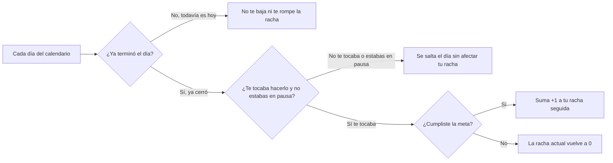

# Cómo se calculan tus rachas y tu porcentaje de cumplimiento

Esta guía explica de manera muy sencilla, paso a paso y sin palabras técnicas, cómo el sistema cuenta tus días seguidos cumpliendo un hábito (tu **racha**) y cómo calcula qué tan constante has sido en un periodo de tiempo.

Para decirlo de la forma más simple posible: **tu racha cuenta cuántos días programados seguidos has cumplido tu meta, sin castigarte por los días que te tocaba descansar, ni por los días en que pusiste pausa, ni por el día de hoy que todavía no se acaba.**

---

## 1. Las 4 reglas de oro para contar tus rachas

Muchas aplicaciones te hacen perder tu racha injustamente. Aquí el cálculo se diseñó con sentido común para ser totalmente justo contigo:



### Regla 1: El día de hoy todavía no te rompe la racha
Mientras el día de hoy sigue corriendo, tú todavía tienes tiempo de cumplir tu hábito.
* **¿Qué significa esto?** Que si abres la aplicación el viernes a las 9 de la mañana y aún no has hecho tu hábito del viernes, **tu racha no se vuelve cero**. El sistema espera hasta que el viernes termine por completo para evaluar ese día.
* **Dicho de otra manera:** Solo se califican los días que ya terminaron (los días cerrados).

### Regla 2: Tus días de descanso no te hacen perder tu racha
Si tú programaste tu hábito únicamente para **lunes, miércoles y viernes**, entonces el martes y el jueves son tus días libres.
* **¿Qué significa esto?** Si cumpliste el lunes y cumpliste el miércoles, llevas **2 días seguidos de racha**. El martes no te quita nada porque ese día no te tocaba.

### Regla 3: Si pones tu hábito en pausa, tu racha se congela y se respeta
Si te enfermas o sales de viaje y pones tu hábito en pausa durante unos días, esos días en pausa se ignoran en la cuenta.
* **¿Qué significa esto?** No pierdes lo que ya habías logrado antes de la pausa, ni te baja tu calificación por los días en que avisaste que estarías en pausa.

### Regla 4: Si en las fechas que consultas aún no te tocaba ningún día, no te pone 0%
Si acabas de crear un hábito hoy o consultas un fin de semana donde no tenías nada programado, sería engañoso decirte que tienes "0% de cumplimiento".
* **¿Qué hace el sistema?** En lugar de ponerte un cero injusto, deja el porcentaje vacío y avisa claramente que en esas fechas todavía no había días cerrados por calificar.

---

## 2. ¿Qué números te entrega este cálculo?

Cada vez que consultas cómo vas entre una fecha inicial y una fecha final, el sistema te devuelve cinco datos muy fáciles de leer:

1. **Días que sí contaban (`eligiblePeriods`):** Cuántos días ya terminados dentro de esas fechas realmente te tocaba hacer el hábito (quitando descansos y pausas).
2. **Días cumplidos (`completedPeriods`):** De esos días que te tocaban, en cuántos sí llegaste a tu meta completa.
3. **Porcentaje de cumplimiento (`completionRate`):** De cada 100 días que te tocaban, cuántos cumpliste (por ejemplo, si te tocaban 4 días y cumpliste los 4, tienes **100%**).
4. **Racha actual (`currentStreak`):** Cuántos días programados seguidos llevas cumpliendo hasta el último día terminado.
5. **Mejor racha (`longestStreak`):** Cuál ha sido tu récord más alto de días programados seguidos cumplidos dentro de las fechas que estás mirando.

---

## 3. ¿Qué contiene cada archivo de esta carpeta?

| Archivo | ¿Qué hace explicado de forma sencilla? |
|---|---|
| [streakCalculator.js](domain/streakCalculator.js) | Recorre día por día el calendario, salta descansos y pausas, ignora el día que sigue abierto y cuenta tu racha actual, tu mejor racha y tu porcentaje. |
| [getHabitMetricsUseCase.js](application/getHabitMetricsUseCase.js) | Revisa que las fechas que pediste tengan sentido, verifica que el hábito sea tuyo y te entrega el resumen completo de tus números. |

---

## 4. ¿Cómo probar que el cálculo de rachas funciona bien?

Para ejecutar las pruebas automáticas desde la carpeta principal del proyecto, escribe en la terminal:

```bash
node --test services/api/tests/streakCalculator.test.js services/api/tests/getHabitMetricsUseCase.test.js
```

---

[Ver cómo funciona el registro diario](../checkins/README.md) · [Volver a la guía de la API](../../../README.md) · [Reglas del proyecto](../../../../../docs/requerimientos/reglas-negocio.md) · [Contrato OpenAPI](../../../../../packages/contracts/openapi.json)
