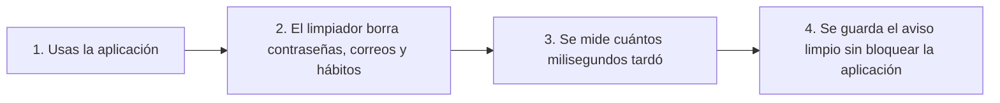

# Cómo vigilamos que el sistema funcione bien sin espiar tus datos privados

Esta guía explica, con palabras sencillas y sin términos complicados, cómo sabemos si el programa está funcionando rápido o si tuvo algún tropiezo, **cuidando siempre que tus contraseñas, tus correos, tus hábitos y tus datos de salud nunca aparezcan en los registros de revisión.**

En pocas palabras: **este módulo es como el tablero de un automóvil que te dice a qué velocidad vas y si el motor está bien, pero sin grabar quién va sentado adentro ni de qué van platicando.**

---

## 1. ¿Qué son las señales de revisión y para qué sirven?

Para saber si el sistema está sano, usamos tres herramientas muy simples:

1. **Contadores de velocidad y uso (Métricas):** Cuentan cuántas veces se usa una pantalla, cuánto tarda en responder en milisegundos y cuántas veces hubo algún error.
2. **Bitácora de avisos (Logs seguros):** Es un cuaderno donde el sistema anota cosas como *"A las 12:00 se guardó un registro en 14 milisegundos"*, pero **borrando cualquier dato privado** antes de escribirlo.
3. **Número de seguimiento (Correlación):** Es como el número de guía de un paquete de mensajería. Sirve para seguir un pedido cuando pasa de una parte del sistema a otra, sin necesidad de usar tu nombre ni tu correo.



---

## 2. ¿Cómo cuidamos tu privacidad al 100%?

A veces los programas guardan por accidente datos privados en sus cuadernos de avisos. Aquí pusimos un **filtro limpiador automático** que revisa cada renglón antes de guardarlo:

* **Lo que NUNCA se guarda (se reemplaza por `[REDACTED]`):**
  * Tu contraseña o llaves de acceso.
  * Tu correo electrónico.
  * El nombre de tus hábitos personales o tus notas.
  * Tus datos del reloj o de salud (pulsaciones del corazón, sueño, pasos o calorías).
* **Dicho de otra manera:** Aunque alguien abra el cuaderno técnico del servidor para buscar por qué tardó una pantalla, **jamás podrá ver qué hábito estabas haciendo ni quién eres**, porque todos esos campos salen tapados con la palabra `[REDACTED]`.

---

## 3. ¿Por qué agrupamos las direcciones sin guardar códigos personales?

Imagina que mil personas consultan sus hábitos. Si el contador guardara una etiqueta distinta por cada persona, el tablero se llenaría de miles de renglones innecesarios.
* **¿Qué hace el sistema?** Cambia cualquier código largo personal por la palabra corta `:id` (por ejemplo, `/api/v1/habits/:id/check-ins`).
* **En palabras simples:** Así todas las consultas al mismo botón se suman juntas en un solo renglón ordenado y limpio, sin mezclar códigos personales.

---

## 4. ¿Qué pasa si el sistema que guarda las estadísticas se apaga?

Imagina que en tu coche deja de funcionar la aguja que marca la velocidad: el coche **no debe frenarse de golpe en medio de la carretera**, debe seguir avanzando.
* Aquí pasa exactamente igual: si el servidor donde se guardan las gráficas se apaga o no responde, **tu aplicación sigue funcionando normal**. El sistema guarda unos cuantos avisos en una fila pequeña y, si se llena, descarta los avisos viejos sin trabar ni detener tu aplicación.

---

## 5. ¿Qué contiene cada archivo de esta carpeta?

| Archivo | ¿Qué hace explicado con palabras sencillas? |
|---|---|
| [logRedactor.js](logRedactor.js) | Es el limpiador automático que busca contraseñas, llaves, correos, hábitos y datos de salud y los tapa con `[REDACTED]`. |
| [correlationContext.js](correlationContext.js) | Le pone un número de guía de mensajería a cada petición para poder seguir su recorrido de principio a fin. |
| [metricsRegistry.js](metricsRegistry.js) | Cuenta cuántas peticiones llegaron, cuántas fallaron y cuántos milisegundos tardaron (incluyendo el tiempo del 95% de los casos, llamado `p95`). |
| [safeExporter.js](safeExporter.js) | Envía los contadores al tablero externo y, si el tablero está apagado, protege la aplicación para que nunca se trabe. |

---

## 6. ¿Cómo comprobar en tu computadora que todo esto funciona?

Desde la carpeta principal del proyecto, corre este comando en tu terminal:

```bash
node --test services/api/tests/observability/*.test.js
```

Verás que todas las pruebas pasan en verde, incluyendo la prueba que intenta meter contraseñas, correos y hábitos falsos y comprueba que ninguno sale en el texto final.

---

[Ver catálogo general de monitoreo](../../../../../infrastructure/observability/catalogo-metricas-y-logs.md) · [Guía de observabilidad](../../../../../infrastructure/observability/README.md) · [Volver a la API](../../../README.md)
