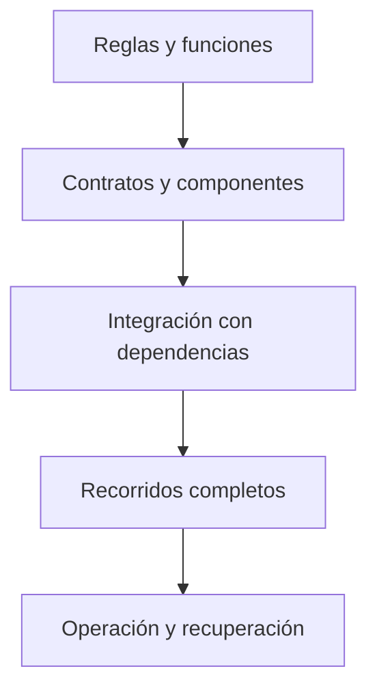

# Estrategia de pruebas

Esta carpeta reúne la estrategia para verificar Quantify Core. **Estado:** hay pruebas del prototipo de la Práctica 07 y del módulo aislado de telemetría sintética QUANCORE-35. La plataforma general y sus integraciones siguen pendientes. Los casos siguientes son obligaciones de desarrollo, no resultados ya aprobados.



## Niveles y ubicación

| Nivel | Qué verifica | Ubicación prevista |
|---|---|---|
| Unidad | Reglas, conversiones, validadores y estados aislados. | Junto al módulo propietario. |
| Contrato | Esquemas, errores y compatibilidad entre consumidores. | Comprobaciones del contrato y sus consumidores. |
| Integración | Identidad, persistencia, transacciones, colas y exportación de señales. | Por servicio o en esta carpeta cuando cruza módulos. |
| Sistema | Flujos completos web/móvil, accesibilidad y comportamiento offline. | En esta carpeta o en el cliente según la herramienta elegida. |
| Operación | Migraciones, capacidad, publicación, reversión y restauración. | Evidencia vinculada con infraestructura y guías operativas. |

## Matriz mínima de comportamiento

| Requisito | Casos que debe cubrir la implementación |
|---|---|
| RF-01 · Identidad | Token válido, vencido, emisor/audiencia incorrectos, sesión revocada y permisos por recurso. |
| RF-02 · Perfil y consentimiento | Cambio de zona, consentimiento granular, revocación y valores inválidos. |
| RF-03 · Hábitos | Datos inválidos, frecuencia, edición versionada, pausa, archivo e historial conservado. |
| RF-04 · Check-ins | Reintento con la misma clave, clave reutilizada con otro cuerpo, doble dispositivo, corrección auditable y fecha inválida. |
| RF-05 · Métricas | Días programados/no programados, día abierto, cambio horario, meta histórica y ausencia de datos. |
| RF-06 · Recordatorios | Permiso denegado, cambio de zona, deduplicación y desactivación. |
| RF-07 · Recomendaciones | Sin consentimiento, evidencia insuficiente, abstención, aceptación explícita y descarte. |
| RF-08 · Dispositivos | Vinculación, lotes duplicados, desconexión, revocación y fuente no autorizada. |
| RF-09 · Administración | Acciones permitidas, motivo requerido, auditoría y denegación de acceso a rutinas privadas. |
| RF-10 · Derechos y auditoría | Exportación con control de acceso, eliminación conforme a política, trazabilidad y minimización. |

La definición exacta está en [aceptación](../docs/requerimientos/aceptacion.md), [reglas de negocio](../docs/requerimientos/reglas-negocio.md) y [contratos](../packages/contracts/README.md). La prueba debe señalar el requisito y versión de regla que valida.

## Datos y reproducibilidad

Usar fixtures sintéticos, reloj controlable y zonas horarias explícitas. Aislar recursos entre ejecuciones y distinguir datos de prueba desechables de datos persistentes. Probar límites de confianza con usuarios distintos, no solo con una cuenta administradora.

Registrar runtime, herramienta, commit, configuración no sensible, comandos y resultado. Los tests que dependen de servicios externos deben indicar sus requisitos y no pasar silenciosamente cuando el servicio está ausente.

## Comprobaciones ejecutables hoy

Desde la raíz y con Node.js disponible:

```bash
node --test docs/practica-07/tests/prototipo.test.cjs
```

Este conjunto utiliza la lógica del prototipo en memoria. Sus mocks de navegador y almacenamiento no validan accesibilidad real, un servidor, autenticación productiva ni sincronización entre dispositivos. Ver [evidencia de la práctica](../docs/practica-07/VALIDACION.md) y [validación de esta documentación](../docs/guias/validacion-documental.md).

### Telemetría sintética · QUANCORE-35

Desde `services/api/telemetry`, con Node.js 22+ y las dependencias del lockfile:

```sh
npm ci
npm test
npm run validate:openapi
npm run evidence
```

QUANCORE-22 añade MongoDB real temporal con autenticación y permisos mínimos: 43 pruebas totales, incluidos validadores BSON, TTL, outbox, auditoría y recuperación. [Evidencia MongoDB](../docs/datos-ia/eventos-mongodb.md).

Pruebas de contrato e integración HTTP con PostgreSQL temporal real, JWT/JWKS sintéticos, permisos por dueño, revocación, reintentos concurrentes, rollback y reinicio. Fallan si la BD no inicia; no se omite integración silenciosamente. No prueban Keycloak/PKCE real, hardware Wear OS ni producto desplegado. Ver [instrucciones del módulo](../services/api/telemetry/README.md) y [evidencia](../docs/datos-ia/telemetria-simulada.md), incluida la ejecución con el SQL de la dependencia de backend.

### Estadísticas propias · QUANCORE-25

La misma suite de `services/api/telemetry` suma 21 pruebas de dominio/HTTP del dashboard: 64 en total con las regresiones previas. Usa tablas y vistas solo en PostgreSQL temporal, comprueba correcciones y snapshot concurrente, pertenencia, ausencia/cero, historial, IANA/DST y tasas ponderadas. `node scripts/evidence-dashboard.cjs` reproduce la demo de consultas SQL, sin afirmar que el escritor esté integrado. [Alcance, comandos y evidencia](../docs/datos-ia/estadisticas-dashboard.md).

## Condiciones de revisión

El [plan operativo](plan-pruebas.md) fija entornos, criterios y procedimientos de ejecución. Los [casos CA-01..20](../docs/requerimientos/aceptacion.md) mantienen sus resultados esperados y pasos; el [informe del 09/11/2026](informe-ejecucion-2026-11-09.md) identifica resultados efectivamente obtenidos, revisión evaluada y limitaciones. Una prueba sintética relacionada no aprueba automáticamente un caso integrado.

Una funcionalidad no se marca verificada sin pruebas de sus caminos principales y fallos relevantes. Elegir las herramientas y umbrales de cobertura cuando existan módulos medibles; no usar un porcentaje arbitrario como sustituto de comportamiento comprobado. Una corrección que afecte contratos debe verificar también a sus consumidores.

Para documentación se comprueban enlaces, diagramas, ejemplos y consistencia semántica. Los cambios de seguridad, migraciones, datos sensibles o recuperación requieren evidencia específica del riesgo que modifican.
